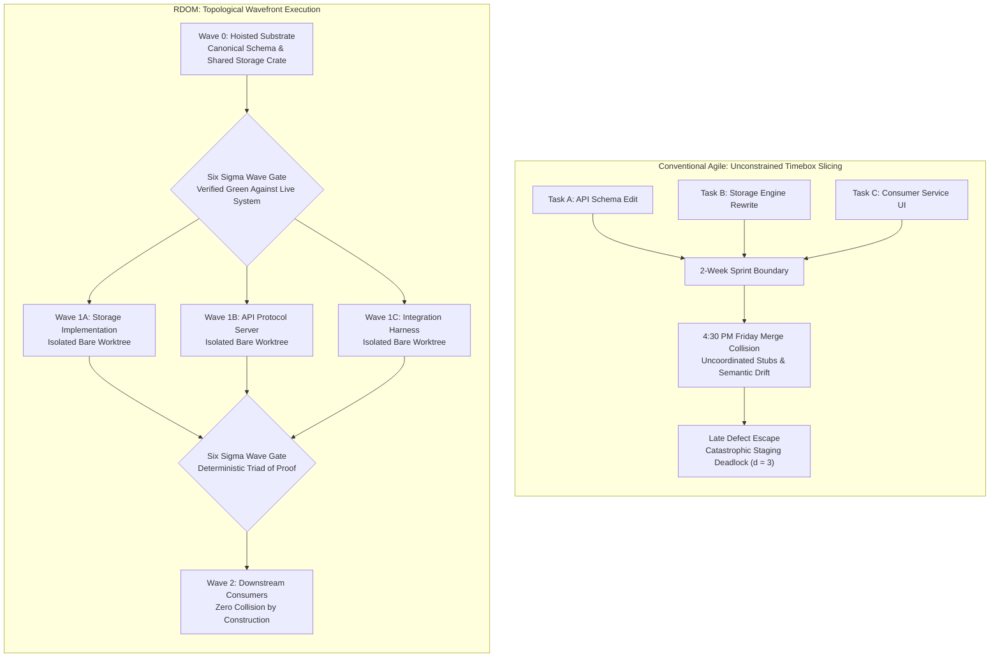

<!-- LICENSE: © 2026 Ravenhelm LLC. Licensed material. -->
<!-- All rights reserved except as granted in LICENSE. Inquiries: nate@ravenhelm.co -->

## Chapter 1 — What This Is and Why Modern Engineering Drifts

You opened your engineering board this morning to thirty-four issues in an active sprint: seven in progress, eleven in review, three blocked, and thirteen idling in backlog. Two blocked tickets wait on an upstream API schema edit promised last Friday before an outage intervened.

Meanwhile, autonomous AI coding agents accelerate this leak into a torrent. Three agent slices, spawned across uncoordinated branches with ambiguous prompts, spent the night hallucinating divergent solutions: Worker A invented a bespoke YAML parser, Worker B an ad-hoc JSON parser, and Worker C a synthetic client with fabricated responses bearing no resemblance to live network reality.

At 4:30 PM on the sprint's penultimate day, these branches converge on trunk in catastrophic merge collisions. Git conflicts are merely the symptom; the fatal damage is deep semantic drift: conflicting connection pools, contradictory locking semantics, and circular initialization orders that pass isolated unit tests but deadlock staging clusters when combined.

Yesterday, your executive sponsor asked whether the platform migration would land this quarter. You displayed burndown charts, but in your gut, you knew that number was fiction: completed story points with unresolved collisions and unverified dependencies represent zero deliverable value.

This is the condition of modern software engineering—the consequence of governing non-linear information manufacturing with calendar timeboxes and multiplying agentic concurrency without topological boundaries.

The **Ravenhelm Development Operations Methodology (RDOM)** is the architectural antidote: a lean, topological, defect-gated operational doctrine for human teams and autonomous agent fleets. It replaces calendar timeboxes with dependency-ordered waves, eliminates redundant code through planning-time DRY hoisting, and guarantees defect-free progression through Six Sigma wave gates.

### The Theoretical & Mechanical Foundation

To understand why modern engineering teams drift, one must examine manufacturing physics and the mathematical topology of software execution.

#### The Industrial & Manufacturing Parallel

In the mid-twentieth century, automotive manufacturing faced an identical crisis: mass-production plants pushed unfinished chassis down assembly lines to meet arbitrary quotas, deferring rework to downstream inspection lots. The results were runaway warranty costs, unpredictable lead times, and catastrophic escapes.

Taiichi Ohno and Shigeo Shingo dismantled this paradigm at Toyota with the Toyota Production System (TPS), anchored in three axioms:

- **Work-in-Progress (WIP) is Inventory Waste (*Muda*):** Partially completed inventory locks capital, conceals process flaws, and multiplies coordination overhead.
- **Quality at the Source (*Jidoka*):** Defect prevention is structural. Every worker must pull the *Andon cord*—halting the line when an anomaly occurs. No defective part moves downstream.
- **Poka-Yoke (Mistake-Proofing):** Fixtures ensure invalid operational states are physically unrepresentable.

Software development executes state transitions on information graphs. While the marginal reproduction cost of bits is zero, repairing structural defects follows a brutal geometric curve. Yet software teams still cargo-cult push-production: sprints push unverified batches into timeboxes, QA acts as a downstream rework lot, and merge queues serve as collision junkyards.

#### Why Timeboxing Fails for Topological Graphs

Conventional Agile presumes engineering work consists of scalar quantities divisible into calendar intervals. But software execution is a **Directed Acyclic Graph (DAG)**:

$$G = (V, E)$$

Where $V = \{v_1, v_2, \dots, v_n\}$ represents discrete atomic deeds and $E \subset V \times V$ represents directed precedence edges. An edge $(u, v) \in E$ establishes an immutable causal requirement: deed $u$ must reach verified green before deed $v$ can be dispatched into an execution workspace.



Forcing graph $G$ into calendar sprints commits topological violence, causing three fatal failures:

- **Speculative Mocking and Upstream Stubs:** When task $v$ is scheduled alongside dependency $u$, worker $v$ cannot run against reality. To fake sprint progress, they build synthetic stubs guessing $u$'s return. When merged, interfaces diverge.
- **Invisibility of the Critical Chain:** Timebox planning treats superficial tweaks as equivalent to tasks across a deep dependency chain, obscuring the critical path and delaying high-precedence blockers.
- **Accumulated Inventory Waste (*Muda*):** Unfinished tickets missing sprint boundaries roll into subsequent cycles as stale branches, accumulating drift and burning context.

RDOM replaces calendar timeboxes with **Topological Wave Partitioning** (DP-2). The level of deed $v \in V$ is defined by distance from root dependencies:

$$\text{level}(v) = \begin{cases} 0 & \text{if } \text{InEdges}(v) = \emptyset \\ 1 + \max_{(u, v) \in E} \text{level}(u) & \text{otherwise} \end{cases}$$

The graph decomposes into discrete topological waves $W_k = \{ v \in V \mid \text{level}(v) = k \}$. Inbound preconditions for Wave $W_k$ reside strictly in earlier waves $\bigcup_{j < k} W_j$. Consequently, all deeds in $W_k$ are mathematically independent with zero causal overlap. Concurrency is not an optimistic gamble; it is earned through topological proof (DP-1, DP-3).

#### The Mathematics of Defect Amplification

Why does RDOM prohibit opening Wave $W_{k+1}$ on a verbal promise or mock pass (DP-7)? The answer is governed by the geometric amplification of escape cost:

$$C_{\text{escape}} = k \cdot b^d$$

Where $k$ is baseline remediation cost at origin, $b \approx 10$ is the cross-boundary amplification factor, and $d$ is phase depth between defect injection and detection:

- **At the Source ($d = 0$):** Caught in an active red-green loop in an isolated worktree. $C_{\text{escape}} = k \cdot 10^0 = k$. Remediation cost is minimal.
- **At the Wave Boundary Gate ($d = 1$):** Detected by automated Six Sigma gates before wave promotion. $C_{\text{escape}} = k \cdot 10^1 = 10k$. Rejected before downstream work begins.
- **Across the Wave Boundary ($d = 2$):** Escaped into Wave $W_{k+1}$. Downstream workers build against a corrupted contract, requiring rewrites, rollbacks, and re-verification. $C_{\text{escape}} = k \cdot 10^2 = 100k$.
- **At Production Runtime ($d = 3$):** Escaped to live traffic, triggering customer downtime, emergency rollbacks, and data restorations. $C_{\text{escape}} = k \cdot 10^3 = 1000k$.

Permitting work to advance on promissory notes increments $d$. RDOM treats wave boundaries as pressure airlocks: Wave $W_{k+1}$ opens solely on verified green (DP-7).

### The Four Pillars of RDOM

RDOM organizes its operational doctrine across four load-bearing pillars:

#### 1. Topological Concurrency & The Ehwaz Doctrine

The *Ehwaz Doctrine* asserts that velocity is a structural property of dependency topology, not headcount.

- **The Graph Precedes the Plan (DP-1):** Every initiative begins with an explicit dependency DAG ($G = (V, E)$). A backlog without causal edges is an unverified hypothesis.
- **Topological Wave Partitioning (DP-2):** Work progresses strictly through discrete wave tiers ($W_0, W_1, \dots, W_m$). A wave consists exclusively of tasks whose causal preconditions have reached verified green.
- **Zero Collision by Construction (DP-3):** Concurrency is permitted *only* within the same wave across tasks with zero read-write surface overlap. Cross-wave concurrency is barred by construction.
- **Critical Chain & Circuit Breakers (DP-4, DP-5):** The longest dependent path dictates the delivery time floor. When an upstream blocker occurs, workers halt immediately and trigger the circuit breaker rather than write speculative stubs.

#### 2. Six Sigma Defect Prevention & Quality at the Source

Quality is built into every transition rather than inspected in post-hoc.

- **Verified Green Precedes Promotion (DP-7):** Wave $W_{k+1}$ opens strictly when all exit criteria of Wave $W_k$ pass verification against live systems using real runner capacity, never on promises or mocks.
- **Red-Green-Refactor as State Transitions (DP-8):** TDD is an operational state machine. Implementation cannot precede a committed, failing test asserting expected behavior against reality.
- **Poka-Yoke & Live Truth (DP-9, DP-10):** Interfaces and schemas make invalid states unrepresentable. State is confirmed against live running kernels, containers, databases, or networks—never stale docs.
- **The Andon Cord Protocol (DP-12):** When an unresolvable defect or circular dependency is detected, the worker stops immediately, flags the blocker, and yields execution. Masking upstream defects with client workarounds is strictly forbidden.

#### 3. Planning-Time DRY Hoisting (Anti-Snowflake Architecture)

In RDOM, duplication is treated not as a code-review finding, but as an upstream defect of plan synthesis.

- **Planning-Time DRY Refactoring (DP-13):** Before plan ratification, architects and tooling scan the graph for duplicate capabilities, schemas, or drivers, refactoring the graph upstream to prevent snowflakes.
- **The Hoist-vs-Defer Rule (DP-14):** If an interface is *known* (derived from verified production systems or schemas), hoist it into Wave $W_0$ as a shared crate. If *guessed* (hypothetical reuse), defer it: implement inline, extracting only when a second verified consumer appears.
- **Zero Unacknowledged Duplication (DP-15):** A slice may decline a platform substrate, but never silently. Every duplicate must be hoisted or assigned an explicit exemption with architectural justification.

#### 4. Workspace Custody & Anti-Thrash Substrate

Physical workspace isolation prevents context pollution and branch drift.

- **Dedicated Worktree Custody (DP-19):** Every slice operates in an isolated, disposable git worktree projected from a canonical `.bare/` repository. Shared working directories, branch thrashing, and `git stash` are outlawed.
- **Anti-Thrash Context Priming (DP-20):** Agents must never crawl directory trees blindly or dump entire files into context windows. Ingestion uses Entity-Attribute-Tag (EAT) digests (`eat prime`, `eat read`) to retrieve AST-precise byte slices directly from silicon.
- **The PR Boundary & Clean Disposal (DP-23, DP-24):** Direct pushes to trunk (`main` or `develop`) are physically blocked. Code lands via pull requests gated by deterministic CI checks. A worktree is disposable once its PR merges and validates.

### What This Is and What This Is Not

To understand RDOM, an engineering leader must understand where it departs from prevailing software dogmas.

| Dimension | Conventional Scrum & SAFe | Unconstrained Agent Swarms | RDOM (The Sovereign Method) |
|:---|:---|:---|:---|
| **Work Unit** | Story points, abstract user stories, timebox backlog items | Free-form natural language prompts and open-ended goals | Topological DAG nodes ($G = (V, E)$), atomic witnessed deeds |
| **Cadence Engine** | Fixed two-week calendar timeboxes (sprints) or release trains | Asynchronous unbounded loops without temporal boundaries | Topological wavefronts ($W_0 \dots W_N$) governed by critical chain floor |
| **Concurrency Gate** | Optimistic assignment during sprint planning | Unbounded parallel execution across unmanaged branches | Zero Collision by Construction: strict wave and write-surface isolation |
| **Quality Gate** | Retrospective QA testing, sprint reviews, and bug hardening | Passive LLM self-evaluation and probabilistic output check | Six Sigma wave boundary airlocks: zero promotion without verified green |
| **Architecture** | Emergent architecture, post-hoc refactoring in retrospectives | Chaotic snowflake generation, duplicate ad-hoc parsers | Planning-Time DRY Hoisting: graph-level schema and crate consolidation |
| **Workspace Model** | Shared local clones, dirty working trees, `git stash` churn | Uncontrolled mutations inside primary development workspace | Dedicated disposable git worktrees projected from canonical `.bare/` repos |
| **Context Strategy** | Human memory, tribal lore, sprawling documentation wikis | Recursive directory sweeps, massive raw file context dumps | Surgical EAT topological digests (<800 token AST byte retrieval) |

RDOM is neither an ad-hoc prompt collection, a cosmetic Scrum rebranding, nor an unconstrained agent playground. It replaces subjective story point estimation and calendar sprints with topological dependency graphs, critical chain scheduling, and physical wave gates. Autonomous agents are strictly bounded within worktree blast radii, constrained by surgical context priming and automated circuit breakers. Above all, RDOM rejects flat task checklists: no work begins until its exact topological preconditions are proven green against the live system.

### Upstream & Downstream Integration (The Sovereign Triad)

RDOM functions as the central execution engine of Ravenhelm's **Sovereign Triad**: the tripartite lifecycle governing software from customer demand to production deployment.

```
       DEMAND & INTENT                  EXECUTION CADENCE                 RELEASE & RUNTIME
  +------------------------+        +------------------------+        +------------------------+
  |          RLOM          |        |          RDOM          |        |          RROM          |
  | Ravenhelm Linear       | =====> | Ravenhelm Development  | =====> | Ravenhelm Release      |
  | Operating Method       |        | Operations Method      |        | Operations Method      |
  +------------------------+        +------------------------+        +------------------------+
  Axiom: "If it isn't               Axiom: "Concurrency is            Axiom: "Builds are the
  witnessed by a deed,              earned through topological        unit; releases are names."
  it didn't happen."                proof; quality is gated
                                    by verified green."
```

#### Upstream Contract: RLOM $\to$ RDOM (The Intake Boundary)

Upstream demand is governed by the **Ravenhelm Linear Operating Method (RLOM)** (`P-1` through `P-29`), which structures demand into validated issue graphs.

Capacity is never allocated to ambiguous tickets. An RLOM issue must satisfy the **Definition of Ready** (validated demand, testable acceptance criteria, single-threaded ownership) before entering RDOM execution. RDOM transforms issues into topological DAG nodes ($V$), resolves dependency edges ($E$), hoists common substrates (DP-13), partitions waves (DP-2), and establishes the critical chain floor (DP-4).

#### Downstream Contract: RDOM $\to$ RROM (The Release Boundary)

Downstream release custody is governed by the **Ravenhelm Release Operations Method (RROM)** (`RP-1` through `RP-18`), operating under the axiom: *"Builds are the unit; releases are names."*

RDOM terminates at the Pull Request boundary (DP-23). Merging to trunk requires the **Feature Release Triad** (DP-11): functional silicon verified green via automated TDD suites (DP-7, DP-8), authoritative documentation with ADRs, and an executable showcase deed proving the feature on the live running system (DP-10). Once approved, code merges to trunk. RROM compiles immutable OCI container images tagged with cryptographic digests, promoting identical binaries to runtime clusters and package taps without recompilation.

#### The Showcase-as-UAT Feedback Loop

In the Sovereign Triad, the showcase deed produced in RDOM is the physical artifact used for RLOM User Acceptance Testing. Stakeholders evaluate the witnessed showcase against original RLOM acceptance criteria. Only when the showcase satisfies the criteria does RLOM transition the initiative to Done, closing the loop with verified evidence.

> **Augmentation Surface — The Wave Governor**
>
> Where an agent layer transforms this practice: An orchestrator continuously monitors the repository graph, evaluates dependency completion, and inspects live CI matrices. The moment all exit gates for Wave $W_k$ produce verified green evidence, the governor synthesizes JIT implementation plans for Wave $W_{k+1}$, provisions isolated bare worktrees, primes workspaces with AST-precise EAT digests, and dispatches agent slices without human coordination. If an anomaly is detected, the governor trips the Andon cord, halts downstream dispatch, and summons the human architect.
>
> What the human architect keeps: Inviolable ownership over strategic intent, invariant system boundaries, planning-time DRY ratification, and sovereign authority over production cutovers.

<!-- RUBRIC_CHECK:
  structural: pass
  content: pass
  funnel: pass
  chapter-type-extras: n/a
  word-count: 2471
  principle-citations: DP-1, DP-2, DP-3, DP-7, DP-8, DP-12, DP-13, DP-14, DP-19, DP-20
  flagged-principle-gaps: none
-->
