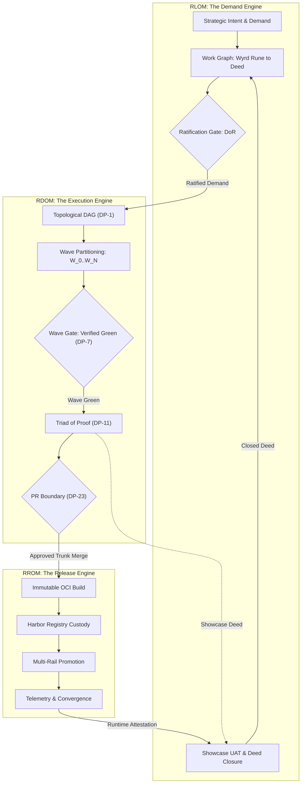

<!-- LICENSE: © 2026 Ravenhelm LLC. Licensed material. -->
<!-- All rights reserved except as granted in LICENSE. Inquiries: nate@ravenhelm.co -->

## Chapter 2 — The Sovereign Triad (RLOM, RDOM, RROM)

It is 4:45 PM on a Thursday. Product leadership announces "Enterprise Multi-Tenancy." In the issue tracker, forty-eight tickets gleam green as "Done." Inside engineering channels, panic reigns. Three squads pushed conflicting migrations to trunk. CI is crimson. Staging throws 502 Bad Gateway errors. A desperate DevOps engineer logs in via SSH to patch a production database node, while an automated script executes an unpinned container build pulling a broken upstream dependency.

By 6:00 PM, customers cannot log in. Product blames engineering for brittle code; engineering blames operations for fragile environments; operations blames product for rushing unratified requirements into the release window.

This is the **Organizational Chasm**—the unbridged abyss separating demand definition, engineering execution, and runtime operations. Product managers live in roadmaps and subjective promises. Developers live in IDEs, branch sprawl, and compiler errors. Operators live in alert storms and configuration drift.

Between these universes, product promises evaporate. Lacking formal interface contracts, organizations bridge gaps with social rituals: status standups, stalled release trains, and recurring post-mortems. When autonomous AI coding agents are deployed into this void, chaos accelerates: agents generate thousands of lines of syntactically valid code that fulfill tickets in name only, multiplying architectural drift and deployment fragility.

The **Sovereign Triad** is the architectural antidote. It establishes operational coherence across three distinct, mathematically bounded disciplines. Each discipline is governed by an authoritative methodology book, its own numbered principles, and an inviolable physical axiom. Demand, execution, and release become three interlocking gears of an indivisible manufacturing engine.

```
       DEMAND & INTENT                  EXECUTION CADENCE                 RELEASE & RUNTIME
  +------------------------+        +------------------------+        +------------------------+
  |          RLOM          |        |          RDOM          |        |          RROM          |
  | Ravenhelm Linear       | =====> | Ravenhelm Development  | =====> | Ravenhelm Release      |
  | Operating Method       |        | Operations Method      |        | Operations Method      |
  +------------------------+        +------------------------+        +------------------------+
  Axiom: "If it isn't               Axiom: "Concurrency is            Axiom: "Builds are the
  witnessed by a deed,              earned through topological        unit; releases are names."
  it didn't happen."                proof; quality is gated
                                    by verified green."
```

---

### The Triad Architecture & Cosmology

To achieve sovereign engineering operations, delivery is formalized as a continuous state-transition system across three state spaces:

1. **The Demand Space ($\mathcal{D}$)**: The universe of verified business intent, customer requirements, and acceptance criteria.
2. **The Execution Space ($\mathcal{E}$)**: The directed acyclic graph of topological implementation waves, compilation units, and verification gates.
3. **The Runtime Space ($\mathcal{R}$)**: The universe of immutable, bit-identical artifacts executing across production infrastructure.

In broken organizations, $\mathcal{D} \to \mathcal{E} \to \mathcal{R}$ is an open-loop, lossy transformation. In the Sovereign Triad, it is a closed-loop homomorphism where every transition is witnessed by physical evidence.



#### 1. RLOM — Demand, Intent, and the Work Graph

Governed by twenty-nine principles (`P-1` through `P-29`), the **Ravenhelm Linear Operating Method (RLOM)** manages how intent enters the organization, decomposing initiatives into projects and deliverable deeds. It treats the issue tracker as an active, living work graph rather than a historical cemetery.

- **The Core Axiom**: *"If it isn't witnessed by a deed, it didn't happen."* (RLOM `P-11` / RDOM **DP-11**)
- **Role & Boundary**: RLOM owns *what* must be built and *why*. It secures customer demand, defines observable acceptance criteria, and enforces the deed hierarchy from *Wyrd Rune* down to *Daily Deed*. It never prescribes code syntax, software architecture, or internal execution mechanics.

#### 2. RDOM — Execution, Concurrency, and Engineering Cadence

Governed by twenty-four principles (**DP-1** through **DP-24**), the **Ravenhelm Development Operations Methodology (RDOM)** is the execution engine. It ingests the ratified work graph from RLOM, maps it into an explicit dependency DAG ($G = (V, E)$), hoists common abstractions at planning time, executes across topological waves, and enforces Six Sigma gates at every boundary.

- **The Core Axiom**: *"Concurrency is earned through topological proof; quality is gated by verified green."* Supported by the Six Sigma Wave Rule: *"Wave $N+1$ never opens on a promise; only on verified green."* (**DP-7**)
- **Role & Boundary**: RDOM owns *how* systems are constructed and verified. It isolates work in disposable git worktrees projected from canonical bare repositories (**DP-19**), eliminates context thrash via topological priming (**DP-20**), and enforces the pull request boundary (**DP-23**). It never mutates live servers via SSH (**DP-21**).

#### 3. RROM — Release, Artifact Custody, and Runtime Deployment

Governed by eighteen principles (`RP-1` through `RP-18`), the **Ravenhelm Release Operations Methodology (RROM)** governs what happens once code merges into trunk, enforcing immutable artifact compilation, strict registry custody, and multi-rail distribution.

- **The Core Axiom**: *"Builds are the unit; releases are names."*
- **Role & Boundary**: RROM owns *where* and *how systems run*. It compiles code once into an immutable OCI container image pinned to a cryptographic digest (`:b42@sha256:...`). It manages multi-rail promotion across GitOps pipelines driving cluster workloads (Argo CD) and private package managers driving workstation tooling (Homebrew taps). It never rebuilds code across environments.

#### The Principle of Non-Overlapping Sovereignty

The Sovereign Triad functions only when each methodology maintains absolute authority within its domain while strictly respecting boundary contracts:

| Methodology | Sovereign Domain | Physical Artifact Produced | Boundary Contract Handed Off |
|:---|:---|:---|:---|
| **RLOM** | Demand, Priority, Acceptance | Ratified Work Graph & Deed Hierarchy | Definition of Ready (DoR) Issue Specification |
| **RDOM** | Architecture, Code, TDD Verification | Topological Wave Code & Triad of Proof | Merged Pull Request & Witnessed Deeds |
| **RROM** | Compilation, Custody, Runtime Deployment | Immutable Artifacts & GitOps Manifests | Deployed Service Attestation & Telemetry |

Total sovereignty within the domain; zero leakage across the boundary.

---

### Interface Contracts & Handoff Protocols

The seams between Triad members are governed by four explicit handoff protocols that ensure no task advances without verifiable evidence.

#### Protocol 1: The RLOM $\to$ RDOM Handshake (Demand to Topology)

Work never enters engineering execution without clearing the RLOM **Definition of Ready (DoR)** gate:

1. **Topological Lineage**: Clear parentage linking through an active Project to a strategic *Wyrd Rune*.
2. **Behavioral Acceptance Criteria**: Testable conditions of satisfaction (e.g., "P99 latency under 200ms at 1,000 concurrent sessions").
3. **Assigned Ownership & Capacity**: An explicit owner and verified capacity within the execution cycle.

Once ratified, RDOM applies the Axiom of Precedence: *"The Graph Precedes the Plan"* (**DP-1**). Requirements map into a directed acyclic graph ($G = (V, E)$) partitioned into topological waves ($W_0, W_1, \dots, W_N$) (**DP-2**). Concurrency is permitted *only* within the active wave (**DP-3**). Speculative downstream work before upstream preconditions pass is barred (**DP-5**).

#### Protocol 2: The RDOM Feature Release Triad (The Triad of Proof)

Inside RDOM, completion is absolute. Under Principle **DP-11**, every completed unit of work must deliver the **Triad of Proof**:

1. **Functional Silicon**: Production code satisfying test-driven transitions (**DP-8**) verified against the live running system (**DP-10**) with real runners, not mocks.
2. **Living Documentation**: Authoritative architectural decision records (ADRs), interface specifications, schema dictionaries, and operational runbooks committed alongside code.
3. **The Executable Showcase Deed**: A reproducible walkthrough proving the software operating in a live environment: a recorded CLI session transcript, integration test screencast, or live test harness execution.

The Showcase Deed serves as the physical bridge connecting technical execution back to business acceptance.

#### Protocol 3: The RDOM $\to$ RROM Handshake (The Custody Boundary)

When an engineering wave completes, its code crosses the **Pull Request Boundary** (**DP-23**). Direct pushes to trunk branches are physically blocked by repository rules.

1. **The PR Gate**: The pull request bundles the complete Triad of Proof. Automated branch protection executes CI suites against live runners, confirming Wave exit criteria are satisfied (**DP-7**).
2. **Custody Attestation**: Once approved, the PR is squash-merged into trunk, transferring custody from RDOM to RROM.
3. **Single-Unit Compilation**: RROM activates the Release Doctrine: *"Builds are the unit; releases are names."* The commit compiles once into an immutable OCI container image tagged with a monotonic build number and pinned by its cryptographic digest (`harbor.domain/app:b42@sha256:...`).
4. **Multi-Rail Distribution**: For dual-surface repos, RROM simultaneously updates GitOps manifests (Argo CD) and package formulae (Homebrew taps). Rebuilding across environments is forbidden.

#### Protocol 4: RROM $\to$ RLOM Closed-Loop Feedback (Showcase UAT)

Deployment to production does not complete delivery. Value is realized only when the demand contract is ratified in the live runtime.

1. **Telemetry Convergence**: Upon deployment, RROM monitors health probes and OpenTelemetry spans, generating an attestation with the immutable build digest, git commit hash, and live endpoints.
2. **Automated Issue Stamping**: RROM posts this attestation back to the upstream RLOM issue, transitioning status to "Validating."
3. **The Showcase as User Acceptance Testing (UAT)**: Stakeholders evaluate the **Showcase Deed** against original RLOM acceptance criteria. Because the showcase demonstrates live software, UAT is fast and objective.
4. **Deed Closure**: When the showcase is validated against production telemetry, the RLOM issue transitions to "Done." The deed is witnessed, recorded, and closed.

---

### The Concrete Failure Modes of Incomplete Triads

Operating with missing or disconnected triad legs invariably breeds predictable pathologies.

#### Failure Mode 1: The Island of Craftsmanship (RDOM Alone)

An engineering team adopts RDOM rigorously: pristine code, topological waves, strict TDD, and isolated worktrees (**DP-19**). Outside their team, the organization lacks RLOM and RROM.

- **The Upstream Failure**: Without RLOM, priorities arrive through fragmented chat messages. Lacking a formal demand filter, the team constructs exquisite architectures for features that solve no customer problem.
- **The Downstream Failure**: Without RROM, there is no release doctrine. Developers build images on laptops, push untracked `:latest` tags, or run `ssh prod "git pull && systemctl restart"`.
- **The Diagnostic Verdict**: Craftsmanship becomes an ivory-tower indulgence. The team produces high-quality silicon that delivers zero reliable business value—an island of craftsmanship drowning in an ocean of organizational drift.

#### Failure Mode 2: The Build-at-the-Wire Catastrophe (RLOM + RDOM without RROM)

The organization possesses strong product discipline (RLOM) and rigorous execution (RDOM). Requirements become dependency DAGs delivered in verified green waves with showcases.

However, the organization lacks RROM, treating release as an unversioned afterthought.

- **The Mechanism of Collapse**: When code ships, CI scripts execute dynamic builds directly on deployment targets:

  ```bash
  # The Anatomy of Disaster
  ssh prod-host "cd /app && git pull && npm install && npm run build"
  ```

  Or, CI compiles separate container images for staging and production.
- **The Inevitable Explosion**: At 2:00 AM during a rollout, an unpinned dependency introduces a breaking change. Staging passed, but production fails. Alternatively, compile-time environment variables point production at a staging database, corrupting records.
- **The Diagnostic Verdict**: Without RROM's immutable custody (*"Builds are the unit; releases are names"*), guarantees established by RDOM evaporate the moment code leaves git. Software is unverified if production bytes differ from tested bytes.

#### Failure Mode 3: The Wishful Deployment Chasm (RLOM + RROM without RDOM)

This is the classic startup architecture: premium product tools (Linear) upstream and GitOps pipelines (Argo CD, Harbor) downstream. The engineering execution engine in the middle is a void.

- **The Mechanism of Collapse**: Execution is governed by Agile dogma: two-week sprints, story points, and standups. Developers pull tickets and code in long-lived feature branches without mapping dependencies.
- **The Injection of Agents**: Unleashing autonomous AI coding agents without topological boundaries (**DP-1**, **DP-3**) and wave gates (**DP-7**) causes agents to concurrently edit interdependent tickets. Each agent invents mock interfaces, hallucinates conventions, and modifies shared schemas incompatibly.
- **The Downstream Trainwreck**: PRs merge by the dozen. RROM faithfully compiles the chaos and deploys it to production. Lacking wave gates against live systems, RROM becomes an automated conveyor belt delivering broken software at high velocity.
- **The Diagnostic Verdict**: Automation without execution discipline merely automates disaster. Sophisticated deployment pipelines connected to chaotic development practices yield continuous, automated production failure.

#### Failure Mode 4: The Promissory Merge & Mock-Passing Illusion

A pervasive anti-pattern is substituting promises for proof, directly violating Principles **DP-7** and **DP-11**.

Teams fall victim to the **Mock-Passing Illusion**: tests pass against in-memory mocks while the live database schema has drifted, foreign key constraints are violated, and JSON serialization diverges from reality (**DP-10**).

Compounding this is the **Promissory Merge**: a PR merges with the comment, *"Core logic implemented; will add integration tests, documentation, and fix edge cases in the next wave."*

In the Sovereign Triad, a promissory merge is treated as an intentional defect escape. Wave $N+1$ never opens on a promissory note (**DP-7**). If the Triad of Proof (Code, Docs, Showcase) is incomplete, the work item remains locked in Wave $N$, the Andon Cord is pulled (**DP-12**), and downstream capacity halts until the boundary condition is physically satisfied.

---

### Augmentation Surface — Sovereign Triad Orchestration

When autonomous agent swarms enter software delivery, human coordination collapses under cognitive load. The Sovereign Triad provides the boundaries required to operate human-agent fleets safely.

> **Augmentation Surface — Triad State Reconciliation**
>
> Where an agent layer transforms this practice:
>
> 1. **Work Graph Ingestion**: An orchestration agent monitors RLOM for issues meeting the Definition of Ready, synthesizing the dependency DAG ($G = (V, E)$) and topological waves ($W_0, \dots, W_N$) (**DP-1**, **DP-2**).
> 2. **Surgical Worktree Provisioning**: The orchestrator projects disposable git worktrees from the canonical `.bare/` repository (**DP-19**), priming agent context with surgical digests (`eat prime`, `eat read`) to eliminate context waste (**DP-20**).
> 3. **Mechanical Boundary Gating**: A supervisor agent validates Six Sigma criteria (**DP-7**): automated tests against live containers (**DP-10**), living documentation, and a recorded showcase deed (**DP-11**). Wave $W_{k+1}$ unlocks only when Wave $W_k$ is verified green.
> 4. **Release Reconciliation**: Upon trunk merge, the orchestrator triggers RROM compilation to immutable Harbor digests, monitors GitOps convergence, and posts deployment attestations to RLOM for UAT sign-off.
>
> What the human architect keeps:
>
> - **Strategic Demand Ratification**: Humans decide what enters the RLOM graph and allocate execution capital.
> - **Architectural Hoisting**: Humans ratify planning-time DRY hoist boundaries (**DP-13**, **DP-14**).
> - **Sovereign Cutover Authority**: Production cutovers and database migrations remain gated by explicit human authorization.

---

<!-- RUBRIC_CHECK:
  structural: pass
  content: pass
  funnel: pass
  chapter-type-extras: n/a
  word-count: 2488
  principle-citations: DP-1, DP-2, DP-3, DP-5, DP-7, DP-8, DP-10, DP-11, DP-12, DP-13, DP-14, DP-19, DP-20, DP-21, DP-23
  flagged-principle-gaps: none
-->
