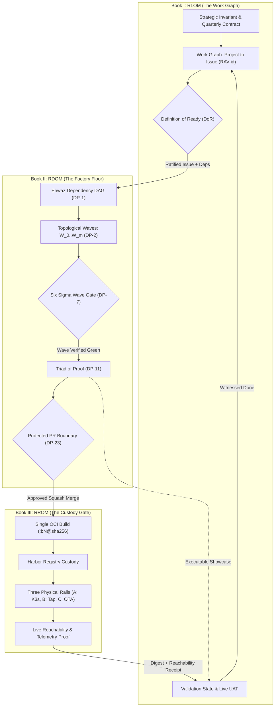

<!-- LICENSE: © 2026 Ravenhelm LLC. Licensed material. -->
<!-- All rights reserved except as granted in LICENSE. Inquiries: nate@ravenhelm.co -->

## Chapter 2 - The Sovereign Triad (RLOM, RDOM, RROM)

On 2026-09-21, two Yggdrasil Architecture Decision Records and the second round of the `WALKER` specification flipped to `Done` in Linear. Reading those green status badges at face value, the fleet supervisor announced that the foundational gate had cleared and prepared to dispatch downstream implementation waves across the estate. The gate had not cleared by a long shot. A ratified markdown file in a repository is a decision, not a running substrate; the runtime binaries those downstream slices needed to import did not exist yet. Less than two weeks earlier, on 2026-09-09, an audit of the opposite boundary exposed ten merged features across the estate - including a 46 KB `wire.py` protocol module, `vodozemac-bridge`, and an `ensure_receiver()` lifecycle hook bypassed by `doom new --launch` - that boasted 73 passing unit tests in CI and zero callers in the production binary. And on 2026-09-13, three merged pull requests were reported up the chain as finished operational tools while `the-work` masthead had never been redeployed and a Matrix hotfix sat unverified on disk. Every one had green tests. None of them ran.

Those three failures happened at three different seams of the engineering lifecycle, and each one poisoned the other two:

1. When the **intent ledger** mistakes a merged document for a running capability, the execution floor launches waves against a phantom foundation.
2. When the **factory floor** certifies unit tests in an isolated worktree without wiring the symbol into the live entrypoint, the release pipeline packages dead bytes into immutable containers.
3. When the **release pipeline** stops at `git merge` and fails to prove runtime reachability in production, the intent ledger marks the customer promise `Done` while the cluster still runs last week's binary.

Most organizations try to paper over these seams with standup rituals, release-train spreadsheets, and post-mortem action items nobody reads twice. When you introduce autonomous AI coding slices into that gap, the failure rate goes vertical. An agent has no intuition for whether a feature is actually reachable by a user; it optimizes for the literal boundary you gave it. Give it an unverified Linear ticket and it will write code against a fantasy. Give it a unit-test gate without a reachability gate and it will ship 46 KB of dead weight with 100% test coverage.

The **Sovereign Triad** closes those seams by treating intent, execution, and release custody as three interlocking law codes - three *dōmbócs*. Old Norse *dómr* and Old English *dōm* (doom) are the exact same word: *"what is laid down; the judgment."* When King Alfred compiled the laws of Wessex, he called the book the *dōmbōc*. In the Ravenhelm estate, a Doom worker slice is literally a bounded container of judgment, and the three books of this trilogy are the three *dōmbócs* that govern the work from the first intake ticket to the live production pod:

```
       BOOK I: INTENT                  BOOK II: EXECUTION                 BOOK III: CUSTODY
  +------------------------+        +------------------------+        +------------------------+
  |          RLOM          |        |          RDOM          |        |          RROM          |
  | Ravenhelm Linear       | =====> | Ravenhelm Development  | =====> | Ravenhelm Release      |
  | Operating Method       |        | Operations Method      |        | Operations Method      |
  +------------------------+        +------------------------+        +------------------------+
  The Work Graph                    The Factory Floor                 The Custody Gate
  Axiom: "If it isn't               Axiom: "Concurrency is            Axiom: "Builds are the
  witnessed by a receipt,           earned through topological        unit; releases are names."
  it didn't happen."                proof; quality is gated
                                    by verified green."
```

---

### The Architecture of the Three Dōmbócs

To stop one stage's lie from becoming the next stage's premise, software delivery is modeled as a closed-loop state machine across three bounded spaces:

1. **The Demand Space ($\mathcal{D}$ - RLOM):** The directed graph of Strategic Invariants, Program Initiatives, Quarterly Engineering Contracts, Projects, and Deliverables (`RAV-<id>`).
2. **The Execution Space ($\mathcal{E}$ - RDOM):** The Ehwaz dependency DAG ($G = (V, E)$), topological waves ($W_0 \dots W_m$), isolated `.bare/` worktrees, and Six Sigma verification gates.
3. **The Runtime Space ($\mathcal{R}$ - RROM):** The immutable Harbor OCI digests (`:b<N>@sha256:...`), GitOps manifests (`norns-gitops`), Homebrew tap formulae (`nate/tools`), and cryptographically signed OTA bundles (`Idunn`).

In a conventional shop, the path $\mathcal{D} \to \mathcal{E} \to \mathcal{R}$ is an open-loop slide: tickets fall into branches, branches merge into trunk, and everyone hopes the deploy script worked. In the Sovereign Triad, every crossing requires a physical receipt that the receiving book validates before accepting custody.



#### 1. Book I: RLOM - Demand, Intent, and the Work Graph

Governed by twenty-nine principles (`P-1` through `P-29`), the **Ravenhelm Linear Operating Method (RLOM)** owns the ledger of intent. We learned the hard way (`designs-systems-not-operations.md`) that if you design a clean Linear taxonomy and look away for six months without mechanizing its maintenance, the workspace rots into 14 workflow states, ~160 ad-hoc labels, and 0 of 45 projects reporting a health status.

- **The Core Axiom:** *"If it isn't witnessed by a receipt, it didn't happen."* (`P-11` / **DP-11**)
- **Jurisdiction & Boundary:** RLOM owns *what* is being built, *why* it matters, and *what constitutes proof that it works*. It structures every piece of work from a multi-year Strategic Invariant down to an atomic Deliverable (`RAV-<id>`), and holds the `Validation` state open between `In Review` and `Done` because `Merged != Built != Running`. RLOM never dictates how a trait is factored or how a worktree is branched.

#### 2. Book II: RDOM - Execution, Concurrency, and the Factory Floor

Governed by twenty-four principles (**DP-1** through **DP-24**), the **Ravenhelm Development Operations Methodology (RDOM)** owns the factory floor where human architects and Doom worker slices turn ready tickets into verified commits.

- **The Core Axiom:** *"Concurrency is earned through topological proof; quality is gated by verified green."* Wave $W_{k+1}$ never opens on a promise; only on verified green (**DP-7**).
- **Jurisdiction & Boundary:** RDOM owns *how* code is planned, isolated, written, and proven before it touches `main`. It takes a batch of ready RLOM issues, runs a planning-time DRY scan to hoist shared crates (**DP-13**, **DP-14**), partitions the DAG into collision-free Ehwaz waves (**DP-2**, **DP-3**), dispatches workers into isolated `.bare/` worktrees primed with `<800`-token EAT digests (**DP-19**, **DP-20**), and blocks every PR that lacks passing live-system tests, updated docs, and a showcase transcript (**DP-10**, **DP-11**, **DP-23**). RDOM stops at the squash-merge to `main`. It never SSHes into `odin` to edit a running container (**DP-21**).

#### 3. Book III: RROM - Release, Artifact Custody, and the Three Rails

Governed by sixteen release principles (`RP-1` through `RP-16`) anchored in **ADR-0007**, the **Ravenhelm Release Operations Methodology (RROM)** takes over the instant a commit lands on `main`.

- **The Core Axiom:** *"Builds are the unit; releases are names."*
- **Jurisdiction & Boundary:** RROM owns *artifact custody, promotion, and live runtime truth*. On merge to `main`, `.forgejo/workflows/build.yml` compiles the source once and pushes an immutable image to Harbor with a monotonic build tag (`:b<N>@sha256:...`). When a release is cut, RROM never rebuilds from source; it retags the proven `:b<N>` digest and promotes it across three physical rails: **Rail A** (Norns K3s via `norns-gitops` Argo CD, modeled on **Vitki**), **Rail B** (workstation CLI formulae in `nate/tools` via sandbox `inreplace`, modeled on **Ullr/Yager**), and **Rail C** (Minisign-verified OTA tarballs, modeled on **Idunn**). RROM also enforces zero-ambient privilege via **Action-Hash Elevation (Valkyrie MFAA)** and OpenBao AppRoles.

#### The Law of Non-Overlapping Sovereignty

Each book is sovereign inside its walls and subordinate at its borders:

| Book | Sovereign Domain | Physical Artifact Produced | Boundary Receipt Required to Cross |
|:---|:---|:---|:---|
| **RLOM** | Intent, Priority, Acceptance Ledger | Ratified Issue Graph (`RAV-<id>`) | Definition of Ready (DoR): Parentage, AC, Dependencies |
| **RDOM** | DAG Waves, Worktrees, TDD Proof | Squash-Merged Commit on `main` | Triad of Proof: Live Green CI, Docs/ADR, Showcase |
| **RROM** | Immutable Builds, Promotion, Runtime | Running Digest on Rail A / B / C | Harbor `sha256` Digest + Live Reachability Probe |

---

### Interface Contracts & Handoff Protocols

A handoff without a machine-checkable receipt is a rumor. Four explicit protocols lock the three *dōmbócs* together.

#### Protocol 1: The RLOM $\to$ RDOM Handshake (Intake to Wavefront)

An issue in Linear cannot be pulled onto the RDOM floor while it sits in `Triage` or `Backlog`. To cross into execution, it must pass the **Definition of Ready (DoR)**:

1. **Unbroken Lineage:** The issue links to an active Project and traces up to a Quarterly Engineering Contract and Strategic Invariant.
2. **Falsifiable Acceptance Criteria:** Concrete conditions that can fail in a test harness (not *"improve dashboard UX"*, but *"render `TurnPhase` transitions under 16ms with zero dropped frames"*).
3. **Declared Causal Edges:** Every upstream blocker is recorded as an explicit Linear `blocks` / `is blocked by` edge, distinguishing documentary decisions (an ADR merged) from runtime preconditions (a crate published or a table migrated).

Once a set of issues clears DoR, RDOM compiles the Ehwaz DAG ($G = (V, E)$) (**DP-1**), runs the Hoist-vs-Defer scan across the graph (**DP-13**, **DP-14**), calculates the Critical Chain floor (**DP-4**), and opens Wave $W_0$ (**DP-2**).

#### Protocol 2: The RDOM Feature Release Triad (The Triad of Proof)

Inside RDOM, a worker slice cannot claim a task is ready for review simply because `cargo test` or `pytest` exited `0`. Under **DP-11**, every pull request must carry the **Triad of Proof**:

1. **Functional Silicon (`Code`):** Implementation driven through Red-Green-Refactor (**DP-8**), verified against real databases and services (**DP-10**), with caller-graph parity proving the new symbol is actually invoked by a production entrypoint.
2. **The Architecture Record (`Docs`):** Synchronized updates to `AGENTS.md`, `docs/adr/`, or operational runbooks in the same commit tree.
3. **The Executable Showcase (`Showcase`):** A verbatim CLI readout, testcontainer integration transcript, or browser harness capture proving the feature working end-to-end against live state.

#### Protocol 3: The RDOM $\to$ RROM Handshake (The PR Custody Gate)

Direct pushes to `main` are blocked across all 217 repositories (**DP-23**). Crossing from RDOM into RROM happens at the Pull Request merge gate:

1. **The Inline Reference Guard:** Every PR title and body must bind to a live `RAV-<id>` issue (`prs-require-linear-issue.md`). Note the mechanical trap we hit in production: the Linear reference guard reads inline JSON payloads only (`linear-ref-guard-reads-inline-json-only.md`), and GitHub's default integration will prematurely auto-close a multi-PR Linear issue the moment the *first* PR titled with `RAV-<id>` merges (`linear-auto-closes-the-issue-when-any-github-pr-titled-with-its-id-merges.md`). RDOM binds component PRs cleanly so the parent issue stays open until every wave slice lands.
2. **Supervisor Merge Authority:** A worker slice may open a PR, attach the Triad of Proof, and request advisory review from **Snotra**, but a worker never merges its own PR. Only the human supervisor - or the session that received explicit human approval first-hand for that specific PR - executes the squash merge.
3. **Build-Once Custody Transfer:** The squash merge on `main` triggers RROM's `build.yml`, minting `:b<N>@sha256:...` in Harbor. From that millisecond forward, source code is no longer touched; RROM handles only immutable digests.

#### Protocol 4: The RROM $\to$ RLOM Closed Loop (Validation to Done)

A merged PR is not a deployed service. When the PR merges, the Linear issue moves to `Validation` - never directly to `Done`.

1. **Rail Promotion:** RROM promotes `:b<N>` to `norns-gitops` (Rail A), updates the Homebrew formula in `nate/tools` and runs `brew reinstall` (Rail B), or publishes the signed `Idunn` bundle (Rail C). Dual-surface repos like **Ullr/Yager** execute Rail A and Rail B together so the workstation CLI and the Norns cluster pods never drift out of version lockstep.
2. **Live Reachability Verification:** The operator or validation harness proves the new digest is running and reachable - checking `kubectl get pods` image digests on Norns, hitting the live endpoint, and verifying that `which <tool>` on the workstation resolves to `/opt/homebrew/bin/<tool>` rather than a stale `~/.local/bin` shim.
3. **Receipt Attachment & Closure:** The Harbor digest, release tag, and live verification output are posted to the Linear issue. Only then does RLOM transition the issue from `Validation` to `Done`.

---

### How Failure in One Book Corrupts the Others: Four Estate Forensics

When any one of the three *dōmbócs* is missing or bypassed, the remaining two amplify the error. We do not need hypothetical parables to prove this; we have the scorch marks in the estate ledger.

#### Forensic Case 1: The Premature Gate (RLOM Corrupting RDOM)

- **The Incident (2026-09-21):** Two Yggdrasil ADRs and the round-two `WALKER` design issues were marked `Done` in Linear. The supervisor treated `Done` on the design tickets as proof that the upstream substrate existed, and prepared to launch the dependent implementation wave in RDOM.
- **The Mechanism of Corruption:** RLOM failed to separate *Decision Ratified* (an ADR merged to markdown) from *Substrate Running* (a crate compiled and serving). Because RDOM trusts upstream `Done` edges to unlock Wave $W_{k+1}$, a lie in the RLOM graph tricks RDOM into dispatching workers into a void where they either stall or invent fake stubs.
- **The Structural Fix:** RLOM issues that produce paper decisions cannot sit as the sole blocker on a code consumer; an explicit implementation issue must sit between the ADR and the downstream wave, and `Doomcourt` verifies the artifact exists before opening Wave $W_{k+1}$.

#### Forensic Case 2: The Ten Ghosts of 2026-09-09 (RDOM Corrupting RROM)

- **The Incident (2026-09-09):** Ten separate features across the estate merged to `main` with 73 passing unit tests. RROM dutifully compiled the commits and shipped them. In production, none of the ten features did anything. A 46 KB `wire.py` sat unimported; `vodozemac-bridge` had no entrypoint wiring; `ensure_receiver()` was written and tested, while `doom new --launch` took a code path that bypassed it completely.
- **The Mechanism of Corruption:** RDOM tested the *existence* of functions inside isolated unit tests without testing *reachability* from the binary's `main()` entrypoint. RROM's build pipeline is content-blind by design - it packages whatever passes RDOM's merge gate. When RDOM certifies dead code, RROM ships dead code with cryptographic precision.
- **The Structural Fix:** Principle **DP-10** and **DP-11** require an executable showcase and caller-graph verification from the live entrypoint (`reachability-is-not-correctness.md`). If a new module has zero callers outside `tests/`, the wave gate fails.

#### Forensic Case 3: The Fiction Release & Stale Shims (RROM Corrupting RLOM)

- **The Incident (2026-09-13 & 2026-10-09):** On 2026-09-13, three merged PRs were reported as completed deliverables while `the-work` masthead still ran the old container and a Matrix hotfix sat undeployed. On 2026-10-09, `domainintelligenceschema` PR #11 shipped the live `v1.8.0` docs site advertising seven new schema constructs that had **zero hits** in `vocabulary/`, `shapes/`, `cue/`, or `tests/`. And during a `doom` CLI upgrade, `doom --version` printed `0.4.0` while executing stale code because `doom update` had dropped a standalone binary into `~/.local/bin/doom` (PATH index 5) that shadowed `/opt/homebrew/bin/doom` (PATH index 9).
- **The Mechanism of Corruption:** When RROM lacks source-to-artifact parity checks (`check-release-source-parity.sh`) or skips the post-merge deploy and PATH verification, RLOM closes the books on features that customers and operators cannot actually touch.
- **The Structural Fix:** Approval to merge is approval to deploy (`merge-then-deploy`). RROM runs automated artifact-grep parity gates on every release and requires a live runtime receipt before RLOM permits the `Validation -> Done` transition.

#### Forensic Case 4: The Ambient SSH Patch (Bypassing All Three Books)

- **The Incident:** An operator or agent logs directly into `odin` or `hrafngud` over SSH, edits a configuration file or restarts a container with manual flags (`docker compose restart` after adding a volume, which silently ignores new volume mounts until `up -d` recreates the container), and declares the outage fixed.
- **The Mechanism of Corruption:** RLOM has no record of the change, RDOM has no commit or test in git, and RROM's next GitOps sync or image rollout overwrites the hand-patched state, detonating the exact same outage three weeks later at 2:00 AM.
- **The Structural Fix:** Principle **DP-21** (Zero Ambient Mutation on Production Hosts). Every production change travels through a worktree commit, a PR merge, and an RROM digest promotion. No exceptions.

---

### Augmentation Surface - Sovereign Triad Orchestration

Running three rigorous *dōmbócs* by hand across 217 repositories would drown a human team in paperwork. The Triad is designed so autonomous tooling carries the mechanical friction while the human architect holds every judgment gate.

> **Augmentation Surface - Closed-Loop Triad Reconciliation**
>
> Where an agent layer transforms this practice:
>
> 1. **RLOM $\to$ RDOM Compilation:** `Doomcourt` inspects Linear issues in `Ready`, verifies that upstream dependencies are genuinely running (not merely merged on paper), synthesizes the Ehwaz wave DAG ($G = (V, E)$), and flags duplicate capabilities for planning-time DRY hoisting (**DP-1**, **DP-13**).
> 2. **RDOM Worktree & Context Provisioning:** For every task in the open wave $W_k$, `Doom` creates an isolated worktree off `.bare/` (**DP-19**) and injects an `<800`-token `eat prime` topological digest so the worker slice starts coding in seconds without directory crawling (**DP-20**).
> 3. **Six Sigma Gate & Caller Parity:** Before a PR can be marked ready for human merge approval, CI and **Snotra** verify live-system tests (**DP-10**), check that new symbols have real callers outside `tests/`, and confirm the Triad of Proof (**DP-11**).
> 4. **RROM Promotion & RLOM Closure:** Once the human supervisor merges the PR, Forgejo Actions builds `:b<N>@sha256:...` in Harbor, promotes the digest across Rail A (`norns-gitops`) and Rail B (`nate/tools`), executes the live reachability probe, and posts the receipt back to Linear so the issue can close from `Validation` to `Done`.
>
> What the human architect keeps:
>
> - **Intent Ratification (RLOM):** Deciding which Strategic Invariants and Quarterly Engineering Contracts get funded and built.
> - **Hoist & Merge Authority (RDOM):** Ruling on Hoist-vs-Defer boundaries (**DP-14**) and personally approving and merging every pull request (**DP-23**).
> - **Cutover & Elevation Authority (RROM):** Authorizing architectural cutovers (ADR-011) and signing cryptographic **Action-Hash Elevation (Valkyrie MFAA)** grants when a release requires privileged execution.

<!-- RUBRIC_CHECK:
  structural: pass
  content: pass
  funnel: pass
  chapter-type-extras: n/a
  word-count: 2564
  principle-citations: DP-1, DP-2, DP-3, DP-4, DP-7, DP-8, DP-10, DP-11, DP-13, DP-14, DP-19, DP-20, DP-21, DP-23
  flagged-principle-gaps: none
-->
