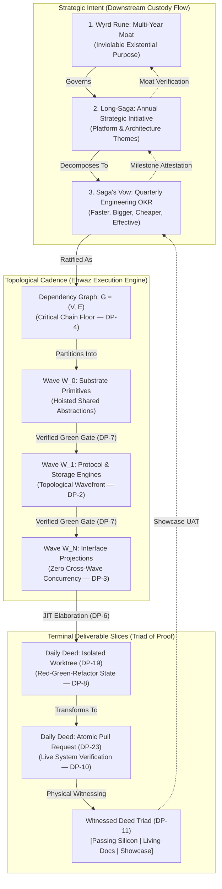

<!-- LICENSE: © 2026 Ravenhelm LLC. Licensed material. -->
<!-- All rights reserved except as granted in LICENSE. Inquiries: nate@ravenhelm.co -->

## Chapter 4 — The Hierarchy of Deeds (Wyrd Rune to Daily Deed)

At 9:00 AM on the first Monday of the fiscal year, executive leadership unveils the multi-year vision: *Unified Distributed Mesh*, *Zero-Trust Autonomous Agent Substrate*, and *Sub-Ten-Millisecond Ingress*. Capital is allocated, and strategic key results are celebrated.

Nine months later, the quarterly business review opens in bewilderment. Product leadership claims engineering completed "eighty-four percent of planned story points." Yet when asked for a live demonstration of the multi-region mesh, engineering leads stammer. What actually shipped was a patchwork: three rewritten frontend panels, ad-hoc migration scripts in staging, twenty-four unmerged branches with conflicting protocol buffers, and maintenance tickets labeled "Tech Debt."

This failure stems from a **broken chain of custody** between strategic intent and code execution. Boardroom objectives and terminal pull requests are unanchored. Strategy lives in slide decks; execution is tracked in ticketing queues where arbitrary "Epics" act as wastebaskets. Commits merge into trunk with messages like `fix: tweak listener`—carrying zero provenance, structural lineage, or physical proof of advancing business goals.

When autonomous AI coding agents enter this void, the chasm widens. Agents churn out thousands of lines of syntactically valid code within isolated context windows, spawning pull requests that solve local puzzles while fracturing system architecture.

The **Hierarchy of Deeds** replaces subjective status reporting, floating stories, and phantom epics with an unbroken, verifiable chain of custody from sovereign intent down to the atomic git commit.

---

### The Formal Cosmology of Deed Custody

To guarantee no line of code is written without strategic necessity, software delivery is formalized as a strict, multi-tiered projection of custody.

Let $\mathcal{R}$ represent multi-year sovereign goals, $\mathcal{S}$ annual architectural initiatives, $\mathcal{V}$ quarterly engineering contracts, $\mathcal{W}$ topological execution waves, $\mathcal{D}$ atomic daily deeds, and $\mathcal{C}$ physical git commits. Custody is an unbroken downward projection:

$$\mathcal{C} \xrightarrow{\pi_1} \mathcal{D} \xrightarrow{\pi_2} \mathcal{W} \xrightarrow{\pi_3} \mathcal{V} \xrightarrow{\pi_4} \mathcal{S} \xrightarrow{\pi_5} \mathcal{R}$$

Proof of delivery is an upward aggregation of mechanical witnesses: every daily deed verifies physical silicon; waves aggregate verified deeds; quarterly contracts fulfill engineering OKRs; and completed sagas fortify the sovereign moat.

```
       [ WYRD RUNE ]           Sovereign North Star (Multi-Year Existential Moat)
             │                 Horizon: 3-5 Years | Authority: Sovereign Architect / Board
             ▼
       [ LONG-SAGA ]           Strategic Architecture & Platform Initiatives
             │                 Horizon: 1-2 Years | Authority: Principal Systems Architect
             ▼
      [ SAGA'S VOW ]           Quarterly Commitment (Faster, Bigger, Cheaper, Effective)
             │                 Horizon: 1 Quarter | Authority: Engineering Director & Leads
             ▼
     [ TOPOLOGICAL WAVE ]      Coherent Execution Wavefront (Ehwaz DAG Waves W_0..W_N)
             │                 Horizon: 1-3 Weeks | Authority: Execution Engine / Fleet Dispatch
             ▼
       [ DAILY DEED ]          Atomic Deliverable Slice & Verified Pull Request
                               Horizon: 2-8 Hours | Authority: Paired Engineers & Agent Slices
```



#### 1. The Wyrd Rune (Sovereign North Star)

The Wyrd Rune embodies the multi-year existential purpose, competitive moat, and physical boundary of the enterprise (horizon: 3–5 years). It defines what the organization builds—and explicitly refuses to build. In Nordic cosmology, *Wyrd* represents systemic cause and effect. A Wyrd Rune is an architectural compass (e.g., *Sovereign Local-First Automation with Cryptographic Auditability*). Work lacking direct lineage to a Wyrd Rune is an unratified distraction.

#### 2. The Long-Saga (Annual Strategic Architecture)

The Long-Saga spans twelve to twenty-four months, translating the Wyrd Rune into foundational platforms (e.g., *Content-Addressed Silicon Entities* or *Global Active-Active Failover Mesh*). Owned by a Principal Systems Architect, each Long-Saga requires an economic thesis, an Architectural Decision Record (ADR), and annual milestone criteria, ensuring capital investments compound over time.

#### 3. The Saga's Vow (Quarterly Commitment / Engineering OKRs)

The Saga's Vow is the binding quarterly covenant (thirteen-week Valknut cadence) between engineering and leadership. It replaces story points with four orthogonal engineering dimensions:

- **Faster**: Reductions in latency or build cycle times (e.g., *Reduce P99 ingestion latency from 180ms to 22ms*).
- **Bigger**: Verified expansions in capacity or throughput (e.g., *Sustain 50,000 concurrent agent WebSockets on an 8-core host*).
- **Cheaper**: Physical decreases in compute spend or memory footprint (e.g., *Drop memory per daemon from 120MB to 14MB via zero-copy IPC*).
- **Effective**: Measurable improvements in reliability or disaster recovery (e.g., *Zero unhandled panics across 100M RPC calls; verified 10-minute restore*).

A Saga's Vow undergoes topological feasibility analysis before ratification: calculating the critical chain floor (**DP-4**) to guarantee physical resolvability within the quarter.

#### 4. The Topological Wave (Ehwaz Execution Wavefront)

RDOM replaces calendar sprints with a Directed Acyclic Graph ($G = (V, E)$) executed across discrete **Topological Waves** ($W_0, W_1, \dots, W_N$) (**DP-1**, **DP-2**). A wave consists exclusively of tasks whose inbound dependencies achieved verified green status in prior waves:

$$W_k = \{ v \in V \mid \forall (u, v) \in E, u \in W_j \text{ where } j < k \text{ and } \text{status}(u) = \text{VerifiedGreen} \}$$

Concurrency is permitted *only* within active wave $W_k$ (**DP-3**). Cross-wave speculative execution is barred (**DP-5**).

#### 5. The Daily Deed (Atomic Deliverable Slice)

The Daily Deed is the atomic execution unit (2–8 hours). Implemented in an isolated git worktree (**DP-19**), it represents an atomic pull request (**DP-23**) that transitions the repository to a verified state. Under Principle **DP-11**, completion requires the physical **Triad of Proof**:
1. Deterministic automated test verification against real runtime environments (**DP-10**).
2. Authoritative operational documentation and ADRs committed alongside code.
3. An executable showcase deed (terminal transcript or test runner attestation) proving behavioral satisfaction.

---

### The Four Invariants of Deed Custody

The Hierarchy of Deeds enforces four non-negotiable invariants. Any violation halts pipeline promotion immediately.

#### Invariant 1: Zero Unanchored Work ($c \in \text{Deed}$)

$$\forall c \in \mathcal{C}, \exists d \in \mathcal{D} \text{ such that } c \models d$$

No commit may enter version control without citing an active Daily Deed. Unanchored code is manufacturing scrap (*Muda*). Pre-receive hooks and PR linters scan for `Deed-Id:` trailers, rejecting unanchored commits at the git boundary.

#### Invariant 2: Zero Rogue Deeds ($d \in W_k$)

$$\forall d \in \mathcal{D}, \exists W_k \in \mathcal{W} \text{ such that } d \in W_k \subseteq V(G)$$

Every Daily Deed must reside as a validated node in a topological wave within a ratified DAG ($G = (V, E)$) (**DP-1**). Isolated tasks lacking inbound prerequisites or outbound consumers are either platform primitives that must be hoisted to Layer 0 (**DP-13**, **DP-14**) or rogue work that must be purged.

#### Invariant 3: Lineage Provenance ($W \to V \to S \to R$)

Lineage is transitive and unbroken. Deeds anchor to waves; waves trace to quarterly Saga's Vows; vows fulfill annual Long-Sagas; sagas fortify Wyrd Runes. Unaligned requests cannot bypass the topology to inject work into developer queues.

#### Invariant 4: Cryptographic & Mechanical Witnessing

Status transitions require physical verification (**DP-11**). Deeds achieve "Done" only through passing CI suites against live containers (**DP-10**), immutable OCI container digests (`sha256:...`) from Harbor, and verifiable showcase artifacts. Status reflects observed physical reality, never verbal promises.

---

### Operational Mechanics & Concrete Workflows

Decomposing high-level strategic intent into atomic execution slices follows five deterministic steps:

1. **Vow Ratification & Critical Chain Calculation**: The systems architect maps required capabilities into an explicit dependency DAG ($G = (V, E)$) (**DP-1**) and calculates the **Critical Chain Floor** (**DP-4**). If the longest dependent path exceeds sixty-five working days, the vow is unfeasible and is refactored before execution begins.

2. **Planning-Time DRY Hoisting**: The architect audits the graph for duplicated capabilities across slices (**DP-13**). Applying the Hoist-vs-Defer Rule (**DP-14**), known interfaces are hoisted into Wave $W_0$ as shared crates, while speculative interfaces remain inline in Wave $W_1$ with scheduled extraction in Wave $W_2$. Silent duplication is prohibited (**DP-15**).

3. **Progressive JIT Elaboration**: Specifying downstream code weeks in advance is inventory waste (*Muda*) (**DP-6**). Only when Wave $W_{k-1}$ achieves verified green status (**DP-7**) is Wave $W_k$ elaborated into Daily Deeds with red-green test specifications (**DP-8**) and invariant boundary assertions (**DP-9**).

4. **Surgical Worktree Dispatch**: Workers receive isolated git worktrees projected from a canonical `.bare/` repository (**DP-19**). Direct mutations on shared branches or live hosts via SSH are barred (**DP-21**). Context thrash is prevented by priming workers exclusively through topological EAT digests (`eat prime`, `eat read`) (**DP-20**).

5. **Git & Issue Schema Enforcement**: Every git interaction reflects the custody chain through strict metadata:

   - **Branch Naming Standard**:

     ```bash
     git worktree add ../deeds/DEED-4102-quic-framing -b deeds/DEED-4102/quic-framing
     ```

   - **Commit Trailer Schema**:

     ```text
     feat(transport): implement zero-copy QUIC frame ring buffer

     Implements vectorized memory writes for inbound QUIC frames,
     reducing kernel allocations from 12 to 0 per datagram packet.

     Deed-Id: DEED-4102
     Wave-Id: WAVE-02
     Vow-Id: VOW-2026-Q1-INGRESS
     Lineage: RUNE-PERF-01/SAGA-CORE-MESH/VOW-2026-Q1-INGRESS
     Signed-off-by: Engineer Name <engineer@ravenhelm.co>
     ```

   - **PR Gate & Witness Anchoring**: CI validates lineage validity, verifies predecessor green status, and confirms the Triad of Proof is embedded in the PR description (**DP-11**). Approved PRs squash-merge into trunk (**DP-23**), permanently recording trailers in git history.

---

### Concrete Anti-Patterns & Defect Escapes

Organizations lacking Deed Custody suffer from characteristic operational breakdowns:

- **The Orphan Commit**: A developer pushes a PR titled `miscellaneous fixes` touching core routines without a deed reference. Unanchored commits introduce unverified side effects and invalidate wave assumptions. RDOM enforces pre-receive hooks that reject commits lacking valid `Deed-Id:` trailers.

- **The Infinite Epic**: A Jira epic named "Platform Modernization" accumulates tickets for twenty months with no closure criteria, serving as an organizational trash can. RDOM replaces epics with quarterly Saga's Vows and finite waves ($V$). Once Wave $W_k$ completes its final deed, it closes permanently (**DP-7**).

- **The Cargo-Cult OKR**: Goals are stated in ambiguous prose: "Accelerate cloud readiness." Teams claim "75% completion" based on subjective consensus while production crashes. Under the Valknut OKR Quad (Faster, Bigger, Cheaper, Effective), vows require verified Daily Deeds whose showcase artifacts mathematically demonstrate metric satisfaction.

- **The Promissory Deed**: A PR passes unit tests and merges with the note: *"Core logic merged; will add integration tests and docs in a follow-up ticket."* Velocity is faked by transferring verification debt downstream. In RDOM, Principle **DP-11** makes completion binary: a deed is verified across the complete Triad of Proof or it is incomplete. Wave $W_{k+1}$ never opens on a promise (**DP-7**).

---

### Upstream & Downstream Integration

The Hierarchy of Deeds is the central transmission gear connecting the Sovereign Triad:

```
       RLOM (Demand Engine)
             │
             │ Definition of Ready (DoR): Wyrd Rune -> Long-Saga -> Saga's Vow
             ▼
       RDOM (Execution Engine)
             │
             │ Topological Waves (W_0..W_N) -> Daily Deeds -> Triad of Proof
             ▼
       RROM (Release Engine)
             │
             │ Immutable OCI Compilation (:b42@sha256:...) & Deed Attestation
             ▼
       RLOM (UAT Sign-off)
```

#### Upstream Integration: RLOM Demand Ratification

1. **Demand Ingestion**: Strategic demand enters RLOM, structured into Wyrd Runes, Long-Sagas, and Saga's Vows.
2. **Definition of Ready (DoR)**: A Saga's Vow passes into RDOM only after DAG construction, critical chain calculation (**DP-4**), and capacity verification.
3. **Deed Custody Binding**: Daily Deeds receive content-addressed identifiers (`DEED-XXXX`) that serve as mandatory foreign keys across branches, commits, and CI artifacts.

#### Downstream Integration: RROM Immutable Artifact Custody

1. **Trunk Merge Event**: Approved PRs carrying the Triad of Proof merge into trunk (**DP-23**), transferring custody to RROM.
2. **Immutable Stamping**: Under the release doctrine (*"Builds are the unit; releases are names"*), RROM compiles the commit once into an immutable OCI container image, injecting lineage directly into container annotations (`dev.ravenhelm.deed.id`, `dev.ravenhelm.wave.id`, `dev.ravenhelm.vow.id`).
3. **Closed-Loop Showcase UAT**: When RROM deploys the container digest (`:b42@sha256:...`), telemetry confirms health. RROM posts an automated attestation to RLOM. Stakeholders review the **Showcase Deed** against live telemetry, concluding UAT and closing the deed.

---

### Augmentation Surface — Lineage Traceability & Automated Custody Verification

Operating Deed Custody manually across high-velocity teams introduces friction. Autonomous agents enforce mechanics while preserving engineering throughput.

> **Augmentation Surface — Automated Lineage & Custody Enforcement**
>
> Where an agent layer transforms this practice:
>
> 1. **Autonomous Work Graph Validation**: Orchestration agents audit the RLOM graph, verifying that every open issue traces to an active Wyrd Rune. Unanchored tickets are halted before developers touch them.
> 2. **Pre-Receive & PR Governance**: Bot agents inspect incoming branches and pull requests, verifying branch conventions, `Deed-Id:` trailers, active wave membership, and green attestation of Wave $W_{k-1}$ predecessors (**DP-7**).
> 3. **Synthetic Witness Assembly**: Agent tools automatically assemble the Triad of Proof: recording headless terminal sessions (`.cast` files), capturing container test logs (**DP-10**), and generating documentation deltas for PR bodies.
> 4. **Topological Wave Boundary Auditing**: When all deeds in Wave $W_k$ merge, governance agents run regression suites across live test runners. Upon green verification, agents open Wave $W_{k+1}$ and provision worktrees for the next wave (**DP-19**).
>
> What the human architect keeps:
>
> - **Sovereign Wyrd Rune Definition**: Leadership alone sets the existential purpose and competitive moat.
> - **Saga's Vow Ratification**: Humans negotiate quarterly covenants across Faster, Bigger, Cheaper, and Effective.
> - **Architectural Hoisting Authority**: Hoisting interfaces into Wave $W_0$ or deferring them (**DP-14**) requires human systems intuition.
> - **Sovereign Cutover Approvals**: Production cutovers and irreversible migrations remain strictly gated by human authorization.

---

<!-- RUBRIC_CHECK:
  structural: pass
  content: pass
  funnel: pass
  chapter-type-extras: n/a
  word-count: 2357
  principle-citations: DP-1, DP-2, DP-3, DP-4, DP-5, DP-6, DP-7, DP-8, DP-9, DP-10, DP-11, DP-13, DP-14, DP-15, DP-19, DP-20, DP-21, DP-23
  flagged-principle-gaps: none
-->
