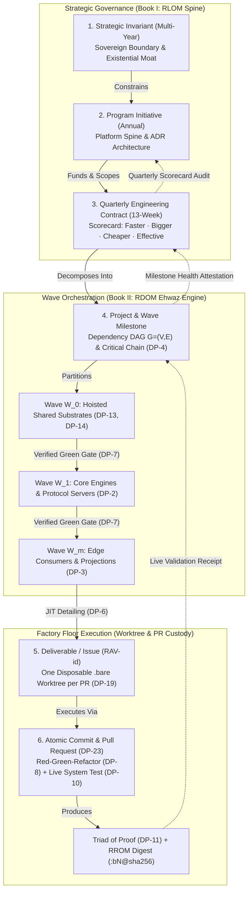

<!-- LICENSE: © 2026 Ravenhelm LLC. Licensed material. -->
<!-- All rights reserved except as granted in LICENSE. Inquiries: nate@ravenhelm.co -->

## Chapter 4 - The Topological Work Hierarchy: From Strategic Invariant to Atomic Commit

In the middle of a live architecture session on the Ravenhelm bench, we opened a simple operational question: *which model and harness should hold the fleet supervisor seat?* To answer that question properly, we checked how the supervisor authenticates its worker slices. That branched one level down into internal PKI certificate issuance. PKI certificate issuance touched Zitadel and OpenBao service identities, which branched outward into the estate-wide identity stack. The identity stack raised a question about how platform capabilities get scaffolded across repositories, which branched into a Project Factory platform design, which exposed a gap in how agents recall architectural rulings, which triggered a full rewrite of the structured memory tree. Four hours later, the memory tree was refactored, three draft specs sat open across four terminals, and the original question - *who holds the fleet supervisor seat?* - remained completely unanswered.

If you are a seed thinker or a systems architect, that failure mode is in your blood (`watch-nates-blindspots`). Every problem you touch is legitimately connected to the foundation underneath it and the platform beside it; it is all one work at different altitudes (`it-is-all-one-work-at-different-altitudes.md`). When a human architect branches down into PKI and sideways into memory layouts without an external altitude lock, an afternoon vanishes. When you hand that same unlayered workspace to twenty concurrent AI coding agents, the estate explodes.

We saw the corpse of that v1 when we audited Ravenhelm's own Linear workspace after months of high-velocity building (`designs-systems-not-operations.md`): **14 workflow states, ~160 ad-hoc labels, and 0 of 45 projects with a health status set.** Issues sat in flat queues with no parent project; PRs merged to `main` with titles like `fix: update handler` and no `RAV-<id>` reference; worker slices spawned child tasks that drifted three architectural layers away from the quarterly goal they were hired to close. Everyone was working at full throttle. Nobody could prove which commits were moving the needle on the quarter's critical path and which commits were rewiring the house to change a lightbulb.

The **Topological Work Hierarchy** is the structural antidote to altitude drift. It replaces flat ticket bags, bottomless epics, and unanchored commits with a strict six-level chain of custody from a multi-year **Strategic Invariant** down to an **Atomic Commit & PR**. When you discover a lower-level PKI defect while working a supervisor-seat issue, you do not silently descend the ladder and lose your thread; you stamp a typed issue at the appropriate level, wire the causal `blocks` edge in the Ehwaz DAG, and stay at your assigned altitude until the gate requires a replan.

---

### The Six Levels of the Topological Work Hierarchy

To guarantee that no line of code is cut without lineage and no strategic goal floats without execution receipts, work is projected downward across six explicit altitudes:

Let $\mathcal{I}_{\text{strat}}$ be Multi-Year Strategic Invariants, $\mathcal{P}_{\text{init}}$ be Annual Program Initiatives, $\mathcal{Q}_{\text{contract}}$ be 13-Week Quarterly Engineering Contracts, $\mathcal{M}_{\text{wave}}$ be Projects and Wave Milestones, $\mathcal{D}_{\text{issue}}$ be Atomic Deliverables (`RAV-<id>`), and $\mathcal{C}_{\text{git}}$ be Physical Git Commits and Pull Requests. Every commit carries an unbroken upward pointer:

$$\mathcal{C}_{\text{git}} \xrightarrow{\pi_1} \mathcal{D}_{\text{issue}} \xrightarrow{\pi_2} \mathcal{M}_{\text{wave}} \xrightarrow{\pi_3} \mathcal{Q}_{\text{contract}} \xrightarrow{\pi_4} \mathcal{P}_{\text{init}} \xrightarrow{\pi_5} \mathcal{I}_{\text{strat}}$$

Intent flows down the ladder as bounded scope; proof flows up the ladder as verified receipts.

```
   LEVEL 1: [ STRATEGIC INVARIANT ]          Multi-Year Existential Moat & Non-Negotiable Law
                  │                          Horizon: 3-5 Years | Linear: Top-Level Initiative
                  ▼
   LEVEL 2: [ PROGRAM INITIATIVE ]           Annual Platform & Architecture Spine
                  │                          Horizon: 12 Months | Linear: Program Initiative
                  ▼
   LEVEL 3: [ QUARTERLY CONTRACT ]           13-Week Binding Commitment (Faster/Bigger/Cheaper/Effective)
                  │                          Horizon: 13 Weeks  | Linear: Quarterly Initiative / Cycle Target
                  ▼
   LEVEL 4: [ PROJECT & WAVE MILESTONE ]     Ehwaz DAG (G = V,E) Partitioned into Waves W_0..W_m
                  │                          Horizon: 1-4 Weeks | Linear: Project + Wave Milestones
                  ▼
   LEVEL 5: [ DELIVERABLE / ISSUE ]          Single-Owner Work Unit (RAV-<id>) in Isolated Worktree
                  │                          Horizon: 2-8 Hours | Linear: Issue / Sub-Issue (RAV-<id>)
                  ▼
   LEVEL 6: [ ATOMIC COMMIT & PR ]           Squash-Merged Commit Carrying the Triad of Proof
                                             Horizon: <2 Hours  | Git: Worktree Branch + Forgejo/GH PR
```



#### Level 1: Strategic Invariant (Multi-Year Horizon)

A **Strategic Invariant** defines the multi-year architectural boundary and commercial moat of the enterprise (3 to 5 years). It states what the organization builds and what it permanently refuses to tolerate: *Sovereign Local-First Execution*, *Zero-Ambient Privilege with Human-Attributed Accountability*, or *Build-Once Content-Addressed Custody*. A Strategic Invariant is not a feature wish list; it is a constitutional filter. If a proposed project violates a Strategic Invariant - such as introducing a vendor dependency without self-hosting, full API coverage, and OpenTelemetry - it is rejected at intake before a single engineering hour is spent.

#### Level 2: Program Initiative (Annual Horizon)

A **Program Initiative** spans 12 months and translates a Strategic Invariant into a concrete platform spine across the 11-office Ravenhelm model: standing up the `Norns` 3-node HA K3s cluster (`urd`, `verdandi`, `skuld`), unifying the `Bifrost` MCP tool gateway, or dissolving the estate filesystem into the `EAT` knowledge substrate. Every Program Initiative is anchored by a ratified Architecture Decision Record (ADR) and an explicit decommission plan for whatever legacy surface it replaces (ADR-011).

#### Level 3: Quarterly Engineering Contract (13-Week Cadence)

The **Quarterly Engineering Contract** is the binding 13-week operational commitment ratified at the **Quarterly Invariant Review**. It replaces vague roadmap slides and story-point velocity theater with measurable targets across all four dimensions of the **Four-Dimensional Engineering Scorecard** (Chapter 6):

- **Faster:** Lead time, PR cycle time, and Critical Chain wave latency (e.g., *Cut markdown and docs CI verification time from 9m23s to <15s via path filtering*).
- **Bigger:** Fleet concurrency and wave width (e.g., *Sustain 12 concurrent Doom worker slices across disjoint worktrees with zero RAM swap thrash*).
- **Cheaper:** Token efficiency, context scrap reduction, and compute unit cost (e.g., *Enforce `<800`-token `eat prime` orientation across 100% of coding slices, cutting fleet cache-read quota drain by 65%*).
- **Effective:** Zero wave-boundary defect escapes, 100% caller reachability, and verified backup coverage (e.g., *Expand logical PostgreSQL backups on `hrafngud` from 1 database to all 8 live databases with automated restore hash checks*).

Before a Quarterly Engineering Contract is ratified, its dependency graph is compiled (**DP-1**) and its Critical Chain floor is summed (**DP-4**). If the Critical Chain exceeds the 65 working days of the quarter, scope is cut or dependencies are hoisted before the quarter starts.

#### Level 4: Project & Wave Milestone (1-to-4-Week Horizon)

Inside a quarter, work is organized into finite **Projects**, and each Project's deliverables are partitioned into **Ehwaz Topological Waves** ($W_0, W_1, \dots, W_m$) mapped to Linear Milestones (**DP-2**):

$$W_k = \{ v \in V \mid \forall (u, v) \in E, u \in W_j \text{ where } j < k \text{ and } \text{status}(u) = \text{VerifiedGreen} \}$$

A Project is never an ongoing department or a permanent bucket (`0 of 45 projects with health set` happens when projects are treated as immortal folders). Every Project has a concrete exit criterion, a named owner, a weekly health status (`On Track`, `At Risk`, `Off Track`), and a finite sequence of wave milestones. Wave $W_0$ holds hoisted shared crates and schemas (**DP-13**, **DP-14**); subsequent waves unlock strictly as prior waves pass Six Sigma verification (**DP-7**).

#### Level 5: Deliverable / Issue (`RAV-<id>`, 2-to-8-Hour Horizon)

The **Deliverable** (tracked as a Linear Issue or Sub-Issue `RAV-<id>`) is the unit of dispatch for a human engineer or a bounded Doom worker slice. A valid Deliverable fits within a single day's execution window (2 to 8 hours), touches a bounded file manifest disjoint from every sibling Deliverable in the same open wave (**DP-3**), and executes inside its own dedicated `.bare/` git worktree (**DP-19**).

When an issue requires multiple sequential or component pull requests, child sub-issues (`RAV-<id>`) are minted so that each PR binds 1-to-1 with an atomic worktree and never triggers GitHub's premature parent-issue auto-close trap (`linear-auto-closes-the-issue-when-any-github-pr-titled-with-its-id-merges.md`).

#### Level 6: Atomic Commit & Pull Request (`<2`-Hour Horizon)

At the bench floor sits the **Atomic Commit** and the **Pull Request** (**DP-22**, **DP-23**). Every commit on a worktree branch represents a clean state transition in the Red-Green-Refactor loop (**DP-8**) or an explicit WIP checkpoint before a risky boundary (**DP-22**). When the Deliverable is complete, the branch opens a Pull Request bound to `RAV-<id>` carrying the complete **Triad of Proof** (**DP-11**): passing live-system tests with caller reachability (**DP-10**), updated local docs (`AGENTS.md` / ADR / runbook), and a verbatim showcase transcript.

---

### The Four Custody Invariants (Stopping Altitude Drift)

How does this six-level hierarchy stop an architect or an agent slice from starting on the supervisor seat and ending up four hours deep in a memory-tree rewrite? By enforcing four mechanical custody laws at every gate.

#### Invariant 1: No Commit or PR Without an Issue Key (`prs-require-linear-issue.md`)

$$\forall \text{PR} \in \text{Forge}, \exists \text{RAV-}k \in \mathcal{D}_{\text{issue}} \text{ such that } \text{PR} \models \text{RAV-}k$$

Every pull request must bind to a live `RAV-<id>` issue in its title and inline JSON payload (`linear-ref-guard-reads-inline-json-only.md`). Unanchored commits and "drive-by refactor" PRs are rejected automatically by CI. If you stumble across a broken PKI helper while working `RAV-2100`, you cannot silently rewrite the PKI stack inside the `RAV-2100` worktree.

#### Invariant 2: The Branch-Capture Rule (Mint, Link, and Return)

When work at Level 5 (`RAV-2100`) uncovers a missing prerequisite or an adjacent defect at another layer:

1. **Do not descend inline.** Never expand the current worktree's blast radius across wave boundaries (**DP-3**, **DP-5**).
2. **Mint the node in RLOM.** Create `RAV-2101` in less than sixty seconds with the exact symptom and file receipt.
3. **Evaluate the edge.** Ask one question: *Can `RAV-2100` pass its live verification gate without `RAV-2101`?*
   - If **yes**, `RAV-2101` goes into `Triage` or a subsequent wave, and you return immediately to finishing `RAV-2100`.
   - If **no**, wire `RAV-2101 --blocks--> RAV-2100`, pull the Andon cord (**DP-12**) on `RAV-2100`, checkpoint the worktree (`doom checkpoint`), and let the supervisor schedule `RAV-2101` cleanly.

That single rule cures the seed thinker's branch trap. Every tangent is captured in the graph so nothing is forgotten, while the active worktree stays locked to its altitude.

#### Invariant 3: No Orphan Issues or Immortal Epics

Every `RAV-<id>` Deliverable in an active wave must link to a finite Project and Wave Milestone ($W_k$), which in turn links to a Quarterly Engineering Contract. Issues floating without project parentage cannot clear the Definition of Ready. Projects that finish their final wave milestone are closed immediately so active views never rot into a cemetery of 45 unmonitored buckets.

#### Invariant 4: Paper Decisions Never Satisfy Runtime Edges

As proven on 2026-09-21 when two merged Yggdrasil ADRs falsely signaled that a runtime gate had cleared, the hierarchy distinguishes **Design Deliverables** (`type:Decision` / ADR) from **Substrate Deliverables** (`type:Feature` / compiled crate or migration). Merging an ADR closes the design issue, which unlocks the Wave $W_0$ substrate implementation issue - never the Wave $W_1$ downstream consumers directly.

---

### Bench Mechanics: Walking a Deliverable Through the Hierarchy

Here is how a concrete piece of work travels down and back up the six levels without drifting:

1. **Level 1 $\to$ Level 3 (Ratifying the Contract):** Under the **Strategic Invariant** of *Zero-Loss Fleet Custody*, the annual **Program Initiative** *Estate Backup Assurance* scopes a **Quarterly Engineering Contract**: bring 100% of stateful PostgreSQL instances under verified multi-database logical dumps with cryptographic restore proof.
2. **Level 4 (Compiling the Project Waves):** Following the discovery that `hrafngud`'s nightly backup had run green for seven months while dumping only `-d ravenmaskos` out of eight live databases (`postgres-dump-covers-one-database-of-eight.md`) and that `RAV-2079` compared two empty strings (`"" == ""`) on a broken restore, the architect compiles the Ehwaz DAG (**DP-1**):
   - **Wave $W_0$:** Fix the restore verifier so empty checksums fail hard (**DP-7**), and hoist the multi-database enumeration contract (**DP-13**).
   - **Wave $W_1$:** Roll out per-database dump lanes for `outline`, `harbor`, `keycloak_dev`, and sibling schemas across `hrafngud` and `Norns` (`bifrost-postgres-backup` with explicit `activeDeadlineSeconds` so an `ImagePullBackOff` under `concurrencyPolicy: Forbid` never wedges the lane for 17 days).
3. **Level 5 (Provisioning the Deliverable Worktree):** When Wave $W_0$ opens, `Doomcourt` dispatches `RAV-2079` into an isolated `.bare/` worktree (**DP-19**):

   ```bash
   # Projected from the canonical .bare repository - one worktree per PR
   git worktree add ~/src/platforms/ravenhelm/backup/rav-2079-verify-nonempty -b fix/rav-2079-verify-nonempty
   eat prime ~/src/platforms/ravenhelm/backup/rav-2079-verify-nonempty
   ```

4. **Level 6 (Cutting the Atomic Commit & PR):** The worker slice writes a failing test reproducing the empty-string `sha256sum` pass (**DP-8**), patches the verifier to fail closed on empty output, runs the suite against a real corrupt archive (**DP-10**), and commits with explicit lineage:

   ```text
   fix(verify): fail closed when backup or restore sha256 is empty

   Previously, a failed restore emitted an empty string on both sides of the
   checksum comparison ("" == "") and printed "matches backup ()" with exit 0.
   Assert non-empty 64-hex sha256 digests before equality comparison.

   Refs: RAV-2079
   Wave: W0
   ```

5. **Upward Attestation (Closing the Loop):** The PR opens with the `RAV-2079` reference and the Triad of Proof showing the verifier rejecting an empty archive and passing a real restore (**DP-11**). The supervisor squash-merges the PR (**DP-23**), RROM deploys the updated verifier, and RLOM marks `RAV-2079` `Done`, unlocking Wave $W_1$.

---

### Concrete Anti-Patterns & Escape Forensics

| Anti-Pattern | What It Looks Like on the Floor | How the Hierarchy Kills It |
|:---|:---|:---|
| **Altitude Drift (The PKI Rabbit Hole)** | A session starts on supervisor routing, dives into PKI, identity, and memory layouts, and never answers the root question. | **Invariant 2 (Branch-Capture):** Mint `RAV-<id>` for the lower-level discovery, wire the `blocks` edge if required, and stay at the current worktree's altitude. |
| **The Reuse-After-Merge Stranding** | Keep coding Phase 2 inside a worktree whose Phase 1 PR already merged (`yager/rav-1541-dashboard` stranding 277 lines of `TurnPhase` code on 2026-08-31). | **1-to-1 Worktree-to-Issue Binding (DP-19, DP-24):** One Deliverable (`RAV-<id>`) = one PR = one disposable worktree. Phase 2 gets a fresh issue and a fresh worktree off updated `main`. |
| **The Multi-PR Premature Auto-Close** | An issue needs 3 PRs across 2 repos; merging PR #1 titled `feat: RAV-1800 part 1` causes the GitHub webhook to auto-close `RAV-1800` while parts 2 and 3 are unbuilt. | **Component Sub-Issues:** Decompose multi-PR work into 1-PR sub-issues (`RAV-1801`, `RAV-1802`, `RAV-1803`) under parent `RAV-1800`, or use non-closing `Refs: RAV-1800` until the final wave PR. |
| **The Immortal Epic Trash Can** | 45 open Linear projects with 0 health updates where unrelated bugs and ideas pile up for a year. | **Wave-Bounded Projects:** Every Level 4 Project is a finite Ehwaz DAG ($G=(V,E)$) with weekly health checks that closes permanently when Wave $W_m$ validates. |

---

### Upstream & Downstream Integration

The Topological Work Hierarchy is the spine that threads all three books together:

```
       RLOM (Book I: Intent)
             │
             │ Level 1-3: Strategic Invariant -> Program Initiative -> Quarterly Contract
             │ Level 4-5: Project Waves (W_0..W_m) -> Ready Deliverable (RAV-<id>)
             ▼
       RDOM (Book II: Execution)
             │
             │ Level 5-6: 1-to-1 .bare Worktree -> Atomic Commits -> PR + Triad of Proof
             ▼
       RROM (Book III: Custody)
             │
             │ Harbor Build (:b<N>@sha256:...) -> Rail A/B/C Deploy -> Live Reachability Receipt
             ▼
       RLOM (Validation -> Done)
```

- **Upstream (RLOM):** Levels 1 through 5 live as structured objects in Linear under RLOM governance. RLOM enforces the 9 canonical workflow states (`Triage`, `Backlog`, `Ready`, `In Progress`, `In Review`, `Validation`, `Done`, `Canceled`, `Duplicate`) and guarantees that no issue enters `Ready` without parent lineage and falsifiable acceptance criteria.
- **Downstream (RROM):** When a Level 6 Pull Request merges to `main`, RROM stamps the git commit SHA and `RAV-<id>` lineage into the immutable Harbor OCI image metadata, promotes `:b<N>` to production, and returns the runtime verification receipt that closes Level 5 (`Validation -> Done`) and advances the Level 4 Wave Milestone.

> **Augmentation Surface - Automated Lineage & Altitude Guards**
>
> Where an agent layer transforms this practice:
>
> 1. **Inline Reference Gate:** Forgejo and GitHub CI guards (`linear-ref-guard`) inspect the inline PR payload on every push, blocking any branch that lacks a valid `RAV-<id>` Deliverable key.
> 2. **Altitude Scope Lock:** `Doomcourt` compares each active worker slice's `git diff --stat` against the file manifest declared on its `RAV-<id>` brief. If a worker begins editing PKI or auth crates outside its wave slice, `Doomcourt` flags the scope breach before the branch contaminates its PR.
> 3. **Worktree Lifecycle Hygiene:** When a PR merges, `doom` checks the corresponding worktree for uncommitted diffs (`git status --porcelain`), rescues any dirty state before pruning (**DP-24**), and provisions a clean worktree for the next wave's Deliverable.
>
> What the human architect keeps: Setting Level 1 Strategic Invariants, ratifying Level 3 Quarterly Engineering Contracts, deciding when an uncovered rabbit hole warrants halting the wave versus filing a deferred ticket, and personally approving every Level 6 Pull Request merge.

<!-- RUBRIC_CHECK:
  structural: pass
  content: pass
  funnel: pass
  chapter-type-extras: n/a
  word-count: 2548
  principle-citations: DP-1, DP-2, DP-3, DP-4, DP-5, DP-6, DP-7, DP-8, DP-10, DP-11, DP-12, DP-13, DP-14, DP-19, DP-22, DP-23, DP-24
  flagged-principle-gaps: none
-->
