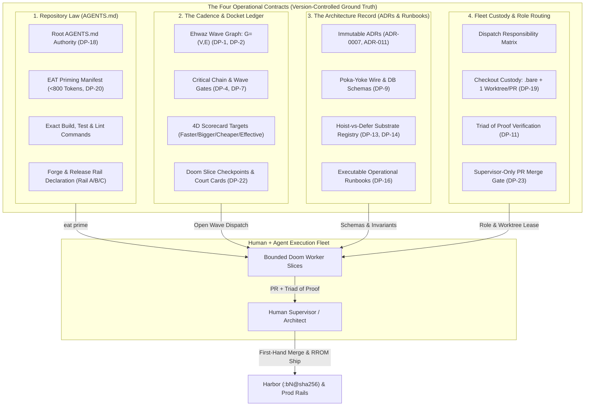

<!-- LICENSE: © 2026 Ravenhelm LLC. Licensed material. -->
<!-- All rights reserved except as granted in LICENSE. Inquiries: nate@ravenhelm.co -->

## Chapter 5 - The Four Operational Contracts: Repository Law, Cadence, Architecture, and Fleet Custody

During an estate custody sweep, an autonomous agent slice inspected `~/var/apps/import-backup` and sounded an alarm: it had discovered an uncommitted edit bumping `CONTRACT_VERSION = 2` inside a dirty checkout and proposed rescuing the diff as precious stranded work. It took sixty seconds of checking the canonical repository to expose the mirage. `~/var/apps/import-backup` was a stale, detached legacy deployment checkout sitting two commits behind `main`; Pull Request #22 had already merged `CONTRACT_VERSION = 2` cleanly into trunk days earlier. In the same week, another worker slice ran `python3 -m unittest ... | tail -5`, read the `0` exit code of `tail` rather than the failing exit code of `unittest`, and reported a broken branch as verified green; a third worker modified files in place with BSD `sed -i` instead of the structured editor tool, leaving corrupted backup suffixes across the tree; and a fourth session attempted to merge a pull request directly by inferring permissions from a domain-specialist name rather than checking the session's `dispatch` role table.

None of those agents were malicious. Every one of them failed because it stepped onto a floor where the operational contract was either missing from the repository root or left to conversational folklore.

A human engineer who has worked in a codebase for six months carries an unwritten mental map: they know `~/var/apps/` is an old runtime path and `~/src/platforms/` holds the canonical `.bare/` repository; they know which repos are Forgejo-primary and which remain on GitHub; they know `norns` runs a 3-node K3s cluster while `odin` runs Docker Compose. An autonomous AI session spawns with zero episodic memory of yesterday's Slack thread. If the operational law is not written down in a deterministic, machine-parsed contract at the exact coordinate where the agent lands, the agent will guess. And when twenty parallel slices guess at once, they manufacture chaos at machine speed.

RDOM replaces unwritten tribal lore with **The Four Operational Contracts**:

1. **Repository Law (`AGENTS.md`):** The local constitution at the root of every repository, platform, and product (**DP-18**, **DP-20**).
2. **The Cadence & Docket Ledger:** The live Ehwaz wave graph ($G = (V, E)$), Linear docket, and `doom momentum` state (**DP-1**, **DP-2**, **DP-4**, **DP-22**).
3. **The Architecture Record (ADRs & Runbooks):** Immutable Architecture Decision Records (such as ADR-0007 and ADR-011), wire schemas, and tested operational runbooks (**DP-9**, **DP-13**, **DP-16**, **DP-17**).
4. **Fleet Custody & Role Routing (`dispatch` Matrix):** The strict role-routing table, `.bare/` worktree custody standard, and PR merge gate (**DP-7**, **DP-11**, **DP-19**, **DP-23**, **DP-24**).

---

### The Architecture of the Four Operational Contracts

Each contract governs one orthogonal axis of the engineering floor so an engineer or agent slice can orient in seconds without reading twenty files:

```
              +---------------------------------------------------+
              |          THE FOUR OPERATIONAL CONTRACTS           |
              +---------------------------------------------------+
                /                 |                 |             \
               /                  |                 |              \
              v                   v                 v               v
    +------------------+ +------------------+ +------------------+ +------------------+
    | 1. REPOSITORY    | | 2. CADENCE &     | | 3. ARCHITECTURE  | | 4. FLEET CUSTODY |
    |    LAW           | |    DOCKET LEDGER | |    RECORD        | |    & ROUTING     |
    |    (AGENTS.md)   | |    (Ehwaz & RLOM)| |    (ADRs/Runbook)| |    (Dispatch/PR) |
    +------------------+ +------------------+ +------------------+ +------------------+
    Local Authority,     Topological Waves,   ADR-0007 / ADR-011,  Dispatch Matrix,
    Build/Test Recipes,  Critical Chain,      Wire Schemas,        .bare Worktrees,
    EAT Priming Packet   Court Cards, Doom    Live Runbooks        Supervisor Merge
```



#### 1. Contract I: Repository Law (`AGENTS.md`)

Per the **Locality Principle** (`locality-principle.md`, **DP-18**), every repository, platform, product, and project carries an authoritative `AGENTS.md` at its root. Global machine rules (`~/.config/agents/AGENTS.md`) hold cross-cutting estate laws - never push directly to `main`, never hardcode secrets, use Process Compose instead of deprecated PM2, use Hammerspoon for shortcuts, and check `~/.claude/context/repo-management.md` for Forgejo vs. GitHub remotes. Repository-root `AGENTS.md` holds everything specific to that codebase, travels with the code in pull requests, and feeds the `<800`-token `eat prime <repo>` packet (**DP-20**):

- **Purpose & Architectural Role:** What the service or tool does, what upstream substrates it consumes (`Bifrost`, `OpenBao`, `Postgres`), and who calls it.
- **Canonical Custody & Forge Remote:** The exact filesystem coordinate (`~/src/platforms/<platform>/<repo>/.bare`), whether the repository is Forgejo-primary (`hrafngud.ravenmask.net`) with GitHub as a passive mirror or GitHub-primary, and which RROM release rails it executes (Rail A `norns-gitops`, Rail B `nate/tools` Homebrew tap, Rail C `Idunn`, or dual-surface Rail A + B).
- **Exact Verification Commands:** Copy-pasteable commands to run the linter, unit suite, and live integration harness without piping through `tail` or masking exit codes (**DP-7**, **DP-10**).
- **Active Local Constraints:** Known footguns in that specific codebase (for example, warning that macOS ships `openrsync` without `--chmod`, or noting required environment variables and `PYTHONPATH` roots).

When a pull request changes how a repo builds, tests, or deploys, updating `AGENTS.md` in that same PR is mandatory. A stale `AGENTS.md` is a broken build gate.

#### 2. Contract II: The Cadence & Docket Ledger

The second contract governs time, dependency order, and in-flight state across the floor:

- **The Ehwaz Implementation Plan (`G = (V, E)`):** Every multi-slice effort has a written Ehwaz plan opening with the full dependency DAG (**DP-1**), the named Critical Chain (**DP-4**), the Hoist-vs-Defer scan table (**DP-13**, **DP-14**), and the partition into Wave $W_0, W_1, \dots, W_m$ (**DP-2**). Only the currently open wave carries bite-sized TDD detail (**DP-6**).
- **The RLOM Issue & Docket Spine:** Every task in the open wave binds to a Linear Deliverable (`RAV-<id>`) in the 9-state workflow canon. When a worker slice hits an architectural question or a gate boundary, it raises a **Doomcourt Card** on the docket rather than guessing. And per our 2026-10-01 lesson (`act-on-card-answers-the-turn-they-arrive.md`, when 12 answered court cards sat unacted on for 16 hours), the supervisor acts on card answers the very turn they arrive.
- **Session Momentum & Checkpoints (`doom` & `/quicksave`):** In-flight slice reality is tracked by `doom` (`doom momentum --quiet`, `doom checkpoint <slice> --message "<state + next action>"`) and `/quicksave` snapshots in `~/var/quicksaves/` (**DP-22**). Before any session resumes or prunes a branch, it reconciles the ledger against all worktrees (`git worktree list`) and live running services.

#### 3. Contract III: The Architecture Record (ADRs & Runbooks)

The third contract prevents agents and engineers from silently replacing production architecture or executing stale operational commands:

- **Architecture Decision Records (`docs/adr/` & Outline):** Non-trivial architectural choices are governed by numbered ADRs. Two estate ADRs anchor every repository:
  - **ADR-0007 (*Builds Are the Unit; Releases Are Names*, ratified 2026-09-21):** Merges to `main` compile once into Harbor (`:b<N>@sha256:...`); releases never rebuild from source.
  - **ADR-011 (*Cutover Governance*, born of the Bifröst cutover crisis on 2026-07-18):** Never replace a deployed service's architecture, repo, datastore, or transport without a ratified ADR, a data-migration plan, explicit human cutover approval, and loud decommission of what it replaces. A cutover is not a routine deploy.
- **Wire & Database Schemas (`Poka-Yoke`, DP-9):** Cross-service contracts live in versioned schemas (Protobuf, OpenAPI, Zod, SQL migrations with an explicit `schema_migrations` tracker). As learned from Heimdall, deploy workflows that pull new container images while skipping SQL migrations ship silently broken; migrations are part of the contract.
- **Operational Runbooks (`docs/runbooks/` & `~/.claude/docs/runbooks.md`):** Step-by-step recipes verified against live infrastructure (**DP-16**). When we discovered that OPNsense Unbound DNSBL reloads break `A` record queries via CNAME spillover unless `configctl template reload OPNsense/Unbound/core` runs *before* `configctl unbound dnsbl` and `configctl unbound restart` (`unbound-dnsbl-reload.md`), that exact command sequence went straight into the runbook contract so no future operator ever repeats the outage.

#### 4. Contract IV: Fleet Custody & Role Routing (`dispatch` Matrix)

The fourth contract governs *who* is permitted to do *what*, and *where* their bytes live on disk:

- **The `dispatch` Responsibility Matrix:** `skills/dispatch` is the sole role-routing authority for substantive work across the fleet - implementation (`bounded-implementer`), diagnosis, independent verification, sensitive-data handling, continuity work, shipping (`delivery-closer`), or architectural review. Canonical names in that matrix are logical role contracts:
  - Resolve the logical responsibility first, then resolve an enabled native binding in the current harness roster for the current session.
  - If no logical owner fits, stop immediately with `ROUTE_UNDECIDED: <missing decision>`.
  - If the logical owner is decided but its native binding is unavailable in the session roster, stop immediately with `ROUTE_UNAVAILABLE: <logical role> -> <harness>: <missing binding>`.
  - Never infer a binding from a domain-specialist name, and never transfer missing worker bindings back onto the Supervisor to code inline.
  - **The Supervisor Merge Exception:** Merge execution is the strict exception in the other direction. Merging an approved PR is the Supervisor's own non-delegable responsibility (**DP-23**), because only the session that received Nate's explicit approval first-hand (*"merge it"*, *"approved, ship"*, *"LGTM merge"*) can verify that approval. Routing post-merge shipment to `delivery-closer` never routes the merge itself.
- **The Checkout Custody Standard (`.bare/` + Worktrees, DP-19, DP-24):** Canonical git history lives once inside `<repo>/.bare/` with `remote.origin.fetch = +refs/heads/*:refs/remotes/origin/*`. Every active PR works in its own disposable worktree directory. Deletion of any worktree is gated by custody proof confirming zero uncommitted diffs and full upstream merge.

---

### Repository Layout & Mechanical Enforcement

Every conforming repository in the Ravenhelm estate exposes these contracts at predictable paths so both `eat prime` and CI linters can validate them without guessing:

```
~/src/platforms/<platform>/<repo>/
├── .bare/                          # Contract IV: Canonical Git History Hub (with fetch refspec)
├── main/                           # Reference worktree tracking main (read-only / clean)
├── feat-rav-2104-auth-hoist/       # Contract IV: Disposable 1-per-PR Worker Worktree (DP-19)
│   ├── AGENTS.md                   # Contract I: Authoritative Local Repository Law (DP-18)
│   ├── .forgejo/workflows/
│   │   ├── ci.yml                  # Contract IV: Six Sigma Gate (with paths-ignore for docs)
│   │   ├── build.yml               # Contract III: ADR-0007 Build-Once -> Harbor :b<N>
│   │   └── release.yml             # Contract III: Digest Retag & Rail A / B / C Promotion
│   ├── docs/
│   │   ├── adr/                    # Contract III: Numbered Architecture Decision Records
│   │   ├── plans/                  # Contract II: Ehwaz Wave DAGs & Hoist-vs-Defer Tables
│   │   └── runbooks/               # Contract III: Verified Operational Procedures
│   └── scripts/
│       ├── check-release-tag.sh            # Contract IV: Tag & Changelog Gate
│       └── check-release-source-parity.sh  # Contract IV: Anti-Fiction Parity Gate
```

---

### Concrete Failure Modes When a Contract Is Missing or Bypassed

Every clause in the Four Operational Contracts exists because an earlier, looser version broke on our bench:

#### 1. The Detached-Clone Phantom (`Contract I & IV` Failure)

- **The Corpse of v1:** Leaving legacy non-bare clones in `~/var/apps/` alongside canonical `.bare/` hubs in `~/src/` without checking `AGENTS.md` custody coordinates.
- **What Happened:** An agent auditing `~/var/apps/import-backup` (detached, 2 commits behind `main`) misread `CONTRACT_VERSION = 2` as unmerged local work when PR #22 had already landed it on trunk. Earlier, on 2026-08-14, 215 of 217 repos failed custody conformance, and on 2026-08-24, 26 `.bare` repos had missing or hollow fetch refspecs because `git clone --bare` does not configure `remote.origin.fetch` by default.
- **The Bench Fix:** Enforce `git-estate` custody checks, configure `+refs/heads/*:refs/remotes/origin/*` on every `.bare` hub, and read `AGENTS.md` via `eat prime` before touching any checkout.

#### 2. The 16-Hour Court Stall & Title-Only Parking (`Contract II` Failure)

- **The Corpse of v1:** Treating the docket and active tmux slices as passive background queues rather than a live cadence ledger.
- **What Happened:** On 2026-10-01, 12 court card answers sat unacted on for 16 hours because the supervisor waited instead of dispatching on the turn the rulings arrived. And on 2026-09-07, during the owl camera MJPEG investigation, a supervisor parked a live worker slice based solely on its window title without reading its uncommitted `git diff` - which already contained the `PIXFORMAT_JPEG` hardware fix for the `EV-VSYNC-OVF` camera wedge.
- **The Bench Fix:** Act on court card rulings the turn they arrive, and never park, close, or judge a worker slice without inspecting its live pane and uncommitted worktree diff (**DP-12**, **DP-24**).

#### 3. The Unapproved Cutover & Stale Inode Bind Mount (`Contract III` Failure)

- **The Corpse of v1:** Swapping service internals inside a normal PR without an ADR, or editing single-file bind mounts on Docker hosts without a runbook.
- **What Happened:** The Bifröst cutover incident (2026-07-18) replaced a live production stack without an ADR or data migration plan, prompting ADR-011. On `odin`, editing a configuration file bound into a Docker container as a single-file mount swapped the host file's inode while leaving the container mounted to the dead inode, causing **287,838 of 287,879 Alertmanager webhooks to fail silently for four weeks**.
- **The Bench Fix:** Enforce ADR-011 on every architectural replacement, and codify directory mounts and container recreate rules in repository runbooks (**DP-16**, **DP-21**).

#### 4. Role Improvisation & Delegated Merges (`Contract IV` Failure)

- **The Corpse of v1:** Allowing a supervisor to code inline when a worker binding is missing, or letting a subagent merge a pull request because the human approved an earlier plan.
- **What Happened:** Unbounded inline coding by the supervisor burned top-tier model context and destroyed separation of powers between author and verifier. Meanwhile, treating plan approval as merge approval allowed unreviewed diffs to hit `main`.
- **The Bench Fix:** Obey the `dispatch` responsibility matrix strictly (`ROUTE_UNDECIDED` / `ROUTE_UNAVAILABLE`), run advisory review through **Snotra**, and keep PR merge execution strictly in the hands of the human supervisor session that received explicit approval for that PR (**DP-23**).

---

### Upstream & Downstream Integration

The Four Operational Contracts wire RDOM directly into RLOM upstream and RROM downstream:

```
       UPSTREAM (Book I: RLOM)          THE FOUR CONTRACTS (Book II: RDOM)       DOWNSTREAM (Book III: RROM)
   +----------------------------+     +-----------------------------------+     +----------------------------+
   | Strategic Invariants       |     | 1. Repository Law (AGENTS.md)     |     | ADR-0007 Single OCI Build  |
   | Quarterly Contracts        | ==> | 2. Cadence & Docket Ledger        | ==> | (:b<N>@sha256:...)         |
   | Ready Issues (RAV-<id>)    |     | 3. Architecture Record (ADRs)     |     | Rail A (Norns) / B (Tap)   |
   +----------------------------+     | 4. Fleet Custody & Dispatch       |     | Action-Hash Elevation      |
                                      +-----------------------------------+     +----------------------------+
```

- **Upstream (RLOM $\to$ RDOM):** RLOM issues (`RAV-<id>`) feed Contract II (The Cadence & Docket Ledger). If an incoming RLOM initiative alters service topology, datastores, or transports, Contract III blocks Wave 0 until the governing ADR is drafted and ratified under ADR-011.
- **Downstream (RDOM $\to$ RROM):** Contract I (`AGENTS.md`) declares which RROM release rails the repository uses. Contract IV enforces the PR boundary (**DP-23**) and Triad of Proof (**DP-11**). Once the supervisor squash-merges the PR, Contract III's ADR-0007 workflow (`build.yml` $\to$ `release.yml`) takes custody and ships the immutable digest to production.

> **Augmentation Surface - Machine-Enforced Contracts**
>
> Where an agent layer transforms this practice:
>
> 1. **Instant Orientation (`eat prime`):** The EAT substrate compiles Contract I (`AGENTS.md`), subsystem topology, and Contract III (active ADRs) into a deterministic `<800`-token digest (**DP-20**), eliminating blind directory crawls.
> 2. **Automated Advisory Review (`Snotra`):** On every Forgejo PR, **Snotra** audits the diff against root `AGENTS.md`, checks for unacknowledged duplication (**DP-15**), and flags missing tests or runbook drift before the human supervisor reviews.
> 3. **Custody & Dispatch Guards (`Doomcourt` & `git-estate`):** `git-estate` verifies `.bare/` refspec and worktree custody across all 217 repositories (**DP-19**), while `Doomcourt` enforces the `dispatch` role matrix and surfaces court cards immediately.
>
> What the human architect keeps: Authoring and ratifying ADRs (Contract III), answering court escalation cards (Contract II), approving exceptions to the Hoist-vs-Defer rule, and executing every Pull Request squash-merge first-hand (Contract IV).

<!-- RUBRIC_CHECK:
  structural: pass
  content: pass
  funnel: pass
  chapter-type-extras: n/a
  word-count: 2634
  principle-citations: DP-1, DP-2, DP-4, DP-6, DP-7, DP-9, DP-10, DP-11, DP-12, DP-13, DP-14, DP-15, DP-16, DP-17, DP-18, DP-19, DP-20, DP-21, DP-22, DP-23, DP-24
  flagged-principle-gaps: none
-->
