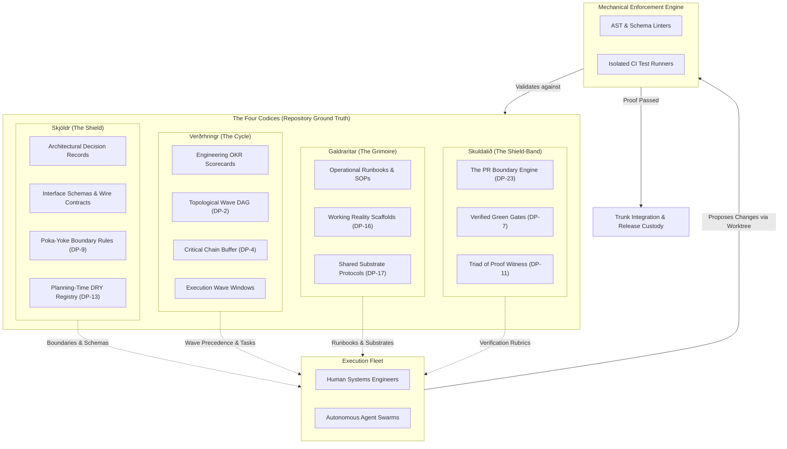

<!-- LICENSE: © 2026 Ravenhelm LLC. Licensed material. -->
<!-- All rights reserved except as granted in LICENSE. Inquiries: nate@ravenhelm.co -->

## Chapter 5 — The Four Codices (Shield, Cycle, Grimoire, Shield-Band)

At 2:15 AM on a Sunday, a distributed banking gateway collapsed into thread exhaustion. On the incident bridge, senior engineers argued over whether the payment coordinator could call the ledger asynchronously. Another engineer ran commands referencing a Redis cluster decommissioned months prior. Simultaneously, an automated agent merged a patch altering a Protobuf schema, breaking the ingress proxy across three availability zones.

No service had violated a compiler check. No PR had bypassed CI. The collapse occurred because the organization ran on ambient folklore: unwritten architectural assumptions, tribal agreements whispered in chat, rotting documentation, and rubber-stamped reviews where approvals rested on social trust rather than witnessed evidence.

When engineering organizations scale—especially when deploying autonomous agent swarms—ambient tribal knowledge becomes fatal. Human engineers retain subtle mental models of unwritten rules. Autonomous agents possess no such intuition. Dropped into a repository governed by folklore, an agent reads stale guides, hallucinates conventions, reimplements existing caching as an incompatible snowflake, and generates thousands of lines of syntactically valid code that destabilizes production.

Engineering excellence cannot survive on oral tradition. Governance must be physical, version-controlled, immutable, and mechanically enforceable by humans and agents alike. The Valknut doctrine structures institutional memory and architectural laws into **The Four Codices**: *Skjöldr* (The Shield), *Verðrhringr* (The Cycle), *Galdraritar* (The Grimoire), and *Skuldalið* (The Shield-Band). Together, they establish an executable constitution governing software across its lifecycle.

---

### The Formal Cosmology of The Four Codices

The Four Codices govern four orthogonal dimensions of systems engineering: spatial boundary, temporal cadence, operational procedure, and evidentiary verification:

```
                  +-----------------------------------+
                  |       THE FOUR CODICES            |
                  +-----------------------------------+
                    /          |             |        \
                   /           |             |         \
                  v            v             v          v
           +------------+ +------------+ +------------+ +------------+
           |  SKJÖLDR   | |VERÐRHRINGR | |GALDRARITAR | | SKULDALIÐ  |
           | The Shield | | The Cycle  | |The Grimoire| | Shield-Band|
           +------------+ +------------+ +------------+ +------------+
           Boundaries,    OKRs, Cadence  Daily Runbooks Peer Review,
           Contracts,     & Topological  & Engineering  Witnessing,
           Architecture   Wave Windows   Standards      Defect Gates
```

Each codex enforces invariance within an isolated domain:

1. **Spatial Invariance (*Skjöldr*)**: Defines system boundaries, service topology, and data contracts.
2. **Temporal Invariance (*Verðrhringr*)**: Defines execution sequencing, topological waves, and capacity buffers.
3. **Operational Invariance (*Galdraritar*)**: Defines operational runbooks, daily standards, and shared runtime substrates.
4. **Evidentiary Invariance (*Skuldalið*)**: Defines witnessing rubrics, defect gates, and physical proof required for promotion.



#### 1. Skjöldr (The Shield — Boundaries & Architecture)

*Skjöldr* establishes the architectural perimeter, defining topology, interfaces, and irreversible decisions:

- **Architecture Decision Records (ADRs)**: Non-trivial choices (datastores, transports, auth boundaries) are recorded as immutable ADRs in version control, documenting context, decision, consequences, and alternatives. Merged ADRs cannot be edited; they are superseded by subsequent ratified records.
- **Interface & Schema Contracts**: Public APIs, internal RPC interfaces, database migrations, and inter-service payloads live inside *Skjöldr* as formal schemas (Protobuf, OpenAPI, SQL DDL).
- **Poka-Yoke Interface Guarantees (DP-9)**: Interfaces defined in *Skjöldr* make invalid states structurally unrepresentable. APIs reject stringly-typed inputs and ambient nulls, using explicit algebraic error types to enforce exhaustive handling at compile time.
- **Planning-Time DRY Boundaries (DP-13)**: *Skjöldr* catalogs shared capabilities. Before plans are ratified, dependency graphs are scanned for duplication; multi-service requirements are hoisted into upstream shared libraries before code is cut.

#### 2. Verðrhringr (The Cycle — Cadence & OKRs)

*Verðrhringr* governs time, sequencing, and objective delivery, replacing arbitrary two-week sprints with a dependency wavefront modeled as a directed acyclic graph $G = (V, E)$:

- **Topological Wave Partitioning (DP-2)**: Work is organized into discrete waves ($W_0, W_1, \dots, W_N$). A wave contains only tasks whose inbound dependencies have fully resolved and verified. Concurrency is permitted exclusively within the active wave; cross-wave execution is forbidden.
- **The Critical Chain Floor (DP-4)**: *Verðrhringr* identifies the longest dependent path through the project DAG before execution begins. This critical chain sets the physical floor on delivery duration, concentrating worker allocation while non-critical paths are managed with capacity buffers.
- **Topological Wave Windows**: Rather than arbitrary calendar sprints, *Verðrhringr* enforces wave windows that remain open until every deed satisfies its exit criteria. Advancement occurs on topological proof, never calendar deadlines.
- **Engineering OKR Framework**: Active waves map directly to quarterly engineering OKR scorecards across four cardinal vectors: *Faster* (latency, throughput), *Bigger* (scale, volume), *Cheaper* (compute cost, footprint), and *Effective* (defect density, reliability).

#### 3. Galdraritar (The Grimoire — Daily Practice & Runbooks)

*Galdraritar* is the repository of operational recipes, standard operating procedures, and developer playbooks required to build, operate, and repair systems. If a command must be executed more than once, it must be codified in *Galdraritar*. Ambient execution folklore is treated as a defect:

- **Scaffolding from Working Reality (DP-16)**: Frameworks, SDKs, and shared utilities are never built in a vacuum; scaffolding and runbooks must be extracted directly from working, verified implementations.
- **Shared Substrate Invariance (DP-17)**: Platform-wide concerns—distributed tracing, structured logging, metrics, IPC protocols, cancellation tokens—belong to Layer 0 substrates, barring snowflake conventions.
- **Runbook Schema**: Every runbook follows an invariant schema: Trigger Condition, Pre-Flight Verification, Surgical Actions with expected outputs, Post-Flight Attestation, and Rollback Protocol.

#### 4. Skuldalið (The Shield-Band — Witnessing & Defect Gates)

*Skuldalið* defines mutual accountability and verification. It governs quality gates, automated testing policies, code review standards, and custody transfers before production deployment:

- **The Pull Request Boundary (DP-23)**: Direct pushes to trunk branches (`main`, `develop`) are physically barred; all changes cross the PR boundary through isolated git worktrees.
- **Verified Green Precedes Promotion (DP-7)**: A wave or PR never advances on verbal assurances or passing mocks, advancing strictly when all exit criteria pass verification against live systems on hermetic CI runners.
- **The Triad of Proof (DP-11)**: Merging requires complete evidence: (1) *Functional Silicon* with deterministic automated tests passing against live dependencies; (2) *Living Documentation* with synchronized updates to *Skjöldr* and *Galdraritar*; and (3) *The Executable Showcase Deed* proving live execution via recorded session transcripts or test replays.
- **Mechanical Review & Semantic Witnessing**: Peer review focuses on architectural conformance rather than formatting; linters handle style, while reviewers enforce ADRs, wave boundaries, and operational standards.

---

### Mechanical Enforcement & Living Documentation

In RDOM, the Four Codices reside directly in version control alongside production code, functioning as executable laws of physics:

```
repo-root/
├── docs/
│   ├── adr/               # Skjöldr: Architecture Decision Records
│   ├── cadence/           # Verðrhringr: OKRs, Wave DAGs, Buffers
│   └── runbooks/          # Galdraritar: Operational SOPs & Playbooks
├── .agents/               # Agent Execution Context & Substrate Priming
├── .github/workflows/     # Skuldalið: Automated Defect Gates
└── AGENTS.md              # Authoritative Machine-Readable Root Contract
```

#### Directory Standards & Repository Topology

Every repository conforms to an invariant structure:
- `docs/adr/` (*Skjöldr*): Sequentially numbered ADRs. Any PR modifying interfaces, dependencies, or persistence models must include a new or amended ADR.
- `docs/cadence/` (*Verðrhringr*): Machine-readable YAML/JSON definitions of the active wave graph, milestone allocations, and OKR scorecards.
- `docs/runbooks/` (*Galdraritar*): Operational runbooks written in Markdown with tagged executable code blocks for automated testing.
- `.github/workflows/` or `.forgejo/workflows/` (*Skuldalið*): CI pipelines, branch protection rules, and verification gates blocking illegal merges.
- Root `AGENTS.md`: Canonical machine-readable contract providing instant discovery of codices, tools, and commands for agents without directory crawling.

#### The Codices as Executable Physics

Automated tooling treats the Codices as active constraints:
- **Schema & AST Linters**: Validate code changes against schemas in *Skjöldr*. Introducing undeclared dependencies or circular crate relationships fails CI immediately.
- **Topological Wave Checkers**: Inspect task identifiers on PRs. Modifying Wave $W_2$ code while Wave $W_1$ remains unverified triggers immediate rejection under Principle **DP-7**.
- **Automated Runbook Testing**: Ephemeral runners execute code blocks inside *Galdraritar* runbooks against containerized test environments during CI, preventing documentation drift.

#### The Rules of Codex Mutation

Codices cannot be modified through ad-hoc commits. Mutation follows strict state transitions:
- **Ratifying an ADR (*Skjöldr*)**: Begins as `Proposed` via PR. Merging transitions it to `Ratified`. Revisions require a new ADR in the `Supersedes` state; history is never rewritten.
- **Updating a Runbook (*Galdraritar*)**: Amendments require execution proof showing the revised procedure ran successfully against a test environment.
- **Altering a Defect Gate (*Skuldalið*)**: Defect gates can be raised, but never lowered to accommodate failing builds. Emergency bypasses require a signed, time-bounded *Andon Cord bypass* logged in release records.

---

### Concrete Anti-Patterns & Defect Escapes

When teams abandon the Codices, predictable failure modes emerge:

#### Anti-Pattern 1: The Ghost Protocol (The Skjöldr Escape)

In *The Ghost Protocol*, engineers agree in chat to alter an inter-service contract—passing an undocumented HTTP header rather than modifying the schema payload. No ADR is created; *Skjöldr* remains unupdated. Weeks later, an agent hardens the ingress proxy by stripping unrecorded headers, blinding downstream pipelines.

*The Remedy*: Enforce the **Axiom of Structural Legality**. Any interface change absent from *Skjöldr* is illegitimate. Linters and security scanners must treat unrecorded headers and undocumented endpoints as critical defect escapes.

#### Anti-Pattern 2: The Blind Sprint (The Verðrhringr Escape)

In *The Blind Sprint*, an organization tracks flat backlogs in two-week cycles. Task B (ingestion) is scheduled concurrently with Task A (schema design). Blocked by missing schemas, Task B's engineer invents an in-memory mock to preserve velocity. At sprint end, components fail to integrate, requiring weeks of refactoring.

*The Remedy*: Reconcile all work against *Verðrhringr's* topological wave DAG (**DP-2**). No task may be dispatched until parent dependencies on the critical chain pass verified green (**DP-4**, **DP-7**). Concurrency is strictly bounded by topological waves.

#### Anti-Pattern 3: The Stale Runbook Disaster (The Galdraritar Escape)

During an outage, an on-call engineer consults a wiki runbook referencing standalone database commands written three years earlier. Months prior, the database had been migrated to a consensus cluster. Executing obsolete instructions creates a split-brain condition, turning a routine failover into a sixteen-hour restore from cold backups.

*The Remedy*: Treat runbooks as compiled software. All operational procedures in *Galdraritar* must be version-controlled alongside code and validated through automated sandbox dry-runs (**DP-16**). Failing runbooks break the build.

#### Anti-Pattern 4: The Rubber-Stamp Shield-Band (The Skuldalið Escape)

A PR modifying 1,400 lines of payment logic is submitted stating *"tests pass locally."* No showcase walkthrough is attached; tests pass against mocks omitting database constraints. Swamped with deadlines, a peer clicks "Approve." In production, the first transaction triggers an unhandled constraint crash.

*The Remedy*: Enforce the physical gates of *Skuldalið*. Pull requests must be mechanically barred from merging without the complete Triad of Proof (**DP-11**): verified green tests on real runners (**DP-7**), updated documentation in *Skjöldr* and *Galdraritar*, and a recorded showcase deed.

---

### Upstream & Downstream Integration

The Four Codices form the core execution nexus of the **Sovereign Triad**, bridging strategic demand from the **Ravenhelm Linear Operating Method (RLOM)** to release custody in the **Ravenhelm Release Operations Methodology (RROM)**:

```
       UPSTREAM (RLOM)                   THE FOUR CODICES (RDOM)                 DOWNSTREAM (RROM)
   +-----------------------+           +-------------------------+           +-----------------------+
   | Demand & Acceptance   |           |  Skjöldr   Verðrhringr  |           | Immutable Artifact    |
   | Wyrd Rune -> Deeds    | ========> |                         | ========> | Compilation & Multi-  |
   | Definition of Ready   |           | Galdraritar  Skuldalið  |           | Rail Promotion        |
   +-----------------------+           +-------------------------+           +-----------------------+
   Demand mapped to:                   Executed via:                         Gated by:
   - Skjöldr Boundaries                - Topological Wave DAGs               - Skuldalið Proof Triad
   - Verðrhringr Cadence               - Real-System Runbooks                - Galdraritar Telemetry
```

- **Upstream Integration (RLOM $\to$ Skjöldr & Verðrhringr)**: When an RLOM Project reaches the Definition of Ready (DoR), functional scope is evaluated against *Skjöldr*; if service boundaries or APIs mutate, draft ADRs must accompany the initiative before ratification. Deeds in the RLOM work graph are ingested by *Verðrhringr*, which converts dependencies into the topological wave DAG ($G = (V, E)$), identifies the critical chain floor (**DP-4**), and establishes wave windows (**DP-2**).
- **Downstream Integration (Skuldalið & Galdraritar $\to$ RROM)**: When an engineering wave completes, *Skuldalið* validates the Triad of Proof (**DP-11**). Merging across the PR boundary (**DP-23**) transfers custody to RROM, which compiles immutable artifacts (*"Builds are the unit; releases are names"*). RROM uses operational runbooks in *Galdraritar* to drive GitOps reconciliation (Argo CD) and package distribution (Homebrew taps), verifying health before stamping completion back to RLOM.

---

### Augmentation Surface — Codex Invariant Auditing & Semantic Enforcement

When scaling software delivery with autonomous AI coding agents, human cognitive bandwidth becomes the primary constraint. Manually inspecting code for codex compliance creates an intolerable bottleneck. The Four Codices provide machine-parsable boundaries necessary to delegate execution to autonomous agent swarms safely.

> **Augmentation Surface — Continuous Semantic Governance**
>
> **Where an agent layer transforms this practice:**
>
> 1. **Autonomous Architectural Auditing (*Skjöldr*)**: Semantic agents evaluate incoming PRs against ADRs and schemas, flagging undeclared contracts, Poka-Yoke violations (**DP-9**), or duplicate utilities (**DP-13**) within seconds.
> 2. **Topological Wave Scheduling (*Verðrhringr*)**: An orchestration agent tracks Wave $W_k$ gates (**DP-7**), provisioning isolated worktrees for Wave $W_{k+1}$ primed via surgical digests (`eat prime`, `eat read`) to eliminate context waste.
> 3. **Runbook Verification in Ephemeral Sandboxes (*Galdraritar*)**: Synthetic agents execute operational runbooks in isolated container sandboxes on every PR, ensuring commands and flags never drift from live reality (**DP-16**, **DP-17**).
> 4. **Witness Verification & Triad Validation (*Skuldalið*)**: A gatekeeper agent verifies the Triad of Proof (**DP-11**)—live tests, living docs, and executable showcase—before human review.
>
> **What the human architect keeps:**
>
> - **Sovereign Architectural Ratification**: Human architects retain sole authority to ratify ADRs in *Skjöldr* and govern system topology.
> - **Strategic Cadence Commitments**: Humans determine business priorities, allocate capital, and accept project commitments in *Verðrhringr*.
> - **Operational Exception Authority**: Only humans possess authority to invoke emergency bypasses or declare disaster recovery in *Galdraritar*.
> - **Production Release Cutover**: Production cutovers, schema migrations, and irreversible infrastructure mutations remain strictly gated by human authorization.

---

<!-- RUBRIC_CHECK:
  structural: pass
  content: pass
  funnel: pass
  chapter-type-extras: n/a
  word-count: 2475
  principle-citations: DP-2, DP-4, DP-7, DP-9, DP-11, DP-13, DP-16, DP-17, DP-23
  flagged-principle-gaps: none
-->
