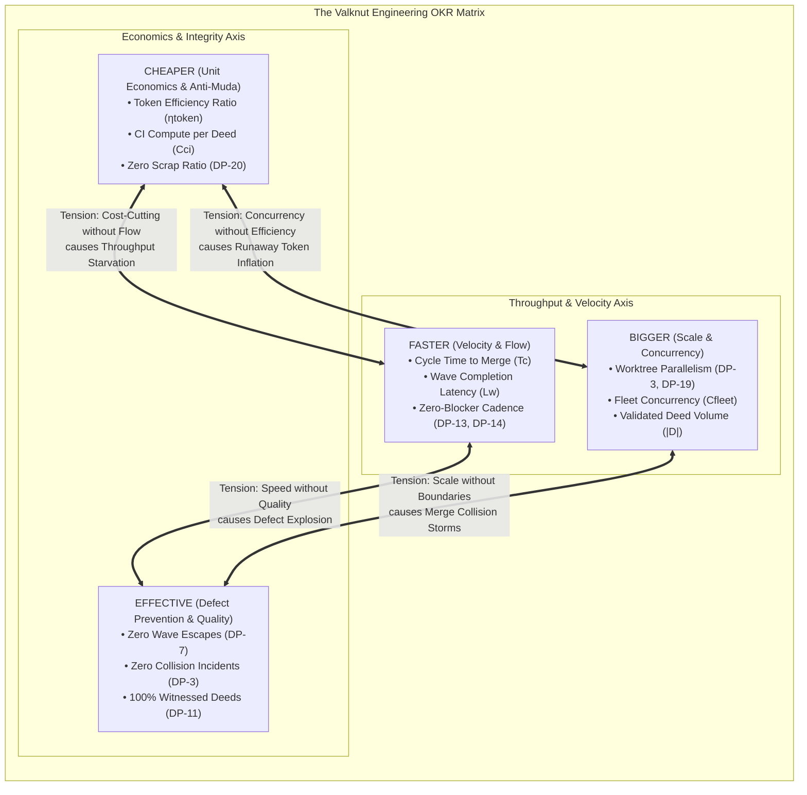

<!-- LICENSE: © 2026 Ravenhelm LLC. Licensed material. -->
<!-- All rights reserved except as granted in LICENSE. Inquiries: nate@ravenhelm.co -->

## Chapter 6 — The Engineering OKR Framework (Faster, Bigger, Cheaper, Effective)

At quarter-end, engineering leadership presents thirty slides celebrating ninety-four percent completion of engineering Objectives and Key Results (OKRs). The deck highlights activity: "Migrated Auth to OAuth2," "Adopted GraphQL Gateway," and "Burned 1,200 Story Points." By conventional agile metrics, the organization enjoyed a banner quarter.

Yet three floors down, production incidents surged forty percent. Outage resolution ballooned from forty minutes to six hours from undocumented circular dependencies. Cloud and token costs exceeded budget by sixty percent from redundant CI matrices and unconstrained directory sweeps. Lead time stretched from two weeks to eleven weeks. The organization ships activity at fever pitch, but its engine seizes under unmeasured friction, architectural decay, and compounding defects.

This is the bankruptcy of modern engineering OKRs. Organizations cargo-cult business frameworks by tracking arbitrary activity rather than mechanical system performance. Goals like "Ship Feature X" or "Migrate 5 Microservices" measure neither throughput, unit economics, structural quality, nor velocity. They incentivize declaring victory when code merges into staging, ignoring operational waste, inflated token consumption, and broken topological integrity.

When autonomous AI coding agents enter an organization lacking mechanical OKR governance, this drift accelerates. Unconstrained agent swarms generate tens of thousands of lines of code within minutes, opening superficial pull requests to satisfy vanity quotas. Without a balanced, mathematically grounded framework, leadership remains blind to disaster until the live running system collapses under unverified debt.

The **Ravenhelm Development Operations Methodology (RDOM)** rejects decorative, activity-based goal setting. It grounds execution in the **Valknut OKR Framework**: a mathematically rigorous operating model balancing four mutually reinforcing dimensions: **Faster, Bigger, Cheaper, Effective**.

---

### The Valknut OKR Matrix & Mechanical Foundations

Borrowed from queueing theory, control systems, and lean manufacturing, the Valknut OKR Framework establishes that an engineering system cannot be governed by a single scalar metric. Optimizing for speed alone triggers a defect explosion; optimizing solely for cost reduction starves throughput; scaling agent fleets without topological boundaries drowns in merge collisions.

The Valknut framework balances four opposing physical forces into homeostatic equilibrium:



Every quarterly engineering commitment—formalized in RDOM as a **Saga's Vow**—must establish explicit targets across all four quadrants.

#### 1. Faster (Velocity & Topological Flow)

The *Faster* quadrant measures velocity converting declared intent into verified, running production code. Discarding subjective story points, RDOM measures flow strictly through physical clock time across the dependency graph ($G = (V, E)$).

- **Cycle Time to Merge ($T_c$):** Physical duration from cutting a worktree branch to verified pull request merge.
- **Wave Completion Latency ($L_w$):** Calendar duration required for a topological wave ($W_k$) to advance from foundation dispatch to Six Sigma verification, bounded by the Critical Chain floor (DP-4).
- **Lead Time to Production ($T_{\text{lead}}$):** Physical duration from issue intake in RLOM to verified deployment on live cluster infrastructure.
- **Zero-Blocker Cadence:** Elimination of idle wait states via Planning-Time DRY Hoisting (DP-13) and the Hoist-vs-Defer Rule (DP-14), resolving shared dependencies before execution.

#### 2. Bigger (Scale, Throughput & Fleet Capacity)

The *Bigger* quadrant measures organizational capacity to scale execution without quadratic communication overhead ($O(n^2)$), scaling execution through topological partitioning.

- **Agent Fleet Concurrency ($C_{\text{fleet}}$):** Count of autonomous agent slices and paired engineers operating simultaneously without cross-dependency blocking.
- **Worktree Parallelism ($P_w$):** Count of dedicated, isolated git worktrees actively executing changes against canonical `.bare/` repositories (DP-19).
- **Validated Deed Volume ($|\mathcal{D}|$):** Count of completed Daily Deeds delivered within an operational cycle, where every deed satisfies the Triad of Proof (DP-11).
- **Surface Coverage:** Breadth of platform subsystems, crates, and services evolving concurrently under Ehwaz wave scheduling (DP-2, DP-3).

#### 3. Cheaper (Unit Economics & Waste Eradication)

The *Cheaper* quadrant measures resource stewardship and the eradication of manufacturing waste (*Muda*), targeting token consumption, cloud compute, and scrap code.

- **Token Efficiency Ratio ($\eta_{\text{token}}$):** Ratio of verified deeds merged into trunk relative to total LLM context tokens consumed. Penalizes directory sweeps and rewards AST context priming via the Entity-Attribute-Tag substrate (`eat prime`, `eat read`) (DP-20).
- **CI Compute Efficiency ($C_{\text{ci}}$):** Compute cost and execution time to validate a pull request pipeline, enforcing deterministic artifact caching and eliminating rebuilds.
- **Manufacturing Scrap Reduction ($S_{\text{scrap}}$):** Proportion of code lines, speculative branches, or unmerged PRs discarded due to upstream drift. Minimized via Just-In-Time (JIT) elaboration (DP-6).

#### 4. Effective (Defect Prevention & Sovereign Quality)

The *Effective* quadrant measures structural integrity and adherence to engineering contracts. Speed and scale are worthless if the system manufactures broken silicon.

- **Zero Wave Boundary Escapes ($E_{\text{wave}}$):** Prohibition against letting broken interfaces, unverified stubs, or failing tests cross from Wave $W_k$ into Wave $W_{k+1}$ (DP-7).
- **Zero Collision Incidents ($I_{\text{coll}}$):** Total absence of merge conflicts or semantic race conditions across concurrent worktrees, guaranteed by wave construction (DP-3).
- **Witnessed Deed Completeness ($\mu_{\text{witness}}$):** Invariant that one hundred percent of merged PRs possess the Triad of Proof: passing automated tests against live environments, updated runbooks/ADRs, and an executable showcase deed (DP-11).
- **Andon Cord Resolution Latency ($T_{\text{andon}}$):** Elapsed time to diagnose and remediate root causes when a worker halts the wavefront (DP-12).

---

### Mathematical Formulations & Exact Metrics

To prevent political distortion, Valknut metrics are harvested directly from machine telemetry: Git commit logs, forge pull request events, CI runner records, and EAT token proxies.

#### 1. Faster Formulations

Let $\mathcal{D}$ represent Daily Deeds completed in an evaluation window. For deed $d \in \mathcal{D}$, let $t_{\text{open}}(d)$ be the timestamp when its worktree branch opens as a pull request, and $t_{\text{merge}}(d)$ be the merge timestamp.

The **Mean Cycle Time** ($\bar{T}_c$) is:

$$\bar{T}_c = \frac{1}{|\mathcal{D}|} \sum_{d \in \mathcal{D}} \left( t_{\text{merge}}(d) - t_{\text{open}}(d) \right)$$

For wave $W_k$, **Wave Completion Latency** ($L_w(W_k)$) is bounded by the Critical Chain floor (DP-4):

$$L_w(W_k) = \max_{v \in W_k} \left( t_{\text{verified}}(v) \right) - \min_{v \in W_k} \left( t_{\text{dispatched}}(v) \right) \ge \sum_{v \in \text{CriticalChain}(W_k)} \text{Duration}(v)$$

#### 2. Bigger Formulations

Let worktree slot $i$ have active execution indicator $\mathbb{I}_i(t) \in \{0, 1\}$ within an isolated `.bare/` projection (DP-19).

The **Instantaneous Fleet Concurrency** ($C_{\text{fleet}}(t)$) and **Mean Worktree Parallelism** ($\bar{P}_w$) across duration $T$ are:

$$C_{\text{fleet}}(t) = \sum_{i=1}^{N_{\text{slots}}} \mathbb{I}_i(t), \quad \bar{P}_w = \frac{1}{T} \int_{0}^{T} C_{\text{fleet}}(t) \, dt$$

Subject to the Axiom of Concurrency, cross-wave execution is forbidden (DP-2, DP-3):

$$\forall u \in W_j, v \in W_k \quad (j \ne k) \implies \mathbb{I}_u(t) \cdot \mathbb{I}_v(t) = 0$$

#### 3. Cheaper Formulations

Let $\text{Tokens}_{\text{total}}(d)$ be the tokens consumed for deed $d$. The **Token Efficiency Ratio** ($\eta_{\text{token}}$) is:

$$\eta_{\text{token}} = \frac{|\mathcal{D}|}{\sum_{d \in \mathcal{D}} \text{Tokens}_{\text{total}}(d)} \times 10^6 \quad \left[ \frac{\text{Verified Deeds}}{\text{Megatoken}} \right]$$

To quantify context waste, the **Context Scrap Ratio** ($R_{\text{scrap}}$) compares primed source bytes ($B_{\text{primed}}$) with bytes utilized in the AST ($B_{\text{ast\_utilized}}$):

$$R_{\text{scrap}} = 1 - \frac{B_{\text{ast\_utilized}}}{B_{\text{primed}}}$$

Raw directory dumps yield $R_{\text{scrap}} > 0.95$, whereas EAT AST priming (DP-20) enforces $R_{\text{scrap}} < 0.15$.

#### 4. Effective Formulations

The **Wave Boundary Defect Escape Rate** ($E_{\text{wave}}$) for wave $W_k$ is:

$$E_{\text{wave}}(W_k) = \frac{\text{Defects detected in } W_{j > k} \text{ originating in } W_k}{|W_k|}$$

RDOM establishes the Six Sigma invariant: $E_{\text{wave}} \equiv 0$ (DP-7).

The **Witnessed Deed Completeness** ($\mu_{\text{witness}}$) asserts full compliance with the Triad of Proof (DP-11, DP-23):

$$\mu_{\text{witness}} = \frac{1}{|\mathcal{D}|} \sum_{d \in \mathcal{D}} \left( \mathbb{I}_{\text{test}}(d) \times \mathbb{I}_{\text{doc}}(d) \times \mathbb{I}_{\text{showcase}}(d)\right) \equiv 1.0$$

The **Collision Incident Rate** ($R_{\text{coll}}$) measures pull request conflicts:

$$R_{\text{coll}} = \frac{\text{Pull Requests with merge conflicts}}{|\mathcal{D}|} \equiv 0$$

Topological wave partitioning eliminates collisions by construction (DP-3).

---

### Operational Protocols & Quarterly Cadence

Valknut OKRs operate as a living control system integrated into organizational ceremonies: the quarterly Althing, the monthly Ráð, and the daily Morning Muster.

#### 1. The Saga's Vow: Binding Targets Across All Four Quadrants

At quarter start, engineering leadership and architects convene at the **Althing** to ratify the quarterly **Saga's Vow**. Unlike standard roadmaps listing feature requests, a Saga's Vow couples functional milestones with Valknut performance invariants:

```yaml
sagas_vow:
  name: "Unified Ingress & Sovereign Mesh Gateway"
  quarter: "2026-Q3"
  strategic_alignment: "RLOM-SAGA-412"
  valknut_commitments:
    faster:
      mean_cycle_time_max_hours: 4.0
      wave_completion_latency_p90_days: 3.5
    bigger:
      min_concurrent_agent_slices: 12
      worktree_parallelism_mean: 8.5
      target_validated_deeds_count: 140
    cheaper:
      min_token_efficiency_deeds_per_mtoken: 2.2
      max_context_scrap_ratio: 0.15
      max_ci_cost_per_deed_usd: 1.85
    effective:
      wave_boundary_defect_escape_rate: 0.0
      multi_branch_collision_count: 0
      witnessed_deed_completeness_ratio: 1.0
```

If an initiative proposes to accelerate velocity (*Faster*) by relaxing wave gates (*Effective*), the Althing rejects the vow. If it scales concurrency (*Bigger*) without accounting for token economics (*Cheaper*), it is returned for structural refactoring.

#### 2. Weekly & Daily Inspection Rituals

Valknut OKR health is monitored continuously through operational rituals:

- **The Morning Muster (Daily):** Teams inspect the live wavefront rather than reciting status lists. Are worktrees idling on unhoisted dependencies (DP-13, DP-14)? Has any worker pulled the Andon cord (DP-12)? Are Daily Deed pull requests maintaining a sub-four-hour cycle time ($T_c$)? Telemetry anomalies halt dispatch immediately.
- **The Ráð (Monthly):** The tactical steering council evaluates drift across empirical distributions: wave latencies ($L_w$), CI runner compute hours, token expenditure trends, and worktree concurrency. If token efficiency ($\eta_{\text{token}}$) declines, prompt templates are audited and EAT priming is enforced (DP-20).
- **The Althing (Quarterly Audit):** The closing Saga's Vow undergoes an unsparing mathematical audit. Completed deeds are verified against the live running system (DP-10). Unmet commitments trigger root-cause analysis rather than narrative excuses.

---

### Concrete Anti-Patterns & Defect Escapes

Organizations adopting OKRs without topological discipline succumb to four fatal failure modes.

#### 1. The Speed Trap (Velocity Without Quality)

Leadership over-indexes on *Faster*, pressuring teams to minimize cycle time and maximize merge counts. Workers bypass integration suites, disable flaky tests, merge against synthetic mocks, and omit documentation.

Apparent velocity spikes briefly, but unverified contracts escape across wave boundaries (violating DP-7). Because defect remediation costs scale geometrically ($C_{\text{escape}} = k \cdot 10^d$), downstream waves encounter broken dependencies ($d \ge 2$). Development halts for emergency triage, driving net lead time through the roof.

#### 2. The Penny-Pinch Choke (Frugality Without Flow)

Management fixates entirely on *Cheaper*, aggressively capping CI runner budgets, throttling staging environments, and restricting agent tokens.

Deprived of AST topological context (`eat prime`), agents hallucinate non-existent interfaces. Deprived of CI runner capacity, pull requests queue for hours, collapsing fleet concurrency ($C_{\text{fleet}}$) and inflating cycle time ($T_c$). The organization saves hundreds of dollars in API tokens while wasting tens of thousands of dollars in engineering labor and missing delivery windows.

#### 3. The Vanity Metric (Activity Without Provenance)

OKRs track superficial output volumes: lines of code committed, raw pull request counts, or story points burned.

In an agentic environment, this is lethal. An AI agent instructed to maximize PR volume generates boilerplate, inflates utility classes, and fragments refactors into unnecessary commits. None of this code advances business capability. RDOM anchors *Bigger* strictly to **Validated Deeds** backed by the Triad of Proof (DP-11). Raw PR counts and lines of code are treated as inventory waste (*Muda*) until proven otherwise.

#### 4. The Disconnected Slide Deck (Intent Without Lineage)

OKRs drafted in Notion, Jira, or slide decks bear zero cryptographic or mechanical lineage to the git commit tree.

In this failure mode, OKRs exist in an alternate corporate dimension. Engineers fight production regressions while managers update subjective status dropdowns. At quarter-end, declared OKR successes bear no resemblance to live cluster reality. Under RDOM, an OKR that cannot be harvested automatically from Git logs, worktree states, and CI test artifacts is categorized as an unverified rumor.

---

### Upstream & Downstream Integration (The Sovereign Triad)

The Valknut OKR framework coordinates intent, execution, and verification across the **Sovereign Triad**.

```
       DEMAND & STRATEGY                  EXECUTION CADENCE                 RELEASE & RUNTIME
  +------------------------+        +------------------------+        +------------------------+
  |          RLOM          |        |          RDOM          |        |          RROM          |
  | Ravenhelm Linear       | =====> | Ravenhelm Development  | =====> | Ravenhelm Release      |
  | Operating Method       |        | Operations Method      |        | Operations Method      |
  +------------------------+        +------------------------+        +------------------------+
  - Long-Saga Portfolio            - Valknut OKR Matrix             - Immutable OCI Digests
  - Demand Intake Boundary          - Topological Wavefront          - Production Deployment
```

#### Upstream Contract: RLOM $\to$ RDOM (The Intake Boundary)

Strategic demand originates in the **Ravenhelm Linear Operating Method (RLOM)** (`P-1` through `P-29`), where Wyrd Runes and Long-Sagas decompose into quarterly portfolio goals.

Before execution, initiatives cross the intake boundary and bind to an RDOM Saga's Vow as a dependency graph ($G = (V, E)$). Valknut validates feasibility: if an initiative requires concurrency ($C_{\text{fleet}}$) or token budgets exceeding estate capacity, the graph is refactored before dispatch.

#### Downstream Contract: RDOM $\to$ RROM (The Release Boundary)

RDOM terminates at the Pull Request boundary (DP-23). Once an atomic deed passes automated test gates, documentation synchronization, and showcase execution (DP-11), it merges into trunk.

Here, custody transfers to the **Ravenhelm Release Operations Method (RROM)** (`RP-1` through `RP-18`), operating under the doctrine: *"Builds are the unit; releases are names."* RROM compiles immutable OCI container images pinned to cryptographic content digests for automated deployment across runtime clusters.

Valknut *Faster* and *Effective* metrics close their feedback loop through RROM runtime telemetry. Production rollbacks feed directly back into the Valknut scorecard as downstream escapes, halting subsequent waves for immediate Andon cord investigation.

#### The Showcase-as-UAT Feedback Loop

Validation of a Saga's Vow culminates when RDOM's witnessed showcase deeds return to RLOM for User Acceptance Testing (UAT). Stakeholders evaluate physical execution against live running environments (DP-10). When all showcase deeds satisfy original acceptance criteria, RLOM marks the initiative Complete, keeping strategic intent and physical execution in lockstep.

---

> **Augmentation Surface — Continuous OKR Harvesting & Telemetry**
>
> Where an agent layer transforms this practice: An autonomous telemetry governor continuously monitors the git repository, CI runner logs, worktree lifecycle events, and model proxy gateways. It calculates cycle times, fleet concurrency, token efficiency ratios, and defect escape rates in real time, synthesizing an automated, mathematically verified Valknut scorecard. If an active wave drifts—such as token scrap exceeding fifteen percent or wave latency exceeding the critical chain floor—the governor alerts engineering leads and pauses agent dispatch before budget or schedule overruns compound.
>
> What the human architect keeps: Inviolable sovereign authority over strategic trade-offs across the four quadrants. The human architect ratifies the quarterly Saga's Vow, sets minimum quality and economic thresholds, approves architectural exceptions (`consumes_exemption`), and provides final authorization for production release cutovers.

<!-- RUBRIC_CHECK:
  structural: pass
  content: pass
  funnel: pass
  chapter-type-extras: n/a
  word-count: 2494
  principle-citations: DP-2, DP-3, DP-4, DP-6, DP-7, DP-10, DP-11, DP-12, DP-13, DP-14, DP-19, DP-20, DP-23
  flagged-principle-gaps: none
-->
