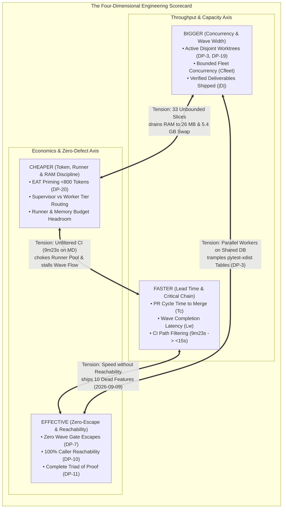

<!-- LICENSE: © 2026 Ravenhelm LLC. Licensed material. -->
<!-- All rights reserved except as granted in LICENSE. Inquiries: nate@ravenhelm.co -->

## Chapter 6 - The Four-Dimensional Engineering Scorecard: Faster, Bigger, Cheaper, Effective

On 2026-09-16, we opened a pull request that touched a single markdown documentation file. Forgejo Actions picked up the push, spun up a job container, and ran all 380 integration and unit tests in the repository for **9 minutes 23 seconds** before reporting green (`ci.yml` had been scaffolded without a `paths-ignore` filter for documentation edits). During the same stretch, Anthropic API rate limits and quota alarms began tripping across the workstation. The naive suspect was the number of coding slices we were spawning, so the instinct was to throttle worker count. Then we pulled the actual token ledger (`anthropic-quota-drain-is-fable-and-fleet-cache-reads.md`): the quota drain was not coming from bounded Sonnet workers writing code; it was coming from the Fable supervisor seat re-reading massive uncompacted context windows and worker slices running blind full-file `read_file` sweeps that burned 78% of their context window before writing a line of diff. And two days earlier, on 2026-09-14, spinning up 33 concurrent live slices on a single workstation had driven free system RAM down to **26 MB** with **5.4 GB of swap thrash**.

Look at what would have happened if we had governed that floor with a conventional single-scalar engineering metric:

- If you optimize purely for **ticket count or PR volume**, thirty autonomous slices will happily churn out fifty tiny, fragmented pull requests an hour while each one triggers a 9-minute-23-second test matrix that starves the `eikthyrnir` runner pool.
- If you optimize purely for **concurrency**, you launch 33 slices on one machine, exhaust physical RAM into 5.4 GB of swap, and watch every slice grind to a halt.
- If you optimize purely for **speed** by turning off verification prompts or skipping integration checks, agents ship module-level `NameError` exceptions (`RAV-1962`) or merge 46 KB of dead protocol code with 73 passing unit tests and zero callers (`2026-09-09`).
- If you optimize purely for **cost** by starving workers of tools rather than fixing context priming, slices guess at interfaces and double your rework bill.

You cannot steer a high-concurrency human-and-agent factory floor with a one-dimensional speedometer. Story points are fiction, raw commit counts are inventory waste (*Muda*), and slide-deck OKRs that cannot be computed from git, runner, and token telemetry are corporate theater.

RDOM governs execution through **The Four-Dimensional Engineering Scorecard**: a homeostatic control system that locks four opposing physical forces - **Faster, Bigger, Cheaper, Effective** - into equilibrium across every **13-Week Engineering Cadence**.

---

### The Four-Dimensional Control Matrix & Homeostatic Tension

Borrowed from control theory, queueing physics, and Toyota production engineering, the Four-Dimensional Engineering Scorecard treats the factory floor as a coupled system. Pushing any one dimension past its structural envelope immediately registers as a violation in the other three:



Every **Quarterly Engineering Contract** (ratified on a 13-week cadence at the **Quarterly Invariant Review**) sets explicit, machine-measured bounds across all four quadrants.

#### 1. Faster (Lead Time, Critical Chain & Queue Discipline)

The *Faster* quadrant measures the wall-clock time required to turn a `Ready` RLOM Deliverable (`RAV-<id>`) into a running production digest in RROM. We never measure velocity in story points; we measure seconds, minutes, and hours along the Ehwaz dependency graph ($G = (V, E)$).

- **PR Cycle Time to Merge ($T_c$):** Elapsed wall-clock time from worktree branch creation (`git worktree add`) to squash-merge on `main` and immediate RROM deploy (`merge-then-deploy`).
- **Wave Completion Latency ($L_w$):** Calendar time required for all tasks in open wave $W_k$ to clear their Six Sigma exit gates, bounded below by Goldratt's **Critical Chain Floor** (**DP-4**).
- **Court Card Turnaround Latency ($T_{\text{card}}$):** Elapsed time between a worker slice raising an architectural escalation card and the supervisor acting on the answer. After 12 answered cards sat unacted on for 16 hours on 2026-10-01 (`act-on-card-answers-the-turn-they-arrive.md`), $T_{\text{card}}$ is governed by a strict rule: act on card answers the very turn they arrive.
- **CI Feedback Latency ($T_{\text{ci}}$):** Eliminating waste in the verification loop itself - such as adding `paths-ignore` for markdown edits so a documentation fix never burns 9 minutes 23 seconds running 380 backend tests.

#### 2. Bigger (Wave Width, Fleet Concurrency & Disjoint Surface)

The *Bigger* quadrant measures the horizontal width of the factory floor: how many independent Deliverables (`RAV-<id>`) the organization can execute in parallel without merge collisions, database trampling, or workstation memory exhaustion.

- **Wave Width ($|W_k|$):** The number of causally independent tasks in open wave $W_k$ unlocked by planning-time DRY hoisting (**DP-2**, **DP-13**). Hoisting shared schemas and scaffolds (`routes.ts`) into Wave $W_0$ widens Wave $W_1$ so ten consumers can run in parallel.
- **Bounded Fleet Concurrency ($C_{\text{fleet}}$):** The number of simultaneous Doom worker slices executing across isolated `.bare/` worktrees (**DP-19**), strictly capped by physical host memory and runner container budgets (`forgejo-runner-scheduler`) so the machine never repeats the 33-slice / 26 MB free RAM swap cliff.
- **Verified Deliverable Throughput ($|\mathcal{D}_{\text{done}}|$):** The count of `RAV-<id>` issues transitioned through `Validation` to `Done` with a complete Triad of Proof (**DP-11**) and a live RROM deployment receipt.

#### 3. Cheaper (Token Efficiency, EAT Priming & Runner Economics)

The *Cheaper* quadrant eradicates manufacturing waste (*Muda*) across three physical budgets: LLM context tokens, CI runner minutes, and workstation RAM/CPU.

- **Orientation Token Budget (`eat prime` $<800$ Tokens, DP-20):** Replacing recursive `list_dir` and whole-file `read_file` dumps (which consumed up to 78% of a slice's context window and triggered lossy compaction) with deterministic `<800`-token `eat prime` topological manifests and `<10ms` `eat read` AST byte slices.
- **Role-Tier Quota Discipline:** Keeping Fable in the high-leverage supervisor and architectural judgment seat while routing bounded implementation slices to Sonnet workers (`who-is-nate.md`), and auditing prompt cache-read amplification so supervisor polling never drains estate API quota (`anthropic-quota-drain-is-fable-and-fleet-cache-reads.md`).
- **Planning-Time Anti-Snowflake Savings (DP-13, DP-14):** Hoisting known shared interfaces once in Wave $W_0$ rather than paying three worker slices to invent, test, and later rip out three duplicate implementations.
- **JIT Detailing Savings (DP-6):** Refusing to write line-by-line TDD plans three waves ahead of their producers, eliminating speculative plan rewrites when upstream types evolve.

#### 4. Effective (Zero-Escape Gates, Caller Reachability & Coverage Truth)

The *Effective* quadrant is the governor on the engine. Speed, concurrency, and low token cost mean nothing if the factory ships dead code or fake green checks.

- **Zero Wave Boundary Escapes ($E_{\text{wave}} \equiv 0$, DP-7):** No broken contract, masked exit code (`unittest | tail -5`), or unverified mock crosses from Wave $W_k$ into Wave $W_{k+1}$.
- **Zero Write-Surface or DB Collisions ($I_{\text{coll}} \equiv 0$, DP-3):** Verified upfront via `git merge-tree --write-tree` and per-worker isolated database schemas (preventing `pytest-xdist` workers from trampling the shared default database).
- **100% Caller Reachability & Source-to-Artifact Parity (DP-10, DP-11):** Every merged feature must have real callers reachable from the production entrypoint (killing the 2026-09-09 failure where 10 features merged with 73 passing tests and zero callers) and pass `check-release-source-parity.sh` (killing the 2026-10-09 `DIS 1.8` fiction release).
- **Falsifiable Coverage Audits:** Measuring what a system fails to cover, not merely that a cron job exited `0` - born of `hrafngud` dumping 1 database out of 8 for seven months (`postgres-dump-covers-one-database-of-eight.md`) and `RAV-2079` comparing `"" == ""` on a broken restore.

---

### Mathematical Formulations & Telemetry Equations

Every metric on the Four-Dimensional Engineering Scorecard is computed directly from Forgejo/GitHub webhook events, git commit trailers, `forgejo-runner-scheduler` metrics, and model gateway logs.

#### 1. Faster Equations

Let $\mathcal{D}$ be the set of Deliverables (`RAV-<id>`) completed in the measurement window. For each deliverable $d \in \mathcal{D}$, let $t_{\text{branch}}(d)$ be the first commit timestamp on its worktree branch, $t_{\text{merge}}(d)$ be its squash-merge timestamp on `main`, and $t_{\text{live}}(d)$ be the timestamp when its RROM `:b<N>` digest passes live validation.

The **Mean PR Cycle Time** ($\bar{T}_c$) and **End-to-End Lead Time** ($\bar{T}_{\text{lead}}$) are:

$$\bar{T}_c = \frac{1}{|\mathcal{D}|} \sum_{d \in \mathcal{D}} \left( t_{\text{merge}}(d) - t_{\text{branch}}(d) \right), \quad \bar{T}_{\text{lead}} = \frac{1}{|\mathcal{D}|} \sum_{d \in \mathcal{D}} \left( t_{\text{live}}(d) - t_{\text{branch}}(d) \right)$$

For topological wave $W_k$, **Wave Completion Latency** ($L_w(W_k)$) is bounded below by the Critical Chain (**DP-4**):

$$L_w(W_k) = \max_{v \in W_k} t_{\text{live}}(v) - \min_{v \in W_k} t_{\text{branch}}(v) \ge \sum_{v \in \text{CriticalChain}(W_k)} \text{Duration}(v)$$

#### 2. Bigger Equations

Let $N_{\text{max\_safe}}$ be the host and runner concurrency ceiling (determined by physical RAM headroom and `eikthyrnir` container budgets), and let $\mathbb{I}_i(t) \in \{0, 1\}$ indicate whether worktree slot $i$ is actively executing at time $t$.

**Instantaneous Fleet Concurrency** ($C_{\text{fleet}}(t)$) must satisfy the hard physical envelope:

$$C_{\text{fleet}}(t) = \sum_{i=1}^{N_{\text{worktrees}}} \mathbb{I}_i(t) \le N_{\text{max\_safe}}$$

Subject to the Ehwaz wave barrier (**DP-2**, **DP-3**), where no task $v \in W_{k}$ may execute while any upstream dependency $u \in W_{j < k}$ where $(u, v) \in E$ remains unverified:

$$\forall (u, v) \in E, \quad \text{status}(u) \ne \text{VerifiedGreen} \implies \mathbb{I}_v(t) = 0$$

#### 3. Cheaper Equations

Let $\text{Tokens}_{\text{in}}(d)$, $\text{Tokens}_{\text{cache\_read}}(d)$, and $\text{Tokens}_{\text{out}}(d)$ be the token counts consumed across the lifecycle of deliverable $d$. The **Deliverable Token Efficiency** ($\eta_{\text{token}}$) is:

$$\eta_{\text{token}} = \frac{|\mathcal{D}|}{\sum_{d \in \mathcal{D}} \left( \text{Tokens}_{\text{in}}(d) + \text{Tokens}_{\text{cache\_read}}(d) + \text{Tokens}_{\text{out}}(d) \right)} \times 10^6 \quad \left[ \frac{\text{Verified Deliverables}}{\text{Megatoken}} \right]$$

The **Context Scrap Ratio** ($R_{\text{scrap}}$) measures the fraction of bytes pulled into the context window ($B_{\text{read}}$) that were never referenced by the AST call graph of the final diff ($B_{\text{ast\_touched}}$):

$$R_{\text{scrap}} = 1 - \frac{B_{\text{ast\_touched}}}{B_{\text{read}}}$$

Blind directory sweeps (`list_dir` + whole-file `read_file`) produce $R_{\text{scrap}} > 0.90$; surgical `eat prime` + `eat read` (**DP-20**) holds $R_{\text{scrap}} < 0.15$.

#### 4. Effective Equations

The **Wave Boundary Escape Rate** ($E_{\text{wave}}$) for wave $W_k$ counts defects discovered in downstream waves $W_{j > k}$ or production that originated in $W_k$:

$$E_{\text{wave}}(W_k) = \frac{\text{Defects detected in } W_{j > k} \cup \text{Prod originating in } W_k}{|W_k|} \equiv 0$$

The **Effective Reachability & Proof Index** ($\mu_{\text{effective}}$) requires every merged deliverable $d \in \mathcal{D}$ to pass four binary gates: live-system test pass ($\mathbb{I}_{\text{test}}$), caller reachability from a production entrypoint ($\mathbb{I}_{\text{reachable}}$), updated docs/runbooks ($\mathbb{I}_{\text{doc}}$), and an executable showcase receipt ($\mathbb{I}_{\text{showcase}}$):

$$\mu_{\text{effective}} = \frac{1}{|\mathcal{D}|} \sum_{d \in \mathcal{D}} \left( \mathbb{I}_{\text{test}}(d) \cdot \mathbb{I}_{\text{reachable}}(d) \cdot \mathbb{I}_{\text{doc}}(d) \cdot \mathbb{I}_{\text{showcase}}(d) \right) \equiv 1.0$$

If any of the four factors is `0` - such as the 2026-09-09 dead modules where $\mathbb{I}_{\text{test}} = 1$ but $\mathbb{I}_{\text{reachable}} = 0$ - the product is `0` and the Deliverable cannot close.

---

### The 13-Week Engineering Cadence & Operational Reviews

A scorecard that is only read at the end of the quarter is an autopsy report. RDOM wires the Four-Dimensional Engineering Scorecard into three operational reviews across the **13-Week Engineering Cadence**:

#### 1. The Quarterly Invariant Review (First Monday of the Quarter)

At the start of each 13-week quarter, the architect conducts the **Quarterly Invariant Review** to audit the closing quarter's receipts and ratify the new **Quarterly Engineering Contract**. Every contract binds functional wave milestones to explicit four-dimensional thresholds:

```yaml
quarterly_engineering_contract:
  contract_id: "QEC-2026-Q4-RUNESTACK"
  quarter: "2026-Q4 (13-Week Cadence)"
  program_initiative: "Runestack Sovereign Platform Spine"
  scorecard_invariants:
    faster:
      mean_pr_cycle_time_max_hours: 4.0
      docs_only_ci_duration_max_seconds: 20
      court_card_action_latency_turns: 1
    bigger:
      target_concurrent_worktree_slices: 10
      max_host_slices_hard_cap: 16
      min_host_free_ram_mb: 2048
    cheaper:
      max_eat_prime_tokens: 800
      max_context_scrap_ratio: 0.15
      min_deliverables_per_megatoken: 2.5
    effective:
      wave_boundary_escape_rate: 0.0
      write_surface_collision_count: 0
      caller_reachability_ratio: 1.0
      triad_of_proof_completeness: 1.0
```

#### 2. The Monthly Architecture Review (First Monday of the Month)

Once a month, the **Monthly Architecture Review** inspects empirical distributions across all active repositories and runner pools:

- Are any CI workflows missing `paths-ignore` or running redundant builds that violate ADR-0007?
- Did any deferred scaffolds from last month's Hoist-vs-Defer tables (**DP-14**) gain a second consumer, triggering their scheduled extraction wave?
- Are `forgejo-runner-scheduler` container budgets balanced between the Norns light lane and `eikthyrnir`, or are jobs queuing?
- Has any repository drifted from the Checkout Custody Standard (`git-estate`) or accumulated stale worktrees?

#### 3. The Daily Fleet Sweep / Morning Muster (Daily Bench Check)

Every day on the floor begins with the **Daily Fleet Sweep (Morning Muster)** using `doom momentum --quiet`, the `Doomcourt` docket, and Linear health views:

- **Flush the Docket First:** Answer and act on every pending court decision card on the current turn so zero worker slices idle waiting on human rulings.
- **Inspect Live Panes and Uncommitted Diffs:** Before parking or pruning any stalled slice, inspect its attached tmux windows (`zero-sessions-is-not-unused-check-attached-windows.md`) and read its uncommitted `git diff` so an in-flight hardware fix like the 2026-09-07 owl `PIXFORMAT_JPEG` patch is never thrown away.
- **Check Wave Gate Readiness:** Verify which open wave tasks have cleared CI and **Snotra** review, execute first-hand squash merges (**DP-23**), trigger immediate RROM deployment (`merge-then-deploy`), and unlock the next topological wave.

---

### Concrete Failure Modes of Unbalanced Scorecards

Every time a team drops one of the four dimensions, the floor breaks in a specific, repeatable pattern:

| Dropped Dimension | The Resulting Trap | Real Estate Receipt |
|:---|:---|:---|
| **Drop *Cheaper* (Runner & CI Hygiene)** | **The 9-Minute Markdown Tax:** Trivial doc PRs run full integration suites; supervisor cache reads drain API quota. | 2026-09-16: 1-file markdown PR ran 380 tests for **9m23s** (`ci.yml` missing `paths-ignore`); Fable + fleet cache reads drained Anthropic quota. |
| **Drop *Cheaper* (Host Envelope)** | **The Necromancer's Swap Cliff:** Spawning unbounded agent slices until kernel swap thrashing freezes every worker on the box. | 2026-09-14: **33 live slices** on one workstation drove free RAM to **26 MB** and swap to **5.4 GB**. |
| **Drop *Effective* (Reachability & Parity)** | **The Ghost Feature & Fiction Release:** High PR velocity and 100% green unit tests on code that is never called in prod. | 2026-09-09: **10 merged features with 73 passing tests and zero callers**; 2026-10-09: `DIS 1.8` live site advertised 7 constructs with 0 hits in repo. |
| **Drop *Faster* (Poka-Yoke Friction)** | **The Oversight-Price Bypass:** Making test execution cost an approval prompt so agents skip testing to move faster. | `WALKER-004J` / `RAV-1962`: `read_file` was free, `bash` cost a prompt -> agent ran zero tests and shipped a module-level `NameError`. |

---

### Upstream & Downstream Integration (The Sovereign Triad)

The Four-Dimensional Engineering Scorecard links all three *dōmbócs* into a single measurable feedback loop:

```
       BOOK I: RLOM                      BOOK II: RDOM                     BOOK III: RROM
  +------------------------+        +------------------------+        +------------------------+
  | Quarterly Engineering  |        | 4D Scorecard Engine    |        | Harbor :b<N>@sha256    |
  | Contract & Project     | =====> | Faster · Bigger        | =====> | Rail A/B/C Promotion   |
  | Health (45/45 Set)     |        | Cheaper · Effective    |        | Live Reachability Gate |
  +------------------------+        +------------------------+        +------------------------+
```

- **Upstream (RLOM $\to$ RDOM):** RLOM enforces that 100% of active projects carry a live health status (ending the `0 of 45 projects with health set` blindness) and that every project update separates raw measurement from conclusion before ending with an action-item table. Those project targets compile directly into RDOM's four scorecard quadrants.
- **Downstream (RDOM $\to$ RROM):** RDOM's *Faster* and *Cheaper* metrics benefit directly from RROM's **ADR-0007** (*"Builds are the unit; releases are names"*): compiling once on merge to `main` and promoting immutable Harbor digests eliminates redundant release-time rebuilds. Conversely, RROM's live deployment probes and backup restore verifiers feed RDOM's *Effective* quadrant: any post-merge deployment failure, `PrometheusRule` RBAC rejection (`RAV-2086`), or parity mismatch halts the wavefront and registers as an escape until the gate is hardened.

> **Augmentation Surface - Real-Time Scorecard Telemetry**
>
> Where an agent layer transforms this practice: `Doomcourt`, `forgejo-runner-scheduler`, and the EAT substrate measure all four quadrants continuously without human spreadsheet maintenance. `eat prime` enforces the `<800`-token orientation ceiling automatically (**DP-20**); `forgejo-runner-scheduler` tracks runner queue depth and active container budgets; `Doomcourt` enforces host slice concurrency caps and checks caller reachability before flagging a PR for merge.
>
> What the human architect keeps: Setting the quarterly trade-off envelope across Faster, Bigger, Cheaper, and Effective at the **Quarterly Invariant Review**, ruling on architectural escalations during the **Daily Fleet Sweep**, and holding non-delegable merge and cutover authority.

<!-- RUBRIC_CHECK:
  structural: pass
  content: pass
  funnel: pass
  chapter-type-extras: n/a
  word-count: 2682
  principle-citations: DP-2, DP-3, DP-4, DP-6, DP-7, DP-10, DP-11, DP-13, DP-14, DP-19, DP-20, DP-23
  flagged-principle-gaps: none
-->
