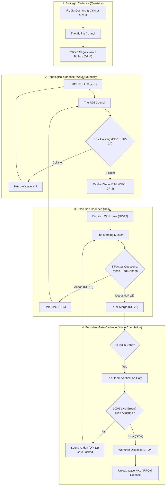

<!-- LICENSE: © 2026 Ravenhelm LLC. Licensed material. -->
<!-- All rights reserved except as granted in LICENSE. Inquiries: nate@ravenhelm.co -->

## Chapter 7 — Ceremonies of Truth (Althing, Ráð, and Morning Muster)

At 9:30 AM in software organizations worldwide, developers assemble for the daily standup. A manager shares a screen displaying a board cluttered with eighty cards. For twenty minutes, developers recite rehearsed monologues: *"Yesterday I worked on the auth bug; today I'm continuing to look into it; no blockers."* The manager nods, drags a card, and records a status note no one reads. Senior engineers triage an active staging outage on mute. Nothing of operational value is communicated, no dependencies are verified, and no broken interfaces are surfaced.

Every other Friday, this performative theater escalates into the sprint retrospective. A scrum master opens a digital whiteboard partitioned into pastel quadrants: *What Went Well*, *What Puzzled Us*, and *What Could Be Improved*. Developers post colored sticky notes venting chronic frustrations: *"CI builds are too slow,"* and *"Staging was broken for three days."* The team votes with virtual dots, records an action item to "communicate earlier," and files it away. Two weeks later, the exact same failures recur, because emotional catharsis has replaced systems engineering.

Between these rituals lies sprint planning poker. Engineers sit in a circle holding cards inscribed with Fibonacci numbers, debating whether a distributed consensus migration is a "five" or an "eight." They bargain over subjective point values that disguise technical illiteracy and an absence of dependency analysis. Teams celebrate "velocity" as they burn down story points, even as trunk remains uncompilable, database migrations conflict, and releases stall behind manual regression testing.

When autonomous AI coding agents enter this vacuum, collapse accelerates. Agents do not attend standups, vote on sticky notes, or parse story points. Left without mathematical boundaries, agents churn out thousands of lines of plausible code that satisfies tickets in name while shattering underlying system architecture.

RDOM abolishes this ritual theater with the **Ceremonies of Truth**. Every ceremony is a mechanical governor designed for one objective: the uncompromising reconciliation of declared intent with observed reality. Status is never reported; it is extracted from physical deeds. Intent is never assumed; it is proven through directed acyclic graphs. Quality is never negotiated; it is enforced by green tests executing against the live running system.

### The Theoretical & Mechanical Foundation

Taiichi Ohno proved that production drift occurs whenever management relies on verbal status reports rather than directly inspecting the factory floor (*Gemba*). In software engineering, the factory floor is physical silicon: git commit graphs, compiler outputs, container registry digests, and live running network state.

The Ceremonies of Truth formalize engineering coordination as a closed-loop feedback control system operating across four discrete geometric scales: strategic, topological, tactical, and boundary gate.



#### 1. The Althing (Quarterly Strategic Council)

The Althing convenes quarterly, assembling principal architects, engineering directors, and product operators to pass judgment on reality and ratify the next **Saga's Vow**.

- **Cadence**: Quarterly, preceding the execution quarter.
- **Inputs**: The Valknut Scorecard (*Faster*, *Bigger*, *Cheaper*, *Effective*), trailing defect post-mortems, and candidate RLOM initiatives.
- **Outputs**: Ratified Saga's Vow committing critical path initiatives (**DP-4**), and capacity allocations reserving at least 20% of engineering throughput for critical chain buffers and substrate maintenance.
- **Truth Criterion**: No initiative is admitted without topological feasibility proof, an identified owner, and verified runner capacity.

#### 2. The Ráð (Wave Architecture & Hoisting Council)

The Ráð is the technical council held at each topological wave boundary ($W_0 \to \dots \to W_N$). Executing a wave without an approved Ráð is an unauthorized mutation of the estate.

- **Cadence**: At each topological wave boundary.
- **Inputs**: Candidate wave DAG $G = (V, E)$ (**DP-1**, **DP-2**), interface schemas (Protobufs, OpenAPI, DDL), and declared blast radii across repositories, crates, and database tables.
- **Outputs**: Ratified wave DAG with partitioned blast radii (**DP-3**), DRY hoisting allocations moving common abstractions into Wave $N-1$ (**DP-13**, **DP-14**), and binding worktree allocations (**DP-19**).
- **Truth Criterion**: The **Disjoint Blast Radius Guarantee**. If concurrent tasks in candidate wave $W_k$ target overlapping schemas, configurations, or library interfaces, the Ráð halts execution until the shared dependency is hoisted into Wave $W_{k-1}$ or serialized across waves.

#### 3. The Morning Muster (Daily Alignment & Blocker Inspection)

The Morning Muster is the daily pulse of tactical execution—an adversarial synchronization capped strictly at fifteen minutes (or executed asynchronously via structured agent digests).

- **Cadence**: Daily, fifteen minutes maximum.
- **Format**: Every engineer and agent coordinator answers three factual questions only:
  1. *What verified deeds were merged into trunk in the last 24 hours?* Must cite merged PR hashes and green CI runs satisfying the Triad of Proof (**DP-11**, **DP-23**).
  2. *What isolated worktree slice is currently checked out, and what is its declared blast radius?* Stating the exact worktree path and canonical branch (**DP-19**).
  3. *Is any Andon cord currently pulled or upstream dependency broken?* Surface blocked interfaces immediately (**DP-5**, **DP-12**).
- **Truth Criterion**: **The Ban on Promissory Status**. Terms such as *"almost done"* or *"ninety percent complete"* are prohibited. Status exists only as witnessed deeds merged to trunk.

#### 4. The Doom Verification (Wave Gate Acceptance & Promotion)

The Doom Verification is the terminal gatekeeper of a topological wave, ensuring no downstream work begins on an unverified promise.

- **Cadence**: Triggered when all constituent tasks in wave $W_k$ claim completion.
- **Inputs**: Aggregated test suites executed against live unmocked infrastructure (**DP-10**), the Triad of Proof for every node (**DP-11**), and custody audit logs proving zero dirty worktrees remain (**DP-24**).
- **Outputs**: Signed Wave Certification Attestation, automated worktree pruning (**DP-24**), and cryptographic unlocking of Wave $W_{k+1}$.
- **Truth Criterion**: **Six Sigma Zero-Defect Gate** (**DP-7**). Test suites must execute 100% green against live systems. A single test failure invalidates the gate, holding Wave $W_{k+1}$ locked while capacity swarms on the regression.

### Operational Mechanics & Step-by-Step Protocols

To eliminate ambiguity across human-agent fleets, each ceremony operates under explicit rules of engagement and state transitions.

| Ceremony | Primary Objective | Required Inputs | Concrete Outputs | Inviolable Truth Criterion |
|:---|:---|:---|:---|:---|
| **The Althing** | Strategic intent ratification; OKR governance | Valknut Scorecard, RCAs, RLOM Initiatives | Saga's Vow, OKR Targets, 20% Buffers | Feasibility proof required for all accepted demand (**DP-4**). |
| **The Ráð** | Wave DAG validation; DRY hoisting | Candidate DAG $G=(V,E)$, Interface Schemas | Ratified Wave DAG, Hoisting ADRs | Disjoint blast radii across parallel slices (**DP-3**, **DP-13**). |
| **The Morning Muster** | Tactical synchronization; blocker extraction | 24h Git reflogs, PR hashes, CI logs | Daily Muster Digest, Andon Escalations | Status admitted only via merged PR deeds (**DP-11**). |
| **The Doom Verification** | Wave gate acceptance; promotion gating | Live integration runs, Triad of Proof packages | Wave Attestation, Pruned Worktrees | 100% live green; zero promissory advancement (**DP-7**, **DP-24**). |

#### The Ban on Promissory Status

Traditional engineering management treats progress as continuous: a developer reports a feature as "70% done," and later as "90% done," where it lingers for weeks. In distributed systems, boundary complexity spikes exponentially: the final "10%"—integration, edge cases, race conditions, and documentation—consumes 90% of cognitive effort.

RDOM models task state as strictly binary: $S(T) \in \{0, 1\}$. A task evaluates to $0$ if implementation is incomplete, tests pass only against mocks, documentation is unwritten, or its pull request remains unmerged. It transitions to $1$ only when the pull request satisfies the Triad of Proof (**DP-11**), passes branch protection gates (**DP-23**), and lands cleanly on trunk.

During the Morning Muster, participants reporting promissory status are called to order immediately. Progress is measured strictly as $\text{Deed Count} = \sum_{i=1}^{M} S(T_i)$. If no deed has transitioned to $1$, the worker reports: *"Zero deeds merged; working worktree slice [ID]; [Blocker state]."* This strips psychological bias from tracking and exposes delivery bottlenecks immediately.

#### The Andon Escalation Mechanism in Muster and Ráð

The Andon Cord protocol (**DP-12**) provides an explicit operational circuit breaker:

```
  [Defect Detected] ===> [Pull Andon Cord (DP-12)] ===> [Halt Slice & Commit WIP (DP-22)]
                                  │
                                  ▼
                     {Resolved by Lead in 2 Hours?}
                       ├── YES ──> Clear Andon & Resume Slice
                       └── NO  ──> Convene Emergency Ráð (Refactor DAG & Hoist — DP-13)
```

1. **Local Detection**: When an engineer or agent encounters an unresolvable interface mismatch, unexpected schema mutation, or upstream compilation failure, the worker is prohibited from inventing a local workaround or speculative mock (**DP-5**). The worker commits a WIP checkpoint (**DP-22**), broadcasts an explicit Andon alert, and halts execution on that worktree slice.
2. **Muster Triage**: If an Andon alert is active during the Morning Muster, the Tech Lead has exactly two hours to resolve the impediment or pair with the worker.
3. **Emergency Ráð Trigger**: If an upstream impediment cannot be cleared within two hours, an ad-hoc Ráð is automatically convened. The council inspects graph topology, refactors the DAG, and hoists the broken interface into an antecedent wave (**DP-13**, **DP-14**). Workers are never left idling or writing speculative dead code.

### Concrete Anti-Patterns & Defect Escapes

When teams transition from conventional Agile to RDOM, four recurring anti-patterns represent the primary failure modes.

#### Anti-Pattern 1: The Standup Monologue

- **The Illusion**: The daily standup stretches to forty-five minutes as engineers narrate internal thoughts, tickets they "plan to investigate," and philosophical musings on code structure.
- **The Mechanism of Failure**: Monologues mask zero throughput. A developer can speak convincingly daily for two weeks without ever merging a verified deed into trunk, while active worktrees drift into conflicting schema migrations.
- **The RDOM Poka-Yoke**: The Muster Arbiter enforces the fifteen-minute hard stop and a sixty-second ceiling per speaker. The display shows only the trunk commit log and worktree registry. If a statement does not announce a merged commit hash, an isolated worktree path, or an Andon blocker, the speaker is called to order.

#### Anti-Pattern 2: The Uncontested Ráð

- **The Illusion**: Under schedule pressure, the engineering team treats the Ráð as a ceremonial rubber stamp, declaring the wave open without inspecting low-level interface schemas or migration targets.
- **The Mechanism of Failure**: Parallel slices dispatched into Wave $N$ modify the same database table or shared library incompatibly. Slices compile against their local mocks, but collide violently when PRs merge, breaking trunk and burning days on conflict resolution.
- **The RDOM Poka-Yoke**: The Ráð requires an explicit Blast Radius Manifest for every node. Static analysis tooling intersects file paths, crate exports, and SQL migration targets. If the intersection is non-empty ($\text{Blast}(T_A) \cap \text{Blast}(T_B) \neq \emptyset$), the tool physically refuses to issue wave authorization tokens until the graph is restructured (**DP-3**, **DP-13**).

#### Anti-Pattern 3: The Retrospective of Grievances

- **The Illusion**: The team holds biweekly retrospectives filled with emotional catharsis, concluding with broad agreements to "communicate better."
- **The Mechanism of Failure**: Emotional venting without structural remediation normalizes deviance, institutionalizing continuous failure without updating architectural standards or erecting automated gates.
- **The RDOM Poka-Yoke**: RDOM replaces subjective retrospectives with mechanical defect analysis during the Althing and Doom Verification. Grievances are inadmissible; only defect escapes with reproducible traces are analyzed. Every identified failure must terminate in an Architectural Decision Record (ADR), an automated lint/Poka-Yoke gate (**DP-9**), or an upstream hoisted substrate primitive (**DP-14**).

#### Anti-Pattern 4: The Promissory Wave Gate

- **The Illusion**: As the deadline for Wave $N$ approaches, the lead declares: *"We are 95% there; let's unlock Wave $N+1$ now and backfill the failing telemetry fix tomorrow."*
- **The Mechanism of Failure**: Violating Principle **DP-7** (*Verified Green Precedes Promotion*) causes defects to metastasize. Downstream tasks in Wave $N+1$ build on the broken harness, multiplying failures across the estate until developers can no longer isolate regressions.
- **The RDOM Poka-Yoke**: The execution engine enforces physical gate interlocks. Unlocking Wave $N+1$ task dispatch requires a cryptographically signed Doom Verification attestation. If a single test fails, the wave gate remains sealed. Overriding the gate requires an executive emergency bypass that sounds a platform-wide Andon alert and records an irreversible governance violation.

### Upstream & Downstream Integration (The Sovereign Triad)

The Ceremonies of Truth provide the mechanical clock-ticks synchronizing RDOM across the Sovereign Triad: upstream to demand (RLOM) and downstream to release (RROM).

#### Upstream Integration: RLOM to RDOM

The interface between the Ravenhelm Linear Operating Method (RLOM) and RDOM is governed by demand ratification and factual deed closure:

1. **Strategic Intent Injection (RLOM $\to$ Althing)**: Business demand enters the Althing exclusively through RLOM initiatives meeting the strict Definition of Ready (DoR). The Althing interrogates candidate initiatives against engineering capacity, transforming market demand into the Saga's Vow.
2. **Topological Refinement (RLOM $\to$ Ráð)**: High-level RLOM projects are decomposed into directed acyclic graphs. The Ráð verifies that every leaf node corresponds to an executable technical slice with verifiable acceptance criteria.
3. **Factual State Synchronization (Muster $\to$ RLOM)**: Developers no longer manually update ticket statuses. In RDOM, the Morning Muster links issue updates directly to verified deeds. When a pull request satisfying the Triad of Proof merges into trunk, the harness automatically attaches the commit SHA, CI logs, and showcase recording to the corresponding RLOM issue and marks it complete (**DP-11**).

#### Downstream Integration: RDOM to RROM

The interface between RDOM and the Ravenhelm Release Operations Methodology (RROM) is governed by verified wave boundaries and artifact custody:

1. **Adversarial Gate Attestation (Doom $\to$ RROM)**: RROM operates under the axiom *"Builds are the unit; releases are names."* RROM never builds untested code. The Doom Verification ceremony executes the comprehensive test battery against live running environments (**DP-10**). Upon achieving 100% green verification, the Doom Arbiter generates an immutable attestation bundle containing the git commit tree hash, test execution manifests, and environment telemetry.
2. **Automated Pipeline Triggering**: The Doom Verification attestation acts as the cryptographic key unlocking RROM build automation. The release engine compiles the verified commit into an immutable OCI container image, registers it in the Harbor registry pinned to its cryptographic digest (`:b<N>@sha256:...`), and promotes it across GitOps deployment rails (Argo CD) and workstation distribution channels (Homebrew tap).
3. **Sovereign Cutover Invariance**: While Doom Verification authorizes release candidate compilation and staging deployment, production cutovers modifying live customer traffic or mutating production data stores remain gated by explicit human architectural authorization.

### Augmentation Surface — Automated Muster & Gate Verification

As autonomous AI agent fleets scale across the enterprise, tracking dozens of concurrent worktrees, checking blast radii, and executing gate verifications becomes unsustainable for human leads alone. The ceremonies are transformed through autonomous agent augmentation.

> **Augmentation Surface — Automated Muster & Gate Verification**
>
> Where an agent layer transforms this practice:
>
> 1. **The Headless Muster Agent**: An automated supervisor agent continuously monitors git reflogs, bare repository worktrees, active PR branch states, and CI pipeline results. Every morning, the agent compiles a cryptographically signed *Morning Muster Digest*. It maps active slices, detects unmerged WIP commits older than twelve hours, flags stale worktrees, and computes blast radius overlaps across active branches. Engineers and agent swarms review an objective, mathematically generated reality manifest rather than verbal status updates.
> 2. **Autonomous DAG Ingestion & Hoisting Analysis**: During wave preparation, an architecture agent parses candidate task specifications, constructs candidate graph $G=(V, E)$, and runs AST-level dependency analysis across existing estate crates. The agent identifies duplicated functions, proposed database migrations, and repeated API definitions, presenting concrete hoisting recommendations prior to the Ráð (**DP-13**, **DP-14**).
> 3. **The Autonomous Doom Gatekeeper**: Upon completion of all nodes in a topological wave, an adversarial verification agent provisions pristine container environments mirroring live production infrastructure (**DP-10**). The gatekeeper executes end-to-end integration batteries, runs fuzz tests against public interfaces (**DP-9**), audits documentation updates, verifies the executable showcase walkthrough, and validates clean worktree pruning (**DP-24**). Only when all criteria are physically proven does the gatekeeper sign the wave certification.
>
> What the human architect keeps:
>
> - **Sovereign Intent & Valknut OKRs**: Humans alone decide strategic value, pass judgment on organizational capacity, and ratify the Saga's Vow at the Althing.
> - **Hoisting & Architecture Adjudication**: Humans hold sole authority during the Ráð to authorize architectural exceptions, approve Layer 0 substrate abstractions, and sign Architectural Decision Records.
> - **Production Cutover Authorization**: No automated gatekeeper may execute a destructive database migration or live production traffic cutover without sovereign human approval.

---

<!-- RUBRIC_CHECK:
  structural: pass
  content: pass
  funnel: pass
  chapter-type-extras: n/a
  word-count: 2904
  principle-citations: DP-1, DP-2, DP-3, DP-4, DP-5, DP-7, DP-9, DP-10, DP-11, DP-12, DP-13, DP-14, DP-19, DP-22, DP-23, DP-24
  flagged-principle-gaps: none
-->
