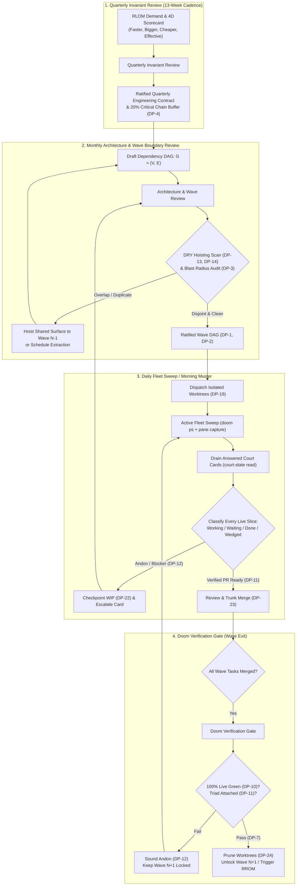

<!-- LICENSE: © 2026 Ravenhelm LLC. Licensed material. -->
<!-- All rights reserved except as granted in LICENSE. Inquiries: nate@ravenhelm.co -->

## Chapter 7: Ceremonies of Truth - Quarterly Invariant Review, Monthly Architecture Review, and the Daily Fleet Sweep

On October 1, 2026, between 04:31Z and 04:34Z, twelve architectural ruling cards on `work.ravenhelm.dev` were answered in three minutes. The rulings arrived as `decision.answered` events on the supervisor watch channel while the fleet seat was executing a `Kanidm` identity provisioning apply. That command crossed the ten-minute synchronous tool ceiling and shifted into the background. The supervisor session finished its turn, emitted a polite summary, and went to sleep without draining the remaining eleven answers from the queue. Nothing woke it. For sixteen hours, twelve signed human authorizations sat cold in the docket until the operator opened the console at 20:41Z and typed two words: `"check again"`. Sitting inside that frozen pile were an emergency remediation for `Andvari` that left a MinIO console exposed to the public internet for sixteen hours, three approved pull request merges, and a production release cut. The ledger held the rulings. The factory floor never moved.

Twenty-four hours earlier, on September 30, 2026, worker slice `onyx.summit.trace` finished issue `RAV-2124` at 05:57Z, printed a five-item action table to its terminal stdout, and waited. It sat untouched for fifteen hours. The supervisor had been polling the docket summary table, which listed only lanes the supervisor had personally spawned. Because the operator had launched `onyx.summit.trace` directly in an interactive `Claude` / `Yager` harness, the slice reported to its own terminal pane rather than the docket index. When the operator forced a full read-only pane sweep across every live `tmux` socket on the workstation (`tmux -L doom-<id> capture-pane -p -J -S -120 -t main`), a single pass uncovered the fifteen-hour `RAV-2124` handoff, an unexecuted `Kanidm` provisioning script, the unguarded MinIO console without SSO, an unreviewed 2,400-line `yager` pull request, a worker slice that had killed a peer slice, and an unsent operator prompt sitting half-typed in a lane's input buffer. The docket summary was green. The panes were bleeding.

Traditional software organizations fail in the exact same geometry, merely slower and with better posture. At 9:30 AM across the industry, human engineering teams gather for the daily standup to recite rehearsed alibis in front of an eighty-card board: *"Yesterday I looked at the auth bug; today I am still looking at the auth bug; no blockers."* Nobody checks the commit graph, nobody reads the failing CI logs, and senior engineers triage an active staging outage on mute. Every second Friday, the team opens a pastel whiteboard for a sprint retrospective, places virtual dots on sticky notes complaining that staging was broken for three days, writes an action item to *"communicate earlier,"* and repeats the outage on Monday. Between those two rituals sits planning poker, where engineers wave Fibonacci cards to guess whether a distributed consensus migration is a five or an eight without mapping a single dependency edge.

When we first replaced human standups with autonomous AI agent coordination, our v1 design repeated the error in silicon. We built a passive supervisor seat that waited for worker slices to post completion messages and checked only the high-level docket registry. On September 13, 2026, the `Odin's Runes` implementation lane sat wedged at an interactive directory-trust prompt for eight hours while idle sessions thrashed the workstation into swap. Passive reporting fails for the same reason human standups fail: a blocked actor cannot reliably report the shape of its own cage, and a summary view is a lossy transform that hides whatever fell off the happy path. Status is never a self-reported string.

The **Ravenhelm Development Operations Methodology (RDOM)** replaces theatrical status meetings and passive docket polling with four **Ceremonies of Truth**: the **Quarterly Invariant Review**, the **Monthly Architecture Review** (coupled with **Wave Boundary Gate Reviews**), the **Daily Fleet Sweep (Morning Muster)**, and the **Doom Verification Gate**. Every ceremony is a closed-loop mechanical governor with one job: force declared intent in the ledger to confront physical state on the machine.

### The Theoretical & Mechanical Foundation

Taiichi Ohno established in the Toyota Production System that management drift begins the moment supervisors read paper summaries in an office instead of walking the shop floor (*Gemba*) where parts are stamped. In a hybrid human-agent software factory, the shop floor is made of git object databases, live `tmux` panes, container registry digests in `Harbor`, court dockets in `Doomcourt`, and running pods on the `Norns` cluster.

A summary compresses two independent measurements into a single soothing lie. If an engineer or a supervisor agent compresses *"the RF sweep is alive at 2,400 samples per second"* and *"the database write path is dead"* into *"RF detection is in progress,"* the receiver cannot diagnose the fault. The Ceremonies of Truth forbid lossy verbal compression by anchoring every cadence to raw system telemetry across four operational horizons:



#### 1. The Quarterly Invariant Review (13-Week Strategic Alignment)

The **Quarterly Invariant Review** convenes at the boundary of every 13-week engineering cycle. Its purpose is to audit the estate against **The Four-Dimensional Engineering Scorecard** (*Faster, Bigger, Cheaper, Effective*), inspect every production defect escape from the trailing quarter, and ratify the **Quarterly Engineering Contract**.

- **Cadence**: Once per 13-week cycle, prior to Wave 0 of the new quarter.
- **Required Inputs**:
  1. Trailing 13-week measurements across the Four-Dimensional Scorecard: cycle time and build latency (*Faster*), workload scale and repository coverage (*Bigger*), unit compute and token cache efficiency (*Cheaper*), and defect escape rate plus restore-proof pass rate (*Effective*).
  2. Candidate **Strategic Invariants** and **Program Initiatives** from the **Ravenhelm Linear Operating Method (RLOM)** that have passed the Definition of Ready.
  3.Measured infrastructure ceilings: `Norns` cluster allocatable CPU/RAM, `Forgejo` runner slot capacity, and LLM token quota burn rates.
- **Concrete Outputs**:
  1. A ratified **Quarterly Engineering Contract** locking the committed initiatives and their Critical Chain floor (**DP-4**).
  2. Explicit capacity reservation allocating at least 20% of total engineering and runner bandwidth to Critical Chain feeding buffers and Layer 0 substrate maintenance.
- **Inviolable Truth Criterion**: No initiative enters the Quarterly Engineering Contract without a compiled top-level dependency graph, a named human accountable owner, and verified runner/compute headroom. Wishful roadmaps die at the door.

#### 2. The Monthly Architecture Review & Wave Boundary Gate

The **Monthly Architecture Review** operates at two levels: a monthly estate-wide audit of **The Architecture Record (ADRs & Runbooks)** and a mandatory topological gate convened prior to opening each execution wave ($W_0 \to W_1 \to \dots \to W_k$). Launching concurrent worker slices without passing the wave boundary review is an unauthorized mutation of the estate.

- **Cadence**: Monthly for estate-wide ADR drift and consumption floor audits; per wave boundary for tactical DAG ratification.
- **Required Inputs**:
  1. Candidate wave dependency graph $G = (V, E)$ (**DP-1**, **DP-2**).
  2. Concrete interface contracts (`Consumes` / `Produces`, Protobufs, OpenAPI specs, SQL DDL migrations) and declared spatial blast radii $\mathcal{B}(v)$ for every task in the wave.
  3. The estate's Supply-Side Surface Catalog (`library-surfaces.json`) and Demand-Side Lane Floor (`lane-consumption.json`).
- **Concrete Outputs**:
  1. Ratified wave DAG with proven disjoint blast radii across all parallel tasks (**DP-3**).
  2. Planning-Time DRY Hoisting mutations (**DP-13**, **DP-14**): known shared surfaces hoisted into Wave $W_{k-1}$ and unknown future abstractions explicitly scheduled as extraction tasks in Wave $W_{k+1}$.
  3. Binding worktree custody assignments (**DP-19**) and ratified Architectural Decision Records (ADRs).
- **Inviolable Truth Criterion**: **Disjoint Blast Radius and Zero Unacknowledged Duplication**. If two tasks in candidate wave $W_k$ touch intersecting files, tables, or routes ($\mathcal{B}(u) \cap \mathcal{B}(v) \neq \emptyset$), or if both implement the same capability without an upstream hoist or scheduled extraction, the review halts dispatch until the graph is refactored.

#### 3. The Daily Fleet Sweep (Morning Muster)

The **Daily Fleet Sweep** (executed synchronously as the **Morning Muster** by human leads and continuously every cycle by the fleet supervisor seat) is the tactical heartbeat of the factory floor. Born directly from the September 13, September 30, and October 1, 2026 supervisor failures, it replaces verbal standups with direct physical inspection of every live execution lane.

- **Cadence**: Daily fifteen-minute hard ceiling for human alignment; continuous sweep loop (at least every two hours and at the start and end of every supervisor turn) for the autonomous fleet seat.
- **Protocol**: The sweep never trusts a ticket board or a docket summary alone. It executes a strict seven-step hardware-and-session inspection:
  1. **Drain Answered Court Cards First**: Query `court-state read --json` for any card with `status=answered` lacking an execution receipt. Execute every answered ruling in the exact turn it arrives, ordered strictly by blast radius: public exposure and security remediations first, then approved PR merges, then deployments. Never end a turn while an answered ruling sits unacted upon.
  2. **Enumerate Every Live Slice**: Run `doom ps` across the host to list every non-closed slice, whether launched by the supervisor seat or opened directly by the operator in `Claude`, `Antigravity`, `Ullr`, or `Yager`.
  3. **Capture Every Pane Read-Only**: For every live slice, inspect its terminal buffer without injecting keystrokes (`tmux -L doom-<id> capture-pane -p -J -S -120 -t main`) and check its session-log modification timestamp. Never judge idleness from checkpoint age alone; on September 30, 2026, slices with four-day-old checkpoints were actively compiling code that same hour.
  4. **Classify Each Slice into One of Five States**:
     - *Working*: Active compiler/test output or recent session-log writes. Leave undisturbed.
     - *Waiting on Benign Prompt*: Stuck on a directory trust prompt or a question already answered in the task brief. Nudge it forward.
     - *Waiting on Sovereign Ruling*: Blocked on an architectural decision, a production mutation, or a privileged credential. Read its staged script and file a structured card on `work.ravenhelm.dev` (one question per card, full options, explicit recommendation).
     - *Finished with Deliverable*: Work complete, PR opened or action table printed in the pane. Route the PR to `Snotra` / review immediately and close the slice once its deliverable is recorded so idle processes never hoard RAM.
     - *Operator's Personal Session*: A pane containing unsent text in the `❯` input box or belonging to the operator's direct exploration. Hands off completely; never inject text and never kill it.
  5. **Verify Turn-State Metadata**: Confirm that `because`, `here`, `next`, and `blocker` fields are populated on every active slice.
  6. **Enforce the Three Factual Muster Questions**: Every human engineer or slice coordinator reports only:
     - *What verified commits merged to `main` in the last 24 hours?* (Cite PR numbers and green CI receipts satisfying **DP-11** and **DP-23**).
     - *What isolated worktree path is currently leased, and what is its declared blast radius?* (**DP-19**).
     - *What Andon cord is pulled or what upstream dependency is broken?* (**DP-5**, **DP-12**).
- **Inviolable Truth Criterion**: **The Ban on Promissory Status and Partial Sweeps**. Phrases like *"90% done"* or *"wrapping up tests"* are inadmissible. A task is either merged with receipts ($1$) or unmerged ($0$). A sweep that checks the docket summary without reading the panes is a failed sweep.

#### 4. The Doom Verification Gate (Wave Boundary Acceptance)

The **Doom Verification Gate** is the airlock between topological waves. When every task in Wave $W_k$ claims completion, the gatekeeper verifies that the integrated trunk actually works on live infrastructure before Wave $W_{k+1}$ is permitted to open.

- **Cadence**: Triggered at the completion of every topological wave $W_k$.
- **Required Inputs**: Full integration test battery executed against live, unmocked containers and databases (**DP-10**); the Triad of Proof (**DP-11**: green tests, updated living documentation in `docs/` and `AGENTS.md`, and a witnessed execution showcase); and a worktree custody audit proving zero orphaned or dirty checkouts remain (**DP-24**).
- **Concrete Outputs**: Cryptographic wave completion attestation, automated disposal of completed Wave $W_k$ worktrees, and the unlock signal for Wave $W_{k+1}$ (or handoff to **RROM** for `:b<N>` release promotion).
- **Inviolable Truth Criterion**: **Six Sigma Wave Exit Gate** (**DP-7**). Wave $W_{k+1}$ never opens on a promise. If a single integration test fails or a merged feature has zero callers on the live runtime path, the gate stays locked.

### Operational Mechanics & Step-by-Step Protocols

To keep human engineers and autonomous agent slices synchronized without bureaucracy, the four ceremonies bind directly to deterministic state transitions.

| Ceremony | Cadence | Primary Objective | Required Inputs | Concrete Outputs | Inviolable Truth Criterion |
|:---|:---|:---|:---|:---|:---|
| **Quarterly Invariant Review** | Every 13 weeks | Strategic intent ratification; scorecard audit | 4D Scorecard (*Faster, Bigger, Cheaper, Effective*), RCAs, RLOM Initiatives | Quarterly Engineering Contract, 20% Buffer Allocation | Topological feasibility and runner headroom proven (**DP-4**). |
| **Monthly Architecture & Wave Review** | Monthly & per wave boundary | Wave DAG validation; DRY hoisting; ADR governance | Candidate DAG $G=(V,E)$, Interface Contracts, Blast Radii $\mathcal{B}(v)$ | Ratified Wave DAG, Hoisted Wave $W_{k-1}$ Tasks, ADRs | Disjoint blast radii ($\mathcal{B}(u) \cap \mathcal{B}(v) = \emptyset$) (**DP-3**, **DP-13**). |
| **Daily Fleet Sweep (Morning Muster)** | Daily (15m) & continuous seat loop | Drain answered cards; sweep all live panes; unblock lanes | `court-state read --json`, `doom ps`, read-only `tmux` pane captures, git reflogs | Executed Rulings, Classified Lanes, Court Cards, Closed Idle Slices | Zero unacted card answers; status admitted only via merged PRs (**DP-11**). |
| **Doom Verification Gate** | Every wave exit ($W_k \to W_{k+1}$) | Live integration proof; worktree custody cleanup | Live test runs (**DP-10**), Triad of Proof packages, `git worktree list` | Wave Attestation, Pruned Worktrees, Wave $W_{k+1}$ Unlock | 100% live green; zero promissory promotion (**DP-7**, **DP-24**). |

#### The Mathematics of Binary Task State

Conventional project management treats task completion as a continuous variable on $[0, 1]$, allowing tickets to sit at `"85% complete"` for three weeks while edge cases, SQL migrations, and deployment permissions remain unsolved. In distributed systems, the final ten percent of integration holds ninety percent of the failure modes.

RDOM restricts task state to a binary step function $S(v) \in \{0, 1\}$:

$$S(v) = \begin{cases} 1 & \text{if } \text{Merged}(v) \land \text{LiveGreen}(v) \land \text{DocsUpdated}(v) \land \text{Witnessed}(v) \\ 0 & \text{otherwise} \end{cases}$$

Wave progress is the exact sum of completed binary nodes across the active wave:

$$\text{Progress}(W_k) = \frac{1}{|W_k|} \sum_{v \in W_k} S(v)$$

During the Daily Fleet Sweep, any report that attempts to claim fractional credit for unmerged work is rejected. If a worker slice has written 1,200 lines of code in its worktree but has not passed live verification and merged to `main`, $S(v) = 0$. The lane reports its worktree path, its current commit checkpoint, and whether its path is clear or blocked.

#### The Andon Escalation & Court Card Loop

When a worker slice encounters a broken upstream contract, an unexpected database constraint, or a permission boundary, Principle **DP-5** (*Upstream-Jump Circuit Breaker*) and Principle **DP-12** (*The Andon Cord*) forbid the worker from improvising a local hack or routing around the safety check.

```text
[Boundary Fault / Blocker Hit]
       │
       ▼
[Commit WIP Checkpoint (DP-22) & Halt Slice (DP-5)]
       │
       ▼
[Supervisor Sweep Captures Pane & Files Court Card on work.ravenhelm.dev]
       │
       ▼
{Human Operator Answers Card (decision.answered)}
       ├── Same-Turn Execution ──> [Apply Ruling: Security -> Merge -> Deploy]
       └── Architectural Fault ──> [Convene Emergency Wave Review & Hoist to Wave N-1 (DP-13)]
```

1. **Local Halt and WIP Checkpoint**: The worker commits its current state using a structured `WIP:` commit (**DP-22**) and halts cleanly. It never invents a synthetic mock to hide the broken dependency.
2. **Proactive Pane Extraction**: On its next cycle, the supervisor seat captures the halted pane, extracts the exact failure trace or staged script, and posts a single-question decision card to `work.ravenhelm.dev` with concrete options and a recommended ruling.
3. **Same-Turn Execution Upon Answer**: The moment the operator answers the card, the `decision.answered` event wakes or notifies the seat. The supervisor executes the ruling in that exact turn before ending its loop. If the blocker exposes a structural collision in the wave graph, an emergency Architecture Review refactors the DAG and hoists the missing interface into an antecedent wave (**DP-13**).

### Concrete Anti-Patterns & Defect Escapes

Four operational failures recur whenever teams relax the Ceremonies of Truth.

#### Anti-Pattern 1: The Docket-Only Supervisor Blindfold

- **The Corpse of v1**: On September 30, 2026, the fleet supervisor reviewed only the `Doomcourt` docket assignment table and reported the estate healthy while `onyx.summit.trace` (`RAV-2124`) sat finished and ignored for fifteen hours in its terminal pane and a 2,400-line `yager` PR waited unreviewed.
- **The Mechanism of Failure**: The docket tracks only slices formally bound to the supervisor's launch roster. Direct operator sessions, detached helper slices, and backgrounded commands fall outside the summary index. Watching the index while ignoring `doom ps` and live `tmux` panes leaves completed work stranded and security gaps open.
- **The RDOM Poka-Yoke**: `doom sweep` enumerates every live `tmux` socket on the host, captures the last 120 lines of every non-closed pane read-only, pairs pane output with session-log write age, and refuses to certify a sweep complete until every live slice is classified.

#### Anti-Pattern 2: Backgrounded Tool Sleep (The 16-Hour Frozen Ruling)

- **The Corpse of v1**: On October 1, 2026, twelve answered court cards arrived during a ten-minute `Kanidm` apply. When the command backgrounded, the supervisor ended its turn and left `Andvari`'s MinIO console publicly exposed for sixteen hours along with three approved merges and a release.
- **The Mechanism of Failure**: Event watches notify a session inside an active turn; if the turn closes without draining the answered queue, no secondary edge trigger wakes the agent.
- **The RDOM Poka-Yoke**: Before any supervisor turn is permitted to terminate, a mandatory pre-exit check runs `court-state read --json`, filters for `status=answered` cards lacking a completion note, and executes them immediately in risk order (exposure/security $\to$ merges $\to$ deployments). Long-running commands are backgrounded explicitly so the foreground turn stays alive to clear the docket.

#### Anti-Pattern 3: The Retrospective of Grievances

- **The Corpse of v1**: Biweekly human meetings where engineers vent about flaky CI runners or undocumented schemas, vote on sticky notes, and produce non-binding resolutions to *"be more careful during code review."*
- **The Mechanism of Failure**: Catharsis substitutes for engineering. Because no code, linter, or contract was altered, the exact same defect escapes two weeks later when the team is under deadline pressure.
- **The RDOM Poka-Yoke**: Subjective grievances are inadmissible in the Quarterly Invariant Review and Monthly Architecture Review. Every defect escape must terminate in a physical mechanism: an automated Poka-Yoke check (**DP-9**), a repository law entry in `AGENTS.md`, or a hoisted substrate crate (**DP-13**). If a review does not produce a gate or a DAG mutation, the review is incomplete.

#### Anti-Pattern 4: The Promissory Wave Gate

- **The Corpse of v1**: Under schedule pressure, a lead declares Wave 1 *"95% done"* because all PRs are open and unit tests pass against mocks, unlocking Wave 2 while a database migration in Wave 1 is still failing against live PostgreSQL.
- **The Mechanism of Failure**: Violating **DP-7** (*Verified Green Precedes Promotion*) exports a broken foundation into every parallel consumer in Wave 2. Five downstream slices immediately build workarounds against broken schemas, multiplying rework tenfold.
- **The RDOM Poka-Yoke**: Wave $W_{k+1}$ dispatch is gated by the Doom Verification attestation. Until every task in Wave $W_k$ is merged to `main` and passes integration tests against live infrastructure (**DP-10**), `Doomcourt` holds Wave $W_{k+1}$ locked.

### Upstream & Downstream Integration (The Sovereign Triad)

The Ceremonies of Truth serve as the synchronization gears linking **RLOM** (Intent), **RDOM** (Execution), and **RROM** (Custody).

1. **Upstream Integration (RLOM $\to$ RDOM)**:
   - Strategic initiatives from RLOM enter the **Quarterly Invariant Review** only when they carry falsifiable acceptance criteria and an explicit dependency outline.
   - During the **Monthly Architecture & Wave Review**, RLOM issues (`RAV-<id>`) are compiled into topological wave nodes with explicit blast radius contracts.
   - During the **Daily Fleet Sweep**, merged commits and Triad of Proof receipts (**DP-11**) synchronize back to Linear automatically, ensuring no issue transitions to `Done` without a live verification receipt.
2. **Downstream Integration (RDOM $\to$ RROM)**:
   - When a wave clears the **Doom Verification Gate**, the merged `main` commit triggers RROM's immutable build pipeline (`.forgejo/workflows/build.yml`), producing a monotonic `:b<N>` OCI artifact pinned by `sha256` digest in `Harbor`.
   - When the operator approves a release or deployment card during the **Daily Fleet Sweep**, the supervisor executes the release promotion across Rail A (`norns-gitops` / Argo CD) and Rail B (`nate/tools` Homebrew tap) in the same turn and proves the new digest running on live silicon.

### Augmentation Surface - Automated Fleet Sweep & Gate Verification

> **Augmentation Surface - The Deterministic Supervisor Loop**
>
> **Where an agent layer transforms this practice:**
> 1. **Deterministic Fleet Sweep (`doom sweep`)**: Designed on September 13, 2026 to run as a deterministic Rust control loop (and executed by the Fable supervisor seat), the sweep daemon cycles through every live slice on the machine and across the `Norns` K3s COO pod (`ARCH-0027`). It inspects `tmux` panes read-only, verifies session-log liveness, checks `because / here / next / blocker` metadata, nudges benign prompts, closes finished slices to reclaim memory, and compiles a factual digest without human polling.
> 2. **Automated Blast Radius & Hoisting Audit**: Ahead of each Wave Boundary Review, an analyzer parses the candidate wave's `Consumes`/`Produces` blocks and file allowlists, flags spatial intersections ($\mathcal{B}(u) \cap \mathcal{B}(v) \neq \emptyset$), and surfaces repeated capabilities across tasks for Planning-Time DRY Hoisting (**DP-13**).
> 3. **Adversarial Doom Gatekeeper**: When all tasks in Wave $W_k$ merge, an independent verification agent runs the end-to-end test battery against live ephemeral infrastructure, checks that every new feature has live runtime callers, verifies `AGENTS.md` and runbook updates, and certifies the wave gate (**DP-7**, **DP-10**, **DP-11**).
>
> **What the human architect keeps:**
> - **Sovereign Contract Ratification**: Humans alone set the Quarterly Engineering Contract, weigh the Four-Dimensional Scorecard, and allocate strategic buffers during the Quarterly Invariant Review.
> - **Court Card Rulings & Merge Authority**: Agents surface evidence, options, and recommendations on `work.ravenhelm.dev`, but the human operator clicks the accept/reject button on architectural trade-offs, PR merge approvals (**DP-23**), and production cutovers.

---

<!-- RUBRIC_CHECK:
  structural: pass
  content: pass
  funnel: pass
  chapter-type-extras: n/a
  word-count: 3012
  principle-citations: DP-1, DP-2, DP-3, DP-4, DP-5, DP-7, DP-9, DP-10, DP-11, DP-12, DP-13, DP-14, DP-19, DP-22, DP-23, DP-24
  flagged-principle-gaps: none
-->
