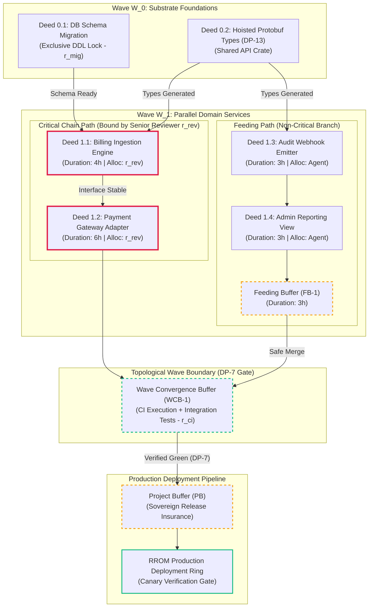

<!-- LICENSE: © 2026 Ravenhelm LLC. Licensed material. -->
<!-- All rights reserved except as granted in LICENSE. Inquiries: nate@ravenhelm.co -->

## Chapter 8 — The Dependency DAG: Critical Path vs. Critical Chain

At 10:14 AM on the third day of a quarterly release, the planning dashboard glows green. Management software—executing traditional Critical Path Method (CPM)—calculates that twenty-four tasks across six engineers and sixteen autonomous AI agent slices are progressing in parallel. The estimated critical path indicates delivery on Friday afternoon with twenty-six hours of slack.

By 2:30 PM, the dashboard collapses into red alerts. Twelve autonomous agent slices, operating inside concurrent worktrees (DP-19), generated their code in under twenty minutes. Each agent opened a pull request and triggered CI. Within ninety seconds, the CI runner pool saturated. Sixty-four queued test suites stalled behind a flaky integration container. Simultaneously, three agents attempted staging database migrations, deadlocking on metadata write locks. Senior human architects opened their queues to find forty-seven pull requests totaling twenty-two thousand lines of code awaiting verification.

By Friday evening, nothing reached production. Theoretical slack evaporated into queueing delay, resource contention, and unbuffered topological convergence.

This collapse exposes CPM's fatal flaw: it is blind to resource constraints. Devised in the late 1950s for physical construction, CPM assumes that if task durations are estimated accurately, technological dependencies dictate delivery. In modern software engineering—amplified by autonomous agents generating code orders of magnitude faster than systems can integrate or test it—duration is rarely the constraint. The true bottleneck is scarce shared resources: reviewer cognition, CI test runners, staging environments, deployment slots, and database write locks.

When organizations treat dependencies as flat checklists or Gantt charts, they fall victim to the infinite parallelism myth. RDOM rejects CPM in favor of Eliyahu Goldratt’s Critical Chain Project Management (CCPM), mapped onto a formalized Dependency Directed Acyclic Graph (DAG) (DP-1).

---

### The Theoretical & Mechanical Foundation

Governing human-agent fleets requires abandoning time-based task lists for a formal mathematical model of system construction.

#### The Dependency DAG Formulation (DP-1)

Software delivery is modeled as a finite directed acyclic graph $G = (V, E)$, designated the Dependency DAG:

$$G = (V, E)$$

Where $V = \{v_1, v_2, \dots, v_n\}$ represents atomic Daily Deeds (DP-1)—bounded, testable units terminating in isolated pull requests (DP-23). Directed edges $e_{ij} = (v_i, v_j) \in E$ denote strict technological preconditions: deed $v_j$ cannot be scheduled or executed until deed $v_i$ completes, merges, and satisfies its verification criteria (DP-5, DP-7).

A valid Dependency DAG satisfies three formal axioms:
1. **Acyclicity**: $\nexists \text{ path } v_k \leadsto v_k$. The graph contains no circular dependencies; circularities require interface hoisting (DP-13, DP-14).
2. **Precedence Invariance**: For every edge $(v_i, v_j) \in E$, execution windows satisfy $t_{\text{start}}(v_j) \ge t_{\text{end}}(v_i)$. Workers never build against unfinished upstream dependencies (DP-5).
3. **Blast Radius Disjointness**: Concurrently scheduled deeds $u, v \in V$ must declare strictly disjoint blast radii: $\mathcal{B}(u) \cap \mathcal{B}(v) = \emptyset$ (DP-3).

#### From Critical Path to Critical Chain: Resource Contention

In classical CPM, the Critical Path is the longest sequence of dependent tasks:

$$\text{CP}(G) = \max_{P \in \mathcal{P}(G)} \sum_{v \in P} D(v)$$

Where $\mathcal{P}(G)$ is the set of directed paths through $G$, and $D(v)$ is task duration. Under CPM, off-path tasks possess "float," leading teams to assume they can run concurrently without penalty.

This assumption collapses under shared resource contention. Let $R = \{r_{\text{rev}}, r_{\text{ci}}, r_{\text{stage}}, r_{\text{mig}}\}$ represent operational resources: senior reviewer bandwidth, CI executor pods, exclusive staging environments, and database DDL migration locks. If concurrent tasks demand more capacity than exists:

$$\sum_{v \in \text{Active}(t)} \text{Demand}(v, r_k) > \text{Capacity}(r_k)$$

Tasks must queue. The true bottleneck is dependency compounded by resource contention. Goldratt’s Critical Chain is the longest sequence of dependent tasks considering technological edges $E$ and resource serialization edges $E_R$:

$$\text{CC}(G, R) = \max_{P \in \mathcal{P}(G \cup E_R)} \sum_{v \in P} D_{\text{aggressive}}(v)$$

Where $D_{\text{aggressive}}(v)$ represents aggressive task durations stripped of hidden safety padding.

#### The Critical Chain Floor Theorem (DP-4)

Principle DP-4 establishes the Critical Chain Floor:

> **Theorem (The Critical Chain Floor)**: For any software initiative mapped to Dependency DAG $G = (V, E)$ constrained by resource set $R$, project duration $T_{\text{initiative}}$ has a strictly positive lower bound:
>
> $$T_{\text{initiative}} \ge \sum_{v \in \text{CC}(G, R)} D_{\text{aggressive}}(v) + \Delta_{\text{Project Buffer}}$$
>
> No addition of engineering staff, parallel agent workers, or sprint compression can reduce delivery duration below this floor without altering graph topology $G$, hoisting shared dependencies upstream (DP-13), or expanding the binding bottleneck $r^* = \arg\max_{r \in R} \text{Utilization}(r)$.

#### Topological Buffer Placement

Traditional projects pad individual tasks. Under Parkinson’s Law and Student Syndrome, individual padding is wasted, while early finishes rarely accelerate downstream work.

RDOM strips individual padding from Daily Deeds, reducing them to fifty-percent estimates ($D_{50}$) and pooling margin into explicit Topological Buffers:

1. **The Project Buffer (PB)**: Sized at 30–50% of critical chain duration, placed at the terminal boundary prior to production deployment to absorb cumulative variance.
2. **Feeding Buffers (FB)**: Placed wherever a non-critical topological branch merges into the critical chain, preventing secondary delays from stalling the critical path.
3. **Wave Convergence Buffers (WCB)**: Placed at each topological wave boundary ($W_k \to W_{k+1}$) (DP-2) to absorb CI execution, review queues, and regression testing, ensuring Wave $W_{k+1}$ never opens on an unverified promise (DP-7).



---

### Operational Mechanics & Algorithmic Protocols

Governing the dependency graph requires concrete algorithms executed during planning and monitored continuously during execution.

#### Protocol 1: Critical Chain Extraction & Wave Partitioning

Before work begins, the orchestrator executes Algorithm 1 to partition tasks into topological waves (DP-2) and extract the critical chain:

```text
Algorithm 1: Critical Chain Extraction and Wave Partitioning
Input: Graph G = (V, E), Resource Set R, Capacities C(r), aggressive durations D(v)
Output: Topological Waves W_0..W_k, Critical Chain CC, Buffer Allocations

1. Cycle Detection: Run Tarjan's SCC algorithm on G. Halt if any SCC > 1.
2. Contention Resolution: Topologically sort V. For each resource r in R,
   if concurrent demand exceeds capacity, insert serialization edge e_R
   minimizing total makespan. Let G_R = (V, E \cup E_R).
3. Early/Late Schedules: Compute ES, EF, LS, LF over G_R.
4. Critical Chain Extraction: CC = { v in V | LF(v) - EF(v) == 0 }.
   Set Critical Chain Floor T_floor = sum_{v in CC} D(v) (DP-4).
5. Wave Partitioning: Assign wave index W(v) = 1 + max_{(u,v) in E} W(u),
   with W(v) = 0 for nodes with in-degree 0 (DP-2).
6. Buffer Sizing: Sqrt-sum-of-squares sizing for feeding buffers FB(B)
   and Project Buffer PB. Size Wave Convergence Buffers WCB for CI runs.
```

#### Protocol 2: Blast Radius Disjointness Verification (DP-3)

Principle DP-3 mandates Zero Collision by Construction. Tasks execute concurrently only if their blast radii share zero mutable state.

Each vertex $v \in V$ declares a Blast Radius tuple $\mathcal{B}(v) = \langle \mathcal{F}_{\text{write}}(v), \mathcal{S}_{\text{write}}(v), \mathcal{E}_{\text{lock}}(v) \rangle$, representing mutated files, database schemas, and exclusively locked environment resources. Prior to dispatching tasks into dedicated git worktrees (DP-19), the orchestrator evaluates:

$$\forall u, v \in W_k \text{ where } u \neq v: \quad \mathcal{B}(u) \cap \mathcal{B}(v) = \emptyset$$

1. $\mathcal{F}_{\text{write}}(u) \cap \mathcal{F}_{\text{write}}(v) = \emptyset$ (Zero overlapping writable files).
2. $\mathcal{S}_{\text{write}}(u) \cap \mathcal{S}_{\text{write}}(v) = \emptyset$ (Zero concurrent table migrations).
3. $\mathcal{E}_{\text{lock}}(u) \cap \mathcal{E}_{\text{lock}}(v) = \emptyset$ (Zero shared environment lease locks).

If blast radii overlap, tasks cannot run in parallel. The orchestrator must serialize deeds across waves or hoist the shared dependency into Wave $W_{k-1}$ as a shared abstraction (DP-13, DP-14).

#### Protocol 3: Buffer Telemetry via the Critical Chain Fever Chart

RDOM tracks execution velocity using Goldratt's Fever Chart, plotting Critical Chain Completion Percentage against Buffer Consumption Percentage:

```text
Buffer Penetration (%)
100% ┌────────────────────────────────────────────────────────┐
     │                                     RED ZONE           │
     │                           (Mandatory Executive Action) │
     │                     ┌──────────────────────────────────┤
 67% │                     │               AMBER ZONE         │
     │               ┌─────┘          (Investigate & Clear)   │
     │         ┌─────┘                                        │
 33% │   ┌─────┘                           GREEN ZONE         │
     │   │                             (Normal Variance)      │
  0% └───┴────────────────────────────────────────────────────┘
     0%                       50%                          100%
                  Critical Chain Progress (%)
```

The operational state space is divided into three actionable zones:

- **Green Zone** ($\text{Buffer Penetration} / \text{Chain Progress} < 0.8$): Normal operations. Variances are absorbed smoothly by buffers.
- **Amber Zone** ($0.8 \le \text{Buffer Penetration} / \text{Chain Progress} \le 1.2$): Precautionary triage. Non-critical feeding branches or review queues erode margins. The team expedites blocked PRs and throttles secondary agent dispatches.
- **Red Zone** ($\text{Buffer Penetration} / \text{Chain Progress} > 1.2$): Circuit breaker trip. Buffer consumption outpaces progress. Delivery is in jeopardy. Secondary work halts; resources reassign to clear the bottleneck immediately.

---

### Concrete Anti-Patterns & Defect Escapes

Neglecting the Dependency DAG and Critical Chain disciplines triggers four structural failures:

#### 1. The Infinite Parallelism Myth

A team prompts ten autonomous agents simultaneously on separate user stories, assuming concurrency equals throughput.

**The Escape**: Ten branches push within minutes, saturating CI runner capacity. Two agents generate conflicting migrations on the same table. Three modify root manifests, creating lockfile conflicts. Lacking a Dependency DAG (DP-1) and blast radius disjointness (DP-3), throughput drops below that of a single engineer working sequentially.

#### 2. The Hidden Dependency Ambush

A plan represents an Authentication Service and a Billing Service as independent parallel tracks in Wave 2. During staging deployment, both mutate an undocumented shared Redis session schema.

**The Escape**: The dependency was dynamic and unhoisted. Bypassing Planning-Time DRY Refactoring (DP-13) and interface hoisting (DP-14) detonated the collision at integration, stalling the critical chain while engineers resolved the conflict in staging.

#### 3. Parkinson's Law Task Padding

An organization allows engineers to pad individual tickets, inflating a four-hour task into a three-day estimate.

**The Escape**: The worker delays starting until late in the cycle (Student Syndrome). An unexpected SDK issue consumes all three days, delivering late and blocking downstream workers. Scattering safety margin across individual tasks converts buffer into waste without protecting the delivery date.

#### 4. The Unbuffered Convergence Crash

Four complex feature branches merge on the final Friday of a sprint. Each engineer works in isolation and submits PRs at 3:00 PM.

**The Escape**: Zero time was allocated for topological convergence. Merging Branch A breaks test fixtures in Branch B. Branch C breaks integration tests with Branch D. Without a Wave Convergence Buffer, the sprint collapses into rollbacks. Under Principle DP-7, Wave $W_{k+1}$ never opens on a promise; without buffers, cadence breaks.

---

### Upstream & Downstream Integration

The Dependency DAG and Critical Chain form the transmission gear connecting the Sovereign Triad:

#### Upstream Integration: RLOM Demand Decomposition

Before an initiative in the Ravenhelm Lifecycle Operations Methodology (RLOM) is committed to a roadmap:

1. **Topological Feasibility Gate**: RLOM initiatives decompose into an explicit Dependency DAG ($G = (V, E)$) before commitment.
2. **Floor Calculation**: The Critical Chain Floor ($T_{\text{floor}}$) is calculated using aggressive durations and resource constraints (DP-4). If the required delivery date is less than $T_{\text{floor}} + \text{Project Buffer}$, the commitment is rejected at the gate.
3. **Resource Booking**: Shared resources identified along the critical chain (e.g., senior reviewer hours, testing fixtures) are reserved on the organizational master calendar.

#### Downstream Integration: RROM Release Ring Alignment

Once code clears the critical chain's terminal Daily Deed, it transitions into the Ravenhelm Release Operations Methodology (RROM):

1. **Release Pipeline as a Critical Chain Resource**: Deployment slots, canary verification windows, and traffic-shifting rings are treated as finite resources ($r_{\text{rel}}$) in the schedule.
2. **Immutable Build Promotion**: Under RDOM's release doctrine (*"Builds are the unit; releases are names"*), code clearing the Wave Convergence Buffer compiles once into an immutable OCI artifact (`:b42@sha256:...`), never rebuilt for downstream rings.
3. **Canary Verification Buffers**: RROM allocates explicit canary bake windows within the Project Buffer. If telemetry detects regressions, the release halts automatically without violating delivery commitments.

---

### Augmentation Surface — Automated DAG Synthesis & Fever Chart Monitoring

Managing dependency DAGs, resource schedules, and buffer consumption across concurrent human and agent workers introduces administrative overhead automated by an agentic orchestration layer.

> **Augmentation Surface — Automated Graph Synthesis & Buffer Telemetry**
>
> Where an agent layer transforms this practice:
>
> 1. **Automated AST & Schema Ingestion**: Agents inspect repository ASTs, package manifests, OpenAPI specifications, and SQL migrations to automatically infer dependency edges between proposed deeds, constructing candidate DAG $G = (V, E)$ without manual mapping.
> 2. **Static Blast Radius Checking**: Agents parse pull request declarations and file tree projections, calculating $\mathcal{B}(u) \cap \mathcal{B}(v)$ across active tasks. Overlapping modules or tables are flagged to serialize nodes or alert architects to hoist dependencies (DP-13).
> 3. **Critical Chain Extraction & Simulation**: The agent executes Algorithm 1, running Monte Carlo simulations across duration distributions to identify the critical chain and calculate optimal feeding and project buffer sizes.
> 4. **Autonomous Fever Chart Surveillance**: Background telemetry daemons track PR review wait times, CI queue durations, and branch merge events in real time, updating the Fever Chart. Amber triggers channel warnings; Red triggers the Andon cord (DP-12), pausing secondary agent execution until bottlenecks clear.
>
> What the human architect keeps:
>
> - **Architectural Boundary Definition**: Humans establish domain boundaries, service splits, and repository structures that dictate allowable dependencies.
> - **Hoisting Arbitration**: When a shared dependency emerges between critical tasks, the architect decides whether to hoist the abstraction upstream into Wave $W_0$ or defer it (DP-14).
> - **Sovereign Buffer Policy**: The architect sets risk tolerance thresholds, approves emergency buffer replenishments, and retains exclusive authority to alter scope when the Fever Chart turns red.

---

<!-- RUBRIC_CHECK:
  structural: pass
  content: pass
  funnel: pass
  chapter-type-extras: n/a
  word-count: 2424
  principle-citations: DP-1, DP-2, DP-3, DP-4, DP-5, DP-7, DP-12, DP-13, DP-14, DP-19, DP-23
  flagged-principle-gaps: none
-->
