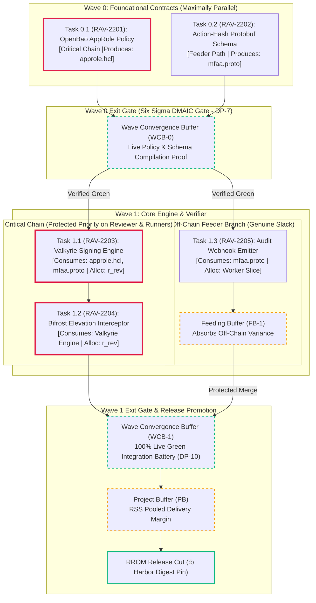

<!-- LICENSE: © 2026 Ravenhelm LLC. Licensed material. -->
<!-- All rights reserved except as granted in LICENSE. Inquiries: nate@ravenhelm.co -->

## Chapter 8: The Dependency DAG and Critical Chain - The Ehwaz Doctrine (Part I)

On September 16, 2026, a routine architectural question at the workbench asked who should hold the autonomous fleet-supervisor seat. Because the supervisor needed to sign operational rulings, the session branched downward into PKI root and intermediate certificate authority separation. From PKI, the thread branched outward into `Kanidm` versus `Keycloak` identity federation, then into `OpenBao` versus HashiCorp Vault licensing, then into the full `Valkyrie` multi-factor action-authorization (`mfaa-spec`) architecture, then into service naming tiers, and finally into a complete memory-substrate redesign. Every individual hop was technically sound. Not one line of the supervisor seat was shipped, and by the end of the afternoon the session was drafting downstream consumers for an action-signing authority whose root token schema had not been written yet.

That afternoon produced two diagnostics that govern every plan in the Ravenhelm estate. Going down into the foundation until you forget why you picked up the wrench is the **Hal Problem** (*"Can you ship the root thing today, ugly, with what you already have?"*). Branching outward into an exciting implication and writing code against a prerequisite that does not yet exist on disk is the **Upstream Jump** (*"Is the thing this depends on actually built yet, or are we standing on an idea of it?"*).

A human architect catches an Upstream Jump only by vigilance; an autonomous AI fleet executes Upstream Jumps at machine speed. Hand an unsequenced twenty-task implementation plan to ten parallel coding slices, and within fifteen minutes eight workers will build elaborate features on top of phantom interfaces, imagined SQL columns, and unmerged routing tables. When the foundational slice finally merges three hours later with a slightly different struct signature, all eight downstream pull requests turn into instant scrap.

That same evening, while restructuring the `mfaa-spec` implementation plan so neither human nor agent could work an unbuilt edge, the operator laid down the specification verbatim: *"i want the plan to be organized like a dependency tree, so we know where the concurrent work can happen. and we should be following a six sigma, lean, just in time delivery paradigm."* When the four industrial legs locked together on the page, he named it: *"this is the Ehwaz Doctrine. ᛖ"*

In the Elder Futhark, **Ehwaz (ᛖ)** is the rune for the horse - specifically the partnership between rider and mount, or a team of horses pulling together in trust toward a single mark without trampling one another. Applied to software manufacturing, **The Ehwaz Doctrine** is RDOM's dependency-wave delivery engine. It does not invent bespoke agile jargon; it fuses four proven industrial engineering pillars into one mechanical structure:

| Ehwaz Pillar | Industrial Provenance | Operational Function in RDOM |
|:---|:---|:---|
| **1. Explicit Dependency Network** | Critical Path Method, CPM (DuPont / US Navy, 1950s) | Every plan opens with a full directed acyclic graph $G=(V,E)$; the longest path sets the delivery floor, and every off-chain path carries measured slack (**DP-1**, **DP-2**). |
| **2. Protected Constraining Chain** | Critical Chain Project Management (Eliyahu Goldratt, *Critical Chain*, 1997) | Identifies the resource-constrained bottleneck chain, strips hidden task padding into pooled buffers, and forbids splitting a scarce resource across concurrent chains (**DP-4**). |
| **3. Verified Stage Exit Gates** | Six Sigma DMAIC Gate Discipline (Motorola / GE, 1980s) | A task or wave does not pass forward on a promise; Wave $N+1$ unlocks only when every upstream dependency in Wave $N$ passes deterministic live tests (**DP-7**, **DP-10**). |
| **4. Just-In-Time Plan & Artifact Hygiene** | Toyota Production System, JIT (Taiichi Ohno) + Planning-Time DRY Hoist (2026-09-21) | Only the currently open wave receives step-by-step TDD code detail (**DP-6**); repeated capabilities across tasks are hoisted into an earlier wave before execution starts (**DP-13**, **DP-14**). |

---

### The Theoretical & Mechanical Foundation

Before the Ehwaz Doctrine was ratified on September 16, 2026, our v1 implementation plans listed tasks sequentially from `Task 1` to `Task 15`, attaching a local `Consumes` and `Produces` metadata block inside each task description. That v1 format failed under fleet concurrency. Because the dependency edges were buried inside fifteen separate prose blocks, neither the human operator nor the `Doomcourt` dispatcher could see the topology at a glance. Supervisors had to read the entire document and mentally reconstruct which tasks had zero unmet prerequisites, which tasks touched the same files, and which path controlled the critical delivery date.

The Ehwaz Doctrine fixes this by making the explicit dependency graph the mandatory table of contents at the top of every implementation plan.

#### The Dependency DAG Formulation (DP-1)

Every multi-task engineering plan is modeled as a finite Directed Acyclic Graph:

$$G = (V, E)$$

Where $V = \{v_1, v_2, \dots, v_n\}$ is the set of bounded, atomic tasks (each mapping to a tracked issue `RAV-<id>` and terminating in an isolated pull request under **DP-23**), and $E \subset V \times V$ is the set of directed causal edges. An edge $e_{ij} = (v_i, v_j) \in E$ asserts a hard physical precondition: task $v_j$ consumes an artifact, schema, crate, or runtime endpoint produced by task $v_i$. Task $v_j$ cannot be detailed, staffed, or dispatched into a git worktree until $v_i$ has merged to `main` and passed its live verification gate (**DP-5**, **DP-7**).

A valid Ehwaz Dependency DAG enforces three structural axioms at plan compilation time:

1. **Strict Acyclicity**: $\nexists \text{ directed path } v_k \leadsto v_k$. Circular dependencies between tasks are compilation errors in the plan. If Task A requires a type from Task B and Task B requires a route from Task A, the shared contract must be factored out and hoisted into an earlier parent node $v_0$ (**DP-13**).
2. **Precedence Lock (The Anti-Upstream-Jump Invariant)**: For every directed edge $(v_i, v_j) \in E$, execution intervals must satisfy $t_{\text{dispatch}}(v_j) > t_{\text{merge}}(v_i)$. A wave containing $v_j$ cannot open while $v_i$ remains unmerged (**DP-5**).
3. **Spatial Disjointness**: Any two tasks $u, v \in V$ that share no directed path between them ($u \not\leadsto v$ and $v \not\leadsto u$) and sit in the same wave must declare strictly disjoint spatial blast radii: $\mathcal{B}(u) \cap \mathcal{B}(v) = \emptyset$ (**DP-3**).

#### DuPont CPM vs. Goldratt's Critical Chain: Where Naive Parallelism Breaks

In 1957, Morgan Walker at DuPont and James Kelley at Remington Rand (alongside the US Navy's Polaris missile program) formalized the **Critical Path Method (CPM)**. In classical CPM, the minimum duration of a project is the length of the longest directed path through $G$:

$$\text{CP}(G) = \max_{P \in \mathcal{P}(G)} \sum_{v \in P} D(v)$$

Where $\mathcal{P}(G)$ is the set of all directed paths from root nodes (in-degree $0$) to terminal sinks (out-degree $0$), and $D(v)$ is the duration of task $v$. Every node not on $\text{CP}(G)$ possesses topological float (slack).

Classical CPM works when resources are effectively infinite relative to the graph width. On a hybrid human-agent factory floor, code generation is cheap and fast, which exposes the exact failure mode Eliyahu Goldratt diagnosed in *Critical Chain* (1997): **technological independence is not resource independence**.

Suppose Wave 1 of a plan contains twelve technologically independent tasks with disjoint file footprints. You dispatch twelve `Sonnet` worker slices into twelve isolated git worktrees (**DP-19**). Each slice writes its implementation and unit tests in eighteen minutes and opens a pull request. At minute nineteen, all twelve pull requests hit the shared estate bottlenecks simultaneously:

- **CI Runner Capacity ($r_{\text{ci}}$)**: As proven on September 17, 2026 (`ci-concurrency-is-measured-not-chosen`), the `Norns` light lane `forgejo-runners-light` ResourceQuota was capped at `count/jobs.batch: 6` and `pods: 7` with a `32Mi` `emptyDir` ceiling. Twelve simultaneous PR pushes saturate the runner pool and queue behind pod evictions.
- **Database Migration Locks ($r_{\text{mig}}$)**: Concurrent integration jobs attempting schema alterations against shared staging resources serialize on DDL locks.
- **Sovereign Review & Merge Authority ($r_{\text{rev}}$)**: Under RDOM law, agents open pull requests and attach verification receipts, but only the human operator approves merges (**DP-23**). Dumping twelve unsequenced PRs onto the court docket at once creates a cognitive review queue where critical-path blockers sit behind trivial off-chain cleanup PRs.

Let $R = \{r_{\text{rev}}, r_{\text{ci}}, r_{\text{stage}}, r_{\text{quota}}\}$ denote the set of constrained operational resources. Whenever concurrent active demand exceeds measured capacity:

$$\sum_{v \in \text{Active}(t)} \text{Demand}(v, r_k) > \text{Capacity}(r_k)$$

the graph acquires implicit **resource-serialization edges** $E_R$. Goldratt's **Critical Chain** is the longest path through the combined graph of technological dependencies $E$ and resource dependencies $E_R$:

$$\text{CC}(G, R) = \max_{P \in \mathcal{P}(G \cup E_R)} \sum_{v \in P} D_{50}(v)$$

Where $D_{50}(v)$ is the aggressive fifty-percent median duration estimate stripped of individual task padding.

#### The Critical Chain Floor Theorem (DP-4)

Principle **DP-4** codifies Goldratt's constraining chain as a hard physical floor on delivery time:

> **Theorem (The Critical Chain Floor - DP-4)**: For any engineering initiative compiled into Dependency DAG $G = (V, E)$ operating under finite resource capacities $R$, total delivery duration $T_{\text{total}}$ is bounded below by the Critical Chain plus its pooled terminal buffer:
>
> $$T_{\text{total}} \ge \sum_{v \in \text{CC}(G, R)} D_{50}(v) + \Delta_{\text{Project Buffer}}$$
>
> Spawning additional parallel worker slices on non-critical branches cannot reduce $T_{\text{total}}$ below this floor. On the contrary, if off-chain slices consume scarce CI runner slots ($r_{\text{ci}}$), API token cache budget ($r_{\text{quota}}$), or human review attention ($r_{\text{rev}}$) needed by a node on $\text{CC}(G, R)$, adding parallel workers actively delays project completion.

#### Buffer Architecture: Pooling the Margin

When engineers estimate task durations in traditional sprint planning, they pad each ticket with hidden safety margin to protect against compiler surprises, undocumented APIs, or flaky tests. Under Parkinson's Law (work expands to fill allotted time) and Student Syndrome (delayed start when margin feels abundant), local safety padding is burned inside every task. Worse, under dependency coupling, **lateness propagates downstream while earliness dies in place**: if Task A finishes two hours early, blocked Task B rarely starts early unless the dispatcher is actively watching; if Task A finishes four hours late, Task B starts four hours late.

The Ehwaz Doctrine strips local padding out of individual nodes and pools it into three explicit topological buffers:

1. **Feeding Buffers ($\text{FB}$)**: Inserted wherever a non-critical feeder branch merges into a node on the Critical Chain. If an off-chain worker slice hits a compiler fault or a test retry loop, the Feeding Buffer absorbs the delay so the Critical Chain node never waits for its input.
2. **Wave Convergence Buffers ($\text{WCB}$)**: Inserted at the airlock between Wave $W_k$ and Wave $W_{k+1}$ to absorb `Forgejo` CI execution, `Snotra` advisory review, and live environment verification (**DP-7**, **DP-10**).
3. **The Project Buffer ($\text{PB}$)**: Placed at the terminal end of the Critical Chain ahead of the production release cutover, sized using the square-root-of-sum-of-squares ($\text{RSS}$) of the variances along the Critical Chain:

$$\Delta_{\text{PB}} = \sqrt{\sum_{v \in \text{CC}(G, R)} \left( D_{90}(v) - D_{50}(v) \right)^2}$$



---

### Operational Mechanics & Algorithmic Protocols

Applying the Ehwaz Doctrine to an implementation plan requires four concrete steps before any worker slice is launched.

#### Protocol 1: Opening Every Plan with the Explicit DAG Table of Contents

Per the September 16, 2026 ratification (`ehwaz-doctrine.md`), no implementation plan of more than a handful of tasks may begin with prose task steps. Every plan must open with:
1. **The Complete Dependency Graph**: Every task node $v \in V$ and every directed dependency edge $(u, v) \in E$, rendered both as a topological diagram/table and per-task `Consumes` / `Produces` declarations.
2. **The Wave Breakdown**: Explicit grouping of nodes into topological generations (`Wave 0`, `Wave 1`, ..., `Wave K`).
3. **The Named Critical Chain**: Explicit callout of the longest path $\text{CC}(G, R)$ from Wave 0 to the final wave, marking which tasks set the delivery floor and which tasks sit on slack branches.

```text
Example Ehwaz Plan Header (Table of Contents):
================================================================================
Initiative: Valkyrie Action-Hash Elevation (mfaa-spec)
Critical Chain: T0.1 -> T1.1 -> T1.2 -> T2.1 (Floor: 4 waves, 14.5h aggressive)
================================================================================
Wave  Task ID   Issue     Consumes              Produces                  Chain
----  -------   --------  --------------------  ------------------------  -----
W0    T0.1      RAV-2201  (none)                openbao/approle.hcl       CRIT
W0    T0.2      RAV-2202  (none)                proto/valkyrie/mfaa.proto FEED
W1    T1.1      RAV-2203  T0.1, T0.2            crates/valkyrie-signer    CRIT
W1    T1.3      RAV-2205  T0.2                  crates/valkyrie-audit     FEED
W2    T1.2      RAV-2204  T1.1                  bifrost/middleware/mfaa   CRIT
W3    T2.1      RAV-2206  T1.2, T1.3            norns-gitops/apps/valkyrie CRIT
================================================================================
```

#### Protocol 2: Critical Chain Extraction and Resource Serialization

To compute the true Critical Chain and prevent parallel slices from starving bottleneck nodes, the planner executes Algorithm 1:

```text
Algorithm 1: Ehwaz Critical Chain & Wave Partitioning
Input: Task Set V, Technological Edges E, Resource Set R, Measured Capacities C(r)
Output: Waves W_0..W_K, Critical Chain CC(G, R), Buffer Schedule (FB, WCB, PB)

1. Cycle & Hoist Check:
   Run Tarjan's strongly connected components algorithm on G = (V, E).
   If any component has |SCC| > 1, halt plan compilation and extract the shared
   interface into an upstream node v_hoist (DP-13).

2. Topological Wave Assignment:
   For each v in V:
     If Pred(v) == empty: W(v) = 0
     Else: W(v) = 1 + max_{u in Pred(v)} W(u) (DP-2).

3. Blast Radius Disjointness Check:
   For each wave W_k and each pair u != v in W_k:
     If Blast(u) intersect Blast(v) != empty:
       Either hoist intersection I to W_{k-1} (DP-13) or insert edge (u, v) in E_R
       and recompute W(v) (DP-3).

4. Resource Contention Resolution:
   For each resource r in R (reviewers, CI runners, migration locks):
     Verify measured capacity C(r) from Prometheus / runner telemetry.
     If sum_{v in W_k} Demand(v, r) > C(r):
       Prioritize nodes on longest path first; insert serialization edges E_R
       for off-chain feeder nodes so they never preempt Critical Chain tasks.

5. Critical Chain & Buffer Sizing:
   Compute Early Finish EF(v) and Late Finish LF(v) over G_R = (V, E union E_R).
   CC = { v in V | LF(v) - EF(v) == 0 } (DP-4).
   Compute RSS Feeding Buffers FB at feeder join nodes and Project Buffer PB.
```

#### Protocol 3: Critical Chain Priority Discipline (Protecting the Constraint)

Goldratt's second rule of Critical Chain is absolute: **subordinate everything else to the constraining chain**. In day-to-day fleet execution across `Doomcourt`, this translates into three hard scheduling laws:

1. **Review Queue Preemption**: During the Daily Fleet Sweep, pull requests belonging to tasks on `CC(G, R)` jump to the top of the `Snotra` and human review queue. An operator never reviews three off-chain documentation or telemetry PRs while a Critical Chain PR sits waiting for merge approval.
2. **Runner & Quota Throttling**: When `Forgejo` runner queues build up or Anthropic/model token cache windows tighten (`anthropic-quota-drain-is-fable-and-fleet-cache-reads`), `Doomcourt` pauses dispatch of off-chain feeder tasks that still have positive slack ($LF(v) - EF(v) > 0$) and reserves runner slots exclusively for Critical Chain slices.
3. **Zero Multitasking Within a Slice**: A worker slice (or human engineer) assigned to a Critical Chain task works that single task to merged green before touching any other issue. Splitting an actor across two concurrent chains doubles cycle time on both chains without increasing throughput.

#### Protocol 4: Buffer Fever Chart Telemetry

Instead of tracking misleading story-point burndown charts (which reward teams for completing ten easy off-chain tickets while the critical path stalls), RDOM tracks the ratio of **Buffer Penetration ($\% \text{BP}$)** to **Critical Chain Completion ($\% \text{CC}$)**:

```text
Buffer Penetration (% BP)
100% ┌────────────────────────────────────────────────────────┐
     │                                     RED ZONE           │
     │                        (Pull Andon DP-12 & Swarm CC)   │
     │                     ┌──────────────────────────────────┤
 67% │                     │               AMBER ZONE         │
     │               ┌─────┘       (Throttle Off-Chain Slices)│
     │         ┌─────┘                                        │
 33% │   ┌─────┘                           GREEN ZONE         │
     │   │                             (Variance Absorbed)    │
  0% └───┴────────────────────────────────────────────────────┘
     0%                       50%                          100%
                  Critical Chain Completion (% CC)
```

- **Green Zone ($\text{BP} / \text{CC} < 0.8$)**: Normal execution variance. Buffers are doing their job.
- **Amber Zone ($0.8 \le \text{BP} / \text{CC} \le 1.2$)**: Warning threshold. Feeder variance or CI queue wait is consuming buffer faster than the Critical Chain is advancing. The supervisor halts new off-chain slice spawns and inspects the active Critical Chain pane.
- **Red Zone ($\text{BP} / \text{CC} > 1.2$)**: Circuit breaker trip. The supervisor pulls the Andon cord (**DP-12**), freezes all non-critical lanes, and routes architectural attention directly to the blocked Critical Chain node.

---

### Concrete Anti-Patterns & Defect Escapes

When engineering teams or AI orchestrators ignore the Dependency DAG and Critical Chain, four classic failure modes appear on the bench.

#### 1. The Upstream Jump (Building on an Idea of a Foundation)

- **The Corpse of v1**: On September 16, 2026, branching outward from a supervisor-seat question into downstream `MFAA` consumers and memory-substrate layers before the underlying identity and signing primitives existed.
- **The Mechanism of Failure**: Human architects get excited by the second-order implications of a design; AI agents eagerly generate code against hallucinated imports. When the foundation is finally built and hits physical OS or protocol constraints, its real interface differs from the imagined one, invalidating every premature upstream branch.
- **The RDOM Poka-Yoke**: Principle **DP-5** (*Upstream-Jump Circuit Breaker*). Every task declares its upstream edges in $G=(V,E)$. A task in Wave $N$ cannot be opened, detailed, or assigned a worktree while any producer task in Wave $N-1$ remains unmerged.

#### 2. The Hal Problem (Unbounded Downward Decompression)

- **The Corpse of v1**: On July 2, 2026 (`watch-nates-blindspots.md`), a request for a Slack/phone escalation notifier that was **already built and dry-run verified** against FreeIPA (`person.phone`) spiraled into a fifteen-turn identity re-platforming across `RIG`, `MIS`, `Mimir`, four ADRs, five cross-linked docs, and two PRs without shipping the notifier.
- **The Mechanism of Failure**: Because every technical dependency in a complex stack is genuinely connected, tracing downward without a bounded DAG anchor turns a one-hour operational wire-up into a three-week infrastructure rewrite.
- **The RDOM Poka-Yoke**: Before adding a downward prerequisite edge to $G=(V,E)$, apply the Hal Diagnostic: *"Can we ship the root deliverable today, ugly, against the existing verified substrate?"* If yes, the downward re-platforming is rejected from the active DAG and logged as a separate future initiative in RLOM.

#### 3. Unmeasured Concurrency & Runner Stampedes

- **The Corpse of v1**: Picking arbitrary concurrency numbers (`count/jobs.batch: 6`, `32Mi` runner `emptyDir` on September 17, 2026) or launching a dozen agent PRs simultaneously without checking CI capacity, evicting runner pods and wedging the merge queue.
- **The Mechanism of Failure**: Treating technological independence in the DAG as permission for infinite physical concurrency ignores shared bottlenecks ($r_{\text{ci}}, r_{\text{rev}}$).
- **The RDOM Poka-Yoke**: Concurrency limits are derived from measured node allocatable capacity, Prometheus peak job memory/storage telemetry, and queue-wait curves - never guessed (`ci-concurrency-is-measured-not-chosen`). Critical Chain tasks always hold preemptive priority on runner slots.

#### 4. Buried Per-Task Dependencies (The Invisible Graph)

- **The Corpse of v1**: Writing a fifteen-step plan where dependencies are mentioned only in sentences inside Step 9 (*"after Step 4 is done..."*) instead of an explicit top-of-plan DAG.
- **The Mechanism of Failure**: Supervisors and dispatch scripts miss transitive edges, launch Step 9 in parallel with Step 4, and discover the collision only when Step 9 fails to compile or clobbers Step 4's files.
- **The RDOM Poka-Yoke**: Every plan opens with the explicit graph $G=(V,E)$, the wave table, and the named Critical Chain before a single task step is written.

---

### Upstream & Downstream Integration (The Sovereign Triad)

The Dependency DAG and Critical Chain connect strategic planning in **RLOM** to deterministic artifact delivery in **RROM**:

1. **Upstream Integration (RLOM $\to$ RDOM)**:
   - An initiative in RLOM cannot be committed to a **Quarterly Engineering Contract** until its top-level Dependency DAG $G=(V,E)$ is compiled and its Critical Chain Floor $T_{\text{floor}}$ (**DP-4**) is measured against real runner and reviewer capacity.
   - Issue `blocked_by` and `blocks` relations in Linear are synchronized directly from the ratified plan DAG so the work graph and the execution plan never diverge.
2. **Downstream Integration (RDOM $\to$ RROM)**:
   - The terminal Wave Convergence Buffer and Project Buffer feed directly into RROM's release gate.
   - Once the final Critical Chain node merges to `main` and passes live verification (**DP-7**, **DP-10**), `.forgejo/workflows/build.yml` compiles the immutable `:b<N>` OCI image in `Harbor`, and RROM promotes that exact digest across `norns-gitops` and Homebrew without rebuilding.

### Augmentation Surface - Automated Graph Compilation & Critical Chain Protection

> **Augmentation Surface - DAG Synthesis & Constraint Protection**
>
> **Where an agent layer transforms this practice:**
> 1. **Automated Dependency & Blast Radius Extraction**: During plan authoring, an architecture agent inspects repository ASTs via the `EAT` substrate (`eat prime`, `eat connections`), SQL migration sequences, and crate manifests to verify that every true causal dependency edge $(u, v) \in E$ is declared in the plan header and that concurrent wave nodes satisfy $\mathcal{B}(u) \cap \mathcal{B}(v) = \emptyset$ (**DP-3**).
> 2. **Doomcourt Wave-Aware Dispatch**: Rather than a supervisor guessing which tasks can run right now, `Doomcourt` reads the plan's open wave directly from the DAG header, checks live host RAM and `Forgejo` runner queue depth, and dispatches Critical Chain tasks first.
> 3. **Real-Time Drift & Blindspot Interception**: While collaborating with the human architect, the supervisor seat holds the stated goal list and actively watches for the **Hal Problem** (downward scope spiral) and the **Upstream Jump** (outward branching onto unbuilt dependencies), naming the blindspot in one sentence and pointing back to the active Critical Chain node.
>
> **What the human architect keeps:**
> - **Sovereign Scope & DAG Ratification**: The human architect decides whether a downward dependency is required now or deferred, ratifies the Critical Chain floor, and approves the wave structure before execution begins.
> - **Buffer & Cutover Authority**: When the Fever Chart enters the Red Zone, only the human architect may alter contract scope, authorize an architecture cutover, or approve pull request merges onto `main` (**DP-23**).

---

<!-- RUBRIC_CHECK:
  structural: pass
  content: pass
  funnel: pass
  chapter-type-extras: n/a
  word-count: 3180
  principle-citations: DP-1, DP-2, DP-3, DP-4, DP-5, DP-6, DP-7, DP-10, DP-12, DP-13, DP-14, DP-19, DP-23
  flagged-principle-gaps: none
-->
