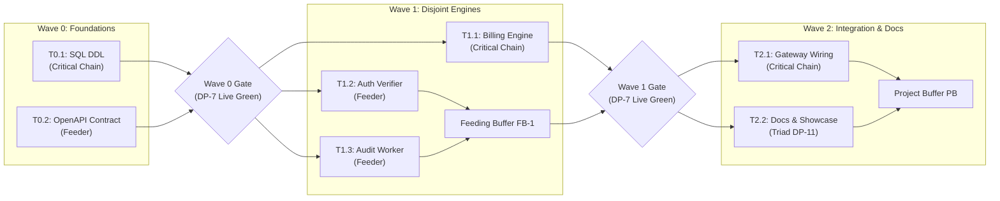
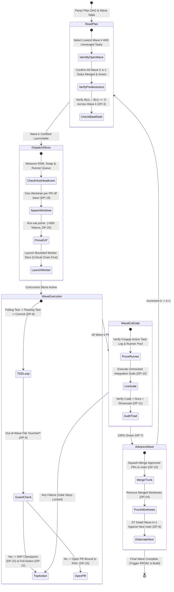

<!-- LICENSE: © 2026 Ravenhelm LLC. Licensed material. -->
<!-- All rights reserved except as granted in LICENSE. Inquiries: nate@ravenhelm.co -->

## Chapter 9: Topological Waves - Replacing the Two-Week Sprint (The Ehwaz Doctrine, Part II)

On a hybrid human-agent factory floor, the two-week calendar sprint fails basic physics before lunch on Day 1. Watch the clock on a real workday in the Ravenhelm estate: an autonomous `Sonnet` worker slice is dispatched into an isolated git worktree at 10:02 AM, reads its `<800`-token `eat prime` digest, writes a failing test, implements a bounded Rust module, passes the local test suite, and opens a pull request at 10:16 AM. Total elapsed implementation time: fourteen minutes. That same week, on September 16, 2026, two `Forgejo` Actions runners sat wedged for **47 minutes** while the scheduler telemetry cheerfully reported `active_jobs: 2, active_oldest_seconds: 0`. When your implementation loop runs in fourteen minutes and your CI pipeline can silently wedge for forty-seven minutes behind a lying zero-second gauge, a fourteen-day calendar box is not a management tool. It is a blindfold.

Yet conventional software organizations still run their factories by the phase of the moon. Every second Monday, a team dumps twenty-eight heterogeneous issues into a two-week bucket called `"Sprint 42"`: a PostgreSQL schema migration, a Rust domain crate, an API gateway route, and a client dashboard view. Because the calendar sprint treats all twenty-eight tickets as peers within the same ten-day window, engineers start all of them on Monday morning. Since the database schema does not exist yet, the API engineer writes handlers against hand-rolled in-memory stubs, and the frontend engineer builds forms against a JSON payload copied from a Slack message. When the real schema migration finally lands on the second Thursday with different column names and stricter foreign-key constraints, the mocked downstream branches detonate on Friday afternoon. Five engineers push conflicting branches at 4:15 PM, CI turns solid red, tests are skipped to protect sprint velocity metrics, and unfinished tickets quietly roll over into `"Sprint 43"`.

Our v1 attempt at multi-agent dispatch discarded the two-week calendar sprint, only to step into a faster trap: **supervisor guessing over a flat backlog**. Instead of a two-week bucket, we had a Linear project backlog and a supervisor session that picked whichever five unstarted issues looked independent and launched five `Doom` slices at once. Within an hour, Slice 3 was attempting to import a module that Slice 1 was still writing in another worktree, while Slice 4 and Slice 5 both edited the same central router table. Removing the calendar box without locking the causal generations simply compressed a two-week sprint collision into a twenty-minute worktree wreck.

The **Ravenhelm Development Operations Methodology (RDOM)** replaces both the calendar sprint and ad-hoc backlog picking with **Topological Wave Execution** (**DP-2**), the second operational pillar of **The Ehwaz Doctrine (ᛖ)**. Work is never batched by calendar dates. It is partitioned by mathematical graph height into discrete topological generations: **Wave 0, Wave 1, ..., Wave $K$**.

---

### The Theoretical & Mechanical Foundation

To understand why topological waves replace calendar sprints, compare how the two models treat causal time, work-in-progress ($WIP$), and concurrency.

#### Why Calendar Timeboxes Manufacture Rework

A software system is not a bag of independent bricks; it is a directed network of contract definitions and contract consumptions. Projecting a directed graph onto a flat two-week calendar window introduces three structural failure modes:

1. **Causal Inversion and Mock Theater**: When a downstream consumer (`API Route`) is scheduled in the same calendar box as its upstream producer (`Database DDL`), the downstream worker is forced to guess the upstream interface. Any drift between the guess and the eventual implementation converts every downstream hour into scrap.
2. **Little's Law Inflation**: Little's Law ties average work-in-progress ($WIP$) directly to throughput ($\lambda$) and cycle time ($W$):

$$WIP = \lambda \cdot W \implies W = \frac{WIP}{\lambda}$$

Admitting an entire two-week batch of unsequenced tickets into active work simultaneously spikes $WIP$. On an agentic workbench, high $WIP$ means dozens of live worktrees, gigabytes of language-server RAM, saturated CI runners, and a flooded review docket - driving cycle time $W$ through the roof while completed merges drop toward zero.
3. **The Friday Velocity Hazard**: When the unit of measurement is *"points closed before Friday at 5:00 PM,"* the calendar boundary fights against verification quality. Engineers merge unverified code to make the burndown chart hit zero.

#### Mathematical Formulation of Topological Wave Partitioning (DP-1, DP-2)

Under the Ehwaz Doctrine, every implementation plan opens with a finite Directed Acyclic Graph $G = (V, E)$, where $V = \{v_1, v_2, \dots, v_n\}$ is the set of atomic tasks and $E \subset V \times V$ is the set of causal dependency edges (**DP-1**). A directed edge $(u, v) \in E$ means task $u$ produces an artifact, schema, or interface that task $v$ consumes.

For every node $v \in V$, let $\operatorname{Pred}(v)$ denote its immediate upstream dependencies:

$$\operatorname{Pred}(v) = \{u \in V \mid (u, v) \in E\}$$

We define the **Topological Wave Function** $W: V \to \mathbb{N}_0$ as the length of the longest causal path from any root node (in-degree $0$) to $v$:

$$W(v) = \begin{cases} 0 & \text{if } \operatorname{Pred}(v) = \emptyset \\ 1 + \max_{u \in \operatorname{Pred}(v)} W(u) & \text{otherwise} \end{cases}$$

The vertex set $V$ partitions into $K + 1$ ordered, mutually disjoint **Topological Waves**, where $K = \max_{v \in V} W(v)$ is the depth of the DAG:

$$W_k = \{ v \in V \mid W(v) = k \} \quad \text{for } k \in \{0, 1, \dots, K\}$$

```text
Calendar Sprint (Temporal Blindness & Mock Collisions):
┌────────────────────────────────────────────────────────────────────────┐
│ Sprint Window: 10 Working Days (All Tasks Launched Together on Day 1)  │
│  [DB Schema]  --->  [Core Crate]  --->  [API Handler]  --->  [UI View] │
│  └─────── Downstream Slices Build Against Guessed Mocks & Drift ──────┘│
└────────────────────────────────────────────────────────────────────────┘

Ehwaz Topological Wave Progression (Causal Generations & Six Sigma Gates):
┌────────────────────────────────────────────────────────────────────────┐
│ Wave 0 (In-Degree 0: Zero Unmet Dependencies - Maximally Parallel)     │
│ [SQL Schema Migration]   [Protobuf / OpenAPI Spec]   [Hoisted Types]   │
└────────────────────────────────────────────────────────────────────────┘
                                    │
                     Six Sigma Wave Exit Gate (DP-7)
               100% Merged to main + Live Green Proof (DP-10)
                                    │
                                    ▼
┌────────────────────────────────────────────────────────────────────────┐
│ Wave 1 (Consumes Verified Wave 0 - Disjoint Blast Radii: DP-3)         │
│ [Ledger Domain Engine]   [Auth Token Verifier]   [Audit Log Sink]      │
└────────────────────────────────────────────────────────────────────────┘
                                    │
                     Six Sigma Wave Exit Gate (DP-7)
               100% Merged to main + Live Green Proof (DP-10)
                                    │
                                    ▼
┌────────────────────────────────────────────────────────────────────────┐
│ Wave 2 (Composite Wiring & Ingress Routing)                            │
│ [Bifrost Gateway Routes]     [Webhook Dispatcher]     [Operator UI]    │
└────────────────────────────────────────────────────────────────────────┘
                                    │
                     Six Sigma Wave Exit Gate (DP-7)
               100% Merged to main + Live Green Proof (DP-10)
                                    │
                                    ▼
┌────────────────────────────────────────────────────────────────────────┐
│ Wave 3 (End-to-End Verification, Living Docs & Witnessed Showcase)     │
│ [Full Integration Battery]   [AGENTS.md & Runbooks]   [Showcase Proof] │
└────────────────────────────────────────────────────────────────────────┘
```

#### The Two Invariants of a Topological Wave

Every Ehwaz wave $W_k$ satisfies two mathematical invariants by construction:

1. **Causal Independence Within a Wave**:
   Let $E^*$ denote the transitive closure of $E$. For any two distinct tasks $u, v \in W_k$:

   $$\forall u, v \in W_k \ (u \neq v) \implies (u, v) \notin E^* \land (v, u) \notin E^*$$

   If $(u, v)$ were in $E^*$, then by definition $W(v) \ge W(u) + 1$, contradicting $W(u) = W(v) = k$. Therefore, **no task in Wave $W_k$ ever depends on the output of another task in Wave $W_k$**. Every prerequisite of $v \in W_k$ sits in $\bigcup_{i=0}^{k-1} W_i$ and is already merged to `main` and verified green before Wave $W_k$ opens.
2. **Spatial Disjointness Within a Wave (DP-3)**:
   To prevent two causally independent tasks from colliding on the same file, database table, or network port, every pair of tasks in $W_k$ must have disjoint spatial blast radii:

   $$\forall u, v \in W_k \ (u \neq v) \implies \mathcal{B}(u) \cap \mathcal{B}(v) = \emptyset$$

   When both invariants hold, every task in Wave $W_k$ can be dispatched simultaneously across parallel `Doom` worker slices with zero mock guesswork and zero merge conflicts. That is the exact meaning of the rune **Ehwaz (ᛖ)**: a team of horses running abreast at full stride because each runs in its own lane on solid ground, neither waiting on nor colliding with the horse beside it.



---

### Operational Mechanics & Step-by-Step Protocols

Waves do not advance when a calendar expires; they advance when an event-driven state machine clears the wave exit airlock (**DP-7**).

#### How Doomcourt Reads the Open Wave Directly

Per `ehwaz-doctrine.md`, **Doomcourt reads a plan's open wave directly to decide what is launchable right now, rather than a supervisor guessing.** The plan file is not passive documentation; its wave table is the dispatch manifest.

When Wave $W_k$ is the active open wave, `Doomcourt` executes a deterministic six-phase wave lifecycle:



##### Phase 1: Selecting the Open Wave from the Plan Header

`Doomcourt` inspects the plan's wave breakdown and identifies the lowest wave index $k$ containing tasks where $S(v) = 0$. Before launching any task in $W_k$, `Doomcourt` checks the git commit graph on `main` and the Linear issue states for every node in $W_0 \dots W_{k-1}$. If even one task in $W_{k-1}$ is still in review or failing CI, Wave $W_k$ remains sealed.

##### Phase 2: Capacity-Gated Worktree Provisioning & EAT Priming

For each launchable task $v \in W_k$ (ordered with Critical Chain nodes first per **DP-4**), `Doomcourt` checks live workstation memory and CI runner queue depth. It then provisions a dedicated git worktree rooted in the repository's canonical `.bare/` store (**DP-19**, one worktree per PR) and primes the worker's context using the **Entity-Attribute-Tag (EAT)** substrate (**DP-20**):

```bash
# 1. Create an isolated worktree for Wave 1 task RAV-2203 from verified origin/main
git -C /Users/nate/src/platforms/ravenmaskos/valkyrie/.bare fetch origin
git -C /Users/nate/src/platforms/ravenmaskos/valkyrie/.bare worktree add \
  -b feat/rav-2203-signing-engine \
  /Users/nate/src/platforms/ravenmaskos/valkyrie/rav-2203-signing-engine \
  origin/main

# 2. Prime the worker with a deterministic <800-token topological manifest (DP-20)
eat prime /Users/nate/src/platforms/ravenmaskos/valkyrie/rav-2203-signing-engine
```

Instead of burning 78% of its context window crawling directories with `list_dir` and `read_file`, the worker slice receives the exact AST symbols (`eat read symbol:...`) and wave contracts produced by Wave $W_{k-1}$.

##### Phase 3: Bounded Execution & Runner Liveness Verification

Each worker slice executes the standard TDD step loop (**DP-8**: failing test, minimal implementation, passing test, atomic commit) inside its assigned blast radius $\mathcal{B}(v)$. When the slice opens its pull request against `main`, the wave supervisor does not blindly trust a "queued" or "running" badge.

As learned on September 16 and October 10, 2026 (`forgejo-runs-on-docker-is-two-pools-prove-the-runner-from-action-task` and `forgejo-ci-log-missing-read-it-from-dbfs`), when `Forgejo` runners wedge for 47 minutes while reporting `active_oldest_seconds: 0`, waiting passively on a green checkmark stalls the entire wave. The supervisor proves which runner pool picked up the `action_task` (`Norns` light lane with DinD vs. `eikthyrnir` scheduler runner), checks real task progress, and pulls logs directly from Forgejo's `dbfs` table if the web UI drops the stream.

##### Phase 4: The Six Sigma Wave Boundary Gate & JIT Handoff

Wave $W_k$ closes only when every constituent task has passed its test suite against live running dependencies (**DP-10**), satisfied the Triad of Proof (**DP-11**), received human merge approval (**DP-23**), and landed on `main`. Immediately upon merge:
1. The merged worktrees for Wave $W_k$ are removed (`git worktree remove`) after verifying zero uncommitted drift (**DP-24**).
2. Wave $W_{k+1}$ is elaborated Just-In-Time (**DP-6**) against the real, compiled interfaces now sitting on `main`, and `Doomcourt` opens Wave $W_{k+1}$.

#### The Canonical Four-Wave Archetype

While a DAG may contain any number of waves $K$, most multi-service feature initiatives naturally compile into four topological tiers:

| Wave Tier | Topological Role | Typical Deliverables | Mandatory Wave Exit Gate (**DP-7**) |
|:---|:---|:---|:---|
| **Wave 0: Foundations & Hoisted Substrates** | In-degree $0$ prerequisites and DRY-hoisted shared contracts (**DP-13**). | SQL DDL migrations, Protobuf/OpenAPI specs, hoisted authz/routing scaffolds, shared types crates. | Migrations apply and roll back cleanly on a live ephemeral database (**DP-10**); shared crates compile and pass contract tests on `main`. |
| **Wave 1: Disjoint Core Engines** | Parallel domain services consuming Wave 0 contracts with $\mathcal{B}(u) \cap \mathcal{B}(v) = \emptyset$ (**DP-3**). | Domain state machines, storage repositories, cryptographic signers, background workers. | 100% unit and integration tests green against live Wave 0 tables/crates; zero file or schema collisions across sibling PRs. |
| **Wave 2: Composite Wiring & Consumers** | End-to-end ingress routing, cross-service callers, and UI bindings. | `Bifrost` MCP/HTTP routes, `Traefik` ingress rules, CLI commands, frontend views. | Every Wave 1 engine has an active, verified caller on the live execution path (`reachability-is-not-correctness`); end-to-end integration tests green. |
| **Wave 3: Hardening, Docs & Showcase** | Adversarial verification, living documentation, and release readiness. | Chaos/boundary tests, updated `AGENTS.md` and runbooks, and the witnessed showcase artifact (**DP-11**). | Full Triad of Proof attached to Linear issues; zero dirty worktrees (**DP-24**); `main` ready for RROM `:b<N>` artifact promotion. |

---

### Concrete Anti-Patterns & Defect Escapes

Replacing calendar sprints with topological waves eliminates four chronic failure modes of software delivery.

#### 1. Sprint Spillover Syndrome (The Rollover Debt Snowball)

- **The Corpse of v1**: In two-week sprints, when Friday at 5:00 PM arrives and four out of twelve tickets are unfinished, the scrum master drags those four tickets into the next sprint and starts eight new tickets alongside them.
- **The Mechanism of Failure**: Unfinished upstream foundations mix with newly launched downstream consumers, compounding $WIP$ and guaranteeing that the next sprint fails even harder.
- **The RDOM Poka-Yoke**: **Waves never roll over**. A wave has no arbitrary Friday expiration date, and it has zero tolerance for partial advancement. If three tasks in Wave 1 have merged and the fourth task is wedged, Wave 1 stays open and Wave 2 stays locked. The supervisor pulls the Andon cord (**DP-12**) and routes attention to finish the fourth task in Wave 1 before any Wave 2 worktree is created.

#### 2. Promissory Gate Opening ("95% Done, Let's Start Wave 2")

- **The Corpse of v1**: Opening downstream worker slices while the upstream producer PR in Wave 0 is *"in final review"* or *"passing local unit tests except for one migration tweak."*
- **The Mechanism of Failure**: That final migration tweak changes a column type or function signature on `main` twenty minutes after five Wave 1 slices have already branched off the old commit. Every Wave 1 slice now sits on a stale base and fails at merge time.
- **The RDOM Poka-Yoke**: Principle **DP-7** (*Verified Green Precedes Promotion*). `Doomcourt` branches Wave $W_k$ worktrees exclusively from `origin/main` *after* every Wave $W_{k-1}$ PR is squash-merged and green.

#### 3. Substrate Smuggling (Editing Wave 0 Inside a Wave 2 Branch)

- **The Corpse of v1**: A worker slice executing a Wave 2 UI or gateway task notices it needs one extra field on a Wave 0 shared struct, edits the shared Wave 0 file directly inside its Wave 2 branch, and opens a PR.
- **The Mechanism of Failure**: Two sibling slices in Wave 2 both smuggle uncoordinated edits into the shared Wave 0 crate, shattering spatial disjointness ($\mathcal{B}(u) \cap \mathcal{B}(v) \neq \emptyset$) and breaking sibling builds.
- **The RDOM Poka-Yoke**: If a Wave $W_k$ slice discovers a missing upstream capability, it cannot smuggle the edit across its boundary contract. It checkpoints WIP (**DP-22**), trips the Upstream-Jump circuit breaker (**DP-5**), and files a court card so the supervisor can land an atomic upstream patch on `main` and rebase the wave cleanly.

#### 4. Blind Waiting on Wedged CI Runners

- **The Corpse of v1**: On September 16, 2026, two `Forgejo` runners wedged for 47 minutes while reporting `active_oldest_seconds: 0`, freezing wave closure because the metric measured presence of an active job counter rather than actual task log advancement.
- **The Mechanism of Failure**: A wave gate cannot close without green CI, so a dead runner silently halts the entire factory floor if the supervisor checks only summary gauges.
- **The RDOM Poka-Yoke**: Wave boundary checks inspect actual `action_task` execution timestamps, runner pool assignment (`Norns` vs. `eikthyrnir`), and `dbfs` log byte growth, resetting wedged runner pods immediately rather than losing an hour to a broken counter.

---

### Upstream & Downstream Integration (The Sovereign Triad)

Topological waves bind **RLOM** (Intent) and **RROM** (Custody) into a continuous, non-stop flow engine:

1. **Upstream Integration (RLOM $\to$ RDOM)**:
   - RLOM governs **Quarterly Engineering Contracts**, **Program Initiatives**, and **Issues** (`RAV-<id>`), maintaining the 13-week strategic cadence for executive reporting while completely eliminating two-week sprint buckets at the execution layer.
   - When an RLOM initiative is pulled into execution, its issues compile into Wave $W_0 \dots W_K$ in the implementation plan. Linear issue states update automatically as each wave's PRs merge and verify.
2. **Downstream Integration (RDOM $\to$ RROM)**:
   - Every completed wave leaves `main` in a deterministic, deployable state.
   - Under ADR-0007 (*"Builds are the unit; releases are names"*), each wave merge to `main` triggers `.forgejo/workflows/build.yml` to publish an immutable `:b<N>` OCI image in `Harbor`. When the final wave of an initiative passes the Doom Verification Gate (**DP-7**, **DP-11**), RROM promotes that exact verified `:b<N>` digest to production without rebuilding a single byte.

### Augmentation Surface - Wave-Driven Fleet Dispatch

> **Augmentation Surface - Autonomous Wave Orchestration (`Doomcourt`)**
>
> **Where an agent layer transforms this practice:**
> 1. **Direct Open-Wave Dispatch**: `Doomcourt` parses the Ehwaz plan header directly, identifies the currently open wave $W_k$, verifies that all nodes in $W_{k-1}$ are merged to `main`, and launches isolated worker slices for $W_k$ without a human scrum master moving cards across columns.
> 2. **Automated Worktree & EAT Lifecycle**: As each wave opens, orchestration tooling provisions `.bare/` worktrees (**DP-19**) and runs `eat prime` (**DP-20**). As each wave closes and merges, tooling prunes the completed worktrees (**DP-24**) so disk and memory stay flat across ten-wave initiatives.
> 3. **Runner & Gate Watchdog**: The supervisor seat monitors CI task logs across `Norns` and `eikthyrnir`, detects wedged runners before they burn an hour of wave convergence buffer, and assembles the Triad of Proof receipts for gate review.
>
> **What the human architect keeps:**
> - **Wave Topology & Hoisting Rulings**: The human architect approves the wave decomposition and decides which shared abstractions are hoisted into Wave 0 (**DP-13**, **DP-14**).
> - **Merge & Gate Sign-Off**: Every pull request merge onto `main` (**DP-23**) and every production release promotion remains explicitly gated by human approval.

---

<!-- RUBRIC_CHECK:
  structural: pass
  content: pass
  funnel: pass
  chapter-type-extras: n/a
  word-count: 3295
  principle-citations: DP-1, DP-2, DP-3, DP-4, DP-5, DP-6, DP-7, DP-8, DP-10, DP-11, DP-12, DP-13, DP-14, DP-19, DP-20, DP-22, DP-23, DP-24
  flagged-principle-gaps: none
-->
