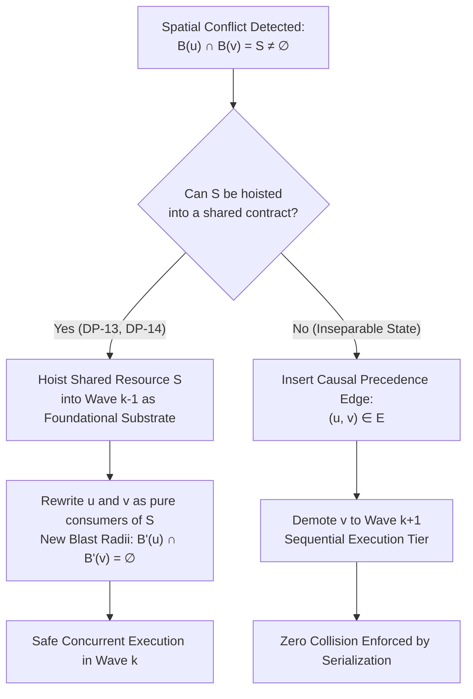
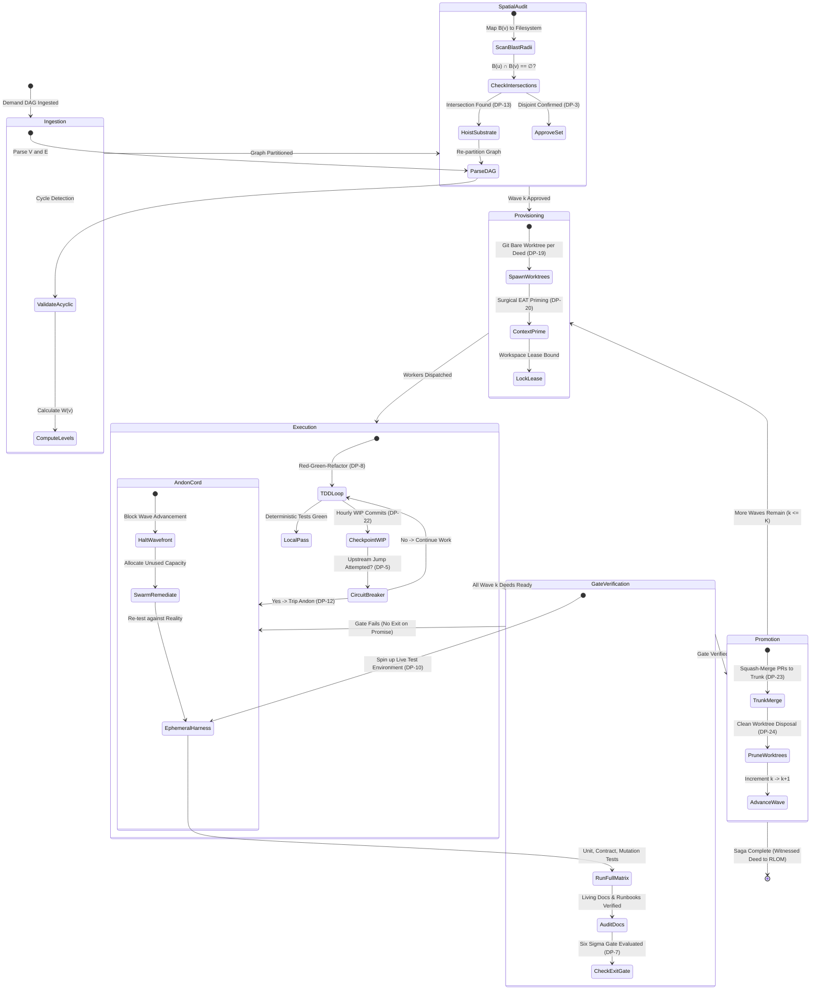

<!-- LICENSE: © 2026 Ravenhelm LLC. Licensed material. -->
<!-- All rights reserved except as granted in LICENSE. Inquiries: nate@ravenhelm.co -->

## Chapter 9 — Topological Waves: Replacing the Two-Week Sprint

It is 3:45 PM on Day 10 of Sprint 42. In the team's project tracking tool, twenty-eight issues sit inside an arbitrary bi-weekly timebox labeled "Checkout & Subscriptions Milestone." Across the engineering floor, panic has set in. The sprint backlog lumped together a database schema migration, an updated billing ledger service, an asynchronous Stripe webhook worker, and a redesigned checkout user interface. Because the sprint treated all twenty-eight tickets as interchangeable items to be completed within the same ten working days, they were scheduled concurrently.

Reality unraveled on Day 3. The senior database engineer assigned to the foundational schema migration was pulled into an urgent production database failover. The schema pull request—which renamed core account identifiers, added mandatory multi-tenant foreign keys, and altered transaction isolation levels—did not merge until Thursday afternoon of the sprint's second week. In the meantime, the frontend engineer, terrified of missing the "sprint commitment," spent six days writing complex React checkout forms against speculative, hand-rolled mock data stubs based on a brief Slack discussion. The backend worker team did the same, mocking the accounting ledger with hardcoded JSON payloads.

At 4:15 PM on Friday, the floodgates open. Five developers push branches to the merge queue simultaneously. The collision is catastrophic. The frontend form payload does not match the actual database schema; field names differ, mandatory UUIDs are missing, and validation rules reject the mocked client requests. The webhook worker deadlocks against the newly indexed ledger tables. Merge conflicts shred shared router tables, application configuration files, and domain models. The continuous integration pipeline lights up in solid crimson. Desperate to hit sprint velocity metrics before midnight, developers hack unreviewed hotfixes directly onto branches, bypass integration tests with `--skip-verify` flags, and merge broken code into the mainline. On Monday morning, Sprint 43 begins with false cheer, while fourteen bug tickets and an emergency production revert paralyze the engineering organization for the next three weeks.

This failure is not a personnel problem; it is a mathematical consequence of temporal timeboxing. The two-week calendar sprint is the most pervasive, destructive anti-pattern in modern software engineering. It commits topological violence against software architecture by projecting non-linear, causally coupled dependency graphs onto a flat calendar plane. The Ravenhelm Development Operations Methodology (RDOM) eradicates the two-week sprint entirely, replacing it with **Topological Wave Execution** (**DP-2**).

---

### The Theoretical & Mechanical Foundation

To understand why calendar sprints fail, one must examine the physics of manufacturing systems, the mathematics of directed graphs, and the queueing dynamics of information flow.

#### The Fallacy of the Calendar Timebox

The two-week sprint was conceived as a managerial compromise: an artificial cadence designed to limit financial exposure and give business stakeholders regular visibility. In practice, it acts as a blindfold. Software construction is not an additive assembly of independent bricks; it is a causal network of state transitions, contract definitions, and interface consumptions.

When an organization forces heterogeneous engineering tasks into a calendar timebox, it creates an artificial synchronization point where none exists in the problem domain. This creates three systemic dysfunctions:

1. **Temporal Blindness and Artificial Batching**: A database migration, an API gateway route, and a client UI screen have strict causal ordering: the database schema must be verified on live disk before the API layer can bind queries to it; the API layer must expose deterministic endpoints before the client can execute transactions against it. Squeezing all three into a two-week sprint creates a pressure cooker where downstream tasks either starve waiting for upstream tasks, or execute against hallucinated stubs.
2. **The "Sprint Crunch" and Ethical Hazard**: Calendar deadlines distort engineering incentives. As Day 10 approaches, the imperative shifts from *verifying correctness* to *burning story points*. Engineers cut corners, skip boundary testing, leave edge cases unhandled, and defer documentation to "next sprint." Debt is systematically manufactured to satisfy a calendar boundary.
3. **Queue Bloat and Little's Law**: Little's Law states that the average work-in-progress ($WIP$) in a system is the product of throughput ($\lambda$) and cycle time ($W$):

$$WIP = \lambda \cdot W$$

When teams admit unsequenced batches of tickets into a sprint, they artificially inflate $WIP$. High $WIP$ increases queuing delay, multiplies context-switching overhead, and creates severe contention for shared integration resources.

#### Mathematical Formulation of Topological Wave Partitioning

RDOM rejects calendar timeboxes in favor of graph topology (**DP-1**). Software work is modeled formally as a Directed Acyclic Graph:

$$G = (V, E)$$

Where $V = \{v_1, v_2, \dots, v_n\}$ represents the set of discrete, atomic deeds, and $E \subset V \times V$ represents the set of directed causal precedence edges. A directed edge $(u, v) \in E$ dictates an immutable causal prerequisite: deed $u$ must reach verified green on trunk before deed $v$ may be dispatched into an active worktree.

For each deed $v \in V$, its set of immediate inbound preconditions is:

$$\operatorname{Pred}(v) = \{u \in V \mid (u, v) \in E\}$$

We define the **Topological Wave Function** $W: V \to \mathbb{N}_0$ as the length of the longest causal path from a root node to $v$:

$$W(v) = \begin{cases} 0 & \text{if } \operatorname{Pred}(v) = \emptyset \\ 1 + \max_{u \in \operatorname{Pred}(v)} W(u) & \text{otherwise} \end{cases}$$

The graph partitions into an ordered sequence of discrete, disjoint **Topological Waves**:

$$W_k = \{ v \in V \mid W(v) = k \} \quad \text{for } k \in \{0, 1, \dots, K\}$$

Where $K = \max_{v \in V} W(v)$ is the topological depth of the execution graph.

```text
Traditional Two-Week Sprint (Temporal Blindness & Collision):
┌────────────────────────────────────────────────────────────────────────┐
│ Sprint Window: Calendar Days 1 to 14                                   │
│  [DB Schema]  --->  [API Route]  --->  [Worker Engine]  --->  [UI Form]│
│  └────── Concurrent Dispatch: Speculative Mocks & Race Conditions ─────┘│
└────────────────────────────────────────────────────────────────────────┘
                                    │
                                    ▼ (Compounding Merge Massacres)

RDOM Topological Wave Progression (Topological Proof & Gated Airlocks):
┌────────────────────────────────────────────────────────────────────────┐
│ Wave 0: Foundations & Schemas                                          │
│ [Database Migrations]  [Proto/OpenAPI Contracts]  [Shared Types Crate] │
└────────────────────────────────────────────────────────────────────────┘
                                    │
                         Six Sigma Gate (DP-7)
                   Deterministic Verified Green Proof
                                    │
                                    ▼
┌────────────────────────────────────────────────────────────────────────┐
│ Wave 1: Core Disjoint Implementations                                  │
│ [Ledger Worker Engine]    [Billing API Server]    [Auth Validator]     │
│   (Spatial Blast Radius Intersection: B(u) ∩ B(v) = ∅; DP-3)           │
└────────────────────────────────────────────────────────────────────────┘
                                    │
                         Six Sigma Gate (DP-7)
                   Deterministic Verified Green Proof
                                    │
                                    ▼
┌────────────────────────────────────────────────────────────────────────┐
│ Wave 2: Composite Integrations & Orchestration                         │
│ [Gateway Ingress Routing]    [Cross-Service Workflows]    [UI Screen]  │
└────────────────────────────────────────────────────────────────────────┘
                                    │
                         Six Sigma Gate (DP-7)
                   Deterministic Verified Green Proof
                                    │
                                    ▼
┌────────────────────────────────────────────────────────────────────────┐
│ Wave 3: End-to-End Verification, Documentation & UAT Showcase          │
│ [Doom Chaos Battery]  [Runbooks & AGENTS.md]  [Witnessed Showcase Deed]│
└────────────────────────────────────────────────────────────────────────┘
```

#### The Invariant of Topological Independence

The fundamental mathematical property of topological wave partitioning is that every deed within a given wave $W_k$ is mutually independent in causal time:

$$\forall u, v \in W_k \ (u \neq v) \implies (u, v) \notin E^* \land (v, u) \notin E^*$$

Where $E^*$ is the transitive closure of $E$. Because no path exists between any two nodes in $W_k$, no deed in $W_k$ depends on the output, interface, or state of any other deed in $W_k$. All nodes in Wave $W_k$ can execute concurrently with zero topological hazard. Concurrency is not an optimistic gamble; it is earned through topological proof (**DP-1**, **DP-2**).

#### Spatial Blast Radii and Zero Collision by Construction (DP-3)

Topological independence guarantees that tasks do not depend on each other's outputs. However, concurrency can still fail if two parallel workers mutate the same physical files, tables, or configuration registers. RDOM enforces **Zero Collision by Construction** (**DP-3**).

Every deed $v \in V$ declares its bounded spatial blast radius $\mathcal{B}(v)$ over the estate's resources $\mathcal{F}$ (filepaths, database tables, API routes, port allocations):

$$\mathcal{B}(v) \subset \mathcal{F}$$

To admit deeds $u$ and $v$ into the same concurrent execution wave $W_k$, their spatial blast radii must be strictly disjoint:

$$\forall u, v \in W_k \ (u \neq v) \implies \mathcal{B}(u) \cap \mathcal{B}(v) = \emptyset$$

If two deeds within candidate wave $W_k$ share a non-empty spatial intersection ($\mathcal{B}(u) \cap \mathcal{B}(v) = \mathcal{S} \neq \emptyset$), the scheduler applies the **Hoisting Resolution Protocol**:



#### Goldratt's Critical Chain, Feeding Buffers & Fever Charts

In classical Project Evaluation and Review Technique (PERT), task durations are treated as deterministic scalars, and resource constraints are ignored. In reality, human and agent worker capacities are bounded. RDOM incorporates Eliyahu Goldratt’s **Theory of Constraints (TOC)** and **Critical Chain Project Management (CCPM)** into wave execution (**DP-4**).

The **Critical Chain** is the longest sequence of resource-dependent and topologically dependent tasks through the DAG. All other paths through the graph are feeder paths that merge into the critical chain at wave boundaries.

To protect the critical chain from stochastic variation (e.g., test flakiness, compiler errors, agent retry loops) without padding individual task estimates, RDOM inserts **Feeding Buffers** ($FB$) at the convergence points between feeder paths and the critical chain, and a **Project Buffer** ($PB$) at the final delivery boundary.

```mermaid
gantt
    title Topological Wave Critical Chain & Buffer Architecture
    dateFormat  X
    axisFormat %d

    section Wave 0 (Substrates)
    Shared DB Schema (Critical)     :crit, w0_1, 0, 4
    OpenAPI Specification (Critical):crit, w0_2, 4, 7
    Wave 0 Exit Gate Airlock        :crit, g0, 7, 8

    section Wave 1 (Implementations)
    Payment Ledger Engine (Critical):crit, w1_c, 8, 14
    Auth Token Validator (Feeder)   :w1_f1, 8, 11
    Audit Log Worker (Feeder)       :w1_f2, 8, 12
    Feeder Buffer 1 (FB1)           :active, fb1, 12, 14
    Wave 1 Exit Gate Airlock        :crit, g1, 14, 15

    section Wave 2 (Integrations)
    Checkout Pipeline (Critical)    :crit, w2_c, 15, 21
    Notification Dispatch (Feeder)  :w2_f, 15, 18
    Feeder Buffer 2 (FB2)           :active, fb2, 18, 21
    Wave 2 Exit Gate Airlock        :crit, g2, 21, 22

    section Wave 3 (Verification)
    Doom E2E Battery (Critical)     :crit, w3_c, 22, 26
    Documentation & Showcase        :crit, w3_d, 26, 28
    Project Buffer (PB)             :active, pb, 28, 32
```



Instead of monitoring misleading burndown charts of story points, wave progression is monitored using a **Fever Chart**. The Fever Chart plots the percentage of the critical chain completed against the percentage of buffer consumed across three operational zones:

| Fever Zone | Buffer Consumption | Operational Meaning | Action Mandated |
|:---|:---:|:---|:---|
| **Green Zone** | $< 33\%$ consumed | Execution variance within normal operational noise. | Normal autonomous execution continues. |
| **Yellow Zone** | $33\% - 66\%$ consumed | Upstream variance eroding safety margins. | Lead architect notified; feeder bottlenecks audited. |
| **Red Zone** | $> 66\%$ consumed | High hazard of critical chain slippage. | **Andon Cord pulled (DP-12)**; unallocated workers swarm critical nodes. |

---

### Operational Mechanics & Step-by-Step Protocols

Topological wave execution operates as an event-driven finite state machine. Waves do not advance on a calendar schedule; they advance when mathematical proof gates are satisfied (**DP-7**).

#### The Standard Four-Tier Wave Architecture

While any valid DAG can be partitioned into $K$ waves, mature software systems converge on a canonical four-tier archetype for complex sagas:

| Wave Tier | Architectural Focus | Primary Deliverables | Strict Exit Gate Criteria |
|:---|:---|:---|:---|
| **Wave 0: Hoisted Substrates** | Schema invariants, foundational types, interface contracts, storage migrations. | SQL DDL migrations, protocol buffers, OpenAPI specs, shared Rust/Go core domain crates, seed test fixtures. | Migrations execute and rollback cleanly on live ephemeral database instances (**DP-10**); contracts compile; SDK crates published to local workspace registry. |
| **Wave 1: Disjoint Core Implementations** | Autonomous domain logic engines, workers, query handlers, and API endpoints. | Service handlers, background consumers, transactional repositories, domain state machines. | 100% unit test coverage; all contract validation suites pass against live Wave 0 schemas; zero spatial blast radius overlap across active branches (**DP-3**). |
| **Wave 2: Composite Integrations** | Ingress routing, multi-service orchestration pipelines, customer-facing workflows. | API gateway bindings, orchestration workflows, event bus consumers, client UI screens. | Multi-service integration test suites pass in containerized networks; telemetry spans propagate end-to-end; data flow matches contract invariants. |
| **Wave 3: Verification, Docs & Showcase** | System-wide verification, living operational documentation, and UAT showcase. | Doom chaos test suites, performance benchmarks, updated `docs/`, runbooks, `AGENTS.md`, and the **Witnessed Showcase Deed** (**DP-11**). | Doom adversarial verification clean; zero unresolved linter warnings; documentation merged; executable showcase video/script witnessed and submitted to RLOM. |

#### The Six-Phase Wave Execution Lifecycle

Executing a topological wave follows a deterministic six-phase lifecycle from graph ingestion to workspace disposal.



##### Phase 1: Ingestion and DAG Compilation

Work packages from upstream intake (RLOM) are passed to the intake compiler. The compiler reads the node set $V$ and causal edge set $E$, executes Tarjan's strongly connected components algorithm to verify acyclicity, and computes topological wave assignments $W(v)$ using the Wave Function. Any circular dependency triggers an immediate intake rejection.

##### Phase 2: Spatial Blast Radius Audit & Hoisting

Before branches are generated, the execution engine evaluates the declared blast radius $\mathcal{B}(v)$ for every deed in the candidate wave $W_k$. The engine inspects filepath patterns, database table allocations, and public interface signatures. If a collision is detected between $u, v \in W_k$, the engine halts wave provisioning and invokes the Hoisting Protocol (**DP-13**, **DP-14**), creating a hoisted substrate deed in $W_{k-1}$ or shifting one task into $W_{k+1}$.

##### Phase 3: Worktree Provisioning & Context Priming

For each verified deed $v \in W_k$, the system provisions an isolated git worktree attached to a canonical bare repository (**DP-19**):

```bash
# Provision isolated worktree for deed RAV-402 in Wave 1
git worktree add \
  --detach \
  /Users/nate/src/platforms/ravenmaskos/worktrees/RAV-402 \
  origin/main

# Prime the workspace context using EAT substrate (DP-20)
cd /Users/nate/src/platforms/ravenmaskos/worktrees/RAV-402
eat prime . --budget 800
```

The workspace is surgically primed using the Entity-Attribute-Tag (EAT) substrate (**DP-20**), loading only the exact AST symbols, interface signatures, and living documents relevant to $\mathcal{B}(v)$. Blind directory dumping is strictly forbidden.

##### Phase 4: Parallel Wavefront Execution & WIP Caps

Workers (human engineers or autonomous agent slices) execute exclusively within their dedicated worktrees. Concurrency is capped by Little's Law and finite worker slots ($M$):

$$C = \min(|W_k|, M)$$

Workers operate under strict state-machine discipline:

- **Red-Green-Refactor FSM (DP-8)**: An implementation diff is invalid unless preceded by a recorded failing test commit.
- **Hourly WIP Commits (DP-22)**: Workers checkpoint progress every sixty minutes using structured `WIP:` commits. Stashes are banned machine-wide.
- **Upstream-Jump Circuit Breaker (DP-5)**: If a worker in Wave 1 attempts to modify a file belonging to Wave 0 substrates, pre-commit hooks intercept the diff, halt execution, revoke the worktree lease, and trip the Andon Cord (**DP-12**).

##### Phase 5: Six Sigma Wave Boundary Gate & Deterministic Verification

When all deeds in Wave $W_k$ announce completion, the wave enters the **Boundary Gate Airlock**. The gatekeeper evaluates the wave against the Six Sigma Quality Standard (**DP-7**):

1. **Live System Conformance (DP-10)**: All database migrations and network services are executed against pristine ephemeral containers mirroring live infrastructure.
2. **Contract Conformance**: Client SDKs execute integration batteries against live services; synthetic mocks are rejected.
3. **No Flakiness Tolerance**: Test suites must pass deterministically across three consecutive runs.
4. **Living Documentation Conformance**: Any API change must include corresponding updates to `docs/`, operational runbooks, and repository `AGENTS.md`.

> **The Axiom of Quality**: *Wave $W_{k+1}$ never opens on a promise; only on verified green.* If any deed in Wave $W_k$ fails verification, the boundary remains sealed. No worktree for Wave $W_{k+1}$ may be unlocked.

##### Phase 6: Promotion, Trunk Merge & Clean Worktree Disposal

Upon certified passage of the wave gate:

1. All pull requests in Wave $W_k$ are squash-merged into the trunk branch (`main`) via authoritative review (**DP-23**).
2. Ephemeral worktrees are purged from local filesystems (**DP-24**):

   ```bash
   git worktree remove /Users/nate/src/platforms/ravenmaskos/worktrees/RAV-402 --force
   git worktree prune
   ```

3. The orchestrator emits a cryptographic wave completion attestation and immediately unlocks Wave $W_{k+1}$.

---

### Concrete Anti-Patterns & Defect Escapes

When engineering organizations attempt to transition from sprints to waves without understanding graph mechanics, they fall prey to five destructive anti-patterns:

```text
Anti-Pattern Typology in Wave Execution:
┌───────────────────────────────┬───────────────────────────────────────────┐
│ Anti-Pattern Name             │ Failure Mechanism & Defect Escape         │
├───────────────────────────────┼───────────────────────────────────────────┤
│ 1. Sprint Spillover Syndrome  │ Treating unfinished work as "carryover"   │
│    (Debt Snowball)            │ rather than an Andon halt.                │
├───────────────────────────────┼───────────────────────────────────────────┤
│ 2. Fake Concurrency           │ Spawning parallel branches that share     │
│    (Spatial Collision)        │ spatial blast radii (B(u) ∩ B(v) ≠ ∅).    │
├───────────────────────────────┼───────────────────────────────────────────┤
│ 3. Premature Wave Advancement │ Opening Wave k+1 while Wave k is          │
│    (Promissory Gate Passing)  │ "almost done" or running on mocks.        │
├───────────────────────────────┼───────────────────────────────────────────┤
│ 4. Substrate Smuggling        │ Modifying Wave 0 schemas mid-wave inside  │
│    (Silent Contract Drift)    │ a Wave 1 or Wave 2 feature branch.        │
├───────────────────────────────┼───────────────────────────────────────────┤
│ 5. The Flat Backlog Fallacy   │ Prioritizing tickets by business urgency  │
│    (Topological Blindness)    │ without calculating graph height.         │
└───────────────────────────────┴───────────────────────────────────────────┘
```

#### 1. The Sprint Spillover Syndrome (The Debt Snowball)

In traditional Agile, unfinished tickets at the end of a sprint simply "roll over" into the next sprint backlog. This normalizes failure. In RDOM, **waves do not roll over**.

A wave has no calendar cutoff, but it has absolute completion invariants. If three deeds in Wave 1 are finished and the fourth is blocked, Wave 1 remains open. The organization does not proceed to Wave 2 and leave the fourth deed as a lingering branch. Instead, the Andon Cord is pulled (**DP-12**): free capacity swarms the blocked node, diagnoses root cause, rectifies the interface, and drives it to green. Rollover debt is eradicated at the point of origin.

#### 2. Fake Concurrency (The Illusion of Parallelism)

Management teams often purchase "velocity" by launching ten autonomous coding agents or assigning ten developers to parallel branches without auditing their spatial footprints.

For example, Developer A works on user registration while Developer B works on password reset. Because both features involve "users," both developers edit `src/models/user.rs`, `src/routes/auth.rs`, and `migrations/004_auth.sql`. Although their business tickets are nominally distinct, their spatial blast radii overlap entirely.

When both branches attempt to merge, git conflicts erupt, semantic changes overwrite one another, and tests fail mysteriously. Under RDOM, this concurrency is recognized as fake: the shared structs must be hoisted into Wave 0 (**DP-13**), or the tasks must be serialized into distinct wave tiers.

#### 3. Premature Wave Advancement (Promissory Notes & Mock Theater)

Under deadline pressure, engineering managers inevitably argue: *"Developer A's backend API is 95% complete; let's unlock Wave 2 so Frontend Developer B doesn't sit idle."*

This is the most lethal escape in software development. Developer B writes code against Developer A's incomplete API or creates a local mock server. When Developer A finishes, the actual API behavior diverges from the mock: error payload structures differ, pagination headers use a different key, and token expiration triggers unexpected status codes. Developer B must now discard days of work and rewrite the integration.

RDOM enforces the geometric cost equation of defect escapes:

$$C_{\text{escape}} = k \cdot b^d$$

Where $b \approx 10$ is the cross-phase amplification factor and $d$ is phase depth. Advancing across a wave boundary on a promise increases $d$ by 1, multiplying the cost of rework tenfold. No wave opens on a promise.

#### 4. Substrate Smuggling (Silent Contract Drift)

A developer assigned to a Wave 2 UI component realizes that the backend API omitted a user avatar URL. Instead of tripping the circuit breaker (**DP-5**) and requesting a hoisted schema update, the developer adds the column to the database migration file directly within their UI branch, modifies the backend handler, and patches the frontend.

This is **Substrate Smuggling**. The developer has broken wave isolation by modifying an upstream Wave 0 artifact from within a downstream branch. If another developer in Wave 2 is also running tests against Wave 0, their tests fail due to uncoordinated migration timestamps and schema drift. RDOM pre-commit hooks intercept any mutation to files outside $\mathcal{B}(v)$ and abort the commit.

#### 5. The Flat Backlog Fallacy (Topological Blindness)

Product managers frequently construct roadmaps by sorting issues in a spreadsheet according to customer squeakiness or subjective business value. They demand that "Feature X" be delivered first because an enterprise customer requested it.

If Feature X is a Wave 3 integration node requiring three layers of prerequisite infrastructure, scheduling Feature X without scheduling its predecessor DAG ($G$) results in immediate failure. RDOM mandates that product managers manage intent through Sagas and Epics in RLOM, but release execution order is dictated solely by graph topology and the critical chain floor (**DP-4**).

---

### Upstream & Downstream Integration (The Sovereign Triad)

Topological wave execution does not exist in an organizational vacuum. It is the core operational engine of the **Sovereign Triad**, interfacing cleanly with upstream demand planning and downstream release operations:

```text
       DEMAND & INTENT                  EXECUTION CADENCE                 RELEASE & RUNTIME
  +------------------------+        +------------------------+        +------------------------+
  |          RLOM          |        |          RDOM          |        |          RROM          |
  | Ravenhelm Linear       | =====> | Ravenhelm Development  | =====> | Ravenhelm Release      |
  | Operating Method       |        | Operations Method      |        | Operations Method      |
  +------------------------+        +------------------------+        +------------------------+
  Axiom: "If it isn't               Axiom: "Concurrency is            Axiom: "Builds are the
  witnessed by a deed,              earned through topological        unit; releases are names."
  it didn't happen."                proof; quality is gated
                                    by verified green."
```

#### Upstream Contract: RLOM $\to$ RDOM (The Intake Boundary)

Upstream demand is governed by the **Ravenhelm Linear Operating Method (RLOM)** (`P-1` through `P-29`). RLOM enforces the **Hierarchy of Deeds**:

- **Sagas (Initiatives)**: High-level business capabilities with explicit strategic objectives.
- **Wyrd Runes (Epics)**: Cohesive architectural deliverables containing a bounded problem space.
- **Deeds (Issues)**: Atomic, single-threaded units of work with verifiable acceptance criteria.

Before an RLOM epic can transition into RDOM execution, it must satisfy the **Definition of Ready (DoR)**:

1. **Explicit Causal Graph**: Every deed must declare its `blocked_by` and `blocks` relationships. Floating or unlinked issues are rejected.
2. **Declared Blast Radius**: Every deed must specify its bounded target paths ($\mathcal{B}(v)$).
3. **Deterministic Acceptance Criteria**: Criteria must be expressible as automated test assertions, not subjective impressions.

During wave compilation, RDOM reads the RLOM epic graph, computes the topological waves ($W_0 \dots W_K$), and synchronizes wave states directly back to Linear. Engineers and stakeholders see real-time wave progression rather than fictional sprint burndown charts.

#### Downstream Contract: RDOM $\to$ RROM (The Release Boundary)

Downstream release custody is governed by the **Ravenhelm Release Operations Method (RROM)** (`RP-1` through `RP-18`), operating under the doctrine: *"Builds are the unit; releases are names."*

RDOM terminates at the Pull Request boundary (**DP-23**). When Wave $W_K$ satisfies its exit gate, RDOM produces the **Feature Release Triad** (**DP-11**):

1. **Deterministic Green Silicon**: Clean, passing test suites across all units, contracts, and integration batteries verified against live environments (**DP-7**, **DP-10**).
2. **Living Authoritative Documentation**: Updated Markdown documentation in `docs/`, operational runbooks, and repository `AGENTS.md` capturing architectural changes and ADR citations.
3. **The Witnessed Showcase Deed**: An executable script, terminal recording, or automated browser session demonstrating the live running system fulfilling the original RLOM acceptance criteria.

Upon approval, code merges to trunk. RROM compiles immutable container images tagged with unique commit SHAs, publishes them to the private Harbor registry, and promotes identical binaries across staging and production clusters via Argo CD GitOps without recompilation.

#### The Showcase-as-UAT Feedback Loop

In conventional software development, User Acceptance Testing (UAT) is an agonizing phase of manual exploratory testing where business stakeholders poke at a staging environment weeks after code was written.

In the Sovereign Triad, the **Witnessed Showcase Deed** produced in Wave 3 serves as the physical proof artifact for RLOM sign-off. Stakeholders review the witnessed execution recording and live verification logs. Because the showcase was executed on the live running system (**DP-10**), acceptance is deterministic. When the showcase satisfies the original RLOM acceptance criteria, the saga transitions to Done, completing the feedback loop between business intent and operational reality.

---

> **Augmentation Surface — AI Agent & Human Roles**
>
> Where an agent layer transforms this practice:
>
> - **Autonomous Graph Compilation & Blast Radius Auditing**: When an RLOM epic is marked ready, an automated governor agent parses the issue graph, verifies acyclicity, calculates the topological wave partition ($W(v)$), and inspects target codebases to ensure $\mathcal{B}(u) \cap \mathcal{B}(v) = \emptyset$. If a spatial collision is detected, the agent drafts the hoisting proposal and presents it to the lead architect.
> - **Worktree Provisioning & AST Priming**: The moment Wave $W_k$ achieves verified green, the orchestrator automatically provisions dedicated bare worktrees for all Wave $W_{k+1}$ deeds (**DP-19**), generates surgical AST context packets using the EAT substrate (**DP-20**), and dispatches autonomous coding agents into their respective sandboxes without human coordination.
> - **Continuous Boundary Gatekeeping & Fever Chart Monitoring**: Headless supervisor agents monitor test executions, track buffer consumption on live Fever Charts, detect failing suites, and enforce the Six Sigma boundary airlock (**DP-7**). If an agent attempts to edit files outside its declared blast radius, the supervisor trips the circuit breaker (**DP-5**), sounds the Andon Cord (**DP-12**), and alerts the human team.
>
> What the human architect keeps:
>
> - **Sovereign Strategic Intent**: Humans alone define business value, prioritize RLOM sagas, and establish the ultimate architectural boundaries of the estate.
> - **Hoisting & Architecture Adjudication**: When spatial conflicts arise or core abstractions must be hoisted into Wave 0 substrates, human architects review the proposed abstractions during the Ráð and authorize Architectural Decision Records (ADRs).
> - **Production Cutover Authority**: No autonomous agent or automated gatekeeper may authorize live production cutovers, destructive database schema migrations, or financial transaction releases without explicit, witnessed human approval.

---

<!-- RUBRIC_CHECK:
  structural: pass
  content: pass
  funnel: pass
  chapter-type-extras: n/a
  word-count: 4666
  principle-citations: DP-1, DP-2, DP-3, DP-4, DP-5, DP-7, DP-8, DP-10, DP-11, DP-12, DP-13, DP-14, DP-19, DP-20, DP-21, DP-22, DP-23, DP-24
  flagged-principle-gaps: none
-->
