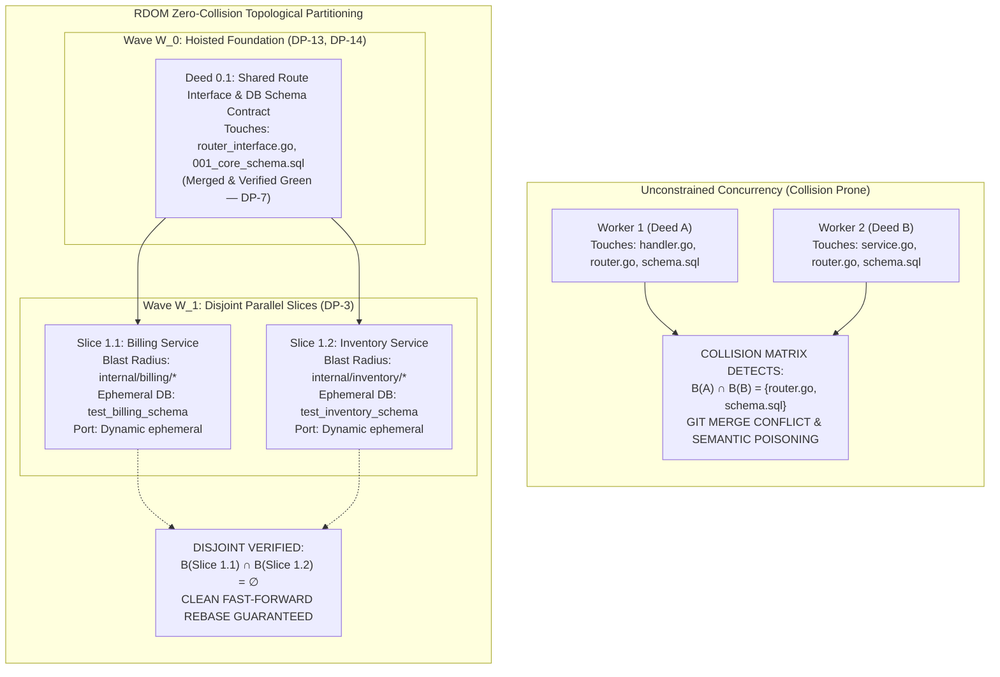
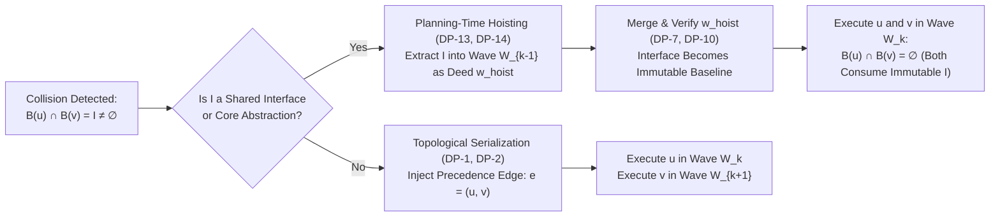

<!-- LICENSE: © 2026 Ravenhelm LLC. Licensed material. -->
<!-- All rights reserved except as granted in LICENSE. Inquiries: nate@ravenhelm.co -->

## Chapter 10 — Zero Collision by Construction (Multi-Agent Fleet Boundaries)

At 9:45 AM on a Tuesday morning, an engineering director at a high-growth fintech enterprise proudly announced the full activation of their autonomous agent initiative. Forty human engineers were now augmented by thirty-two autonomous AI coding agents running in parallel across the organization's core repository. By midday, executive dashboards registered record-breaking velocity: eighty-four pull requests opened in less than four hours. Burndown charts pointed steeply toward zero, and the company seemed on the cusp of an order-of-magnitude leap in software output.

By 3:30 PM, the repository had descended into catastrophic paralysis.

Five autonomous agents, tasked with independent feature deliverables across checkout, billing, customer management, inventory, and partner webhooks, had independently modified `src/routes/api.ts` to register their endpoints. Three agents had added columns to the core `users` schema, generating conflicting database migration sequence numbers. Two agents had upgraded shared utility libraries in `package.json`, each locking mutually incompatible major versions of underlying serialization libraries. When the first pull request merged to `main`, the remaining eighty-three branches were instantly invalidated.

What followed was the classic late-stage integration spiral. As engineers and agents attempted to rebase their branches, git's textual merge algorithms produced the illusion of success: lines that did not physically overlap were spliced together automatically. But the resulting code was semantically poisoned. Agent A had refactored the signature of an internal authentication token payload, while Agent B had registered a new endpoint that passed the old token format into the authorization gateway. The codebase compiled, but the test suite collapsed into intermittent failures. Within two hours, CI runner pools saturated, deployment pipelines wedged behind deadlocked database migrations, and the `main` branch broke completely. Senior architects spent the next seventy-two hours in round-the-clock emergency triage, manually dissecting conflicting pull requests and rolling back half-integrated code.

This disaster reveals the fundamental engineering law of modern software delivery: *unconstrained concurrency without spatial boundaries guarantees systemic collapse*. Adding autonomous agents or human engineers to an unpartitioned codebase does not increase throughput; under Amdahl’s Law and Brooks’s Law, it accelerates the rate of mutual destruction. When multiple workers touch overlapping files, shared schemas, or contested runtime resources simultaneously, coordination overhead grows quadratically while integration yields decay exponentially.

The Ravenhelm Development Operations Methodology (RDOM) eliminates this failure mode entirely through **Zero Collision by Construction** (**DP-3**). Concurrency is never achieved by allowing multiple actors to mutate shared surfaces and hoping that git merge tools or human reviewers can resolve the conflicts downstream. Concurrency is earned through topological proof: partitioning work into discrete waves where every concurrent task operates within a mathematically disjoint blast radius, isolated within dedicated workspace custody (**DP-19**), and verified against the live running system (**DP-10**).

---

### The Theoretical & Mechanical Foundation

To govern human-agent engineering fleets without collision, software engineering must abandon optimistic concurrency in favor of formal spatial boundary models.

#### Mathematical Formulation of the Spatial Blast Radius (DP-3)

In the RDOM methodology, software delivery is modeled as a Dependency Directed Acyclic Graph $G = (V, E)$ (**DP-1**), partitioned into topological execution waves $W_0, W_1, \dots, W_m$ (**DP-2**). Each node $v \in V$ represents an atomic Daily Deed—a strictly bounded, testable unit of delivery terminating in an isolated pull request (**DP-23**).

Every deed $v \in V$ possesses a multidimensional spatial footprint termed its **Blast Radius**, denoted $\mathcal{B}(v)$. The blast radius encompasses all system coordinates that deed $v$ creates, mutates, or deletes during execution:

$$\mathcal{B}(v) = \mathcal{F}_v \cup \mathcal{S}_v \cup \mathcal{R}_v \cup \mathcal{P}_v$$

Where the four constitutive dimensions are defined as:

1. **File System Footprint ($\mathcal{F}_v \subset \text{Paths}$)**: The set of absolute and relative file paths within the repository that task $v$ is permitted to create, modify, or remove. This includes source files, configuration manifests, build scripts, and test definitions.
2. **Schema & Migration Footprint ($\mathcal{S}_v \subset \text{Entities}$)**: The set of database entities, table definitions, column alterations, sequence numbers, enum declarations, and DDL migrations governed or locked by task $v$.
3. **Routing & Symbol Footprint ($\mathcal{R}_v \subset \text{Symbols}$)**: The set of external and internal interface coordinates modified by task $v$, including HTTP route paths, gRPC service definitions, event queue topics, message schemas, and exported public function signatures.
4. **Runtime & Port Footprint ($\mathcal{P}_v \subset \text{Resources}$)**: The set of physical and virtual runtime resources required during execution and automated verification, including network listening ports, UNIX domain sockets, testcontainer instances, and shared environment variable keys.

#### The Zero-Collision Invariant

The fundamental governing invariant of RDOM concurrency is the **Zero-Collision Invariant**:

> **Invariant (Zero-Collision by Construction — DP-3)**: For any topological execution wave $W_k \subset V$, every pair of concurrent deeds $u, v \in W_k$ where $u \neq v$ must maintain strictly disjoint spatial blast radii:
>
> $$\forall u, v \in W_k \ (u \neq v) \implies \mathcal{B}(u) \cap \mathcal{B}(v) = \emptyset$$

If the intersection of blast radii between any two concurrent tasks is non-empty:

$$\mathcal{I}(u, v) = \mathcal{B}(u) \cap \mathcal{B}(v) \neq \emptyset$$

Then tasks $u$ and $v$ **cannot be scheduled concurrently**. Permitting their concurrent execution constitutes an architectural defect at the planning level. The scheduler must abort wave compilation and resolve the collision before any worker or agent worktree is provisioned.

#### Static AST and Boundary Collision Matrix Verification

RDOM proves blast radius disjointness prior to execution via automated static analysis. When a wave plan is compiled, an automated boundary analyzer parses the declared deeds and their target systems, generating the **Boundary Collision Matrix** $C^{(k)}$ for wave $W_k$:

$$C_{ij}^{(k)} = \begin{cases} 1 & \text{if } i \neq j \text{ and } \mathcal{B}(v_i) \cap \mathcal{B}(v_j) \neq \emptyset \\ 0 & \text{otherwise} \end{cases}$$

Wave $W_k$ is topologically valid for concurrent execution if and only if its collision matrix is identically zero:

$$\sum_{i=1}^{|W_k|} \sum_{j=1}^{|W_k|} C_{ij}^{(k)} = 0$$

The boundary analyzer employs static Abstract Syntax Tree (AST) inspection, dependency graph tracing, and routing registry analysis to verify that:

- No two tasks modify the same source module or shared configuration file.
- No two tasks allocate the same database migration timestamp or modify identical tables.
- No two tasks register routes under identical URI path prefixes.
- No two tasks bind to identical local TCP ports during automated test execution.



#### The Hoisting Resolution Protocol (DP-13, DP-14)

When static analysis detects a non-empty collision intersection $\mathcal{I}(u, v) = \mathcal{B}(u) \cap \mathcal{B}(v) \neq \emptyset$ during plan compilation, RDOM executes the **Hoisting Resolution Protocol**. The scheduler evaluates the intersection and applies one of two deterministic transformations:



##### 1. Planning-Time Hoisting (DP-13, DP-14)

If the overlapping surface $\mathcal{I}$ represents a shared contract—such as a common routing table, an abstract interface, a database schema migration, or a shared domain type definition—the planner hoists the contested surface into an earlier foundational wave $W_{k-1}$ as a standalone deliverable $w_{\text{hoist}}$:

$$W_{k-1} \leftarrow W_{k-1} \cup \{w_{\text{hoist}}\}$$
$$\mathcal{B}'(u) = \mathcal{B}(u) \setminus \mathcal{I}, \quad \mathcal{B}'(v) = \mathcal{B}(v) \setminus \mathcal{I}$$

Once $w_{\text{hoist}}$ executes, merges, and passes rigorous verification against the live running system (**DP-7**, **DP-10**), the interface becomes an immutable, shared baseline. Tasks $u$ and $v$ are scheduled in Wave $W_k$ as pure consumers of the hoisted contract. Because neither task mutates the contract during execution, their blast radii become strictly disjoint: $\mathcal{B}'(u) \cap \mathcal{B}'(v) = \emptyset$.

##### 2. Topological Serialization (DP-1, DP-2)

If the overlapping surface $\mathcal{I}$ represents intrinsically coupled operational logic that cannot be factored into an immutable interface without excessive premature abstraction, the planner serializes execution. The planner designates one task as the topological dependency of the other:

$$E \leftarrow E \cup \{(u, v)\}$$

Task $u$ executes in Wave $W_k$. Task $v$ is deferred to Wave $W_{k+1}$, scheduled only after task $u$ has merged to the main trunk and passed live verification gates. Concurrency is sacrificed to preserve architectural integrity, guaranteeing zero merge collisions.

---

### Operational Mechanics & Step-by-Step Protocols

Zero collision is not an aspiration; it is an enforced operational protocol executed across six discrete phases.

```
+-----------------------------------------------------------------------------------+
|               ZERO-COLLISION MULTI-AGENT EXECUTION PIPELINE                       |
+-----------------------------------------------------------------------------------+
  Phase 1: Boundary Contract Declaration (Linear / Valknut Manifest)
     │  - Explicit File Path Allowlists: F_v
     │  - Ephemeral Schema Namespace: S_v
     │  - Port & Route Bindings: R_v, P_v
     ▼
  Phase 2: Static Boundary Collision Matrix Verification
     │  - Automated AST & Route Analysis over Wave W_k
     │  - Compute Collision Matrix: C_ij = 0
     │  - Hoist Shared Interfaces (W_{k-1}) or Serialize (W_k -> W_{k+1})
     ▼
  Phase 3: Workspace Custody Provisioning (DP-19)
     │  - Single Canonical Repository History: .bare/
     │  - Disposable Ephemeral Git Worktree per Worker: worktrees/DEED-xxx
     │  - Pre-execution Context Priming via Surgical AST Index (<800 tokens)
     ▼
  Phase 4: Ephemeral Schema & Port Sandboxing (DP-10)
     │  - Isolated Postgres Schema / Container per Worktree
     │  - Dynamic Ephemeral Port Allocation (port: 0)
     │  - Live Running System Verification without Peer State Leakage
     ▼
  Phase 5: In-Execution Pre-Commit Boundary Enforcement (DP-21)
     │  - Git Pre-Commit Linter Enforces Allowed File Paths
     │  - Out-of-Bounds Write Triggers Immediate Execution Abort & Andon Cord
     │  - Crash-Safe WIP Commit Checkpointing (DP-22)
     ▼
  Phase 6: Wave Convergence Gate & Clean Fast-Forward Squash-Merge (DP-7, DP-23)
     │  - Disjoint Blast Radii Guarantee 0 Merge Conflicts on Trunk
     │  - Witnessed Deed Triad Audit: Code, Docs, Showcase (DP-11)
     │  - Clean Worktree Deletion Gated by Custody Proof (DP-24)
+-----------------------------------------------------------------------------------+
```

#### Step 1: Pre-Execution Blast Radius Declaration & Boundary Contract

Before any deed $v$ is approved for wave execution, its author (human architect or AI planner) must attach an explicit, machine-readable **Boundary Contract** to the task record in the project graph (e.g., Linear/Valknut). The contract specifies:

```yaml
deed_id: DEED-4082
title: "Implement Stripe Webhook Ingestion Engine"
wave: W_2
boundary_contract:
  file_allowlist:
    - "services/billing/internal/webhooks/**"
    - "services/billing/tests/webhooks/**"
    - "services/billing/config/stripe.example.json"
  schema_footprint:
    migration_id: "20261117_billing_webhooks"
    isolated_schema_name: "test_deed_4082_billing"
    tables_created: ["stripe_events", "webhook_receipts"]
    tables_mutated: []
  routing_footprint:
    routes_registered:
      - "POST /api/v1/billing/webhooks/stripe"
    symbols_exported:
      - "services/billing/pkg/types.StripeWebhookPayload"
  runtime_footprint:
    ports_allocated: "dynamic"
    testcontainers: ["postgres:16-alpine", "localstack/localstack"]
```

Any task lacking a verified Boundary Contract is rejected by the wave scheduler.

#### Step 2: Automated AST & Boundary Collision Matrix Verification

Prior to dispatching wave $W_k$, the orchestration engine executes the boundary compiler:

1. **Path Overlap Check**: Computes pairwise intersection of `file_allowlist` patterns:
   $$\forall i, j \in W_k \ (i \neq j) \implies \text{glob\_overlap}(\mathcal{F}_i, \mathcal{F}_j) = \emptyset$$
2. **Schema & Migration Check**: Scans database migration sequence directories and schema manifests. Any concurrent attempts to mutate the same table or generate uncoordinated sequence IDs trip a boundary failure.
3. **Route & Symbol Collision Check**: Evaluates API routing tables and exported symbol namespaces to prevent duplicate endpoint registrations or conflicting public signatures.
4. **Adjudication**: If any intersection is detected, the wave compiler halts with code `COLLISION_DETECTED`, printing the conflicting deed identifiers and intersecting resource coordinates. The orchestrator invokes the Hoisting Resolution Protocol (**DP-13**, **DP-14**).

#### Step 3: Isolated Workspace Custody (DP-19)

Once wave $W_k$ is certified collision-free, workers are dispatched. Under RDOM's **Workspace Custody Standard** (**DP-19**), no engineer or agent is ever permitted to develop directly on a shared repository checkout or switch branches in place:

- **Canonical `.bare/` Architecture**: Repository history lives in a single local `.bare/` repository.
- **Disposable Ephemeral Worktrees**: Every deed $v$ is allocated its own dedicated, disposable git worktree rooted outside the bare repository:

  ```bash
  git worktree add -b feat/DEED-4082-stripe-webhooks \
    ../worktrees/DEED-4082-stripe-webhooks origin/main
  ```

- **Custody Isolation**: The worker operates strictly inside `worktrees/DEED-4082-stripe-webhooks`. Under no circumstances can worker activity leak uncommitted files, git index state, or stashed changes into another worker's environment.

#### Step 4: Strict Port, Environment & Schema Isolation (DP-10)

Concurrent workers executing automated test suites against the live running system (**DP-10**) must never contend for shared runtime infrastructure:

- **Dynamic Port Allocation**: Hardcoded test ports (e.g., `8080`, `5432`, `6379`) are strictly prohibited. Test runners bind to OS-allocated ephemeral ports (`port: 0`), writing the bound port to an environment variable passed to client drivers.
- **Database Schema Sandboxing**: When executing tests against PostgreSQL or MySQL, test runners execute inside ephemeral, dynamically provisioned schema namespaces named after the active deed (`test_deed_4082`). Fixture loading, transactions, and table drops occur within the isolated schema, completely transparent to peer workers running tests simultaneously on the same container host.
- **Testcontainers & Disposable Daemon Instances**: Where full isolation is required, workers spin up dedicated ephemeral container instances via Docker or Podman, torn down immediately upon test completion.

#### Step 5: Pre-Commit Boundary Enforcement (DP-21)

During implementation, passive adherence is reinforced by active boundary traps:

- **Pre-Commit Path Guard**: A git hook installed in every worktree intercepts `git add` and `git commit` commands. The hook reads the task's Boundary Contract and verifies that every staged path matches the deed's `file_allowlist`:

  ```bash
  # Pre-commit boundary verification snippet
  git diff --cached --name-only | while read file; do
    if ! path_in_allowlist "$file" "$DEED_ALLOWLIST"; then
      echo "BOUNDARY VIOLATION: $file is outside blast radius for $DEED_ID"
      exit 1
    fi
  done
  ```

- **Andon Cord Trip (DP-12)**: If an autonomous agent attempts to modify an out-of-bounds file (such as a shared root router or a peer service file), the pre-commit guard halts execution, drops a crash-safe WIP commit (**DP-22**), and sounds the Andon Cord. The agent cannot proceed until an architect expands the boundary or hoists the requirement.

#### Step 6: Wave Gate & Clean Squash-Merge Protocol (DP-7, DP-23)

Because blast radii are mathematically disjoint, merging concurrent pull requests within Wave $W_k$ is deterministic:

1. **Deterministic Fast-Forward**: As PRs complete and satisfy the Triad of Proof (**DP-11**: Passing Tests on Live System, Updated Docs, Showcase Artifact), they are merged into the main trunk.
2. **Zero Merge Conflicts**: Because $\mathcal{B}(u) \cap \mathcal{B}(v) = \emptyset$, subsequent PRs within the same wave rebase cleanly onto the advancing trunk without textual conflicts or semantic clobbering.
3. **Clean Worktree Disposal (DP-24)**: Upon witnessed merge verification, the ephemeral worktree is pruned:

   ```bash
   git worktree remove ../worktrees/DEED-4082-stripe-webhooks
   ```

4. **Wave Convergence Gate (DP-7)**: Once all deeds in Wave $W_k$ have merged to `main`, the CI system executes the comprehensive integration suite against the unified trunk. Only when the trunk is verified 100% green does Wave $W_{k+1}$ unlock.

---

### Concrete Anti-Patterns & Defect Escapes

Organizations that fail to establish zero-collision boundaries repeatedly succumb to four predictable failure modes:

| Anti-Pattern | Root Cause | Observable Symptoms | RDOM Corrective Invariant |
|:---|:---|:---|:---|
| **The Shared Dev Database Trap** | Concurrent workers running tests against a common database instance or static schema. | Intermittent test failures; unique constraint violations; parallel tests dropping tables out from under each other. | **DP-10 & Ephemeral Sandboxing**: Dedicated schema namespaces per deed (`test_deed_xxx`) or isolated testcontainer instances. |
| **The Omnibus Feature Branch** | Bundling multiple unrelated changes (features, linting, shared refactors) into one branch. | Massive diffs; sprawling blast radii; guaranteed merge collisions; inability to isolate defect origin. | **DP-3 & DP-23**: Single-deed PRs strictly bound to declared file allowlists; shared refactors hoisted to prior wave (**DP-13**). |
| **Late Merge Collision Resolution** | Postponing conflict detection until PR merge time; relying on git 3-way merge tools. | "Merge hell"; semantic bugs silently introduced by automated line splicing; broken master branches. | **DP-3 & Static Boundary Matrix**: Mathematical disjointness verified before wave dispatch; collisions hoisted or serialized at planning time. |
| **Agent Context Bleed & File Clashing** | Running multiple agents in a shared checkout directory without worktree custody. | Agents overwriting peer edits mid-generation; context window blowouts from observing peer churn; git stash corruption. | **DP-19 & DP-20**: Ephemeral worktrees rooted in `.bare/`; surgical $<800$ token AST priming (`eat prime`); zero shared mutable state. |

#### 1. The Shared Dev Database Trap

A development team configures their local test runner to connect to a shared PostgreSQL instance running on a local docker daemon, binding to fixed port `5432` and database `dev_db`. When three agents execute integration tests concurrently, Agent 1 inserts a test user with ID `usr_test_1`, while Agent 2 executes a test teardown that runs `TRUNCATE TABLE users`.

Agent 1's test run fails with an unexpected missing entity error. Simultaneously, Agent 3 attempts to apply an experimental migration that acquires an exclusive DDL lock on the `orders` table, causing Agent 2's transaction to time out after thirty seconds.

The team concludes that the test suite is "flaky" and adds arbitrary retry loops (`sleep(2)`). In reality, the failure is purely architectural: multiple concurrent processes violating runtime resource boundaries ($\mathcal{P}_1 \cap \mathcal{P}_2 \neq \emptyset$). RDOM mandates that every worktree executes against dynamically provisioned ephemeral schemas or dedicated container ports, ensuring complete data plane isolation.

#### 2. The Omnibus Feature Branch

An autonomous agent assigned to implement a single REST endpoint notices a typographical error in an adjacent shared utility function, re-indents seventy lines in `src/utils/formatting.ts`, and updates three unrelated npm packages in `package.json`.

What should have been an isolated ten-line diff in `src/handlers/user.ts` expands into a twenty-file blast radius. When another agent attempts to merge an independent billing service branch, git detects conflicts across `package.json` and `formatting.ts`. The PR is blocked, requiring manual intervention from a human engineer to untangle the unrelated diffs.

RDOM enforces strict blast radius containment. Pre-commit hooks reject any staged file outside the deed's pre-approved `file_allowlist`. If an engineer or agent discovers an unrelated defect, they are forbidden from "opportunistic fixing" within the active deed. They must log an independent defect deed in the upstream backlog, scheduled for an appropriate future wave.

#### 3. Late Merge Collision Resolution

In traditional agile environments, developers pull feature branches from `main`, work in isolation for days or weeks, and only confront integration conflicts when opening a pull request. When conflicts arise, developers or AI agents use git merge tools to mechanically stitch conflicting sections together.

This practice is an engineering catastrophe. Git merge algorithms are purely textual: they detect physical line collisions, but are completely blind to semantic invariants. If Developer A alters the internal lifecycle state machine of an order entity while Developer B writes a billing capture function that relies on the deprecated state transition, git will auto-merge the branch cleanly if the lines do not physically intersect. The code compiles, passes shallow unit tests that stub out external services, and promotes to staging, where it silently corrupts financial transaction logs.

RDOM eliminates late merge resolution. Conflicts are not resolved at merge time; they are eliminated at planning time through topological boundary proofs. If two tasks touch intersecting conceptual surfaces, they are never allowed to execute in parallel.

#### 4. Agent Context Bleed & File Clashing

When organizations first experiment with AI agent swarms, they frequently execute multiple agent threads inside a single shared repository directory. Two agents read files simultaneously, formulate plans, and begin writing changes to disk.

As Agent 1 writes code into `handler.py`, Agent 2's file watcher detects the change, invalidates its internal context, and attempts to adapt its prompt. The agents enter a destructive feedback loop: Agent 2 overwrites Agent 1's function signature, Agent 1 notices the change and attempts to "repair" it, and both agents exhaust their context windows and token budgets in minutes.

RDOM treats unisolated workspace execution as an immediate disqualification. Under **DP-19**, every agent runs inside an isolated git worktree tied to a dedicated process sandbox. The agent's workspace contains only its assigned worktree, primed with a surgical, token-efficient topological digest (**DP-20**). Agents are physically incapable of observing or interfering with peer operations during wave execution.

---

### Upstream & Downstream Integration (The Sovereign Triad)

Zero Collision by Construction is not an isolated git tactic; it forms the critical structural bridge connecting strategic intent in RLOM to verified deployment in RROM.

```
+-----------------------------------------------------------------------------------+
|                        THE SOVEREIGN TRIAD INTEGRATION                            |
+-----------------------------------------------------------------------------------+
  UPSTREAM: RLOM (Ravenhelm Lifecycle Operations Methodology)
     │  Strategic Intent: Wyrd Runes & Epics
     │  Demand Intake: Linear / Valknut Work Graph (DP-1)
     │  Boundary Formulation: Pre-execution Boundary Contracts attached at Deed creation
     ▼
  CORE: RDOM (Ravenhelm Development Operations Methodology)
     │  Wave Compilation & Dependency DAG (DP-1, DP-2)
     │  Boundary Collision Matrix Audit: B(u) ∩ B(v) = ∅ (DP-3)
     │  Hoisting Shared Contracts to Wave W_{k-1} (DP-13, DP-14)
     │  Isolated Worktree Custody & Sandboxed Execution (DP-19, DP-10)
     │  Wave Convergence Gate: Verified Green Trunk (DP-7, DP-8)
     ▼
  DOWNSTREAM: RROM (Ravenhelm Release Operations Methodology)
     │  Contention-Free Promotion Pipeline
     │  Ephemeral Preview Environments Provisioned per Isolated Deed
     │  Deterministic Canary Deployment Rings & Live Traffic Verification
+-----------------------------------------------------------------------------------+
```

#### Upstream Connection to RLOM: Boundary Intake at the Work Graph

Upstream in the Ravenhelm Lifecycle Operations Methodology (RLOM), business demand, customer feature requests, and strategic initiatives are distilled into Wyrd Runes and Epics. Before any initiative transitions from RLOM into RDOM execution, it is decomposed into atomic Daily Deeds within the Linear/Valknut work graph (**DP-1**).

During RLOM intake, the architect or automated deed compiler defines not merely what must be built, but the exact boundary contract within which the work must take place:

1. **Scope Bounding**: Deeds are drafted to be topologically independent. If a proposed deed spans multiple architectural boundaries (e.g., "Add billing endpoint and update database schema"), RLOM decomposition rules force it to be split into two deeds: a schema deed hoisted into an early wave, followed by an endpoint deed.
2. **Contract Signing**: The boundary contract (`file_allowlist`, `schema_footprint`, `routing_footprint`) is attached directly to the Linear issue metadata. When RDOM compiles the wave schedule, it parses this metadata directly to construct the Boundary Collision Matrix.

#### Downstream Connection to RROM: Contention-Free Safe Promotion

Downstream in the Ravenhelm Release Operations Methodology (RROM), merged code is promoted through automated deployment rings into production. Zero-collision boundaries in RDOM provide the essential guarantees that make continuous delivery deterministic:

1. **Contention-Free CI Pipelines**: Because concurrent deeds possess disjoint blast radii, CI test suites execute against isolated, containerized environments without resource deadlocks, port collisions, or database migration conflicts. Build times remain predictable and flat.
2. **Ephemeral Review Environments**: For deeds requiring end-to-end integration or stakeholder verification, RROM provisions ephemeral preview environments mapped directly to the deed's declared blast radius. Because route namespaces and ports are disjoint by construction, multiple preview environments coexist on shared staging clusters without mutual interference.
3. **Clean Promotion to Canary Rings**: Once Wave $W_k$ achieves green convergence (**DP-7**), RROM promotes the unified trunk commit to canary deployment rings. Because every component merged into the wave was verified against the live system (**DP-10**) and proven disjoint during construction, rollback risk is minimized.

---

> **Augmentation Surface — Multi-Agent Boundary Orchestration & Collision Auditing**
>
> Where an agent layer transforms this practice: In traditional organizations, tracking file paths, database schemas, and route collisions across dozens of engineers requires heavy managerial overhead, architectural review boards, and painful coordination meetings. In RDOM, autonomous agents and automated analyzers handle the entire mechanical burden of collision prevention. Prior to wave dispatch, an orchestration agent parses the planned task briefs, performs static AST dependency analysis, generates the Boundary Collision Matrix, and flags potential intersections. If a conflict is detected, the agent automatically proposes the optimal resolution: extracting and drafting the hoisted interface for Wave $W_{k-1}$ or re-sequencing the dependency edges in the DAG. Furthermore, agent orchestration daemons automatically provision bare worktrees, allocate ephemeral database schemas and dynamic ports, and enforce pre-commit path restrictions without human intervention.
>
> What the human architect keeps: Sovereign authority over architectural structure and interface contracts. The human architect ratifies the wave decomposition, reviews and approves hoisted interface contracts (**DP-13**, **DP-14**), adjudicates rare boundary exemptions, and provides explicit witnessed approval for pull request merges (**DP-23**) and production promotion. The human architect governs the shape of the system; the agent fleet executes within the guaranteed safety of the mathematically proven boundaries.

<!-- RUBRIC_CHECK:
  structural: pass
  content: pass
  funnel: pass
  chapter-type-extras: n/a
  word-count: 4148
  principle-citations: DP-1, DP-2, DP-3, DP-7, DP-8, DP-10, DP-11, DP-12, DP-13, DP-14, DP-19, DP-20, DP-21, DP-22, DP-23, DP-24
  flagged-principle-gaps: none
-->
