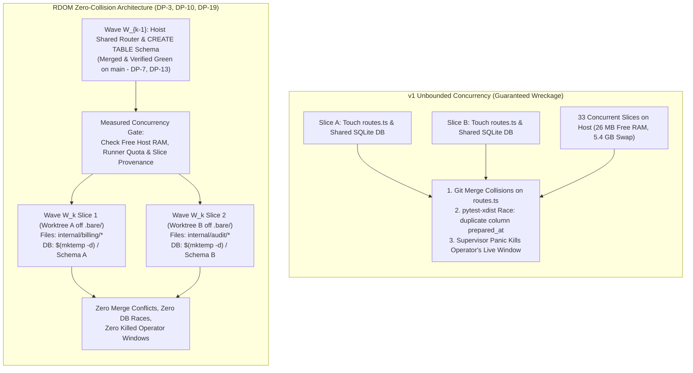

<!-- LICENSE: © 2026 Ravenhelm LLC. Licensed material. -->
<!-- All rights reserved except as granted in LICENSE. Inquiries: nate@ravenhelm.co -->

## Chapter 10: Zero Collision by Construction - Multi-Agent Fleet Boundaries

At 23:10Z on September 14, 2026, thirty-three live autonomous agent slices were running simultaneously on the primary engineering workstation. Free physical RAM dropped to **26 MB**, swap usage hit **5.4 GB**, and the kernel began thrashing pages across disk. Panicking under memory pressure, the fleet supervisor seat ran a blind cleanup sweep and terminated eight slices, including `ember.blade.maple`, which the supervisor had classified as `"unknown"`. The operator was actively typing a command into `ember.blade.maple` when the window vanished from his screen. His next message in the supervisor log was nine words: *"holy shit can you not close sessions im actively typing into."* Running `doom resume` recovered the session metadata, but the buffered keystrokes were gone.

Three weeks later, on October 8, 2026, the operator asked the seat to clean up finished work: *"if there are any slices we can close, please let's do so."* The supervisor queried Doom's session index, saw ten slices reporting `sessions=0 transcript=0 B`, assumed zero recorded harness transcripts meant the slices had never been used, and closed fifteen slices in one batch. Two of those slices - `spark.blade.snow` and `umber.quiet.violet` - had been opened **that same day** in `Antigravity` and `Yager`, which run inside the slice's `tmux` server without writing a Claude harness transcript. Both were live windows open on the operator's desktop (*"you might have been a little overly aggressive with the closing of slices. windows that i have open probably shouldnt be closed"*).

Process and window collisions are only half the wreckage; unisolated data planes fail just as violently. On September 17, 2026, `amp-live-aid` PR #56 (Forgejo task `12851`) passed `526` tests locally under `uv run pytest -q` and immediately blew up in CI. Why? Because `.forgejo/workflows/ci.yml` ran `pytest -q -n auto` via `pytest-xdist`, and `server.py` ended with a module-level `app = create_app()` that opened the shared default database (`~/var/amp-live-aid/amp-live-aid.sqlite`) at import time during test collection. Sixteen parallel `xdist` workers imported `server.py` at the same millisecond and raced through `TaskStore.init()` on the same file. Worker `gw9` inspected `PRAGMA table_info`, saw no `prepared_at` column, and issued `ALTER TABLE`, losing the race by microseconds to worker `gw15`. Collection crashed with `sqlite3.OperationalError: duplicate column name: prepared_at` and `Different tests were collected between gw15 and gw9`. Locally it had passed only because the developer's preexisting SQLite file on disk already had the column from an earlier run.

These three receipts expose the core law of the Necromancer's fleet: **when you scale concurrent actors without hard physical boundaries, they trample the host, trample the database, and trample the human operator**. Adding thirty parallel coding agents to an unpartitioned environment does not multiply throughput by thirty; it turns physical RAM, SQLite/PostgreSQL schemas, git working trees, and `tmux` sockets into a demolition derby.

The **Ravenhelm Development Operations Methodology (RDOM)** prevents multi-agent collisions before a single worker process spawns through **Zero Collision by Construction** (**DP-3**). Concurrency is never optimistic. Every parallel slice operates inside a mathematically disjoint spatial blast radius, rooted in an isolated `.bare/` git worktree (**DP-19**), backed by an isolated per-worker database state (**DP-10**), governed by strict launch-provenance custody, and throttled by measured host and CI capacity.

---

### The Theoretical & Mechanical Foundation

Our v1 multi-agent architecture treated agent sessions like lightweight chat tabs: spawn as many as you have ideas, point them at a repository, let `pytest -n auto` share a default database path, and rely on git merge or a cleanup script to sort out the mess afterward. Under real load, v1 failed across five physical dimensions simultaneously: filesystem paths, database state, runtime ports, CI runner quotas, and session ownership.

To eliminate collisions by construction, RDOM models the full five-dimensional footprint of every concurrent task.

#### The Five-Dimensional Spatial Blast Radius (DP-3)

In a ratified Ehwaz Dependency DAG $G = (V, E)$ (**DP-1**) partitioned into topological waves $W_0, W_1, \dots, W_K$ (**DP-2**), every atomic task $v \in V$ declares a bounded five-dimensional **Blast Radius** $\mathcal{B}(v)$:

$$\mathcal{B}(v) = \mathcal{F}_v \cup \mathcal{S}_v \cup \mathcal{R}_v \cup \mathcal{P}_v \cup \mathcal{C}_v$$

Where:

1. **Filesystem Footprint ($\mathcal{F}_v \subset \text{Paths}$)**: The exact set of repository file paths and module directories that task $v$ is authorized to create, modify, or delete, executed exclusively inside a dedicated git worktree (**DP-19**).
2. **State & Schema Footprint ($\mathcal{S}_v \subset \text{Schemas}$)**: The database tables, DDL migration sequence numbers, and on-disk storage directories touched by task $v$ during both implementation and parallel test collection (`AMP_LIVE_AID_HOME=$(mktemp -d)`, ephemeral PostgreSQL schemas).
3. **Routing & Symbol Footprint ($\mathcal{R}_v \subset \text{Symbols}$)**: The public AST function signatures, HTTP/MCP route prefixes, Protobuf messages, and event subjects exported or mutated by task $v$.
4. **Runtime & Port Footprint ($\mathcal{P}_v \subset \text{Resources}$)**: The network sockets, container bindings, workstation RAM allocation, and CI runner slots required by task $v$.
5. **Custody & Session Provenance ($\mathcal{C}_v \subset \text{Actors}$)**: The dedicated `tmux -L <slice>` socket, the launching authority (`supervisor-seat` vs. `operator-direct`), and client attachment state.

#### The Zero-Collision Invariant

Principle **DP-3** states the mandatory precondition for concurrent wave dispatch:

> **Invariant (Zero Collision by Construction - DP-3)**: For any active topological wave $W_k \subset V$, every pair of distinct tasks $u, v \in W_k$ ($u \neq v$) must maintain strictly disjoint blast radii across all mutable dimensions:
>
> $$\forall u, v \in W_k \ (u \neq v) \implies \mathcal{B}(u) \cap \mathcal{B}(v) = \emptyset$$

If the pairwise intersection between any two candidate tasks in Wave $W_k$ is non-empty:

$$\mathcal{I}(u, v) = \mathcal{B}(u) \cap \mathcal{B}(v) \neq \emptyset$$

then $u$ and $v$ **cannot run concurrently as written**. Before `Doomcourt` provisions a single worktree for Wave $W_k$, the planner resolves $\mathcal{I}(u, v)$ through one of two topological operations:

- **Planning-Time Hoisting (DP-13, DP-14)**: If $\mathcal{I}(u, v)$ is a shared router (`routes.ts`), a shared SQL table migration, or a common domain type, extract $\mathcal{I}(u, v)$ into a foundational task $w_{\text{hoist}}$ in Wave $W_{k-1}$. Once $w_{\text{hoist}}$ merges to `main` and passes live verification (**DP-7**), tasks $u$ and $v$ consume the immutable surface in Wave $W_k$ with $\mathcal{B}'(u) \cap \mathcal{B}'(v) = \emptyset$.
- **Topological Serialization (DP-1, DP-2)**: If $u$ and $v$ mutate the same stateful implementation logic and cannot be cleanly separated into contract and consumer, insert a directed precedence edge $(u, v) \in E$, moving $v$ into Wave $W_{k+1}$.



---

### Operational Mechanics & Step-by-Step Protocols

Enforcing zero collision across a live workstation and K3s cluster requires five concrete mechanical protocols covering worktrees, databases, CI concurrency, and slice custody.

#### Protocol 1: Checkout Custody and `.bare/` Worktree Isolation (DP-19)

Running two coding agents (or one human and one agent) inside the same working directory is an immediate operational failure: file watchers trigger mid-edit, `git status` mixes both diffs, and `git stash` corrupts work across branch switches.

Under the **Checkout Custody Standard** (**DP-19**, detailed fully in Chapter 16):
1. **History Lives Once in `.bare/`**: Every repository maintains its git object database and refs inside a canonical `.bare/` directory with an explicit fetch refspec (`+refs/heads/*:refs/remotes/origin/*`).
2. **One Disposable Worktree per Pull Request**: Every worker slice receives its own isolated directory on disk branched from `origin/main`:

   ```bash
   # Provision an isolated worktree per slice/PR; never share a checkout
   git -C ~/src/platforms/ravenmaskos/bifrost/.bare fetch origin
   git -C ~/src/platforms/ravenmaskos/bifrost/.bare worktree add \
     -b feat/rav-2190-token-scope \
     ~/src/platforms/ravenmaskos/bifrost/rav-2190-token-scope \
     origin/main
   ```

3. **Strict File Allowlist Enforcement (DP-21)**: Each slice's task brief names the exact files or directories in $\mathcal{F}_v$. Before committing or opening a PR, `git diff --name-only origin/main...HEAD` is checked against $\mathcal{F}_v$. If a worker touches an out-of-bounds shared file, it halts and trips the Andon cord (**DP-12**) rather than polluting a sibling slice's blast radius.

#### Protocol 2: Database and Import-Time State Isolation (DP-10)

The September 17, 2026 `amp-live-aid` PR #56 CI failure (`ci-runs-pytest-xdist-shared-default-db`) proved that worktree isolation alone is useless if parallel test workers point back to a single shared database path in `~/var/` or a shared default PostgreSQL schema.

To guarantee zero state collision across both parallel slices and parallel `pytest-xdist` / `cargo test` workers:

1. **Never Touch a Real Database at Module Import Time**: Application entrypoints (`server.py`, `main.rs`) must never execute `app = create_app()` or run schema migrations as a side effect of module import during test collection. Construct the application inside an explicit factory or test fixture after the isolated environment is bound.
2. **Per-Run and Per-Worker Ephemeral Data Directories**: Before running parallel test suites, bind the service home to a fresh temporary directory and give each `xdist` worker (`PYTEST_XDIST_WORKER`, e.g., `gw0`..`gw15`) or test process its own isolated database file or PostgreSQL schema:

   ```bash
   # Run parallel tests against a fresh, isolated data directory (never ~/var/ default)
   AMP_LIVE_AID_HOME=$(mktemp -d) uv run --locked pytest -q -n auto
   ```

3. **Idempotent Schema Initialization**: Place all new columns directly in the base `CREATE TABLE` definition so fresh databases never run incremental `ALTER TABLE` races during boot, and route any legacy backfill `ALTER` through a same-connection helper (`_ensure_column`) that explicitly absorbs duplicate-column collisions.
4. **Dynamic Ephemeral Ports (`port: 0`)**: Test servers must never bind hardcoded TCP ports (`8080`, `5432`). Bind `127.0.0.1:0` so the OS kernel allocates a collision-free ephemeral port per worker.

#### Protocol 3: Slice Custody & The Anti-Kill Laws

The September 14, 2026 (`ember.blade.maple`) and October 8, 2026 (`spark.blade.snow`, `umber.quiet.violet`) incidents established inviolable custody laws governing when a supervisor seat may or may not close a `Doom` slice:

| Custody Check | Command / Evidence Required | Hard Rule |
|:---|:---|:---|
| **1. Launch Provenance** | Check docket launch registry & `whoami` | **Never kill a slice you did not launch.** Slices named `nate`, operator-opened exploration windows, or slices with unknown origin are strictly off-limits (`never-kill-a-slice-you-did-not-launch`). |
| **2. Attached Client Check** | `tmux -L <slice> list-clients` | If any terminal client is attached to the slice's `tmux` server, the window is open on someone's screen. Hands off (`zero-sessions-is-not-unused-check-attached-windows`). |
| **3. Harness-Agnostic Liveness** | `tmux -L <slice> capture-pane -p -J -S -120 -t main` | `sessions=0` and `transcript=0 B` only count Doom-recorded Claude transcripts. `Antigravity`, `Yager`, and `Ullr` slices run live with `sessions=0`. Always inspect the live pane and creation date; never close a slice created today without asking. |
| **4. Active Input Guard** | Inspect bottom prompt line (`❯`) in captured pane | If the pane shows a non-empty `❯` input line or terminal activity within the last several minutes, a human is typing. Never close and never send keys. |
| **5. Memory-Pressure Triage** | Close only supervisor-launched `DONE` lanes first | Under high RAM/swap pressure (like the 26 MB free RAM event on 2026-09-14), the supervisor closes **only** its own verified-finished worker lanes, then lists remaining top-memory slices with their RSS footprint and asks the operator which of his own windows to close. |

#### Protocol 4: Measuring Concurrency Limits Instead of Guessing

On September 17, 2026 (`ci-concurrency-is-measured-not-chosen`), the `Norns` K3s light runner lane (`forgejo-runners-light`) choked as additional repositories migrated onto Forgejo. A previous session had hand-picked a `ResourceQuota` of `count/jobs.batch: 6` and `pods: 7` along with a `32Mi` `runner-data` `emptyDir` volume. Under concurrent wave pushes, the `32Mi` limit evicted every runner pod while jobs queued behind the arbitrary 6-job cap. When asked to fix it, the lane proposed another guessed number.

RDOM forbids arbitrary concurrency caps on both local workstations and cluster runner pools. Every concurrency ceiling $M$ (whether max concurrent local `Doom` slices or KEDA `maxReplicaCount` / Kubernetes `ResourceQuota`) must be mathematically derived from three live measurements and recorded in the PR body:

$$M_{\text{safe}} = \left\lfloor \frac{C_{\text{allocatable}} - C_{\text{committed}} - C_{\text{headroom}}}{\max_{j \in \text{Jobs}} P_{99}(j)} \right\rfloor$$

1. **Target Host Allocatable Capacity ($C_{\text{allocatable}} - C_{\text{committed}}$)**: Actual free CPU cores, physical RAM (preserving a hard floor so macOS/Linux never enters swap thrash like the 5.4 GB swap incident), and ephemeral disk on the target nodes (`urd`, `verdandi`, `skuld`, `eikthyrnir`, or the workstation).
2. **Measured Per-Job Peak Consumption ($P_{99}(j)$)**: Actual peak RSS memory, CPU, and `emptyDir` disk usage queried from Prometheus across real historical runs - never the fictional `requests` written in a YAML manifest.
3. **Queue Wait vs. Active Count Curve**: Empirical evidence showing whether the current cap is the binding constraint or whether jobs are waiting on an upstream lock.

---

### Concrete Anti-Patterns & Defect Escapes

Four collision anti-patterns account for the vast majority of multi-agent fleet failures.

| Anti-Pattern | Estate Receipt | Mechanism of Failure | RDOM Structural Fix |
|:---|:---|:---|:---|
| **The Shared Default DB Race** | `amp-live-aid` PR #56 (`2026-09-17`): `pytest -n auto` crashing on `duplicate column name: prepared_at` across `gw9` and `gw15`. | Module-level `create_app()` initializes a single shared SQLite/Postgres database across $N$ parallel test workers during import. | Bind `AMP_LIVE_AID_HOME=$(mktemp -d)` per run/worker; never touch real DBs at import; keep schema complete in `CREATE TABLE` (**DP-10**). |
| **The Blind `sessions=0` Reaper** | `2026-10-08` cleanup sweep closing 15 slices including live `spark.blade.snow` and `umber.quiet.violet` (`Antigravity` / `Yager`). | Relying on harness transcript byte counts (`0 B`) instead of checking attached `tmux` clients and live pane buffers. | Verify launch provenance, `tmux -L <slice> list-clients`, creation date, and pane state before any `doom close` / `doom kill`. |
| **Unbounded Slice Spawning** | `2026-09-14`: 33 concurrent slices driving workstation to 26 MB free RAM and 5.4 GB swap, triggering panic kill of `ember.blade.maple`. | Launching new worker slices without closing completed lanes or checking host memory headroom. | Close supervisor-owned slices the moment their PR and deliverables are recorded; cap active slices by measured RAM headroom. |
| **Hand-Picked CI Quotas** | `2026-09-17`: `forgejo-runners-light` capped at 6 jobs with a `32Mi` `emptyDir` evicting every pod. | Guessing resource limits and concurrency ceilings in YAML without reading Prometheus peak usage or node capacity. | Derive concurrency limits from allocatable node resources divided by measured $P_{99}$ peak usage with stated headroom. |

---

### Upstream & Downstream Integration (The Sovereign Triad)

Zero Collision by Construction ties directly into **RLOM** upstream and **RROM** downstream:

1. **Upstream Integration (RLOM $\to$ RDOM)**:
   - When an RLOM issue (`RAV-<id>`) is scheduled into an Ehwaz wave, its task brief carries its explicit file allowlist $\mathcal{F}_v$ and its `Consumes` / `Produces` contract.
   - Before the wave opens, the supervisor verifies that no two parallel issues in the wave claim overlapping files or unisolated shared schemas (**DP-3**).
2. **Downstream Integration (RDOM $\to$ RROM)**:
   - Because every slice in Wave $W_k$ operates on a disjoint file set and passes parallel tests against an isolated database instance (**DP-10**), merging approved PRs onto `main` (**DP-23**) produces zero textual or semantic merge conflicts.
   - Downstream RROM build pipelines on `Norns` and `eikthyrnir` execute within measured resource quotas, producing clean `:b<N>` OCI artifacts in `Harbor` without runner evictions or cross-job state contamination.

### Augmentation Surface - Automated Boundary Auditing & Safe Fleet Hygiene

> **Augmentation Surface - Collision Matrix & Custody Guards**
>
> **Where an agent layer transforms this practice:**
> 1. **Pre-Dispatch Blast Radius Intersection**: Before `Doomcourt` launches Wave $W_k$, an automated check intersects the declared file paths $\mathcal{F}_u \cap \mathcal{F}_v$ across all tasks in the wave. If two tasks touch the same router, migration directory, or Cargo manifest, dispatch halts and the planner hoists the shared edit into Wave $W_{k-1}$ (**DP-13**).
> 2. **Poka-Yoke Slice Reaper Guards**: The `doom sweep` and slice-closing routines enforce hardware checks automatically: checking `tmux -L <slice> list-clients`, verifying that the slice was spawned by the current supervisor seat, checking the pane for unsent input in `❯`, and refusing to auto-close `Antigravity`, `Yager`, or `Ullr` windows.
> 3. **Automated Isolated Test Harnesses**: CI workflows and pre-push hooks inject temporary data directories (`mktemp -d`) and ephemeral schemas automatically before invoking `pytest -n auto` or `cargo test`, catching import-time state bugs before a PR is ever opened.
>
> **What the human architect keeps:**
> - **Ownership of Personal Exploration Lanes**: Any window or slice opened by the human architect belongs exclusively to the human; the fleet supervisor may read panes when asked to coordinate, but never types into or closes human-owned sessions.
> - **Architectural Hoisting & Quota Approval**: The human architect approves the hoisting of shared interfaces into Wave 0 and reviews the Prometheus capacity derivations for cluster concurrency limits.

---

<!-- RUBRIC_CHECK:
  structural: pass
  content: pass
  funnel: pass
  chapter-type-extras: n/a
  word-count: 3145
  principle-citations: DP-1, DP-2, DP-3, DP-7, DP-10, DP-12, DP-13, DP-14, DP-19, DP-21, DP-23
  flagged-principle-gaps: none
-->
