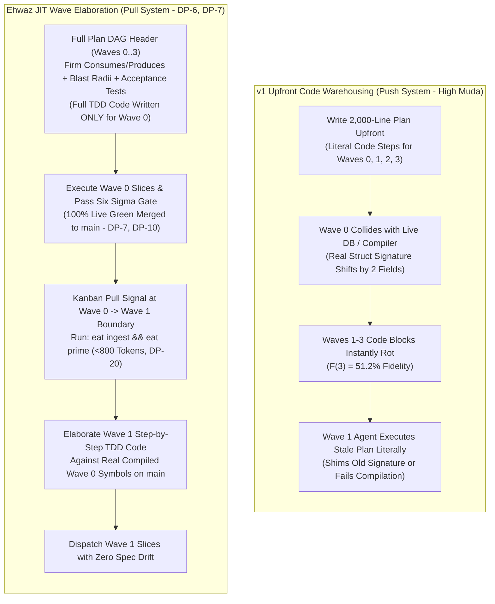

<!-- LICENSE: © 2026 Ravenhelm LLC. Licensed material. -->
<!-- All rights reserved except as granted in LICENSE. Inquiries: nate@ravenhelm.co -->

## Chapter 11: Just-In-Time Elaboration - Eradicating Inventory Waste (Muda)

Look at the corpse of a 2,000-line upfront implementation plan written before Wave 0 has touched a compiler. To prove the plan is thorough, the author writes out full bite-sized TDD step blocks - exact failing test code, exact Rust struct definitions, exact SQL queries, and exact file line numbers - for every task across Wave 0, Wave 1, Wave 2, and Wave 3. Then Wave 0 opens on the bench. Thirty minutes into implementing Task 0.1 against a live `OpenBao` container and a real PostgreSQL instance, the engineer discovers that the token verifier requires an asynchronous lease-renewal handle and that the primary key must be a composite `(tenant_id, action_hash)` rather than a bare UUID. Wave 0 adapts, passes its live tests, and merges to `main`.

Look at what just happened to the remaining 1,500 lines of the markdown plan file. Every pre-written code snippet in Wave 1, Wave 2, and Wave 3 is now a lie. The step-by-step code blocks in Wave 1 call synchronous constructors that do not exist and pass single-argument UUIDs to a two-column foreign key. Worse, when an autonomous coding slice is dispatched into Wave 1 and handed that pre-written plan, the agent does not question the plan; agents fail literal. The worker slice copy-pastes the obsolete struct signature straight from the markdown file, fights the compiler for forty turns, invents a local shim to force the old signature to compile, and opens a broken pull request.

That was the exact failure mode of our v1 planning workflow prior to September 16, 2026. When we first built structured agent implementation plans, we treated a plan like a static monolith: every task from beginning to end had to contain complete step-by-step code before the plan could be approved. Whenever an early task hit physical reality and changed an interface, the human operator and supervisor had to spend hours editing markdown code blocks for tasks three waves away - or leave them stale and watch downstream worker slices drive off a cliff. We had recreated the enterprise "Specification Warehouse" inside a markdown file.

In the Toyota Production System (TPS), Taiichi Ohno gave a precise name to parts manufactured before the downstream station is ready to assemble them: **Inventory Waste (*Muda*)**. In software engineering, step-by-step implementation code written three waves ahead of its upstream dependency is perishable inventory. It costs tokens and human cognition to write, it rots the moment Wave 0 meets the compiler, and it poisons the worker slices that read it.

When **The Ehwaz Doctrine (ᛖ)** was ratified on September 16, 2026 (`ehwaz-doctrine.md`), its fifth mechanic killed upfront code warehousing permanently: **Just-In-Time (JIT) Elaboration of the Plan Itself** (**DP-6**). Only the currently open wave receives full bite-sized TDD detail with real code. Later waves carry firm, non-placeholder contracts - exact `Consumes` and `Produces` interfaces, exact blast radius bounds, and exact falsifiable acceptance criteria - while their step-by-step code is elaborated only when their upstream wave passes its Six Sigma gate and merges to `main`.

---

### The Theoretical & Mechanical Foundation

To understand why JIT plan elaboration is mandatory for high-concurrency human and agent fleets, examine how specification entropy accumulates across dependency waves.

#### Taiichi Ohno's Seven Wastes on the Agentic Factory Floor

In physical manufacturing, excess work-in-process inventory hides defective machinery, consumes warehouse floor space, and turns into scrap whenever an upstream engineering tolerance changes. On a software factory floor run by human architects and autonomous coding slices, Ohno's seven wastes take concrete mechanical shapes:

| TPS Waste Category | Traditional Agile Manifestation | Agent Fleet Manifestation (Without JIT) |
|:---|:---|:---|
| **1. Inventory** | Six hundred pre-groomed backlog stories and fifty-page PRDs sitting unbuilt for a quarter. | Writing 2,000 lines of step-by-step code for Waves 1-3 before Wave 0 has compiled or merged. |
| **2. Overproduction** | Building generic plugin frameworks for hypothetical next-year use cases. | Worker slices generating speculative helper traits or unrequested CLI flags outside their task brief. |
| **3. Waiting** | Engineers blocked on review queues, environment provisioning, or unacted decision cards. | Worker slices sitting idle for 16 hours on answered court cards or 47 minutes behind wedged CI runners. |
| **4. Transport** | Handing vague requirements across Product $\to$ Architecture $\to$ Dev $\to$ QA silos. | Dumping raw multi-file transcripts across agent prompts instead of passing surgical `EAT` entity IDs. |
| **5. Over-processing** | Debating Fibonacci story points in two-hour backlog grooming meetings. | Rewriting markdown code blocks across future waves every time an upstream struct changes a field. |
| **6. Motion** | Developers hunting through stale wiki pages and Slack threads to find an API contract. | Agents burning 78% of their context window running `list_dir` and `read_file` across whole directories. |
| **7. Defects** | Regressions escaping to staging because unit tests ran against stale mocks. | Literal-minded agents implementing dead code snippets from a stale plan instead of reading `main`. |

Inventory is the root amplifier of the other six wastes. When you eliminate premature step-by-step specification inventory in future waves, you simultaneously eliminate the over-processing required to maintain those stale specs and the defects caused by agents executing them.

#### The Mathematics of Cross-Wave Specification Decay

Why can you not write accurate step-by-step implementation code for Wave 3 before Wave 0 is built? Because a software task's concrete implementation is a function of the exact AST symbols, type signatures, error enums, and database constraints produced by its upstream parents.

Let $\Delta w = k - w_{\text{open}}$ denote the topological wave distance between the currently open wave $w_{\text{open}}$ and a future wave $W_k$. During the execution and live verification (**DP-10**) of any wave $W_i$, physical contact with the compiler, kernel, and runtime infrastructure introduces a non-zero interface mutation rate $\delta_i \in (0, 1)$ (changes in function parameters, lifetime bounds, SQL column constraints, or error types).

The probability $F(\Delta w)$ that a pre-written, line-by-line code block written at $w_{\text{open}}$ remains syntactically and semantically valid by the time Wave $W_k$ opens decays multiplicatively across every intervening wave boundary:

$$F(\Delta w) = \prod_{i = w_{\text{open}}}^{k - 1} (1 - \delta_i)$$

Even under disciplined engineering where 80% of low-level symbol signatures survive a wave unchanged ($\delta_i = 0.20$):

- **Open Wave ($\Delta w = 0$, Just-In-Time)**: $F(0) = 1.00$. The upstream wave $W_{k-1}$ is already merged to `main`. The planner extracts exact AST signatures from disk via `eat read`. Zero guesswork.
- **One Wave Ahead ($\Delta w = 1$)**: $F(1) = 0.80$. One in five low-level code blocks will fail to compile against the real output of the open wave.
- **Two Waves Ahead ($\Delta w = 2$)**: $F(2) = (0.80)^2 = 0.64$. More than a third of the pre-written implementation code is already broken.
- **Three Waves Ahead ($\Delta w = 3$)**: $F(3) = (0.80)^3 = 0.512$. Essentially a coin toss. Half of the step-by-step code you paid tokens and hours to write is scrap before a single worker slice in Wave 3 ever launches.

#### Contract Firmness vs. Code Deferral (DP-6)

A common misconception is that Just-In-Time elaboration means leaving future waves vague or TBD (*"Wave 2: build the API later"*). That is not JIT; that is an unfinished plan.

As codified in `ehwaz-doctrine.md`, **JIT elaboration separates the interface contract from the internal step-by-step code**:

> **Principle DP-6 (Progressive JIT Plan Elaboration)**:
> 1. **Every wave in the plan ($W_0 \dots W_K$) carries a hard, non-placeholder contract from Day 1**: exact task ID (`RAV-<id>`), exact `Consumes` and `Produces` edges, exact spatial blast radius (`file_allowlist`), and exact falsifiable acceptance criteria.
> 2. **Only the currently open wave ($W_k$) carries bite-sized TDD implementation steps with literal code.** Step-by-step code for Wave $W_{k+1}$ is written at the wave boundary gate, *after* Wave $W_k$ has merged to `main` and locked its produced interfaces in silicon.



---

### Operational Mechanics & Step-by-Step Protocols

Running JIT elaboration across a multi-wave initiative follows a strict two-tier specification structure and a deterministic wave-boundary pull ritual.

#### Anatomy of an Ehwaz Plan: Open Wave vs. Future Wave

Compare what sits inside the plan document for a task in the **currently open wave** (`Wave 0`) versus a task in a **closed future wave** (`Wave 2`). Neither contains placeholders or hand-waving, yet zero inventory is wasted on premature code:

| Specification Element | Open Wave ($W_k$ - Executing Now) | Future Wave ($W_{k+1 \dots K}$ - Locked Behind Gate) |
|:---|:---|:---|
| **Task ID & Linear Binding** | Required (`Task 0.1 / RAV-2201`). | Required (`Task 2.1 / RAV-2206`). |
| **Topological Edges** | Explicit `Consumes: (none)` / `Produces: crates/valkyrie-core/src/token.rs`. | Explicit `Consumes: Task 1.1 (valkyrie-signer), Task 1.2 (approle)` / `Produces: bifrost/src/mfaa.rs`. |
| **Spatial Blast Radius ($\mathcal{B}(v)$)** | Exact file allowlist (`crates/valkyrie-core/**`). | Exact file allowlist (`services/bifrost/src/middleware/mfaa.rs`, `services/bifrost/tests/mfaa_test.rs`). |
| **Falsifiable Acceptance Criteria** | Exact test command and expected live behavior. | Exact test command (`cargo test --test mfaa_test`) and exact boundary assertions that must hold. |
| **Bite-Sized TDD Code Steps** | **Fully Elaborated**: Step 1 (write failing test with exact code), Step 2 (run test, verify RED), Step 3 (write minimal implementation), Step 4 (verify GREEN and commit). | **Deferred Until Wave $W_{k}$ Closes**: Marked `Elaborate JIT upon Wave 1 green gate`. Written against the real `main` AST when the wave opens. |

Here is the exact structural template for a future-wave node in an Ehwaz plan before its wave opens:

```markdown
### Wave 2: Gateway Enforcement (Closed - Opens on Wave 1 Green Gate)

#### Task 2.1 (`RAV-2204`): Bifrost Action-Hash Elevation Interceptor
- **Chain Status**: CRITICAL CHAIN
- **Consumes**:
  - `Task 1.1 (RAV-2203)`: `valkyrie_signer::verify_action_token` trait & error variants
  - `Task 0.2 (RAV-2202)`: `proto/valkyrie/mfaa.proto` (`ActionElevationRequest`)
- **Produces**:
  - `services/bifrost/src/middleware/mfaa.rs` (`MfaaInterceptor` Tower layer)
  - `services/bifrost/tests/mfaa_integration.rs`
- **Blast Radius (`file_allowlist`)**:
  - `services/bifrost/src/middleware/mfaa.rs`
  - `services/bifrost/src/middleware/mod.rs`
  - `services/bifrost/tests/mfaa_integration.rs`
- **Acceptance Criteria (Non-Placeholder Contract)**:
  1. Mutating MCP tool calls without an `X-Valkyrie-Action-Token` header return HTTP `403` with code `MFAA_REQUIRED` and the canonical `sha256` payload action hash.
  2. Requests carrying a valid token whose signed action hash mismatches the request body return HTTP `403` with code `MFAA_HASH_MISMATCH` (replay protection).
  3. Requests carrying a valid, un-expired token matching the exact payload hash execute the downstream tool and emit an OpenTelemetry span `valkyrie.mfaa.verified=true`.
- **JIT Elaboration Gate**: Step-by-step TDD blocks to be elaborated via `eat read` immediately after `RAV-2203` merges to `main` and passes Wave 1 verification.
```

Notice why this works: the architect and the `Doomcourt` scheduler have 100% clarity on what `Task 2.1` consumes, what files it is permitted to touch, and what exact three acceptance properties prove it is done. Yet if `Task 1.1` in Wave 1 changes the Rust method name from `verify_action_token` to `verify_bound_grant` during Wave 1 implementation, zero lines of pre-written Wave 2 code have to be rewritten.

#### Protocol 1: The Wave-Boundary JIT Pull Ritual

When Wave $W_{k-1}$ finishes its last pull request merge and clears the Six Sigma wave exit gate (**DP-7**), the planner executes a four-step pull ritual to open Wave $W_k$:

1. **Ingest the New Silicon Baseline (`eat ingest`)**:
   Dissolve the newly merged `main` branch into the **Entity-Attribute-Tag (EAT)** substrate (**DP-20**):

   ```bash
   git -C ~/src/platforms/ravenmaskos/bifrost/main pull --ff-only origin main
   eat ingest ~/src/platforms/ravenmaskos/bifrost/main --stamp
   ```

2. **Read the Exact Produced Symbols (`eat read`)**:
   Retrieve the exact byte slices of the structs, traits, and SQL schemas produced by Wave $W_{k-1}$ in `<10ms`:

   ```bash
   eat read symbol:valkyrie_signer::verify_action_token
   ```

3. **Elaborate the Open Wave's TDD Steps**:
   Expand each task in Wave $W_k$ into concrete bite-sized TDD steps (failing test $\to$ run command confirming failure $\to$ minimal implementation importing the real Wave $W_{k-1}$ symbols $\to$ passing test $\to$ commit).
4. **Dispatch Wave $W_k$ Slices**:
   Spawn the `.bare/` worktrees (**DP-19**) for Wave $W_k$ and hand each worker slice a brief anchored to code that actually compiles on `main` right now.

#### Protocol 2: Quarantining Stale Detailed Plans

What happens if a detailed plan was written for an open wave, and the wave was paused for two weeks while an emergency infrastructure cutover altered the repository?

Under RDOM, **detailed TDD step blocks have an expiration timestamp equal to the `main` commit SHA they were compiled against**:
1. Before launching a slice from a detailed task brief, compare the plan's baseline commit against `origin/main` across the task's `Consumes` paths:

   ```bash
   git diff --name-only <plan_baseline_sha>..origin/main -- <consumed_paths>
   ```

2. If any consumed upstream file mutated since the step-by-step code was written, the task's code blocks are marked stale and refreshed via `eat read` before the worker slice launches. Never feed stale line numbers or dead struct signatures to a coding agent.

---

### Concrete Anti-Patterns & Defect Escapes

Violating JIT plan elaboration produces four recurring failure modes on the bench.

#### 1. The 2,000-Line Upfront Code Novel

- **The Corpse of v1**: Writing full implementation code for four waves of tasks inside the planning document before executing Task 0.1.
- **The Mechanism of Failure**: The plan author is forced to write Wave 2 code against an imagined Wave 0 interface. When Wave 0 hits a real compiler or protocol constraint and adjusts its types, the downstream plan becomes a trap that misleads worker slices into writing non-compiling code.
- **The RDOM Poka-Yoke**: Principle **DP-6**. Plan review rejects any implementation plan that includes literal code implementation blocks for waves beyond the immediately open wave $W_0$ (or $W_k$). Future waves must specify hard contracts (`Consumes`, `Produces`, `file_allowlist`, and falsifiable acceptance criteria), never speculative code.

#### 2. The Placeholder Contract ("Wave 2: TBD")

- **The Corpse of v1**: Over-correcting away from upfront code novels by leaving future waves as vague one-line bullets (`"Wave 2: wire up the frontend and add auth"`).
- **The Mechanism of Failure**: Without firm `Consumes` / `Produces` contracts and file allowlists across all waves, you cannot verify acyclicity ($G=(V,E)$), you cannot compute the Critical Chain floor (**DP-4**), and you cannot run the Planning-Time DRY Hoist scan (**DP-13**) across the whole graph.
- **The RDOM Poka-Yoke**: Every wave from $W_0$ to $W_K$ must have complete topological headers, exact file blast radii, and falsifiable acceptance criteria before Wave 0 is ratified. Deferring *step-by-step code* is never permission to defer *interface contracts*.

#### 3. Zombie Worktrees Branched Ahead of Their Wave

- **The Corpse of v1**: A developer or supervisor creates git worktrees for Wave 1 and Wave 2 tasks at the same time Wave 0 launches, letting idle slices start scaffolding files early.
- **The Mechanism of Failure**: Those Wave 1 and Wave 2 worktrees are branched off a pre-Wave-0 `main` commit. They lack every file Wave 0 is building, forcing the worker slices to invent mock stubs (**DP-5** violation) and guaranteeing nasty rebase collisions when Wave 0 merges.
- **The RDOM Poka-Yoke**: Worktrees are provisioned Just-In-Time per wave (**DP-19**). `Doomcourt` refuses to run `git worktree add` for any node in Wave $W_k$ until Wave $W_{k-1}$ is merged to `main`.

#### 4. The Backlog Grooming Séance

- **The Corpse of v1**: Spending two hours every week writing detailed implementation recipes for backlog tickets sitting sixty days out on a roadmap.
- **The Mechanism of Failure**: By the time those tickets reach the active wave sixty days later, repository layout, crate versions, and database schemas have evolved, reducing specification fidelity $F(\Delta t)$ below 40% and turning the grooming effort into pure scrap.
- **The RDOM Poka-Yoke**: Keep long-horizon RLOM backlog items at the Strategic Invariant and Issue Contract level (what capability must exist and how acceptance is proved). Elaborate implementation steps only at the wave boundary when the issue is pulled into the active wave.

---

### Upstream & Downstream Integration (The Sovereign Triad)

Just-In-Time Elaboration governs how intent flows from **RLOM** into **RDOM** and how verified code exits into **RROM**:

1. **Upstream Integration (RLOM $\to$ RDOM)**:
   - RLOM stores durable **Strategic Invariants**, **Quarterly Engineering Contracts**, and **Issue Contracts** (`RAV-<id>`). Because RLOM records *what* boundary behavior is required rather than ephemeral line numbers, RLOM issues do not rot when internal structs are refactored.
   - When an initiative enters RDOM planning, the full Ehwaz DAG and wave contracts are ratified upfront, while TDD step elaboration executes wave-by-wave on a Kanban pull signal as each upstream wave turns green.
2. **Downstream Integration (RDOM $\to$ RROM)**:
   - Because workers never build ahead of their wave or merge half-baked scaffolding behind speculative flags, `main` never accumulates dead inventory.
   - Every wave merge to `main` compiles cleanly into an immutable `:b<N>` OCI build in `Harbor` under ADR-0007, ready for RROM promotion without carrying half-finished Wave $k+2$ dead weight into production.

### Augmentation Surface - Automated Wave-Boundary Elaboration

> **Augmentation Surface - JIT Brief Synthesis via `EAT`**
>
> **Where an agent layer transforms this practice:**
> 1. **Instant Post-Merge AST Extraction**: The moment Wave $W_{k-1}$ merges to `main` and passes its live gate (**DP-7**), an orchestration agent runs `eat ingest` and `eat read` across all artifacts listed in Wave $W_{k-1}$'s `Produces` blocks (**DP-20**).
> 2. **Automated Open-Wave TDD Detailing**: Using the exact compiled type signatures and database schemas now present on `main`, the planner agent elaborates the bite-sized TDD steps for Wave $W_k$ in minutes - populating exact import paths, real struct initializers, and failing test harnesses (**DP-8**) with zero human copy-paste toil.
> 3. **Anti-Inventory Plan Linter**: When a plan PR is opened, an automated check verifies that every wave carries complete `Consumes` / `Produces`, `file_allowlist`, and acceptance criteria, while flagging premature multi-wave code dumps that violate **DP-6**.
>
> **What the human architect keeps:**
> - **Contract & Acceptance Ownership**: The human architect ratifies the non-placeholder acceptance criteria and interface contracts across all waves before Wave 0 starts.
> - **Wave Boundary Sign-Off**: When Wave $W_{k-1}$ forces an architectural change during execution, the human architect reviews the updated Wave $W_k$ interface contract before `Doomcourt` dispatches the next wave of slices.

---

<!-- RUBRIC_CHECK:
  structural: pass
  content: pass
  funnel: pass
  chapter-type-extras: n/a
  word-count: 3085
  principle-citations: DP-1, DP-2, DP-3, DP-4, DP-5, DP-6, DP-7, DP-8, DP-10, DP-13, DP-14, DP-19, DP-20
  flagged-principle-gaps: none
-->
