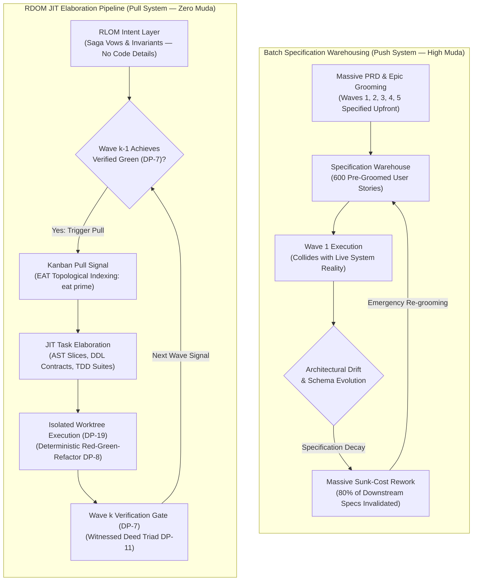

<!-- LICENSE: © 2026 Ravenhelm LLC. Licensed material. -->
<!-- All rights reserved except as granted in LICENSE. Inquiries: nate@ravenhelm.co -->

## Chapter 11 — Just-In-Time Elaboration: Eradicating Inventory Waste (Muda)

In the third week of a critical enterprise migration, an engineering organization celebrated a milestone that should have triggered an immediate evacuation. The product and architecture team unveiled the "Q3 Specification Warehouse": seventy-four detailed Product Requirement Documents, one hundred and twenty Jira epics spanning six hundred pre-groomed user stories, forty-five mock OpenAPI schemas, and thousands of lines of Gherkin acceptance criteria specifying the behavior of Wave 4 and Wave 5 services. The initiative was scheduled to execute across six bi-weekly cycles. The management tier viewed this mountain of documentation as proof of rigorous preparation, predictability, and forward-thinking alignment.

By the second week of Wave 1 execution, live production reality demolished the foundation of the warehouse.

The engineers implementing the foundational authentication and tenant-partitioning substrate discovered that the third-party identity provider imposed an undocumented 250-millisecond latency penalty when evaluating nested role hierarchies, while the primary database engine deadlocked under concurrent table partition creation. Resolving these operational constraints required replacing the planned synchronous token-validation middleware with an asynchronous cryptographic proof-verifier, and restructuring the relational multi-tenant isolation model into an append-only event store. These modifications were neither failures nor oversights; they were the natural, inevitable consequence of software colliding with silicon, live network packets, and operating system kernels.

Downstream in the requirement warehouse, the impact was catastrophic. Over eighty percent of the pre-written specifications for Waves 2, 3, and 4 were rendered instantaneously toxic. The mock OpenAPI contracts asserted parameter structures for endpoints that could no longer exist. The pre-groomed Jira stories detailed database foreign keys against tables that had been eliminated. The Gherkin test suites described user interaction flows dependent on synchronous state transitions that the system could not physically support.

Yet, because weeks of architectural labor and executive sign-offs had been invested in these documents, the organization fell victim to industrial sunk-cost fallacy. Product managers fought tenaciously against necessary engineering adaptations, arguing that "the contracts were already approved" and "the backlog is already groomed." Teams spent dozens of hours in emergency re-grooming sessions rewriting tickets for code that had not yet been written, while developers contorted the live architecture to accommodate obsolete requirements. Thousands of hours of cognitive labor and hundreds of thousands of dollars evaporated into pure industrial scrap.

This failure mode is not an anomaly; it is the mathematical certainty of the **Over-Elaborated Requirement Warehouse**. In traditional software development, organizations treat requirement documents and backlog tickets as capital assets. In Lean systems engineering, unexercised specifications are recognized for what they truly are: perishable, highly volatile inventory that rots the moment it is committed to paper.

RDOM eradicates this failure mode through **Progressive Just-In-Time (JIT) Elaboration** (DP-6). By treating granular technical specifications as perishable goods with a shelf life strictly bounded by wave boundaries, RDOM guarantees that implementation contracts are elaborated exclusively against verified, running silicon.

---

### The Theoretical & Mechanical Foundation

To eliminate specification waste, engineering governance must transition from traditional task-accounting to industrial production theory.

#### Taiichi Ohno’s Seven Wastes Mapped to Software Systems

In formulating the Toyota Production System (TPS), Taiichi Ohno identified seven distinct forms of waste (*Muda*) that degrade manufacturing efficiency: Overproduction, Waiting, Transport, Over-processing, Motion, Defects, and Inventory. In physical manufacturing, physical inventory ties up capital, requires floor space, conceals machine breakdowns, and suffers physical degradation.

In modern software engineering—particularly when accelerated by autonomous AI agent fleets—these seven wastes manifest as severe operational dysfunctions:

| TPS Waste Category | Software Engineering Manifestation | Autonomous Agent Fleet Manifestation |
|:---|:---|:---|
| **Overproduction** | Building speculative features, helper libraries, and abstractions prior to verified consumer demand. | Agents generating thousands of lines of unrequested scaffolding or premature domain types. |
| **Waiting** | Developers blocked on architectural sign-offs, long-lived PR review queues, or manual QA cycles. | Agent worker slices idling on saturated CI test runners or deadlocked database migrations. |
| **Transport** | Passing tickets across handoff boundaries (Product $\to$ Arch $\to$ Eng $\to$ QA $\to$ SecOps). | Shuffling context blobs, raw logs, and unparsed files across disparate agent tool calls. |
| **Over-processing** | Writing hundred-page PRDs, Gherkin test suites for unbuilt systems, and redundant UML models. | Generating exhaustive mock fixtures and multi-layered adapter wrappers for simple internal traits. |
| **Motion** | Context-switching across projects, re-reading stale tickets, and searching for source files. | Context-thrashing: agents recursively crawling directory trees to discover existing interfaces. |
| **Defects** | Regressions, runtime panics, and interface contract mismatches leaking into downstream waves. | Hallucinated API calls, broken import paths, and silent mock drift passing synthetic test suites. |
| **Inventory** | **Unimplemented specifications, pre-groomed backlogs, parked branches, and unmerged PRs.** | **Speculative prompts, unexercised prompt templates, and unmerged worktrees rotting in storage.** |

Among Ohno’s seven categories, **Inventory is the supreme multiplier of waste**. In manufacturing, excess inventory masks underlying defects: if a milling machine produces defective parts, excess buffer stock allows the defect to go unnoticed for weeks until thousands of unusable assemblies pile up. In software engineering, specification inventory conceals architectural drift: writing detailed tickets for Wave $k+3$ masks the fact that the architecture of Wave $k$ is unstable, ensuring that when Wave $k+3$ finally launches, every single ticket must be discarded or rewritten.

#### The Half-Life of Software Specification Decay

A software specification is not an immutable truth; it is a point-in-time hypothesis regarding system behavior. The validity of this hypothesis decays exponentially as a function of its distance from execution.

Let $F(t)$ represent the fidelity (accuracy) of a technical specification relative to the live system state, normalized on the interval $[0, 1]$. In a dynamic codebase subjected to continuous integration and concurrent refactoring, specification entropy accumulates according to an exponential decay formulation:

$$F(\Delta t) = F_0 e^{-\lambda \Delta t}$$

Where:
- $F_0$ is the initial fidelity of the specification at the moment of authoring ($F_0 \le 1.0$).
- $\Delta t$ is the latency between specification creation and implementation execution.
- $\lambda$ is the system volatility coefficient, governed by the rate of interface mutation, schema migration, dependency upgrades, and requirements discovery.

When measured across topological waves rather than continuous time, specification decay is governed by wave distance. Let $\Delta w = w_{\text{exec}} - w_{\text{spec}}$ denote the topological wave delta between the wave in which a specification is elaborated ($w_{\text{spec}}$) and the wave in which the specification is executed ($w_{\text{exec}}$).

The composite fidelity across discrete wave transitions is modeled as:

$$F(\Delta w) = \prod_{i=1}^{\Delta w} (1 - \delta_i)$$

Where $\delta_i \in (0, 1)$ represents the interface mutation rate introduced by the execution of wave $i$. In production distributed systems, empirical interface mutation rates rarely drop below $\delta = 0.20$ (a twenty percent divergence in internal types, database DDL constraints, error variants, or network contracts per wave).

Consider the mathematical consequence of premature elaboration:
- **Zero Wave Delta ($\Delta w = 0$, Just-In-Time)**: The specification is authored immediately as the preceding wave closes. $F(0) = 1.0$. The specification is constructed against verified, compiled ASTs. Entropy is zero.
- **One Wave Delta ($\Delta w = 1$, Boundary Staged)**: $F(1) = 1 - 0.20 = 0.80$. Twenty percent of assumptions require adjustment, but interface stubs remain largely salvageable.
- **Three Wave Deltas ($\Delta w = 3$, Traditional Sprint Grooming)**: $F(3) = (1 - 0.20)^3 = 0.512$. Nearly fifty percent of the specification is actively incorrect.
- **Five Wave Deltas ($\Delta w = 5$, The Requirement Warehouse)**: $F(5) = (1 - 0.20)^5 \approx 0.328$. Over two-thirds of the specification is toxic waste. An engineer or autonomous agent acting on this specification will hallucinate non-existent interfaces, construct incompatible schemas, and introduce catastrophic regression loops.

Premature specification elaboration is an act of negative productivity: it consumes engineering hours to produce artifacts whose execution actively damages the system.

#### The Just-In-Time (JIT) Elaboration Protocol (DP-6)

Principle **DP-6** codifies the operational remedy:

> **Principle DP-6 (Progressive JIT Elaboration)**: A task $v \in W_k$ shall be elaborated to concrete implementation specifications if and only if $W_k$ is the active wave or $W_{k-1}$ has achieved verified green. All downstream tasks ($W_{k+1 \dots \infty}$) remain coarse topological intent nodes.

JIT Elaboration establishes an intentional dichotomy between **Strategic Intent** and **Implementation Specifications**:
1. **Strategic Intent (The Saga Contract)**: Defines business outcomes, architectural invariants, security perimeters, and boundary interfaces. Intent is durable, high-level, and resilient to implementation drift. It lives in the RLOM layer as Saga's Vows and Long-Sagas. It states *what* sovereign capability must exist and *what invariants* must hold, without prematurely dictating AST symbols, database column types, or internal helper signatures.
2. **Implementation Specifications (The Daily Deed Contract)**: Defines deterministic test assertions, exact source file paths, AST symbol targets, database DDL scripts, and blast radii declarations ($\mathcal{B}(v)$). This level of detail is perishable. It is generated Just-In-Time at the wave boundary, pulling directly from the live, compiled reality of $W_{k-1}$.



---

### Operational Mechanics & Step-by-Step Protocols

Executing Progressive JIT Elaboration requires replacing informal grooming rituals with deterministic, state-machine-governed elaboration horizons.

#### The 3-Horizon Elaboration Cadence

RDOM divides all work within an initiative's Dependency DAG ($G = (V, E)$) into three strict temporal horizons. Movement between horizons is governed by mathematical graph positioning, not calendar dates:

| Elaboration Dimension | Horizon 1: Active Wave ($W_k$) | Horizon 2: Staged Wave ($W_{k+1}$) | Horizon 3: Future Waves ($W_{k+2 \dots \infty}$) |
|:---|:---|:---|:---|
| **Graph Position** | Currently executing wave. | Immediate successor wave. | Distant topological waves. |
| **Elaboration State** | **Fully Compiled (Concrete)** | **Boundary Drafted (Abstract)** | **Topological Intent (Coarse)** |
| **Specification Artifacts** | Concrete failing TDD test suites (DP-8), exact file paths, blast radius declarations ($\mathcal{B}(v)$), verified database DDL. | Interface boundary stubs, shared trait definitions, protobuf schemas, input/output type signatures. | High-level capability requirements, architectural invariant constraints, business outcome vows. |
| **Prohibited Elements** | Ambiguous acceptance criteria, hand-waving requirements, unmapped dependencies. | Internal implementation logic, algorithmic details, private helper signatures, UI layout specs. | **Any source code, mock schemas, concrete test assertions, or granular task breakdowns.** |
| **Workspace Custody** | Dedicated bare git worktrees allocated (`~/src/.../.bare/`) (DP-19). | No worktrees. Interface definitions reviewed in main branch planning PRs. | No worktrees. Pure nodes in Linear/Valknut Dependency DAG. |
| **Context Priming Mechanism** | Full surgical AST byte retrieval via `eat read <entity_id>` (DP-20). | Topological repository digest via `eat prime <repo>`. | High-level saga metadata and dependency edge verification. |

#### Protocol 1: The Wave Boundary Pull Signal

The transition of tasks from Horizon 2 into Horizon 1 is an automated, pull-based operation triggered by the Six Sigma wave boundary gate (DP-7):

1. **Gate Verification**: All Daily Deeds $v \in W_{k-1}$ must achieve Verified Green status. Every PR has merged into the integration trunk across the DP-23 review boundary, verified by deterministic CI attestations, updated runbooks, and executed showcases (the Triad of Proof, DP-11).
2. **Clean Disposal**: All ephemeral worktrees utilized in Wave $k-1$ are audited for uncommitted state and cleanly disposed of via `git worktree remove` (DP-24).
3. **Topological Ingestion**: The orchestration layer executes an automated topological re-indexing of the repository:

   ```bash
   eat ingest . --stamp --tag wave-k-baseline
   eat prime .
   ```

4. **JIT Specification Synthesis**: For each deed $u \in W_k$, the orchestrator or lead architect generates the execution brief by reading the *live, newly merged code* of $W_{k-1}$:
   - Exact symbol references extracted via `eat read symbol:<trait_name>`.
   - Live database schema queried directly from the running migration container (DP-10).
   - Strict blast radius boundaries computed: $\mathcal{B}(u) = \{ \text{paths} \}$.
   - The failing test harness (Red state of DP-8) compiled against the live integration head.
5. **Worktree Provisioning**: A fresh, isolated git worktree is spawned for each deed $u \in W_k$ from the verified integration commit:

   ```bash
   git worktree add -b feat/deed-k-u ../worktrees/deed-k-u origin/main
   ```

6. **Execution Lock**: The execution lock for Wave $k$ is opened. Workers (agents or engineers) receive briefs containing zero speculative context.

#### Protocol 2: The Spec Deprecation & Quarantine Protocol

If a task was prematurely elaborated to Horizon 1 detail for a wave that failed to execute immediately (for instance, if an upstream circuit breaker tripped or strategic priorities halted a branch), the specification is considered contaminated:

1. **Automatic Invalidation**: Any detailed specification, test suite, or prompt template whose authoring timestamp predates the integration head of $W_{k-1}$ by more than zero wave boundaries is immediately marked as `STATUS: SPEC_QUARANTINED`.
2. **Purge of Implementation Mocks**: All synthetic mocks, pre-written unit tests, and assumed AST structures within the quarantined specification are purged.
3. **Re-Elaboration from Silicon**: The task is demoted back to Horizon 2 (or Horizon 3). When the task is eventually scheduled for execution, it must be re-elaborated *de novo* against the live AST reality of the current repository state using `eat prime` and live database introspection.

#### Protocol 3: Red-Green-Refactor at Wave Boundaries (DP-8)

A critical failure mode of traditional specifications is the generation of "retrospective tests"—writing tests after code is already running, which merely validates existing bugs. JIT elaboration operates symbiotically with Principle **DP-8** (Red-Green-Refactor as State Transitions):

$$\text{JIT Specification} \xrightarrow{\text{Compile}} \text{State: Red (Failing Harness)} \xrightarrow{\Delta \text{code}} \text{State: Green (Verified)} \xrightarrow{\Delta \text{clean}} \text{State: Refactor (PR Ready)}$$

1. **The JIT Output is a Failing Test**: Under RDOM, the terminal output of JIT elaboration for task $v \in W_k$ is not a markdown document; it is a **failing automated test harness** committed directly to the task’s dedicated worktree.
2. **Verification of Red State**: The harness must execute against the live system container (DP-10) and fail deterministically for the exact expected functional reason (e.g., `501 Not Implemented` or missing trait implementation), rather than compilation syntax errors or environment misconfigurations.
3. **Implementation to Green**: The worker writes the minimal functional implementation to transition the harness from Red to Green.
4. **Refactor and Boundary Seal**: The worker cleanses implementation aesthetics and deduplicates internal logic without modifying public boundary contracts, verifying that the test suite remains continuously Green throughout the refactor phase.

#### Protocol 4: The Zero-Speculation Rule (DP-14)

Premature elaboration frequently manifests as premature architectural abstraction. Engineers attempting to anticipate Horizon 3 requirements write complex, highly generic abstractions—generic repository wrappers, multi-protocol transport abstractions, and speculative plugin frameworks—that bloat the codebase and introduce subtle bugs.

Principle **DP-14 (The Hoist-vs-Defer Rule)** halts this speculation through mathematical gating:

$$\text{Hoist}(\mathcal{C}) \iff \left( \sum_{v \in \text{Active}(W_k) \cup \text{Staged}(W_{k+1})} \mathbb{I}(\text{Consumes}(v, \mathcal{C})) \right) \ge 2$$

Where:
- $\mathcal{C}$ is a candidate component, trait, or data structure.
- $\mathbb{I}(\cdot)$ is the indicator function.
- A component is hoisted to shared infrastructure crates (Wave 0 foundations) **if and only if** two or more concrete consumers in the active wave ($W_k$) or immediately staged wave ($W_{k+1}$) have proven structural dependency upon it.
- If a component is required by only one consumer ($\sum = 1$), hoisting is strictly forbidden. The logic must remain private and local to that specific service or domain package (DP-18).
- **Zero Speculation for Horizon 3**: Future requirements in Horizon 3 ($W_{k+2 \dots \infty}$) have a consumer count of zero ($\sum = 0$). Designing abstractions for Horizon 3 is an explicit violation of RDOM doctrine, resulting in immediate PR rejection at the review boundary (DP-23).

---

### Concrete Anti-Patterns & Defect Escapes

Organizations that resist JIT elaboration exhibit distinct, predictable pathology patterns. Recognizing these anti-patterns allows engineering leaders to arrest inventory accumulation before it corrupts system architecture.

#### 1. The Speculative Architecture Graveyard

- **The Pattern**: An architect writes detailed specifications for an entire product line before the first service is deployed. The specifications mandate a generic distributed event bus, a dynamic rule engine, and an abstract multi-cloud storage driver, anticipating that "we will need these in Phase 3."
- **The Defect Escape**: The team spends three months building and testing complex abstractions. When Phase 1 ships to production, real-world customer usage reveals that the product requires low-latency local caching, not distributed event streaming. The generic abstractions introduce massive operational latency and memory overhead. The team must maintain thousands of lines of unused, dead abstraction code—or spend weeks deleting it.
- **RDOM Cure**: Apply DP-14. No abstraction is permitted without two verified live consumers in $W_k$ or $W_{k+1}$. Implement the simplest concrete code that passes the Horizon 1 test harness. Defer all generalization until topological pull demands it.

#### 2. Gherkin Theater

- **The Pattern**: Non-technical product managers or dedicated QA teams spend weeks drafting hundreds of Cucumber/Gherkin business scenarios (`Given / When / Then`) for features scheduled months in advance.
- **The Defect Escape**: Because the scenarios were written without knowledge of real API constraints, authentication flows, or database constraints, they cannot be bound to automated test step-definitions without extensive modification. When implementation begins, developers find that the Gherkin steps assert impossible UI states or obsolete payload schemas. QA engineers spend their days updating Gherkin text files to match what was actually built, turning the entire BDD exercise into pure documentation theater that provides zero defect prevention.
- **RDOM Cure**: Eradicate Gherkin theater. High-level intent is documented as RLOM Saga's Vows (invariant business rules). Concrete test suites are generated JIT at Horizon 1 in native programming languages (e.g., Rust `#[test]`, Go `testing`, or TypeScript Vitest) using Poka-Yoke type contracts (DP-9) that fail compilation when interfaces drift.

#### 3. The Backlog Grooming Séance

- **The Pattern**: A software team convenes for two hours every Wednesday to groom backlog tickets that sit thirty to ninety days out on the Gantt chart. Twelve high-salaried engineers debate whether a speculative user story for payment invoice reconciliation is an "8 or a 13 story point estimate."
- **The Defect Escape**: During the sixty days between the grooming meeting and actual execution, the payment provider changes its API version, the organization shifts from credit cards to direct debit, and the core transaction schema is migrated. When the developer finally picks up the ticket, every single acceptance criterion, architectural note, and story point estimate is completely obsolete. The hours spent debating points during the séance represent an absolute economic loss.
- **RDOM Cure**: Abolish long-range backlog grooming. Backlogs contain only topological intent nodes (Horizon 3). Daily Deeds are elaborated exclusively at the Wave Boundary Pull Signal for the active wave (Horizon 1). Task sizing is governed by the Critical Chain Floor (DP-4) and strict blast radius bounds ($\mathcal{B}(v) \le 5$ files), rendering story point debates irrelevant.

#### 4. Zombie WIP (Work-In-Process)

- **The Pattern**: A developer or autonomous agent opens five concurrent feature branches for upcoming waves, partially implementing backend models, API routes, and database stubs across all of them to "get ahead of the curve."
- **The Defect Escape**: As active Wave $k$ deeds merge into the integration trunk, the underlying code changes beneath the parked feature branches. The branches accumulate severe merge conflicts, stale dependencies, and broken type signatures. Attempting to resurrect a Zombie WIP branch requires resolving hundreds of merge conflicts against an unrecognizable codebase. In practice, the team either abandons the branch and starts over, or spends days performing a messy merge that re-introduces regressions into production.
- **RDOM Cure**: Enforce single-wave execution boundaries and Dedicated Worktree Custody (DP-19). Workers are forbidden from opening worktrees or authoring code for tasks outside active Wave $k$. If an upstream blocker occurs, the worker does not jump ahead to speculative future tasks; they pull the Andon Cord (DP-12) or assist in clearing the critical chain bottleneck (DP-4).

#### 5. The Promissory Mock Defect

- **The Pattern**: To allow Wave $k+1$ agents to work concurrently with Wave $k$ developers, the team constructs elaborate synthetic in-memory mocks of the unbuilt Wave $k$ interfaces.
- **The Defect Escape**: The mock reflects the developer’s *hope* of how Wave $k$ will behave, rather than how it *actually* behaves. The mock fails to simulate network timeout semantics, PostgreSQL transaction isolation levels, connection pool exhaustion, or edge-case error payloads. Wave $k+1$ agents generate thousands of lines of code that pass all mock tests with one hundred percent green coverage. When Wave $k$ merges and the mocks are replaced with live service connections, the entire subsystem collapses with runtime panics, cascading timeouts, and data corruption.
- **RDOM Cure**: Apply the Upstream-Jump Circuit Breaker (DP-5) and Live Running System Truth (DP-10). Speculative mocking of unbuilt upstream interfaces across wave boundaries is strictly prohibited. Wave $k+1$ never executes against promissory mocks; it executes only when Wave $k-1$ achieves verified green on live running infrastructure.

---

### Upstream & Downstream Integration (The Sovereign Triad)

Progressive JIT Elaboration does not operate as an isolated engineering practice; it serves as the vital structural bridge linking strategic intent (RLOM) to immutable release deployment (RROM).

```
┌────────────────────────────────────────────────────────────────────────┐
│                        RLOM: Sovereign Demand                          │
│   (Long-Sagas, Strategic Vows, Market Intake, Topological Nodes)       │
└───────────────────────────────────┬────────────────────────────────────┘
                                    │ Pure Business Intent (No Code Specs)
                                    ▼
┌────────────────────────────────────────────────────────────────────────┐
│                    RDOM: Sovereign Construction                        │
│   ┌────────────────────────────────────────────────────────────────┐   │
│   │ Horizon 3: Topological Dependency DAG G=(V,E) (DP-1)          │   │
│   └───────────────────────────────┬────────────────────────────────┘   │
│                                   │ Wave k-1 Verified Green (DP-7)     │
│                                   ▼                                    │
│   ┌────────────────────────────────────────────────────────────────┐   │
│   │ Horizon 2: Boundary Staged Interfaces & Schema DDL Proposals   │   │
│   └───────────────────────────────┬────────────────────────────────┘   │
│                                   │ Wave Boundary Pull Signal (DP-6)   │
│                                   ▼                                    │
│   ┌────────────────────────────────────────────────────────────────┐   │
│   │ Horizon 1: JIT AST Elaboration & TDD Failing Harnesses (DP-8)  │   │
│   └───────────────────────────────┬────────────────────────────────┘   │
│                                   │ Dedicated Bare Worktrees (DP-19)   │
│                                   ▼                                    │
│   ┌────────────────────────────────────────────────────────────────┐   │
│   │ Execution & Triad of Proof Verification (DP-11, DP-23)         │   │
│   └────────────────────────────────────────────────────────────────┘   │
└───────────────────────────────────┬────────────────────────────────────┘
                                    │ Atomic Verified Green Merges (Harbor OCI)
                                    ▼
┌────────────────────────────────────────────────────────────────────────┐
│                        RROM: Sovereign Release                         │
│   (Immutable Builds :b<N>, Harbor Digest Pinning, GitOps Cutovers)     │
└────────────────────────────────────────────────────────────────────────┘
```

#### Upstream Integration with RLOM

The Ravenhelm Lifecycle Operations Methodology (RLOM) governs demand intake, customer discovery, portfolio roadmaps, and value stream governance. Traditional organizations struggle at the intake boundary because product managers attempt to translate strategic ideas directly into technical specifications months before engineering capacity is available.

RDOM establishes a clean, decoupled boundary with RLOM:
1. **Demand Preserved as Intent**: Strategic demand entering from RLOM is captured as high-level intent nodes—**Long-Sagas** and **Saga's Vows**—in the central tracker (Linear/Valknut). An RLOM vow defines business capabilities, regulatory constraints, and sovereign user guarantees.
2. **Safe Intent Inventory**: Unlike technical specifications, high-level intent does not rot at the speed of code. A customer requirement ("Tenants must be able to export audit logs in compliance with SOC2 Type II") remains valid for years, even while the underlying database transitions from MySQL to PostgreSQL to ClickHouse. RLOM can maintain a strategic backlog of intent without generating inventory waste.
3. **Compilation to Graph (DP-1)**: Only when an initiative is pulled into active execution does RDOM compile the intent nodes into a formal Dependency DAG ($G = (V, E)$). Even then, the compiled DAG initially consists of Horizon 3 topological nodes. Granular technical elaboration is deferred until the JIT Wave Boundary Pull Signal fires.

#### Downstream Integration with RROM

The Ravenhelm Release Operations Methodology (RROM) governs artifact creation, deployment pipelines, canary rings, and production cutovers. A pervasive failure mode in continuous delivery pipelines is the deployment of "dark, half-implemented code"—features partially merged under speculative feature flags, dead code branches awaiting future phases, and unexercised database columns.

JIT Elaboration guarantees downstream release integrity:
1. **Zero Dead Inventory in Trunk**: Because code is elaborated and executed exclusively in atomic, self-contained wave batches, every commit that merges into `main` across the DP-23 review boundary represents a complete, functional, verified topological increment. There are no dangling, half-implemented abstractions or dead helper libraries cluttering the production binary.
2. **Build Once, Deploy by Name (ADR-0007)**: In the Ravenhelm release doctrine, *builds are the unit, releases are names*. Every merge to main triggers a single automated build producing an immutable OCI container image tagged with a deterministic build number (`:b<N>`) and pinned by cryptographic digest in Harbor. Because JIT elaboration prevents speculative code from entering main, every container build is intrinsically production-grade and capable of immediate promotion through RROM deployment rings.
3. **Clean Feature Flag Hygiene**: Speculative engineering relies heavily on complex feature flags to conceal unready code in production. JIT elaboration eliminates the need for speculative flags. Flags are reserved strictly for operational canary routing and controlled business rollouts, eliminating feature-flag spaghetti and state-explosion defects.

---

> **Augmentation Surface — Automated JIT Specification Drafting & Anti-Inventory Sentry**
>
> Where an agent layer transforms this practice:
> In traditional organizations, performing JIT elaboration manually creates an intense cognitive burden for human architects, who must rapidly inspect git diffs, review schema migrations, and write fresh ticket briefs between sprint boundaries. Under pressure, human teams inevitably slip back into batch warehousing to "stay ahead of the developers."
>
> An autonomous agent layer transforms JIT elaboration into a frictionless, automated pipeline:
> - **Topological AST Synthesis**: The moment Wave $N-1$ passes its final DP-7 gates and merges to main, an orchestrator agent reads the newly integrated AST diffs, schema changes, and exported interface signatures using EAT indexing (`eat prime`, `eat read`) (DP-20).
> - **Deterministic Brief Generation**: Within ninety seconds of wave closure, the agent drafts the exact, AST-anchored Daily Deed briefs for Wave $N$. Each brief includes concrete file paths, blast radius declarations ($\mathcal{B}(v)$) (DP-3), and the failing test harnesses (DP-8) compiled directly against the new integration head.
> - **The Anti-Inventory Sentry**: An autonomous supervisory agent continuously monitors the Linear/Valknut project graph. If an engineer or agent attempts to write concrete implementation details, file paths, or mock schemas for tasks residing in Horizon 3 ($\Delta w \ge 2$), the Sentry immediately flags the task, strips the speculative content, issues an alert citing DP-6, and quarantines the ticket back to coarse intent status.
>
> What the human architect keeps:
> The human architect retains absolute sovereign authority over:
> 1. Defining and ratifying the strategic intent and boundary vows in RLOM.
> 2. Approving interface boundary contracts during Horizon 2 staging reviews.
> 3. Arbitrating hoist-vs-defer decisions (DP-14) when multiple concurrent deeds request shared infrastructure extraction.
> 4. Adjudicating Andon Cord escalations (DP-12) when live system constraints diverge from high-level intent.
> 5. Granting explicit, witnessed approval for PR merges across the DP-23 boundary and authorizing production cutovers in RROM.

<!-- RUBRIC_CHECK:
  structural: pass
  content: pass
  funnel: pass
  chapter-type-extras: n/a
  word-count: 4528
  principle-citations: DP-1, DP-3, DP-4, DP-5, DP-6, DP-7, DP-8, DP-9, DP-10, DP-11, DP-12, DP-14, DP-18, DP-19, DP-20, DP-23, DP-24
  flagged-principle-gaps: none
-->
