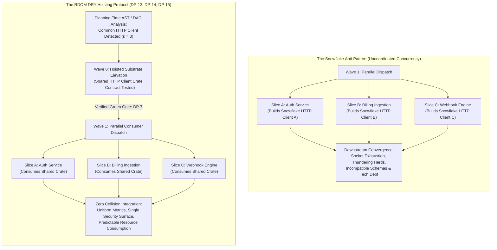

<!-- LICENSE: © 2026 Ravenhelm LLC. Licensed material. -->
<!-- All rights reserved except as granted in LICENSE. Inquiries: nate@ravenhelm.co -->

## Chapter 12 — The DRY Hoisting Protocol: Anti-Snowflake Planning

At 2:45 AM on a Sunday morning, the distributed transaction pipeline of a high-throughput financial exchange deadlocked under peak Asian session volume. Three independent services—the OAuth Token Exchange, the Real-Time Settlement Ingester, and the Webhook Dispatch Engine—were concurrently rejecting incoming payload bursts with cryptic socket timeouts and TLS handshake resets. On call, three senior engineers from three separate domain teams opened their respective repositories to troubleshoot.

What they uncovered was a masterclass in modern architectural decay: the "Three-Engine Trap." Six weeks earlier, during an aggressive quarterly push, management had partitioned the initiative across three parallel teams and a fleet of autonomous AI agent workers. In isolation, every worker completed their sprint tickets early. The burndown charts glowed green. But because the three teams and their agent swarms worked in uncoordinated code repositories without plan-level dependency modeling, each independently implemented their own operational utilities:

1. The OAuth Token Exchange authored a custom HTTP client using an unpooled connection model with aggressive 500-millisecond timeouts.
2. The Real-Time Settlement Ingester authored an asynchronous HTTP engine using a connection pool of 2,048 sockets, silently starving the operating system's ephemeral port range.
3. The Webhook Dispatch Engine authored a third HTTP client using an exponential backoff loop with zero jitter, creating a thundering-herd resonance cascade that hammered internal microservices whenever latency spiked.

Furthermore, each team had invented its own distinct JSON error schema, its own database connection wrapper, and its own cryptographic token verification routine. In local mock tests, every service passed with 100% code coverage. In live staging, under low concurrency, the divergences hid beneath the noise floor. But in production, the three divergent snowflakes collided: the settlement engine exhausted the socket table, the token service failed its handshake, and the webhook dispatch engine slammed the deadlocked cluster with synchronized retries.

Every software organization pays lip service to DRY ("Don't Repeat Yourself"). Yet in industry practice, DRY is treated as an aesthetic virtue—a stylistic guideline left to the discretion of tired engineers during code review. A pull request is submitted with 1,500 lines of business logic and an ad-hoc retry loop. A reviewer notes the duplication. The author responds that unifying the client is "out of scope for this ticket," and promises to file a tech debt card. That card enters the backlog graveyard, never to be seen again.

In high-concurrency human-agent software manufacturing, post-hoc DRY is dead on arrival. Once code is written across parallel branches, the cognitive and political cost of harmonizing divergent implementations scales quadratically. The **Ravenhelm Development Operations Methodology (RDOM)** rejects the fiction of post-hoc code cleanup. It elevates DRY from an incidental code-review recommendation into an inviolable architectural gating discipline: **Planning-Time DRY Hoisting** (DP-13, DP-14, DP-15, DP-16). Duplication is not a formatting flaw; it is an architectural defect that must be eradicated in the dependency DAG *before* a single line of feature code is permitted to enter the execution wavefront.

---

### The Theoretical & Mechanical Foundation

To eliminate accidental duplication across concurrent engineering streams, RDOM establishes a formal topological model for capability elevation.

#### The Mathematical Formulation of Hoisting

Software execution under RDOM is governed by a Dependency Directed Acyclic Graph $G = (V, E)$, partitioned into topological waves $W_0, W_1, \dots, W_N$ (DP-1, DP-2). Let $T_1, T_2, \dots, T_m \in W_k$ denote the set of atomic Daily Deeds scheduled for concurrent execution within topological wave $W_k$ (DP-3).

Each deed $T_i$ requires a set of technical capabilities and operational primitives, denoted by its requirement set $\mathcal{R}(T_i)$:

$$\mathcal{R}(T_i) = \{c_{i,1}, c_{i,2}, \dots, c_{i,p}\}$$

Where $c_{i,j}$ represents an explicit technical requirement: a database connection pool, a structured telemetry middleware, an HTTP client with retry logic, an authorization token parser, or a schema definition.

When two or more parallel tasks in the same wave share underlying technical requirements, we define their common substructure as:

$$\operatorname{Common}(T_a, T_b) = \mathcal{R}(T_a) \cap \mathcal{R}(T_b) \quad \text{for } a \neq b$$

In conventional development methodologies, $\operatorname{Common}(T_a, T_b)$ is ignored during planning. As a consequence, workers independently materialize implementations $I_a(c)$ and $I_b(c)$ for each shared requirement $c \in \operatorname{Common}(T_a, T_b)$. Because these implementations are created in parallel isolation, their semantic divergence $\delta(I_a, I_b)$ is strictly positive:

$$\delta(I_a, I_b) = \| I_a(c) - I_b(c) \| > 0$$

This divergence represents the birth of a **Snowflake**—a redundant, subtly incompatible component that fragments the codebase, multiplies the attack surface, and burdens the engineering organization with permanent maintenance overhead.

Under RDOM Principle **DP-13 (Planning-Time DRY Refactoring)**, this divergence is prevented through the Hoisting Transformation $\mathcal{H}$. During the DAG construction and refinement phase—conducted during the Ráð ceremony (Chapter 7)—the graph compiler scans the requirement sets across all nodes in wave $W_k$. Whenever a non-empty common substructure is identified:

$$\exists \, T_a, T_b \in W_k \quad \text{such that} \quad \mathcal{C} = \operatorname{Common}(T_a, T_b) \neq \emptyset$$

The Hoisting Transformation $\mathcal{H}$ extracts the common capability $\mathcal{C}$ into an atomic, standalone substrate deed $D_{\mathcal{C}}$, elevates it to an earlier wave $W_{k-1}$ (or earlier), and mutates the dependency edges such that both $T_a$ and $T_b$ depend directly on the hoisted deliverable:

$$G' = \mathcal{H}(G) \implies \begin{cases}
V' = V \cup \{D_{\mathcal{C}}\} \\
E' = E \cup \{(D_{\mathcal{C}}, T_a), (D_{\mathcal{C}}, T_b)\} \\
\text{where } \operatorname{Wave}(D_{\mathcal{C}}) \le k - 1
\end{cases}$$

Through this topological transformation, parallel workers in Wave $W_k$ are physically barred from writing bespoke implementations. They consume a single, verified, immutable contract delivered by Wave $W_{k-1}$ that has already passed its Six Sigma gate (DP-7).

#### The Hoisting Decision Boundary (DP-14: The Zero-Speculation Rule)

While the cost of duplication is catastrophic, naive hoisting introduces an equally lethal failure mode: **The Speculative Framework Syndrome**. Eager architects, anticipating hypothetical future requirements, often extract massive "universal abstractions" that complicate the codebase, add indirection, and solve problems no consumer actually has.

To maintain perfect equilibrium between anti-duplication and anti-speculation, RDOM enforces Principle **DP-14 (The Hoist-vs-Defer Rule)** through the **Two-Consumer Gate**:

> **The Zero-Speculation Hoisting Invariant (DP-14)**:
> An abstraction, shared library, crate, or schema may be hoisted into an upstream wave $W_{k-1}$ if and only if it satisfies the Two-Consumer Gate:
>
> $$\kappa(\mathcal{C}) \ge 2$$
>
> Where $\kappa(\mathcal{C})$ is the count of concrete, immediate, scheduled consumer deeds within the active planning graph $G$. Speculative elevation based on hypothetical future consumers ($\kappa_{\text{future}} > 0, \kappa_{\text{active}} < 2$) is strictly prohibited as inventory waste (*Muda*, DP-6).

If $\kappa(\mathcal{C}) = 1$, the capability MUST remain private, inline, and unexported within the single consumer's repository or module. The first consumer implements the minimal viable solution for its own needs. Only when a second concrete consumer $T_b$ appears in a subsequent plan does the Hoisting Protocol activate, triggering an explicit refactoring deed to elevate the working implementation into a shared substrate.

#### The Three Taxonomies of Hoisting

Hoisted artifacts are not monolithic; they operate across three distinct architectural planes:

1. **Interface Hoisting (Types, Protobufs, Schemas)**:
   Elevates structural definitions across service or module boundaries. Includes Protocol Buffer schemas, OpenAPI specifications, shared TypeScript interfaces, and domain event types. Interface hoisting requires zero implementation code—only typed, machine-verifiable contracts.
2. **Utility Hoisting (Algorithms, Middleware, Helpers)**:
   Elevates stateless computational mechanics that are universally required across consumers. Includes exponential backoff with full jitter, cryptographic HMAC verification, structured logging decorators, and OpenTelemetry span injectors.
3. **Architectural Substrate Hoisting (Layer 0 Primitives, DP-17)**:
   Elevates foundational stateful runtime infrastructure. Includes database connection pooling, distributed lock managers, Redis cluster client wrappers, POSIX shared memory ring buffers, and IPC wire protocols.

The following topological comparison contrasts the post-hoc duplicate proliferation pattern against the RDOM planning-time hoisting protocol.



---

### Operational Mechanics & Step-by-Step Protocols

Hoisting is not an informal design philosophy; it is an algorithmic sequence executed during the plan-authoring phase and verified at every wave boundary.

#### The 5-Step DRY Hoisting Protocol

When constructing an initiative DAG, architects and graph compilers must execute the following five-step protocol for every proposed wave:

```
┌─────────────────────────────────────────────────────────────────────────┐
│                      5-Step DRY Hoisting Protocol                       │
├─────────────────────────────────────────────────────────────────────────┤
│  Step 1: Substructure Identification & Semantic Clustering             │
│          Scan proposed task specifications and ASTs for commonality.    │
│                                  ▼                                      │
│  Step 2: The Two-Consumer Gate (Zero Speculation Verification)          │
│          Assert κ(C) ≥ 2 among concrete, active tasks in the graph.     │
│                                  ▼                                      │
│  Step 3: Elevation to Wave W_{k-1} (Deed Decomposition)                │
│          Extract crate/module contract as an explicit foundation deed.  │
│                                  ▼                                      │
│  Step 4: Downstream Consumer Retargeting                                │
│          Refactor consumer deeds to bind strictly to the hoisted API.   │
│                                  ▼                                      │
│  Step 5: Verification & Immutability Lock (DP-7 Gating)                 │
│          Seal the hoisted substrate with property and contract tests.   │
└─────────────────────────────────────────────────────────────────────────┘
```

##### Step 1: Substructure Identification & Semantic Clustering

During the planning of Wave $W_k$, the authoring system (whether human lead or compiler agent) analyzes the task briefs, interface boundaries, and data models of all candidate deeds.

In automated environments, this is performed by analyzing the Abstract Syntax Trees (AST) and Entity-Attribute-Tag (EAT) knowledge substrates (Chapter 17). The analyzer clusters proposed dependencies according to functional signatures:
- Persistent storage access patterns (e.g., PostgreSQL connection pools, transaction coordinators).
- External network communication (e.g., HTTP clients, gRPC stubs, retry loops).
- Domain serialization models (e.g., user identity payloads, billing line items).
- Security and cryptographic primitives (e.g., token signing, secret decoding).

##### Step 2: The Two-Consumer Gate

For each clustered capability $\mathcal{C}$, evaluate the consumer count $\kappa(\mathcal{C})$.
- If $\kappa(\mathcal{C}) == 1$: Reject hoisting. Mark the capability as `scope: internal` to the specific task. Do not create an external library or shared package.
- If $\kappa(\mathcal{C}) \ge 2$: Approve hoisting. Proceed to Step 3.
- If $\kappa(\mathcal{C}) == 0$: Halt immediately. This represents an ungrounded speculative proposal. Purge it from the plan.

##### Step 3: Elevation to Wave $W_{k-1}$

Once approved, the capability is extracted into an explicit Daily Deed:

$$D_{\mathcal{C}} = \langle \text{Name}, \text{Crate/Module Path}, \text{Public API Signature}, \text{Exit Tests} \rangle$$

The deed $D_{\mathcal{C}}$ is scheduled in Wave $W_{k-1}$ (or added to Wave $W_0$ if Wave 1 is the active wave). This deed is not an informal stub; it is a full, first-class deliverable requiring:
- An isolated repository or monorepo package path (e.g., `packages/common-http` or `crates/estate-db-pool`).
- A minimal, clean public interface exposing only what the $\kappa$ consumers explicitly demand.
- A comprehensive suite of unit, property-based, and contract tests proving interface correctness.

##### Step 4: Downstream Consumer Retargeting

With $D_{\mathcal{C}}$ placed in Wave $W_{k-1}$, the original task specifications $T_1, T_2, \dots, T_m \in W_k$ are rewritten. Their technical instructions are stripped of any mandate to create local utilities or database drivers. Instead, their specifications are updated to declare a strict dependency:

```toml
# Example: Consumer retargeting inside downstream slice manifest
[dependencies]
estate-telemetry-middleware = { path = "../../crates/estate-telemetry-middleware", version = "0.1.0" }
estate-http-client = { path = "../../crates/estate-http-client", version = "0.1.0" }
```

The tasks in Wave $W_k$ now consume the hoisted artifact as an external black-box dependency.

##### Step 5: Verification & Immutability Lock

Wave $W_{k-1}$ executes. Before Wave $W_k$ is permitted to dispatch its workers, deed $D_{\mathcal{C}}$ must pass the Six Sigma Wave Boundary Gate (DP-7, Chapter 13):
1. **Deterministic Build & Test**: The hoisted package must compile cleanly and pass 100% of its automated test suite against the live test runner environment.
2. **Interface Stability (Poka-Yoke)**: The public API must enforce compile-time safety (DP-9), making invalid consumer states unrepresentable.
3. **Artifact Publishing**: The artifact is built, tagged, and published to the local workspace registry or monorepo path, locking its SHA or semver tag. Once Wave $W_{k-1}$ closes, the hoisted artifact is immutable. Workers in Wave $W_k$ may not mutate the hoisted crate; if a defect is discovered, they must halt and sound the Andon Cord (DP-12).

#### Refactoring as Hoisting (DP-16: Scaffolding from Working Reality)

A critical corollary of the DRY Hoisting Protocol is Principle **DP-16 (Scaffolding from Working Reality)**.

In classical engineering cultures, "refactoring" is treated as aimless, unstructured cleanup—engineers wander through codebases renaming variables, adjusting whitespace, or reorganizing folders according to personal aesthetic preference. This generates massive git churn, breaks active worktrees, and provides zero architectural defense.

Under RDOM, **Refactoring is Hoisting**:

> **Principle DP-16**:
> Never build abstract frameworks, base classes, or shared platforms *ex nihilo*. Scaffolds, platform libraries, and shared SDKs are extracted exclusively from working, battle-tested implementations that have already proven their viability in production.

When consumer $T_1$ builds an inline utility in Wave $W_1$, it does so against working reality. When consumer $T_2$ arrives in Wave $W_3$ requiring the same capability, the refactoring deed does not write a brand-new abstract library from scratch. Instead, the refactoring deed takes $T_1$'s proven, tested implementation, hoists it into a shared substrate crate, wraps it in contract tests, and retargets both $T_1$ and $T_2$ to consume the newly hoisted primitive. Refactoring is never aesthetic; it is the physical elevation of verified code into durable estate substrate.

#### The Sovereign Consumption Contract & Estate Floor (DP-15)

Hoisting common libraries is only half the battle; the other half is ensuring that parallel workers actually consume them instead of building redundant shadow implementations.

In multi-agent environments, autonomous agents frequently demonstrate a bias toward local code generation. An agent tasked with fetching an HTTP resource will gladly generate a twenty-line Python `urllib` wrapper rather than navigate the repository to find the canonical, corporate-standard, rate-limited HTTP client.

To prevent this silent proliferation of shadow code, RDOM establishes the **Consumption Contract** (DP-15):

> **The Sovereign Consumption Rule (DP-15)**:
> A repository, service, or task slice may decline to use an established estate surface. It may not do so silently.

The estate maintains a dual-registry architecture:

1. **The Supply-Side Surface Catalog (`registry/library-surfaces.json`)**:
   A machine-readable ledger of all approved, hoisted platform surfaces across the organization:

   ```json
   {
     "surfaces": [
       {
         "id": "surface.estate.telemetry",
         "crate": "estate-telemetry",
         "layer": "substrate",
         "capabilities": ["distributed-tracing", "prometheus-metrics", "structured-json-logging"],
         "status": "canonical"
       },
       {
         "id": "surface.estate.db.postgres",
         "crate": "estate-pg-pool",
         "layer": "substrate",
         "capabilities": ["connection-pooling", "read-replica-routing", "deadlock-retry"],
         "status": "canonical"
       }
     ]
   }
   ```

2. **The Demand-Side Lane Floor (`registry/lane-consumption.json`)**:
   Declares the mandatory baseline of surfaces that any repository operating within a specific architectural lane must consume:

   ```json
   {
     "lanes": {
       "backend-service": {
         "mandatory_surfaces": [
           "surface.estate.telemetry",
           "surface.estate.db.postgres",
           "surface.estate.auth-validator"
         ]
       },
       "cli-tool": {
         "mandatory_surfaces": [
           "surface.estate.telemetry"
         ]
       }
     }
   }
   ```

##### The Explicit Exemption Invariant

Under Principle DP-15, if a worker or team decides to bypass an established platform surface—for example, implementing a zero-dependency diagnostic binary that cannot afford the footprint of the standard database pool—they are forbidden from doing so silently.

The worker must declare an explicit `consumes_exemption` block in their deed manifest or repository configuration:

```json
{
  "consumes_exemption": {
    "surface_id": "surface.estate.db.postgres",
    "rationale": "High-frequency embedded watchdog requires raw SQLite connection; libpq runtime dependency prohibited in target initramfs.",
    "authorized_by": "Architectural Council (Ráð)",
    "adr_reference": "ADR-0042",
    "review_wave": "W_8"
  }
}
```

If an automated pull request linter or compiler agent detects that a repository is implementing capability matching an active estate surface without importing the canonical crate *and* without an authorized `consumes_exemption`, the build immediately fails with a fatal Poka-Yoke exit code (DP-9).

#### The Hoisting Decision Matrix

The following decision matrix guides architects during the Ráð ceremony in categorizing and processing candidate abstractions:

| Evaluation Dimension | Interface Hoisting | Utility Hoisting | Substrate Hoisting (DP-17) | Inline Implementation |
| :--- | :--- | :--- | :--- | :--- |
| **Consumer Count** ($\kappa$) | $\kappa \ge 2$ cross-boundary | $\kappa \ge 2$ internal callers | $\kappa \ge 2$ service engines | $\kappa = 1$ single caller |
| **Artifact Type** | Schema / Types / Protobuf | Stateless Pure Functions | Stateful Infrastructure Crate | Private unexported module |
| **Target Wave** | Wave $W_{k-1}$ | Wave $W_{k-1}$ | Wave $W_0$ or Foundation Wave | Current Wave $W_k$ |
| **Statefulness** | Zero state (declarative) | Pure / Ephemeral state | Connection pools / Memory buffers | Scoped to caller lifecycle |
| **Change Frequency** | Low (Strict SemVer) | Medium (Additive updates) | Extremely Low (Invariance gate) | High (Rapid iteration) |
| **Verification Gate** | Schema compatibility check | Property-based unit tests | Integration & load stress tests | Caller integration tests |

---

### Concrete Anti-Patterns & Defect Escapes

When teams fail to execute planning-time hoisting, organizational pathologies emerge with mathematical predictability. Below are the four most destructive anti-patterns and their structural remedies.

#### 1. The Speculative Framework Syndrome

- **The Manifestation**: An architect reviews an upcoming project plan and notices that two services will need to query an S3-compatible object store. Rather than hoisting a minimal, two-method S3 wrapper (`put_object`, `get_object`), the architect embarks on a four-week crusade to build the "Universal Enterprise Storage Substrate"—a sprawling meta-framework supporting twelve storage backends, dynamic pluggable caching, distributed write-through locks, and an abstract virtual filesystem.
- **The Defect Escape**: By the time this behemoth is delivered, it is riddled with subtle concurrency bugs, heavily bloated, and completely misaligned with what the downstream services actually require. Downstream teams bypass it entirely to meet their deadlines.
- **The RDOM Poka-Yoke**: Enforce the **Zero-Speculation Rule (DP-14)**. Hoisting requires $\kappa \ge 2$ *concrete* requirements, not speculative futures. The hoisted deliverable must expose only the strict union of capabilities immediately demanded by the registered consumers ($\mathcal{C} = \mathcal{R}(T_a) \cap \mathcal{R}(T_b)$). Building support for unrequested capabilities is treated as defect generation and inventory waste (*Muda*, DP-6).

#### 2. Copy-Paste Parallelism

- **The Manifestation**: Under pressure to deliver features rapidly, parallel human developers or AI agent slices duplicate utility logic across isolated worktrees. Developer A needs a function to parse ISO-8601 timestamps with microsecond precision; they copy it from Stack Overflow or prompt an LLM to generate it. Developer B, working on a parallel slice in the same wave, does the same.
- **The Defect Escape**: Six months later, a timezone edge-case bug is discovered in Developer A's implementation. The fix is applied to Service A. Service B remains unpatched. Months later, during daylight saving time transition, Service B corrupts financial reconciliation records.
- **The RDOM Poka-Yoke**: Static AST duplication scanning prior to wave closure. Any identical or near-isomorphic token sequences spanning distinct task slices trigger an automated Andon Cord (DP-12). The code cannot merge until the duplicate is either hoisted into an internal shared module or explicitly exempted via an ADR.

#### 3. The "Snowflake Exception" Culture

- **The Manifestation**: A domain team insists that their microservice is "unique" and cannot use the canonical estate database connection wrapper. They claim their queries require non-standard transaction isolation levels or specialized telemetry tags that the standard library does not accommodate.
- **The Defect Escape**: The team implements their own bespoke database client. When the platform infrastructure migrates to a zero-trust network topology requiring mutual TLS (mTLS) certificate rotation every 60 minutes, the standard library handles the rotation seamlessly across 90 services. The snowflake service fails to rotate certificates, causing an unrecoverable cascading outage across the core payment network.
- **The RDOM Poka-Yoke**: The **Consumption Contract (DP-15)**. No team may opt out of a canonical platform surface without an explicit, time-bounded `consumes_exemption` signed off by the Ráð council. If a canonical library lacks a necessary capability, the team is forbidden from building a shadow client; instead, they must submit a pull request against the canonical library in Wave $W_{k-1}$ to extend the shared substrate for the entire estate.

#### 4. Late Extraction Drift

- **The Manifestation**: During sprint planning, an engineering manager notices that three concurrent tasks require identical webhook signature verification logic. Rather than delaying the feature tasks to extract the library first, the manager declares: "We need to hit our sprint deadline. Everyone build it locally for now, and we'll create a tech debt ticket to consolidate it into a shared library next sprint."
- **The Defect Escape**: "Next sprint" never arrives. The three implementations subtly diverge in their handling of URL encoding, header casing, and secret stripping. By the time consolidation is attempted six months later, changing the logic in any one service breaks downstream external webhook integrations. The organization is permanently stuck supporting three diverging engines.
- **The RDOM Poka-Yoke**: Principle **DP-13 (Planning-Time DRY Refactoring)**. Hoisting must occur *before* the consumer wave opens. If a shared requirement is discovered mid-execution, the active wave is paused, the Andon Cord is pulled (DP-12), and the DAG is re-topologized to insert Wave $W_{k-1}$ extraction before feature work proceeds.

---

### Upstream & Downstream Integration (The Sovereign Triad)

The DRY Hoisting Protocol does not exist in an architectural vacuum; it functions as the central binding mechanism linking upstream business strategy to downstream continuous delivery across the Sovereign Triad:

```
┌─────────────────────────────────────────────────────────────────────────┐
│                          The Sovereign Triad                            │
├─────────────────────────────────────────────────────────────────────────┤
│  Upstream: RLOM (Ravenhelm Lifecycle Operations Methodology)            │
│  - Strategic Demand Formulation & Feature Definition                    │
│  - The Ráð Architectural Council (Hoisting Gatekeeper)                  │
│                                  │                                      │
│                                  ▼ (Plan-Time Hoisting - DP-13, DP-14)  │
│  Midstream: RDOM (Ravenhelm Development Operations Methodology)         │
│  - Topological Wave Partitioning (W_0, W_1, ..., W_N)                   │
│  - Substrate Elevation & Consumer Retargeting (DP-15, DP-16)            │
│  - Six Sigma Boundary Gates (DP-7 Verified Green)                       │
│                                  │                                      │
│                                  ▼ (Immutable Artifact Publication)     │
│  Downstream: RROM (Ravenhelm Release Operations Methodology)            │
│  - Estate Package Registry Distribution (Harbor OCI / Private Cargo)    │
│  - Fleet-Wide Drift Detection & Zero-Downtime Ring Deploys              │
└─────────────────────────────────────────────────────────────────────────┘
```

#### Upstream RLOM Integration: The Ráð Gatekeeper

Before any engineering initiative is authorized for wave dispatch, the work passes through the upstream **Ravenhelm Lifecycle Operations Methodology (RLOM)** governance gate. During the **Ráð** ceremony (the Architecture Review Council, Chapter 7), the initiative's proposed Dependency DAG is subjected to the Hoisting Analysis:

1. **Demand-Side Clustering**: RLOM demand signals and functional specs are evaluated across all proposed work streams. If two distinct product capabilities require similar technical scaffolding (e.g., automated PDF report generation and customer invoice export), RLOM mandates that the shared rendering engine be hoisted into Wave 0.
2. **Pre-Flight DAG Ratification**: The Ráð physically rejects any DAG where parallel nodes in Wave $W_k$ contain duplicate capability without an explicit dependency on an upstream hoisted deed in Wave $W_{k-1}$. The plan cannot be ratified until the graph topology is mathematically clean.

#### Downstream RROM Integration: Immutable Registry Publication

Once hoisted artifacts are verified green at their wave boundary, they hand off directly to **Ravenhelm Release Operations Methodology (RROM)** for estate-wide distribution:

1. **Hermetic Packaging**: Hoisted crates and modules are compiled into immutable, content-addressed artifacts (e.g., OCI registry packages, internal Cargo crates, or npm tarballs). They are tagged with strict Semantic Versioning and cryptographic digests.
2. **Registry Elevation**: Artifacts are published to the internal estate registry. Downstream consumer worktrees in Wave $W_k$ consume these artifacts via immutable package references, guaranteeing that all parallel agent and human slices build against the exact same bit-for-bit binary or library interface.
3. **Automated Fleet Ingestion**: RROM continuous delivery pipelines monitor the Demand-Side Lane Floor (`registry/lane-consumption.json`). When a new canonical patch is published to an estate surface, RROM automatically dispatches automated dependency-bump PRs across all registered consumer repositories, ensuring zero estate drift over time.

---

> **Augmentation Surface — AST Duplication Detection & Plan-Time Hoisting**
>
> **Where an agent layer transforms this practice:**
> In high-scale engineering organizations, detecting cross-cutting duplication across hundreds of proposed tasks exceeds human cognitive capacity. An autonomous agent layer transforms this practice through continuous static analysis and graph compilation:
>
> 1. **Automated Substructure Extraction**: As feature deeds are authored in draft DAGs, background compiler agents parse the natural language specifications, proposed schema definitions, and codebase ASTs. Agents perform semantic clustering across all active branches, instantly identifying when two uncoordinated tickets are attempting to implement isomorphic utilities.
> 2. **Proactive Hoisting Proposals**: When the agent detects $\kappa \ge 2$ convergence, it automatically generates the hoisted deed specification for Wave $W_{k-1}$, scaffolds the new crate repository structure, generates the typed interface contract, and drafts the consumer retargeting patches for Wave $W_k$.
> 3. **Poka-Yoke Consumption Enforcement**: Agentic CI linters continuously scan PRs across all active worktrees. If a human engineer or coding subagent writes custom HTTP, database, or logging logic that duplicates an established estate surface, the linter blocks the PR, points to the exact canonical crate in `library-surfaces.json`, and generates an automated autofix PR.
>
> **What the human architect keeps:**
> The human architect retains sovereign judgment over the **Hoisting Decision Boundary**:
>
> - Determining whether observed commonality represents true domain equivalence or merely accidental syntactic similarity. (For example: deciding whether an internal billing token and an external auth token should share a single cryptographic parser or remain strictly isolated domain types).
> - Authorizing or denying `consumes_exemption` requests, ensuring that performance-critical exceptions are grounded in genuine physics rather than developer convenience.
> - Setting estate-wide platform standards during the Ráð ceremony, ensuring that hoisted abstractions serve long-term enterprise strategy rather than short-term convenience.

<!-- RUBRIC_CHECK:
  structural: pass
  content: pass
  funnel: pass
  chapter-type-extras: n/a
  word-count: 4311
  principle-citations: DP-1, DP-2, DP-3, DP-6, DP-7, DP-9, DP-12, DP-13, DP-14, DP-15, DP-16, DP-17
  flagged-principle-gaps: none
-->
