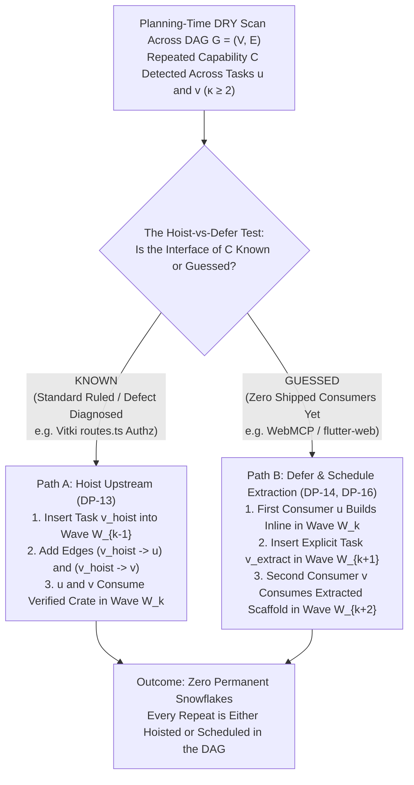

<!-- LICENSE: © 2026 Ravenhelm LLC. Licensed material. -->
<!-- All rights reserved except as granted in LICENSE. Inquiries: nate@ravenhelm.co -->

## Chapter 12: The DRY Hoisting Protocol - Anti-Snowflake Planning

On September 21, 2026, while reviewing the multi-wave `RootFifth` implementation plan, the operator stopped the dispatch before Wave 0 opened. Across the dependency graph, multiple parallel application slices were each scheduled to wire up their own namespace and authorization routing file (`routes.ts`), while other branches proposed building shared `WebMCP` and `flutter-web` application scaffolds from scratch. Two defects in **Vitki** had already diagnosed the exact failure mode of hand-rolled `routes.ts` namespace and authz wiring, yet the draft plan was about to dispatch parallel worker slices to write three more bespoke copies of `routes.ts` in separate repositories.

The operator laid down the missing leg of **The Ehwaz Doctrine (ᛖ)** verbatim: *"basically im just making sure that the plan gets refactored to try to not build snowflakes. if we are building something, build the version that everything downstream can use. like extracting out repetitive code snippets and creating a class or a library."*

Every software organization claims to believe in DRY (*Don't Repeat Yourself*), and almost every software organization practices DRY at the wrong point in time. In conventional workflows, DRY is treated as a post-hoc code-review critique. Three engineers or three autonomous coding slices work in parallel worktrees for two days, each writing their own custom HTTP retry wrapper, their own `routes.ts` authz middleware, or their own database pool initializer. When the three pull requests hit the review queue on Thursday afternoon, a reviewer notices the duplication. By then, the trap has already snapped shut. Rejecting two passing pull requests and forcing a cross-repo extraction breaks the release schedule, so the lead compromises: *"Merge all three for now and open a tech-debt issue to unify them next cycle."* That issue sinks to the bottom of the backlog, and the estate is now permanently saddled with three diverging snowflakes.

When you run a parallel fleet of AI worker slices, post-hoc DRY is dead on arrival. An autonomous worker slice knows only the files inside its worktree and the symbols inside its `<800`-token `eat prime` manifest. If the plan instructs three Wave 1 slices to build endpoints requiring namespace authorization and no shared authz scaffold exists in Wave 0, those three slices will deterministically manufacture three incompatible snowflakes in fifteen minutes.

The **Ravenhelm Development Operations Methodology (RDOM)** moves DRY out of code review and into **plan compilation**. Under **The Ehwaz Doctrine**, **Planning-Time DRY Hoisting** (**DP-13**, **DP-14**, **DP-15**, **DP-16**) refactors the dependency graph $G = (V, E)$ *before* Wave 0 opens. This is not a fourth methodology bolted onto CPM, Lean, and Six Sigma. Six Sigma is variation reduction; three snowflake implementations of one capability is variation in the artifact rather than the process. Planning-Time DRY is the Six Sigma leg pointed directly at what gets built.

---

### The Theoretical & Mechanical Foundation

Refactoring a plan to prevent snowflakes immediately collides with another foundational law of software engineering: **extract scaffolds from working code; never imagine them** (**DP-16**). If you hoist an abstraction into Wave 0 before any consumer has ever been built, and you have to *guess* what the interface should look like, you will build a speculative framework that fits none of the downstream consumers.

How do you honor both rules without contradiction? On September 21, 2026 (`ehwaz-doctrine.md`), the Ehwaz Doctrine resolved this tension with a strict binary discriminator: **The Hoist-vs-Defer Test**.

#### The Mathematical Formulation of Plan-Level Duplication

Let $G = (V, E)$ be a candidate Dependency DAG partitioned into topological waves $W_0, W_1, \dots, W_K$ (**DP-1**, **DP-2**). Each task $v \in V$ requires a set of capabilities $\mathcal{R}(v) = \{c_1, c_2, \dots, c_m\}$ (routing scaffolds, authz verifiers, telemetry decorators, schema definitions, or UI harnesses).

Across the entire graph $G$, a repeated capability $\mathcal{C}$ exists whenever two or more tasks share a common requirement:

$$\exists \, u, v \in V \ (u \neq v) \quad \text{such that} \quad \mathcal{C} \in \mathcal{R}(u) \cap \mathcal{R}(v)$$

If the plan leaves $\mathcal{C}$ inside both $u$ and $v$, parallel workers will produce distinct implementations $I_u(\mathcal{C})$ and $I_v(\mathcal{C})$ with positive semantic divergence:

$$\delta\left(I_u(\mathcal{C}), I_v(\mathcal{C})\right) > 0$$

In Six Sigma terms, $\delta > 0$ across equivalent components is **structural artifact variance**. Every bug fixed in $I_u(\mathcal{C})$ remains unpatched in $I_v(\mathcal{C})$.

#### The Hoist-vs-Defer Test (DP-13, DP-14, DP-16)

When the planning-time DRY scan detects a repeated capability $\mathcal{C}$ across two or more tasks ($\kappa(\mathcal{C}) \ge 2$), the planner does not blindly hoist everything into Wave 0, nor does it ignore the repeat. Instead, it evaluates whether the interface of $\mathcal{C}$ is **Known** or **Guessed**:

| Interface Epistemic State | Diagnostic Criterion | Mandatory Graph Mutation | RootFifth Plan Receipt (2026-09-21) |
|:---|:---|:---|:---|
| **1. Interface is KNOWN** | Encodes a decision already made, an estate standard already ratified, or a defect already diagnosed in production code. | **Hoist Upstream Now (DP-13)**: Create one upstream task $v_{\text{hoist}}$ in an earlier wave ($W_{k-1}$ or $W_0$), rewire all consumers $u, v$ to depend on $v_{\text{hoist}}$, and strip the duplicate work from their briefs. | **Project Factory Namespace/Authz Scaffold (`routes.ts`)**: Every app was writing its own `routes.ts`; two **Vitki** defects had already diagnosed and locked the exact interface. Hoisted upstream. |
| **2. Interface is GUESSED** | No consumer has shipped one yet; extracting now would mean predicting what downstream callers will need in a vacuum. | **Defer & Schedule Extraction Explicitly (DP-14, DP-16)**: Let the first consumer $u$ in Wave $W_k$ build the capability inline against real constraints, and **insert an explicit extraction task $v_{\text{extract}}$ in Wave $W_{k+1}$** before consumer $v$ runs in Wave $W_{k+2}$. | **`WebMCP` and `flutter-web` Scaffolds**: No consumer had shipped one yet; imagining the scaffold upfront would build the wrong abstraction. First consumer builds inline; extraction task scheduled explicitly in a later wave. |

Look closely at the invariant governing that table:

> **The Law of Named Duplicates (`ehwaz-doctrine.md`)**:
> **No duplicate is ever left unnamed.** The fatal failure mode is not temporary inline implementation; it is *unacknowledged* duplication, which silently becomes permanent. Every repeat found during the planning scan must terminate in the DAG as either an **upstream hoisted task** (when the interface is known) or an **explicitly scheduled downstream extraction task** (when the interface would be guessed) - never neither.



#### Topological Mechanics of Both Transformations

Let us trace how both branches of the Hoist-vs-Defer Test mutate the dependency graph $G = (V, E)$:

1. **Path A - Upstream Hoist Transformation ($\mathcal{H}_{\text{known}}$)**:
   When tasks $u, v \in W_k$ both require a known capability $\mathcal{C}$ (such as the Vitki-proven `routes.ts` authz scaffold):

   $$V' = V \cup \{v_{\text{hoist}}\}, \quad W(v_{\text{hoist}}) = k - 1$$
   $$E' = E \cup \{(v_{\text{hoist}}, u), (v_{\text{hoist}}, v)\}$$

   In Wave $W_{k-1}$, a single slice builds and tests $v_{\text{hoist}}$. Once $v_{\text{hoist}}$ passes the Six Sigma wave exit gate (**DP-7**), Wave $W_k$ opens and tasks $u$ and $v$ run in parallel as pure consumers of the verified scaffold.
2. **Path B - Scheduled Extraction Transformation ($\mathcal{H}_{\text{guessed}}$)**:
   When tasks $u$ and $v$ both need a capability $\mathcal{C}$ whose shape is not yet proven in production (such as `WebMCP` or `flutter-web`):

   $$V' = V \cup \{v_{\text{extract}}\}$$
   $$E' = E \cup \{(u, v_{\text{extract}}), (v_{\text{extract}}, v)\}$$
   $$W(u) = k, \quad W(v_{\text{extract}}) = k + 1, \quad W(v) = k + 2$$

   In Wave $W_k$, task $u$ builds the first real working instance inline without speculative ceremony. In Wave $W_{k+1}$, task $v_{\text{extract}}$ extracts the proven scaffold directly from $u$'s working code (**DP-16**) and rewires $u$ to use it. In Wave $W_{k+2}$, task $v$ consumes the newly extracted scaffold. You never guess an abstraction in a vacuum, and you never ship a second copy without extracting the first.

---

### Operational Mechanics & Step-by-Step Protocols

Executing the DRY Hoisting Protocol requires running a mandatory graph scan before detailing the open wave, combined with machine-enforced consumption contracts across the repository estate.

#### Protocol 1: The 5-Step Planning-Time DRY Scan

Per `ehwaz-doctrine.md`, every implementation plan of more than a handful of tasks undergoes this exact sequence before Wave 0 is detailed:

```text
┌─────────────────────────────────────────────────────────────────────────┐
│               5-Step Planning-Time DRY Hoisting Protocol                │
├─────────────────────────────────────────────────────────────────────────┤
│  Step 1: Draft Initial Dependency Graph & Wave Breakdown (W_0 .. W_K)   │
│          Map all functional tasks and technological edges E.            │
│                                  ▼                                      │
│  Step 2: Cross-Graph Capability Scan                                    │
│          Inspect all tasks across all waves for repeated patterns,      │
│          shared schemas, authz routers, CLI harnesses, or scaffolds.    │
│                                  ▼                                      │
│  Step 3: Apply the Hoist-vs-Defer Test to Every Repeat (κ ≥ 2)          │
│          - Single consumer (κ = 1) -> Keep inline (No speculation).     │
│          - Known interface (κ ≥ 2) -> Hoist task to Wave W_{k-1}.       │
│          - Guessed interface (κ ≥ 2) -> First inline; schedule extract. │
│                                  ▼                                      │
│  Step 4: Rewire DAG Edges & Recompute Wave Numbers                      │
│          Update Consumes/Produces blocks and recompute Critical Chain.  │
│                                  ▼                                      │
│  Step 5: JIT Elaborate ONLY Wave 0 (Including Hoisted Foundations)      │
│          Write bite-sized TDD steps for Wave 0 and dispatch slices.     │
└─────────────────────────────────────────────────────────────────────────┘
```

#### Worked Case Study: The 2026-09-21 RootFifth Plan Refactoring

To see how Protocol 1 operates at the bench, examine the two concrete transformations from the September 21, 2026 `RootFifth` plan:

##### Case 1: Hoisting the Known Interface (`Project Factory` Namespace/Authz `routes.ts`)

1. **The Observation**: Multiple service tasks in the plan needed to expose HTTP/MCP routes protected by Ravenhelm namespace isolation and role authorization. Left alone, each service slice would write its own `routes.ts` middleware.
2. **The Epistemic Check**: Was the interface a guess? No. Two prior defects in **Vitki** had already exposed what goes wrong when a service rolls its own `routes.ts` authz handler and had locked the exact required middleware contract, error status codes, and claim checks.
3. **The Hoist Mutation**: Rather than letting downstream slices copy-paste `routes.ts` from `Vitki` and drift, the planner hoisted the namespace/authz routing scaffold into an upstream **Project Factory** task. Every downstream application task was rewired to consume the Project Factory scaffold. Variation reduced to zero before a single downstream slice launched.

##### Case 2: Deferring & Scheduling the Guessed Interface (`WebMCP` & `flutter-web` Scaffolds)

1. **The Observation**: Multiple planned tasks across the roadmap intended to expose `WebMCP` browser tool surfaces and `flutter-web` frontends. An eager architect might be tempted to insert a "Wave 0: Build Universal WebMCP and Flutter-Web Project Factory Template" task before building the first app.
2. **The Epistemic Check**: Was the interface known? No. Zero production apps in the estate had shipped a `WebMCP` or `flutter-web` surface yet. Writing the reusable template in Wave 0 would mean guessing build flags, asset bundling paths, and state-bridge lifecycles without a single live consumer (**DP-16** violation).
3. **The Defer-and-Schedule Mutation**: The planner forbade a speculative Wave 0 template. Instead, the first application task was scheduled to build its `WebMCP` / `flutter-web` wiring inline against real browser and compiler constraints. Immediately behind that first consumer in the DAG, the planner inserted an explicit extraction task: once Consumer 1 passes live verification (**DP-7**), harvest the proven wiring into the Project Factory template so Consumer 2 and Consumer 3 consume the battle-tested scaffold.

#### Protocol 2: The Sovereign Consumption Contract (DP-15)

Hoisting a capability into a shared crate or Project Factory template only prevents snowflakes if downstream worker slices actually import it. Left unsupervised, an LLM coding agent tasked with adding an authenticated route or an OpenBao secret lookup will happily write forty lines of raw `reqwest` or `urllib` inline rather than searching the estate for the canonical client.

Principle **DP-15 (The Sovereign Consumption Rule)** closes this loophole:

> **Principle DP-15**: A repository, service, or task slice may decline to use an established estate surface. **It may not do so silently.**

RDOM enforces consumption through two machine-readable contracts and an explicit exemption gate:

1. **The Supply-Side Surface Catalog (`registry/library-surfaces.json`)**:
   Enumerates the canonical, hoisted libraries and scaffolds across the estate (e.g., `Project Factory` authz routing, `OpenBao` AppRole client, `EAT` indexing bindings, standard telemetry emitters).
2. **The Demand-Side Lane Floor (`registry/lane-consumption.json`)**:
   Defines which canonical surfaces are mandatory for each class of repository (e.g., every K3s service on `Norns` must consume the canonical health/metrics surface and `Project Factory` authz scaffold; every CLI tool on Rail B must consume the standard version/provenance surface).
3. **The Explicit `consumes_exemption` Declaration**:
   If a specific binary genuinely cannot consume a mandatory surface (for example, an ultra-minimal init container or a standalone recovery script that cannot link the full workspace crate), the author must declare a signed `consumes_exemption` block in the repository manifest citing the approving ADR:

```json
{
  "consumes_exemption": {
    "surface_id": "surface.ravenhelm.project-factory.authz-routes",
    "reason": "Standalone air-gapped recovery CLI; zero HTTP server surface.",
    "adr": "ADR-0019",
    "approved_by": "nate"
  }
}
```

Any pull request that re-implements a capability listed in `library-surfaces.json` without importing the canonical package and without a valid `consumes_exemption` fails verification at the review gate (**DP-9**, **DP-23**).

---

### Concrete Anti-Patterns & Defect Escapes

The DRY Hoisting Protocol prevents four classic architectural defects.

#### 1. Unacknowledged Duplication (The Silent Snowflake Factory)

- **The Corpse of v1**: Three parallel tasks in Wave 1 each implement their own `routes.ts` authz middleware because the plan author only looked at each task in isolation.
- **The Mechanism of Failure**: Once three separate PRs are written and passing local tests, nobody wants to delay the release to delete two of them. All three merge. Six months later, an authz bypass bug found in **Vitki** has to be hunted down manually across a dozen drifted copies.
- **The RDOM Poka-Yoke**: The mandatory pre-wave DRY scan (**DP-13**). Before Wave 0 opens, every repeated capability across the DAG is named and either hoisted upstream or linked to a scheduled extraction node.

#### 2. Speculative Framework Syndrome (Hoisting a Guess)

- **The Corpse of v1**: Building a generic `WebMCP` or `flutter-web` framework in Wave 0 before a single application has ever compiled or run in a browser.
- **The Mechanism of Failure**: Because the author is guessing what future consumers need, the speculative framework gets the lifecycle hooks wrong. When Consumer 1 finally runs in Wave 1, the framework blocks real work, forcing Consumer 1 to write ugly workarounds or bypass the framework entirely.
- **The RDOM Poka-Yoke**: The **Hoist-vs-Defer Test** (**DP-14**, **DP-16**). If the interface is guessed (zero shipped consumers), hoisting into Wave 0 is forbidden. Let Consumer 1 build inline, prove the code on live silicon (**DP-10**), and run the scheduled extraction task in the next wave.

#### 3. Deferred Extraction Amnesia ("We'll Clean It Up Later")

- **The Corpse of v1**: Deciding wisely not to build a speculative framework before Consumer 1 ships, but failing to put the extraction task into the DAG before Consumer 2 starts.
- **The Mechanism of Failure**: When Consumer 2 opens in Wave 2, the worker slice simply copies Consumer 1's inline directory and modifies it. Deferral without a scheduled extraction node in the DAG is just procrastination.
- **The RDOM Poka-Yoke**: Whenever the Hoist-vs-Defer Test selects **Defer**, the planner must insert the extraction task $v_{\text{extract}}$ into the DAG immediately, with a hard dependency edge $(v_{\text{extract}}, v_2)$ blocking Consumer 2 until the extraction merges.

#### 4. Silent Estate Surface Bypass

- **The Corpse of v1**: A canonical crate exists in the estate, but a newly spawned worker slice is not told about it in its task brief and writes a bespoke local implementation instead.
- **The Mechanism of Failure**: The codebase accumulates shadow implementations that ignore estate security invariants, retry budgets, and telemetry standards.
- **The RDOM Poka-Yoke**: Every JIT-elaborated task brief explicitly names the hoisted packages in its `Consumes` block, `eat prime` surfaces existing estate modules in `<800` tokens (**DP-20**), and `Snotra` / CI linters enforce `lane-consumption.json` (**DP-15**).

---

### Upstream & Downstream Integration (The Sovereign Triad)

The DRY Hoisting Protocol links **RLOM** portfolio hygiene to **RROM** artifact distribution:

1. **Upstream Integration (RLOM $\to$ RDOM)**:
   - When a **Planning-Time Hoist** or **Scheduled Extraction** is added to an Ehwaz plan, a corresponding tracked issue (`RAV-<id>`) is created in Linear with explicit `blocks` edges to every downstream consumer issue.
   - During the **Monthly Architecture & Wave Boundary Review** (Chapter 7), the architect audits the DAG specifically to verify that every $\kappa \ge 2$ repeat has passed the Hoist-vs-Defer Test.
2. **Downstream Integration (RDOM $\to$ RROM)**:
   - When a hoisted substrate crate or `Project Factory` template passes its wave exit gate and merges to `main`, RROM packages and publishes the immutable versioned artifact so all downstream repositories and worktrees pull the exact same verified dependency digest.

### Augmentation Surface - Automated Graph DRY Scanning & Consumption Auditing

> **Augmentation Surface - Anti-Snowflake Compilation**
>
> **Where an agent layer transforms this practice:**
> 1. **Pre-Wave DAG Duplication Scan**: Before Wave 0 opens, an architecture agent scans the `Produces` and file-path targets across every task in the draft plan alongside the `EAT` knowledge graph (`eat find`, `eat connections`). It flags any capability being built in two or more places and checks whether an existing surface in `library-surfaces.json` or a diagnosed defect (like the **Vitki** `routes.ts` receipts) already defines the interface.
> 2. **Automated Hoist / Extraction Graph Rewiring**: Based on the Hoist-vs-Defer classification, the planner agent rewrites the DAG table of contents - either inserting the upstream hoist node in Wave $W_{k-1}$ or inserting the explicit extraction node between Consumer 1 and Consumer 2.
> 3. **Advisory & CI Consumption Gate (`Snotra`)**: During pull request review, `Snotra` inspects diffs for hand-rolled authz, HTTP, or database boilerplate that duplicates a canonical estate surface, blocking silent snowflake proliferation before merge (**DP-15**, **DP-23**).
>
> **What the human architect keeps:**
> - **The Hoist-vs-Defer Ruling**: Deciding whether an interface is genuinely *known* (ready to hoist now) or *guessed* (must be built inline by Consumer 1 first and extracted in the next wave) is an architectural judgment call reserved for the human operator.
> - **Exemption Authorization**: Only the human architect may approve a `consumes_exemption` allowing a repository to step outside the estate consumption floor.

---

<!-- RUBRIC_CHECK:
  structural: pass
  content: pass
  funnel: pass
  chapter-type-extras: n/a
  word-count: 3060
  principle-citations: DP-1, DP-2, DP-6, DP-7, DP-9, DP-10, DP-13, DP-14, DP-15, DP-16, DP-20, DP-23
  flagged-principle-gaps: none
-->
