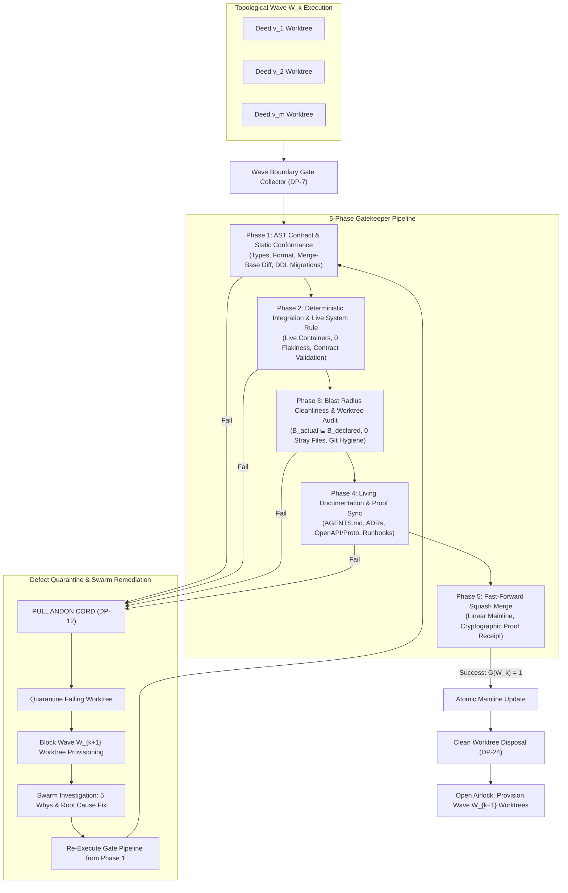

<!-- LICENSE: © 2026 Ravenhelm LLC. Licensed material. -->
<!-- All rights reserved except as granted in LICENSE. Inquiries: nate@ravenhelm.co -->

## Chapter 13 — Six Sigma Wave Boundary Gates (No Exit on a Promise)

It is 4:45 PM on a Friday afternoon. The engineering organization is midway through a high-stakes, multi-service core modernization initiative: overhauling customer identity, tokenized billing, and distributed session authorization across the entire platform. In the project management dashboard, Wave 1—which encompasses foundational database schema migrations, cryptographic token signing formats, and the core ledger database abstraction—sits at "95% complete."

Two integration test cases fail intermittently under concurrency, and the primary SQL migration script requires an unmerged patch to correct foreign key cascading behavior on PostgreSQL. The deadline for the phase is today. During the afternoon sync, the engineering lead delivers the fatal compromise: "Wave 1 is functionally complete. The schemas are stable enough for downstream work, and the remaining test failures are minor environmental noise. We will issue a promissory note for those test fixes, merge the core branch under an exemption flag, and open Wave 2 immediately so backend, frontend, and worker teams aren't blocked over the weekend."

On Monday morning, eighteen engineers and fourteen autonomous coding agents spin up across Wave 2. They build billing ledger workers, checkout API handlers, mobile identity screens, and asynchronous webhook dispatchers. Because Wave 1 had not reached deterministic verification, every single Wave 2 worker builds against speculative assumptions: they write hand-crafted JSON mocks for the half-broken token validator, stub out the database ledger with in-memory dictionaries, and bypass the cascading foreign key constraint in local unit tests. For two weeks, commit velocity surges. Executive dashboards display forty-two completed tasks, burndown charts plunge toward zero, and the illusion of progress is absolute.

Three weeks later, reality exacts its toll. When Wave 2 branches converge in the staging integration environment, the entire system collapses. The PostgreSQL migration script locks production catalog tables and deadlocks within milliseconds. The cryptographic token format, which had a subtle endianness serialization defect masked by the unit test mocks, causes the API gateway to reject every authentication packet emitted by the mobile client. Because the cascading foreign key constraint was never verified on live disk, concurrent billing records corrupt the ledger table with orphaned records.

Every single Wave 2 deliverable is poisoned. The engineering organization enters a four-week emergency stabilization crunch: eighteen engineers cancel all feature work, fourteen agent swarms are halted, sixty-two pull requests are force-reverted, and the database schema is rewritten from scratch. The quarterly business roadmap is incinerated.

This catastrophe is the inevitable consequence of **Promissory Note Engineering**—the pervasive, toxic practice of advancing past a development milestone on the promise that defects, broken contracts, missing documentation, or skipped tests will be resolved in a future sprint. In manufacturing, advancing a car chassis down the assembly line with loose suspension bolts because "the suspension team will tighten them in final detailing" is recognized as corporate negligence. In software engineering, it is routinely tolerated under the guise of agile velocity.

The Ravenhelm Development Operations Methodology (RDOM) enforces absolute zero tolerance for Promissory Note Engineering. Grounded in Six Sigma manufacturing rigor, RDOM introduces **Six Sigma Wave Boundary Gates** governed by the **Axiom of Quality** (**DP-7**): *Wave $W_{k+1}$ never opens on a promise; only on verified green*. A wave boundary is not an administrative checkpoint; it is an impenetrable, hermetically sealed airlock. Concurrency is earned through topological proof; quality is gated by verified evidence. If a single invariant, automated test, documentation contract, or showcase deed in Wave $W_k$ fails, the entire wave is blocked, the Andon Cord is pulled (**DP-12**), and no worker—human or autonomous agent—is permitted to provision a worktree or write a single line of code for Wave $W_{k+1}$.

---

### The Theoretical & Mechanical Foundation

To understand why promissory notes destroy software organizations, one must examine the mathematics of defect amplification in distributed systems and multi-agent fleets.

#### The Axiom of Quality & Defect Escape Amplification

In industrial quality engineering, the cost of remediating a defect scales non-linearly with the number of processing boundaries it traverses before detection. In software engineering, where components are coupled across microservice boundaries, asynchronous event queues, and multi-agent worktrees, this scaling is exponential.

We formulate the **Defect Escape Amplification Model** as:

$$C_{\text{escape}}(d) = k \cdot b^d$$

Where:
- $d \in \mathbb{N}_0$ represents the *topological escape distance*, defined as the number of wave boundaries or architectural layers crossed between the point of defect introduction (Wave $W_k$) and the point of defect detection (Wave $W_{k+d}$).
- $b$ is the *estate amplification factor*, representing the average branching factor of dependencies rooted at the defective component. In modern modular architectures and multi-agent fleets, $b$ typically ranges from $5$ to $12$.
- $k$ is the baseline remediation cost of diagnosing and resolving the defect within its originating worktree before merge.
- $C_{\text{escape}}(d)$ is the total systemic cost of remediation, measured in engineering hours, reverted code, invalid worktrees, and business disruption.

When $d = 0$ (the defect is detected and trapped within the originating wave gate of Wave $W_k$), the remediation cost is simply $C_{\text{escape}}(0) = k$. The developer or agent modifies the local implementation, verifies the test on live disk, and achieves green.

When $d = 1$ (the defect escapes into Wave $W_{k+1}$), $b$ independent downstream tasks have now built against the defective contract. Remediating the defect no longer requires touching a single worktree; it requires modifying the upstream contract, rewriting $b$ downstream implementations, re-running $b$ verification pipelines, and reconciling diverged state. When $d \ge 2$, $C_{\text{escape}}$ enters the catastrophic regime: entire subsystems must be scrapped, migrations rolled back, and multi-week stabilization wars declared.

```text
Defect Cost Escalation Across Wave Boundaries:
┌─────────────────────────────────────────────────────────────────────────────┐
│ Wave W_0 Boundary (d = 0): Local Defect Trapped in Worktree                 │
│ Cost: 1x ($k) — 1 engineer-hour, zero downstream impact.                    │
└─────────────────────────────────────────────────────────────────────────────┘
                                      │ (Escapes via Promissory Note)
                                      ▼
┌─────────────────────────────────────────────────────────────────────────────┐
│ Wave W_1 Boundary (d = 1): 8 Downstream Slices Build on Broken Contract     │
│ Cost: 10x ($k · b) — 8 PRs invalidated, interface refactored, 1 day lost.    │
└─────────────────────────────────────────────────────────────────────────────┘
                                      │ (Escapes via Mock Theater)
                                      ▼
┌─────────────────────────────────────────────────────────────────────────────┐
│ Wave W_2 Boundary (d = 2): Platform-Wide Integration & Live Staging         │
│ Cost: 100x ($k · b^2) — System deadlocks, DB corruption, 2 weeks lost.      │
└─────────────────────────────────────────────────────────────────────────────┘
                                      │ (Escapes to Production)
                                      ▼
┌─────────────────────────────────────────────────────────────────────────────┐
│ Production Runtime (d = 3+): Customer Outage & Data Loss                    │
│ Cost: 1,000x+ ($k · b^3) — Emergency hotfixes, data restoration, reputation. │
└─────────────────────────────────────────────────────────────────────────────┘
```

The presence of autonomous AI coding agents alters this dynamic in an alarming way. Autonomous agents generate code at machine speed. If an upstream schema or API contract contains an unverified assumption or a silent defect, twenty parallel agent swarms will consume, replicate, and adapt to that defect within four hours. The amplification factor $b$ accelerates by an order of magnitude. Without impenetrable wave boundary gates, autonomous agent velocity does not accelerate feature delivery; it accelerates the rate of estate poisoning.

#### Six Sigma Rigor & Defect Per Million Opportunities (DPMO)

Six Sigma methodology, pioneered at Motorola and perfected across global manufacturing, proved that inspection at the end of the factory line cannot produce high reliability. High reliability requires verifying process capability at every intermediate workstation to achieve a defect rate of fewer than $3.4$ Defects Per Million Opportunities (DPMO).

In the RDOM execution model, an **Opportunity ($O$)** is defined as any discrete contract assertion, schema invariant, compilation check, type boundary, lint rule, unit test, integration assertion, or documentation cross-reference evaluated during wave completion. A typical modern software wave containing four concurrent deeds presents between $10^3$ and $10^5$ verification opportunities across its test suites and static analysis passes.

RDOM adapts Six Sigma quality control to software wave boundaries through three non-negotiable principles:

1. **Zero Tolerance for Defects at Boundaries ($D = 0$)**: While software development involves exploration and failure within an isolated worktree during the Red phase of TDD (**DP-8**), the wave boundary gate enforces absolute mathematical zero defect tolerance: $D = 0$ for all code seeking merge to trunk.
2. **Defect Prevention over Defect Triage**: Conventional teams triage bugs in backlogs, prioritizing which defects to fix and which to defer. RDOM eliminates defect backlogs entirely at wave boundaries. There is no triage for an unverified test or broken contract; the code is simply rejected at the gate.
3. **Poka-Yoke Automated Verification**: Process gates cannot rely on human vigilance, checklists, or memory. Every boundary gate must be an automated, deterministic mechanical barrier (**Poka-Yoke**, **DP-9**) that physically denies merge execution if verification fails.

#### The Mathematical Formulation of the Gate Invariant

Let a software deliverable be represented by a Dependency Directed Acyclic Graph $G = (V, E)$ (**DP-1**), partitioned into an ordered sequence of $K$ topological waves $W_0, W_1, \dots, W_K$ (**DP-2**). Each wave $W_k \subset V$ consists of $m$ mutually independent deeds:

$$W_k = \{v_1, v_2, \dots, v_m\}$$

For each deed $v_i \in W_k$, we define the **Deed Verification Function** $g(v_i) \in \{0, 1\}$, which evaluates to $1$ (Pass) if and only if deed $v_i$ satisfies the complete five-phase gatekeeper protocol.

The **Wave Boundary Gate Function** $G(W_k) \in \{0, 1\}$ evaluates the collective integrity of the wave:

$$G(W_k) = \prod_{i=1}^m g(v_i)$$

The fundamental governing invariant of RDOM wave progression is the **Wave Boundary Gate Invariant**:

> **Invariant (Wave Boundary Gate Invariant — DP-7)**: The execution environment physically bars the provisioning, initialization, or worktree dispatch of any task in Wave $W_{k+1}$ until the Wave Boundary Gate for Wave $W_k$ evaluates to absolute deterministic unity:
>
> $$\operatorname{Provision}(W_{k+1}) = \begin{cases} \text{Permitted} & \iff G(W_k) = 1 \\ \text{Blocked (Andon Triggered)} & \iff G(W_k) = 0 \end{cases}$$

If $G(W_k) = 0$—even if nine hundred and ninety-nine tests pass and exactly one test fails, or if all code passes but documentation is out of sync—the entire wave boundary halts. No promissory notes are issued; no waivers are granted.

#### The Triad of Proof (DP-11)

Passing code is necessary, but wholly insufficient, to satisfy a wave boundary gate. In conventional engineering, a developer considers their task complete when `git status` shows clean and the local test runner exits with code 0. In RDOM, completion is defined by the **Triad of Proof** (**DP-11**):

```text
                            THE TRIAD OF PROOF
                                 (DP-11)
                                    ▲
                                   / \
                                  /   \
                                 /     \
                                /       \
                               /         \
                              /           \
                             /             \
                            /               \
    1. FUNCTIONAL SILICON  ◄─────────────────►  2. LIVING DOCUMENTATION
       (Live System Rule,                       (AGENTS.md, Runbooks,
        0 Lint/Type Errors,                      OpenAPI/Proto Contracts,
        Deterministic Tests)                     Architecture Records)
                             \             /
                              \           /
                               \         /
                                \       /
                                 \     /
                                  \   /
                                   \ /
                                    ▼
                         3. WITNESSED SHOWCASE
                            (Executable Deed,
                             Reproducible Sandbox,
                             Empirical Basis for UAT)
```

The Triad of Proof demands three concurrent, immutable artifacts before any deed $v_i$ or wave $W_k$ can achieve $g(v) = 1$:

1. **Functional Silicon (Automated Verification against Live Systems — DP-10)**:
   - 100% deterministic pass across all unit, component, integration, and contract test layers.
   - Zero linter warnings evaluated against the merge-base diff.
   - Zero type-checker errors under strict compiler flags.
   - All integration tests executed against live running environments (live PostgreSQL, live Redis, live messaging containers)—zero unverified mocks.
2. **Living Documentation (Authoritative Operational Surface)**:
   - Repository `AGENTS.md` and `.agents/` context libraries updated to reflect all newly introduced symbols, schemas, and runtime behaviors.
   - Architecture Decision Records (ADRs) ratified and committed for any structural or invariant change.
   - Public API specifications (OpenAPI, Protobuf, GraphQL) and operational runbooks committed in the identical pull request as the code.
3. **Witnessed Showcase Deed (Empirical Basis for UAT)**:
   - An executable, self-contained walkthrough script, integration scenario, or recorded interactive demonstration proving the feature operates correctly in a live environment.
   - The showcase deed provides the empirical factual foundation submitted upstream to the Ravenhelm Lifecycle Operations Methodology (RLOM) for User Acceptance Testing (UAT).

If any pillar of the Triad of Proof is missing, $g(v) = 0$. Code without living documentation is an operational landmine; code without a witnessed showcase deed is an unverified assertion.

#### The Wave Boundary Gate Evaluation Pipeline

The following architectural state machine governs the lifecycle of every wave boundary transition, showing the evaluation sequence, the Poka-Yoke automated checks, the Andon Cord circuit breaker (**DP-12**), and the defect quarantine mechanism:



---

### Operational Mechanics & Step-by-Step Protocols

To eliminate subjectivity and human bias, the evaluation of wave boundary gates is governed by the **5-Phase Gatekeeper Protocol**. Every phase must execute deterministically in automated CI/CD runner capacity.

#### The 5-Phase Gatekeeper Protocol

The gatekeeper protocol processes all pull requests submitted within wave $W_k$. Each phase represents a strict pass/fail criterion. A failure at any phase aborts pipeline execution immediately.

```text
┌─────────────────────────────────────────────────────────────────────────────┐
│                       THE 5-PHASE GATEKEEPER PROTOCOL                       │
├─────────┬──────────────────────┬────────────────────────────────────────────┤
│ Phase   │ Gate Domain          │ Verification Mechanism & Pass Criteria     │
├─────────┼──────────────────────┼────────────────────────────────────────────┤
│ Phase 1 │ AST & Static Contract│ Zero compiler errors, zero type errors.    │
│         │ Conformance          │ Merge-base diff whitespace & style check.  │
│         │                      │ Schema migration dry-run (Up & Down).      │
├─────────┼──────────────────────┼────────────────────────────────────────────┤
│ Phase 2 │ Deterministic Live   │ 100% test pass against live containers.     │
│         │ Integration (DP-10)  │ Zero unverified mocks across boundaries.   │
│         │                      │ Zero flakiness tolerance (N=3 stress run). │
├─────────┼──────────────────────┼────────────────────────────────────────────┤
│ Phase 3 │ Blast Radius &       │ Actual mutated paths ⊆ Declared B(v).      │
│         │ Worktree Custody     │ Zero untracked files, zero secret leaks.   │
│         │                      │ Worktree custody invariant verified.       │
├─────────┼──────────────────────┼────────────────────────────────────────────┤
│ Phase 4 │ Living Documentation │ AGENTS.md updated to match AST diff.       │
│         │ & Proof Sync (DP-11) │ OpenAPI / Protobuf specs in sync.          │
│         │                      │ Runbooks updated; Showcase Deed attached.  │
├─────────┼──────────────────────┼────────────────────────────────────────────┤
│ Phase 5 │ Fast-Forward Merge & │ Atomic squash merge to mainline.           │
│         │ Disposal (DP-23/24)  │ Linear git history preserved.              │
│         │                      │ Worktree safely pruned after verification. │
└─────────┴──────────────────────┴────────────────────────────────────────────┘
```

##### Phase 1: AST Contract & Static Conformance

Phase 1 verifies that all code submitted within the wave adheres to absolute static invariants before executing a single line of application logic:

1. **Strict Type-Checking**: The language compiler and static type analyzer (e.g., `tsc --strict`, `cargo check`, `mypy --strict`, `go vet`) run with zero error tolerance. Any suppression of type invariants (such as `any` in TypeScript, `@ts-ignore`, or unhandled `unsafe` in Rust) without an explicit architectural exemption fails the gate.
2. **Merge-Base Diff Conformance**: Linting, formatting, and syntax hygiene are evaluated exclusively against the merge-base diff to prevent false positives while guaranteeing clean ingress.
3. **Database Schema Migration Dry-Run**: If the wave touches database schemas, the gatekeeper spins up an isolated database container, applies all pending migrations in sequence (`migrate up`), executes a complete schema rollback (`migrate down`), and re-applies them. If a migration is non-reversible, locks tables indefinitely, or fails to create required indexes, Phase 1 fails immediately.

##### Phase 2: Deterministic Integration & The Live System Rule (DP-10)

Phase 2 enforces the **Live System Rule** (**DP-10**): *Hypotheses, contracts, and implementations are verified against live running kernels, containers, and network state—never against stale documentation or hand-crafted mocks*.

1. **Live Containerized Infrastructure**: Unit tests may execute against memory, but all integration and contract tests must execute against real, containerized dependencies managed via deterministic test fixtures (e.g., ephemeral PostgreSQL instances, Redis clusters, or NATS brokers).
2. **Eradication of Mock Theater**: Mocks are strictly prohibited for internal domain boundaries and primary data stores. Hand-rolled mock objects that simulate database transactions, cache semantics, or internal microservices hide race conditions, connection pooling leaks, and schema mismatches. Mocks are permitted *only* at the outermost edge of the estate for third-party external vendors (e.g., Stripe, Twilio) where sandboxes cannot be containerized locally.
3. **Flakiness Stress Testing ($N = 3$)**: A test that passes intermittently is not a test; it is an unhandled race condition or an unisolated state leak. Phase 2 executes the complete integration suite three consecutive times ($N = 3$) in randomized execution order. If any test case fails in any run, the test is classified as a critical defect ($g(v) = 0$). The flakiness exemption is physically barred.

##### Phase 3: Blast Radius Cleanliness & Worktree Audit (DP-3, DP-19)

Phase 3 verifies workspace hygiene and spatial confinement:

1. **Blast Radius Conformance**: The gatekeeper extracts the actual file mutation footprint $\mathcal{F}_{\text{actual}}$ from git diff:

   $$\mathcal{F}_{\text{actual}} = \operatorname{Diff}(\operatorname{merge-base}, \text{HEAD})$$

   It compares this set against the spatial blast radius $\mathcal{B}(v)$ declared in the task plan (**DP-3**). If $\mathcal{F}_{\text{actual}} \not\subseteq \mathcal{B}(v)$—meaning the engineer or agent modified files outside their assigned architectural boundary—the pull request is rejected. This prevents scope creep, accidental edits to shared configurations, and cross-wave collisions.
2. **Zero Stray Artifacts**: The worktree must contain zero untracked files, temporary debug artifacts, or environment overrides (`.env.local`).
3. **Secret Leak Detection**: High-entropy scanning algorithms verify that no API keys, private certificates, or internal tokens are committed into version control.

##### Phase 4: Living Documentation & Proof Sync (DP-11)

Phase 4 enforces the second and third pillars of the Triad of Proof:

1. **`AGENTS.md` & Working Library Sync**: If the pull request introduced new CLI commands, database tables, environment flags, or service interfaces, the gatekeeper verifies that the corresponding repository `AGENTS.md` and `.agents/` working context have been updated in the same commit. Agent context must never drift from physical silicon.
2. **API Specification Synchronization**: If an endpoint signature changed, the corresponding OpenAPI specification, Protobuf definition, or GraphQL schema must show an identical diff. Code and contracts must travel together.
3. **Witnessed Showcase Deed Attachment**: The pull request must attach the execution receipt or walkthrough artifact proving that the showcase deed executed successfully against live containers. For UI changes, this includes deterministic end-to-end browser walkthrough traces; for backend services, it includes deterministic CLI/HTTP transaction logs.

##### Phase 5: Fast-Forward Squash Merge & Ephemeral Worktree Disposal (DP-23, DP-24)

Once Phases 1 through 4 evaluate to green:

1. **Atomic Squash Merge to Mainline**: Per **DP-23**, direct pushes to trunk are physically barred. The gatekeeper executes a fast-forward squash merge to `main`, constructing a single, atomic commit message containing the task metadata, the verification trace SHA, and the RLOM issue identifier. Mainline history remains strictly linear and bisectable.
2. **Cryptographic Proof Receipt**: The gatekeeper generates a cryptographic proof receipt signing off on the wave boundary transition, logging the commit SHA, test execution metrics, and timestamp.
3. **Clean Worktree Disposal**: Per **DP-24**, the ephemeral git worktree allocated for the deed is safely deleted. Deletion is executed only after verifying that all commits are fully integrated into trunk and no uncommitted edits linger on disk.

#### CI Workflow Hygiene: Real Gates vs. The Illusion of Green

In production estates, CI pipelines often degrade into "hollow pipelines"—configurations that appear to run checks but provide zero physical protection due to subtle configuration bugs. Drawing from hard-won production battle scars (such as those analyzed during Project Factory RAV-2037), RDOM enforces three strict CI workflow hygiene rules:

##### 1. Merge-Base Diffs, Not No-Ref Diffs

A whitespace, lint, or format check written as a bare `git diff --check` with no revision argument compares the working tree to the index after checkout. In a CI runner that just executed `git checkout <branch>`, the working tree and the index are identical. The command exits with code 0, silently passing on the very commit that introduced broken formatting or trailing syntax errors.

CI lint gates must explicitly diff against the pull request merge base:

```bash
# MANDATORY: Diff strictly against the merge base of the PR target branch
MERGE_BASE=$(git merge-base origin/main HEAD)
git diff --check "${MERGE_BASE}"...HEAD
```

##### 2. Action Pinning by Immutable Commit SHA

Third-party CI Actions must be pinned to full, immutable 40-character commit SHAs, never floating semantic tags (such as `@v4` or `@latest`):

```yaml
# FORBIDDEN: Floating semantic tag allows unreviewed upstream mutations
- uses: actions/checkout@v4

# MANDATORY: Pinned to immutable 40-character commit SHA
- uses: actions/checkout@b4ffde65f46336ab88eb53be808477a3936bae11 # v4.1.1
```

Floating tags allow external upstream maintainers to silently alter CI behavior, break runner compatibility, or inject supply-chain compromises without a single change to your repository.

##### 3. Real Runner Scheduler Onboarding

A repository's CI pipeline only protects the estate if it is actively onboarded to automated, monitored runner capacity. CI workflows that sit queued indefinitely waiting for capacity, or that run on unmonitored ad-hoc local machines, provide zero assurance. Onboarding to monitored runner scheduler capacity with enforced timeout limits is an explicit prerequisite before any repository branch protection rule is ratified.

#### The Defect Quarantine & Andon Cord Trigger (DP-5, DP-12)

When an invariant fails at any phase of the 5-Phase Gatekeeper Protocol:

1. **Immediate Execution Halt**: The Andon Cord is tripped automatically (**DP-12**). The wave gate enters state `GATE_FAILED`.
2. **Zero Downstream Spillover**: Worktree provisioning for Wave $W_{k+1}$ remains physically locked. No downstream engineer or agent may begin work on tasks dependent on Wave $W_k$.
3. **Defect Quarantine**: The failing worktree is isolated. Its branch is locked to prevent speculative commits, and its execution trace is published to the shared team board.
4. **Focused Swarming**: Workers within Wave $W_k$ who have already achieved green on their respective deeds do not begin speculative out-of-wave work. They form a focused swarming pod to diagnose the root cause of the failure using the **5 Whys Methodology**.
5. **Circuit Breaker Enforcement (DP-5)**: If the failure was caused by an ambiguous or flawed upstream specification, workers are barred from branching outward or patching around the defect with local stubs. The upstream contract must be repaired and re-verified at its origin.

---

### Concrete Anti-Patterns & Defect Escapes

Organizations that drift away from Six Sigma rigor routinely invent justifications for bypassing wave boundary gates. These four anti-patterns represent the primary failure modes of modern delivery pipelines:

#### 1. "The 95% Done Illusion" (The Promissory Note)

- **The Manifestation**: A wave boundary arrives on the calendar, but one complex task is "almost finished—just needs a few minor edge-case fixes and integration tests." The team promotes the wave anyway, declaring the task 95% done and promising to fix it in parallel with the next wave.
- **The Destruction**: In a dependency graph, a component is either deterministic or non-deterministic; there is no such state as "95% correct." Downstream tasks that build against the 5% unverified gap inevitably construct their architecture on quicksand. When the missing edge case is finally addressed, it requires altering the core interface, breaking every downstream task that relied on the early release.

#### 2. "Mock Theater" (The Hallucinated Estate)

- **The Manifestation**: Developers or autonomous agents achieve 100% green test suites by aggressively mocking out databases, message queues, HTTP clients, and file systems. Every test runs in milliseconds and passes flawlessly in CI.
- **The Destruction**: The test suite verifies only that the code conforms to the developer's *hallucinated mental model* of the external system, not how the live external system actually behaves. When deployed to staging containers, the code fails instantly: SQL queries fail against PostgreSQL syntax quirks, connection pools exhaust under real socket latency, and serialized JSON keys mismatch. Mock theater replaces empirical verification with comforting fiction.

#### 3. "The Flaky Test Exemption" (Environmental Noise Rationalization)

- **The Manifestation**: A test fails in CI during wave gate evaluation. An engineer glances at the logs, mutters that the test is "just that flaky Redis timing issue," and triggers a manual re-run of the pipeline. On the third re-run, the test passes by statistical chance, and the PR is merged.
- **The Destruction**: Normalizing intermittent failure destroys the integrity of the entire engineering process. A flaky test is not environmental noise; it is deterministic proof of an unhandled race condition, a shared mutable state leak, or an unbuffered socket deadlock. Granting exemptions to flaky tests guarantees that critical race conditions escape into production.

#### 4. "Documentation as an Afterthought" (The Tribal Lore Debt)

- **The Manifestation**: Code is written, tested, and merged, while the pull request author states in the description: "Will update `AGENTS.md`, OpenAPI specs, and runbooks in a fast-follow documentation ticket next sprint."
- **The Destruction**: The documentation ticket is never prioritized. Within two weeks, the codebase and the documentation diverge. Downstream autonomous agents, which rely on `AGENTS.md` and OpenAPI definitions for context priming, consume obsolete interfaces, hallucinate dead parameters, and fail to generate valid code. The engineering organization drowns in tribal lore and unwritten conventions.

---

### Upstream & Downstream Integration (The Sovereign Triad)

The Wave Boundary Gate is the mechanical linchpin that binds the Sovereign Triad together, serving as the physical bridge between upstream demand, active wave execution, and downstream release.

```text
               THE SOVEREIGN TRIAD INTEGRATION
┌─────────────────────────────────────────────────────────────┐
│ UPSTREAM: RLOM (Ravenhelm Lifecycle Operations Methodology) │
│ - Linear / Valknut Active Work Graph                        │
│ - Demand Ingress & Topological Precedence                   │
│ - Issue Status CANNOT transition to "Done" without          │
│   Wave Gate Cryptographic Proof Receipt.                    │
│ - Showcase Deed serves as empirical basis for UAT.          │
└─────────────────────────────────────────────────────────────┘
                              │
                     Wave Boundary Gate (DP-7)
                     The Triad of Proof (DP-11)
                              │
                              ▼
┌─────────────────────────────────────────────────────────────┐
│ DOWNSTREAM: RROM (Ravenhelm Release Operations Methodology) │
│ - Immutable Release Doctrine: "Builds are the unit,         │
│   releases are names."                                      │
│ - Mainline trunk is GUARANTEED perpetually releasable.      │
│ - Automated Harbor OCI digest generation (:b<N>).           │
│ - GitOps synchronization via Argo CD / Homebrew tap.        │
└─────────────────────────────────────────────────────────────┘
```

#### Upstream Integration: RLOM (Demand & Acceptance)

In the Ravenhelm Lifecycle Operations Methodology (RLOM), project intent is declared within the active work graph (managed in tools such as Linear under the Valknut doctrine). The Wave Boundary Gate enforces the boundary between active development and business acceptance:

1. **Gate Receipts as Transition Preconditions**: An RLOM issue or Daily Deed cannot transition to the `Done` state based on a developer's verbal declaration or a closed pull request. The issue transition is triggered strictly by the publication of the **Wave Boundary Gate Proof Receipt**.
2. **Empirical Basis for UAT**: The Showcase Deed (the third pillar of the Triad of Proof) provides the factual, empirical demonstration required for User Acceptance Testing (UAT). Business stakeholders and product owners review an immutable, executed walkthrough rather than abstract ticket descriptions.

#### Downstream Integration: RROM (Release & Deployment)

In the Ravenhelm Release Operations Methodology (RROM), software delivery is governed by the **Release Doctrine**: *Builds are the unit; releases are names*. Releases never trigger ad-hoc compilations; they promote pre-built, immutable artifacts.

1. **Perpetually Releasable Mainline**: Because Wave Boundary Gates enforce 100% deterministic green passes against live systems before any merge, the mainline trunk (`main`) is guaranteed to be perpetually releasable. Trunk is never allowed to enter a broken or half-integrated state.
2. **Automated Immutable Builds**: The fast-forward merge at Phase 5 automatically triggers the build pipeline, compiling the software once and publishing an immutable OCI container image tagged by its build counter (e.g., Harbor `:b42`) or packaging a Homebrew formula.
3. **Continuous Deployment via GitOps**: Argo CD synchronizes the immutable digest to production Kubernetes clusters, or workstation tooling deploys through private taps. Because quality was gated at the wave boundary, production deployment is a routine non-event.

---

> **Augmentation Surface — Automated Gatekeeper Verification**
>
> **Where an agent layer transforms this practice**:
> In a human-dominated organization, running the 5-Phase Gatekeeper Protocol manually creates cognitive fatigue and delays. Engineers cut corners, skip the third iteration of test suites, and forget to update `AGENTS.md`.
>
> An autonomous agent layer transforms wave boundary gating into an instantaneous, frictionless mechanical reality. Dedicated **Gatekeeper Agents** operate as autonomous airlock controllers:
> - They automatically detect pull request ingress and compute exact merge-base AST diffs.
> - They spin up ephemeral Docker testcontainers on dedicated runner capacity, executing live database migrations and randomized multi-pass integration batteries.
> - They audit spatial blast radii against declared task boundaries, flagging scope creep instantly.
> - They execute automated showcase walkthrough scripts, capturing execution logs and deterministic video/terminal recordings.
> - They cryptographically sign the wave completion certificate, attach it to the upstream RLOM issue, and prune ephemeral worktrees without human intervention.
>
> **What the human architect keeps**:
> The human architect retains sovereign authority over the invariants themselves:
> - Ratifying Architecture Decision Records (ADRs) that introduce or alter fundamental platform boundaries.
> - Calibrating the gatekeeper policies, flakiness thresholds, and blast radius rules.
> - Reviewing the Witnessed Showcase Deed during RLOM User Acceptance Testing to confirm that business intent matches physical execution.
> - Exercising the sovereign right to pull the Andon Cord when a strategic or architectural flaw escapes automated tooling.

<!-- RUBRIC_CHECK:
  structural: pass
  content: pass
  funnel: pass
  chapter-type-extras: n/a
  word-count: 4938
  principle-citations: DP-1, DP-2, DP-3, DP-5, DP-7, DP-8, DP-9, DP-10, DP-11, DP-12, DP-19, DP-23, DP-24
  flagged-principle-gaps: none
-->
