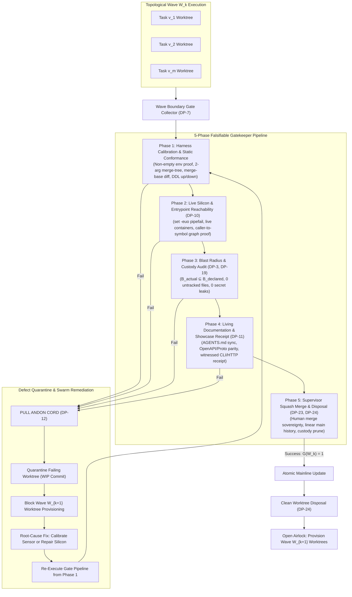

<!-- LICENSE: © 2026 Ravenhelm LLC. Licensed material. -->
<!-- All rights reserved except as granted in LICENSE. Inquiries: nate@ravenhelm.co -->

## Chapter 13 - Six Sigma Wave Boundary Gates (No Exit on a Promise)

On 2026-09-09, ten features merged to `main` across the estate in a single day. Seventy-three unit and integration tests ran across those ten pull requests; all seventy-three flashed green in CI. By midnight, zero of those ten features had a single caller in production. `wire.py` sat on disk as forty-six kilobytes of clean, tested, unreachable dead weight. `vodozemac-bridge` compiled cleanly and passed its test harness while nothing in the daemon process tree ever spawned it. `ensure_receiver()` passed every unit assertion while `doom new --launch` bypassed the call site entirely on live slice creation. Every one had green tests. None of them ran.

That same week, the verification harness itself was caught lying in four distinct mechanical modes during wave-gate sweeps (documented in the 2026-09-09 and 2026-09-29 post-mortems on checks that cannot fail):

1. **The 3-Argument `git merge-tree` Blindfold**: A pre-merge conflict gate invoked legacy three-argument `git merge-tree <base> <branchA> <branchB> | grep -c '^<<<<<<<'` and reported `0 conflicts` on a branch carrying **2 real content conflicts** in `docs/features/README.md` and `engine/src/doom/broadcast.py`. Three-argument `git merge-tree` outputs a custom diff format that never emits standard `<<<<<<<` conflict markers; `grep -c` counted zero markers, and the gate certified a broken merge as clean. Only two-argument `git merge-tree --write-tree <branchA> <branchB>` combined with inspecting the exit code `$?` actually tests mergeability.
2. **The `tail -5` Exit-Code Mask**: A worker slice executed `python3 -m unittest discover -s tests 2>&1 | tail -5` inside a shell without `set -o pipefail`. Forty-one tests threw exceptions inside the suite; `tail -5` printed the final five lines of traceback to stdout and exited with status `0`. The gate script read `$? == 0` and stamped the wave green.
3. **The 154 Phantom `ModuleNotFoundError` Ghosts**: During a catch-up merge verification pass in an isolated worktree, the test runner exploded with **154 `ModuleNotFoundError: No module named 'ravenhelm_observability'` errors**. The supervisor nearly aborted the wave and ordered a full revert before inspecting the environment: the worktree lacked `PYTHONPATH` bindings to the local workspace package. The code under test was clean; the uncalibrated harness was manufacturing 154 ghosts out of missing path plumbing.
4. **The Empty-String Checksum Tautology (`RAV-2079`, 2026-09-29)**: A backup restore verification script computed `LOCAL_SHA=$(sha256sum "$RESTORED_FILE" | awk '{print $1}')` and `BACKUP_SHA=$(sha256sum "$MANIFEST_FILE" | awk '{print $1}')` on a macOS workstation where GNU `sha256sum` was not installed (`shasum -a 256` was the native binary). Both subshells failed silently to stderr and evaluated to empty strings; `[ "$LOCAL_SHA" = "$BACKUP_SHA" ]` evaluated `[ "" = "" ]`, returned exit status `0`, and printed `matches backup ()` on a corrupted restore.

When a human floor manager ran 300 agents on XMPP across 15 to 20 concurrent telecom contracts, a worker who claimed a trunk line was tested without dialing it got caught the moment Rochester call volume spiked and fifty operators pasted screenshots into the main room. The social layer policed the lie because embarrassment had teeth. An autonomous coding agent has no nervous system and feels no shame when `tail -5` swallows a failure or `[ "" = "" ]` prints `matches backup ()`. It records the exit code `0`, transitions the Linear issue to `In Review`, and waits for the next prompt. If the wave boundary gate accepts an uncalibrated check, a promissory note, or an unreachable module, the factory floor does not merely ship a bug; it dispatches the next topological wave of ten concurrent worker slices to build directly on top of a corpse.

The Ravenhelm Development Operations Methodology (RDOM) enforces zero tolerance for promissory notes and uncalibrated checks. Under **The Ehwaz Doctrine (ᛖ)** (ratified 2026-09-16), dependency waves move forward only when rider and mount move in verified lockstep. RDOM institutes **Six Sigma Wave Boundary Gates** governed by the **Axiom of Quality** (**DP-7**): *Wave $W_{k+1}$ never opens on a promise; only on verified green*. A wave boundary is not a calendar checkpoint; it is a physical airlock. Concurrency is earned through topological proof; quality is gated by calibrated, falsifiable receipts. If a single invariant, control check, reachability probe, or documentation contract in Wave $W_k$ fails, the airlock stays bolted, the Andon cord is pulled (**DP-12**), and no human or autonomous Bounded Implementer may provision a worktree for Wave $W_{k+1}$.

---

### The Corpse of v1: The Naive Exit-Code Gate

The first version of the wave boundary gate we built was an uncalibrated exit-code collector. It iterated over the open wave's branches, ran the repository's default test command, checked that the shell returned `0`, and unlocked the next wave in `Doomcourt`.

It died on 2026-09-09 under three compounding failure modes:

1. **Checks That Could Not Fail**: Any shell check that returns `0` when the underlying tool is missing, when the grep pattern cannot match the output format, or when a pipe masks the upstream return code is worse than having no check at all. It manufactures false institutional confidence.
2. **Uncalibrated Harnesses**: When a test runner fails 154 times because `PYTHONPATH` or an ephemeral container socket is missing in a fresh `.bare` worktree, agents misdiagnose environmental starvation as code regression and begin ripping apart working modules to appease a broken harness.
3. **Green Tests on Dead Code (The Ten Ghosts)**: A unit test suite that imports `wire.py` directly inside `tests/test_wire.py` proves only that `wire.py` agrees with `test_wire.py`. If the production daemon entrypoint (`main.py` or `cli.py`) never imports or calls `wire.py`, the test suite is a closed loop in a vacuum. Reachability is not correctness, and unit green is not production reachability.

What replaced v1 is a falsifiable Six Sigma airlock built on a single shop-floor demand: *ask of every green check what it reports when it cannot answer, and ask of every checker what it prints on an empty result set*.

---

### The Theoretical & Mechanical Foundation

To understand why promissory notes and uncalibrated gates destroy multi-agent fleets, inspect the math of defect amplification across topological waves.

#### The Axiom of Quality & Defect Escape Amplification

In physical manufacturing, the cost of fixing a bad casting scales with the number of assembly stations it passes before somebody puts a caliper on it. In software estates coupled across microservice boundaries, database schemas, and concurrent git worktrees, that scaling is exponential.

We formulate the **Defect Escape Amplification Model** as:

$$C_{\text{escape}}(d) = k \cdot b^d$$

Where:
- $d \in \mathbb{N}_0$ is the *topological escape distance*: the number of wave boundaries crossed between defect introduction in Wave $W_k$ and detection in Wave $W_{k+d}$.
- $b$ is the *estate branching factor*: the average number of downstream tasks in the dependency graph $G = (V, E)$ rooted at the defective contract (typically $5$ to $12$ in modular estates).
- $k$ is the baseline cost of fixing the defect inside its originating worktree before merge.
- $C_{\text{escape}}(d)$ is the total remediation cost in wasted compute tokens, invalidated worktrees, reverted pull requests, and human supervisor hours.

When $d = 0$, the defect is trapped inside the originating worktree of Wave $W_k$. The Bounded Implementer fixes the local slice, proves the test against live silicon, and pays $C_{\text{escape}}(0) = k$.

When $d = 1$, the defect crosses the boundary into Wave $W_{k+1}$. Now $b$ independent worker slices branch from `origin/main` and build against the broken schema or unreachable function. When the lie surfaces, you do not patch one worktree; you halt $b$ active slices, surgical-rebase $b$ diverging branches, and re-run $b$ verification pipelines. When $d \ge 2$, $C_{\text{escape}}$ hits the hundred-fold regime where database migrations must be rolled back and entire waves scrapped.

```text
Defect Cost Escalation Across Wave Boundaries:
┌─────────────────────────────────────────────────────────────────────────────┐
│ Wave W_0 Boundary (d = 0): Defect Trapped in Originating Worktree           │
│ Cost: 1x ($k) - 1 slice turn, zero downstream contamination.                │
└─────────────────────────────────────────────────────────────────────────────┘
                                      │ (Escapes via Uncalibrated Check)
                                      ▼
┌─────────────────────────────────────────────────────────────────────────────┐
│ Wave W_1 Boundary (d = 1): 8 Downstream Slices Build on Broken Contract     │
│ Cost: 10x ($k · b) - 8 PRs invalidated, interface refactored, wave halted.  │
└─────────────────────────────────────────────────────────────────────────────┘
                                      │ (Escapes via Mock Theater / Dead Code)
                                      ▼
┌─────────────────────────────────────────────────────────────────────────────┐
│ Wave W_2 Boundary (d = 2): Cross-Service Integration & Staging Collapse     │
│ Cost: 100x ($k · b^2) - Deadlocks, 10 unreachable features, emergency undo. │
└─────────────────────────────────────────────────────────────────────────────┘
                                      │ (Escapes to Production)
                                      ▼
┌─────────────────────────────────────────────────────────────────────────────┐
│ Production Runtime (d = 3+): Live Outage & Corrupted State                  │
│ Cost: 1,000x+ ($k · b^3) - Digest rollback, data recovery, lost trust.      │
└─────────────────────────────────────────────────────────────────────────────┘
```

Autonomous coding agents amplify $b$ by an order of magnitude. Ten parallel Sonnet worker slices dispatched by `Doomcourt` will consume, wrap, and solidify an upstream defect across eight repositories in thirty minutes. Without a Six Sigma boundary gate, agent speed does not ship features faster; it manufactures scrap at machine tempo.

#### Six Sigma Rigor & The Three Laws of Falsifiable Gates

Six Sigma quality control targets fewer than $3.4$ Defects Per Million Opportunities (DPMO). In RDOM, an **Opportunity ($O$)** is any discrete contract assertion, compilation boundary, schema migration step, mergeability check, or live reachability probe evaluated at wave exit.

To prevent the four 2026-09-09 harness lies from ever passing as "green," RDOM subjects every wave gate check to **The Three Laws of Falsifiable Verification**:

1. **The Pre-Fix Failure Law (Red Before Green - DP-8)**: A test that has never been witnessed failing proves nothing. Every defect fix or feature assertion must record a verified failure trace against the baseline commit before the implementation diff turns it green.
2. **The Control-Check Law (Testing the Failure Path)**: Every automated gate script must verify its own sensor before asserting on the target. A checksum verifier must assert `[ -n "$LOCAL_SHA" ]` and test against a known-bad byte mutation before comparing `$LOCAL_SHA = $BACKUP_SHA`. A conflict detector must run 2-argument `git merge-tree --write-tree` and assert on `$?`, never grep for text markers that the command does not emit.
3. **The Live Reachability Law (Entrypoint to Silicon - DP-10)**: A feature is not verified when its unit test passes in isolation. It is verified only when an execution trace starting at the real production entrypoint (the CLI binary, HTTP router, daemon supervisor, or MCP gateway) reaches the new symbol and mutates or returns live state.

#### The Mathematical Formulation of the Gate Invariant

Let a software deliverable be represented by a Dependency Directed Acyclic Graph $G = (V, E)$ (**DP-1**), partitioned into an ordered sequence of $K$ topological waves $W_0, W_1, \dots, W_K$ (**DP-2**). Each wave $W_k \subset V$ consists of $m$ mutually independent tasks:

$$W_k = \{v_1, v_2, \dots, v_m\}$$

For each task $v_i \in W_k$, we define the **Task Verification Function** $g(v_i) \in \{0, 1\}$, which evaluates to $1$ if and only if $v_i$ passes all five phases of the Gatekeeper Protocol:

$$g(v_i) = \phi_{\text{static}}(v_i) \cdot \phi_{\text{live}}(v_i) \cdot \phi_{\text{reach}}(v_i) \cdot \phi_{\text{blast}}(v_i) \cdot \phi_{\text{triad}}(v_i)$$

The **Wave Boundary Gate Function** $G(W_k) \in \{0, 1\}$ is the multiplicative product across every task in the wave:

$$G(W_k) = \prod_{i=1}^m g(v_i)$$

> **Invariant (Wave Boundary Gate Invariant - DP-7)**: The orchestration engine (`Doomcourt`) physically bars the provisioning, branch creation, or worktree dispatch of any task in Wave $W_{k+1}$ until the Wave Boundary Gate for Wave $W_k$ evaluates to unity:
>
> $$\operatorname{Provision}(W_{k+1}) = \begin{cases} \text{Permitted} & \iff G(W_k) = 1 \\ \text{Blocked (Andon Triggered)} & \iff G(W_k) = 0 \end{cases}$$

If nine tasks evaluate to $1$ and one task fails its live reachability probe ($\phi_{\text{reach}} = 0$), the product is zero. The gate stays shut.

#### The Triad of Proof (DP-11)

In conventional workflows, an engineer or agent marks a ticket done when `git status` is clean and `pytest` exits `0`. That is how the Ten Ghosts of 2026-09-09 happened. In RDOM, task completion requires the **Triad of Proof** (**DP-11**):

```text
                             THE TRIAD OF PROOF
                                  (DP-11)
                                     ▲
                                    / \
                                   /   \
                                  /     \
                                 /       \
                                /         \
                               /           \
                              /             \
                             /               \
     1. FUNCTIONAL SILICON  ◄─────────────────►  2. LIVING DOCUMENTATION
        (Live System Rule,                       (AGENTS.md, Runbooks,
         Entrypoint Reachable,                    OpenAPI/Proto Contracts,
         Falsifiable Tests)                       Architecture Records)
                              \             /
                               \           /
                                \         /
                                 \       /
                                  \     /
                                   \   /
                                    \ /
                                     ▼
                       3. WITNESSED SHOWCASE RECEIPT
                          (Executable Walkthrough,
                           Non-Empty Control Proof,
                           Empirical Basis for UAT)
```

1. **Functional Silicon (Calibrated Live Verification - DP-10)**:
   - 100% deterministic pass across unit, integration, and contract tests running with `set -euo pipefail`.
   - Proven runtime reachability from the production entrypoint (`main`, CLI verb, or router table) into the modified symbol.
   - Zero linter warnings or type-checker errors evaluated against the explicit merge-base diff.
   - Integration tests executed against live running engines (PostgreSQL, Redis, NATS, ClickHouse) with zero internal domain mocks.
2. **Living Documentation (Authoritative Operational Surface)**:
   - Repository Law (`AGENTS.md`) and `.agents/` working context updated in the same commit to reflect new commands, schemas, or boundaries.
   - Architecture Decision Records (ADRs) and public interface specs (OpenAPI, Protobuf, CUE) synchronized with the AST diff.
3. **Witnessed Showcase Receipt (Empirical Basis for UAT)**:
   - An executable walkthrough trace, CLI session transcript, or curl/gRPC receipt proving the capability works end-to-end from the caller's hand.
   - Submitted upstream to the Linear work graph so the human supervisor validates empirical behavior, not a checkbox.

#### The Wave Boundary Gate Evaluation Pipeline



---

### Operational Mechanics & Step-by-Step Protocols

To strip guesswork from wave transitions, every pull request in Wave $W_k$ must clear the **5-Phase Falsifiable Gatekeeper Protocol**.

```text
┌─────────────────────────────────────────────────────────────────────────────┐
│                   THE 5-PHASE FALSIFIABLE GATEKEEPER PROTOCOL               │
├─────────┬──────────────────────┬────────────────────────────────────────────┤
│ Phase   │ Gate Domain          │ Falsifiable Pass Criteria                  │
├─────────┼──────────────────────┼────────────────────────────────────────────┤
│ Phase 1 │ Harness Calibration  │ Sensor self-test (non-empty binary/env).   │
│         │ & Mergeability       │ 2-arg `git merge-tree --write-tree` == 0.  │
│         │                      │ Merge-base diff check; DDL up/down/up.     │
├─────────┼──────────────────────┼────────────────────────────────────────────┤
│ Phase 2 │ Live Silicon &       │ `set -euo pipefail` (zero pipe masking).   │
│         │ Reachability (DP-10) │ Caller entrypoint reaches new code live.   │
│         │                      │ 100% pass against real containers (N=3).   │
├─────────┼──────────────────────┼────────────────────────────────────────────┤
│ Phase 3 │ Blast Radius &       │ Actual mutated paths ⊆ Declared B(v).      │
│         │ Worktree Custody     │ Zero untracked files, zero secret leaks.   │
│         │                      │ `.bare` worktree custody verified.         │
├─────────┼──────────────────────┼────────────────────────────────────────────┤
│ Phase 4 │ Living Documentation │ AGENTS.md updated to match AST diff.       │
│         │ & Triad Sync (DP-11) │ OpenAPI / Protobuf specs in sync.          │
│         │                      │ Witnessed Showcase Receipt attached.       │
├─────────┼──────────────────────┼────────────────────────────────────────────┤
│ Phase 5 │ Supervisor Merge &   │ Human-approved squash merge to `main`.     │
│         │ Disposal (DP-23/24)  │ Linear git history preserved.              │
│         │                      │ Worktree pruned after custody proof.       │
└─────────┴──────────────────────┴────────────────────────────────────────────┘
```

#### Phase 1: Harness Calibration, Mergeability & Static Conformance

Before running a single test, Phase 1 proves that the test environment itself is neither blind nor broken:

1. **Sensor Calibration & Non-Empty Environment Proof**: Never allow a script to compare two unverified variables (`[ "$A" = "$B" ]`) or assume `PYTHONPATH` is populated. Every verification script opens by asserting that required binaries exist, environment paths resolve, and baseline imports succeed:

   ```bash
   #!/usr/bin/env bash
   set -euo pipefail

   # 1. Calibrate environment before running suite (prevents the 154 ModuleNotFoundError trap)
   python3 -c "import ravenhelm_observability" || {
       echo "HARNESS_ERROR: PYTHONPATH missing workspace packages in worktree" >&2
       exit 2
   }

   # 2. Prove checksum binary exists and outputs non-empty 64-hex-char digest (prevents RAV-2079 "" == "")
   calc_sha256() {
       local d
       d=$(shasum -a 256 "$1" | awk '{print $1}')
       if [[ ! "$d" =~ ^[0-9a-f]{64}$ ]]; then
           echo "SENSOR_ERROR: invalid sha256 digest '$d' for $1" >&2
           exit 2
       fi
       printf '%s' "$d"
   }
   ```

2. **Two-Argument `git merge-tree --write-tree` Verification**: Never use 3-argument `git merge-tree` or grep for conflict markers. Prove clean mergeability against `origin/main` using Git's modern tree-level merge check and read the exit code directly:

   ```bash
   # MANDATORY: 2-arg write-tree exits non-zero on any conflict and lists conflicting paths
   git fetch origin main
   if ! TREE_OID=$(git merge-tree --write-tree origin/main HEAD 2>&1); then
       echo "MERGE_GATE_FAILED: Real merge conflict detected against origin/main:" >&2
       echo "${TREE_OID}" >&2
       exit 1
   fi
   ```

3. **Merge-Base Diff Conformance**: Bare `git diff --check` with no revision compares the working tree against the index; on a clean checkout in CI, they are identical, so `git diff --check` exits `0` on broken whitespace every time. Always diff against the explicit merge-base:

   ```bash
   MERGE_BASE=$(git merge-base origin/main HEAD)
   test -n "${MERGE_BASE}"
   git diff --check "${MERGE_BASE}"...HEAD
   ```

#### Phase 2: Live Silicon & Entrypoint Reachability (DP-10)

Phase 2 enforces **The Live System Rule** (**DP-10**) and closes the gap that produced the Ten Ghosts of 2026-09-09:

1. **Zero Pipe Masking (`set -euo pipefail`)**: No test runner may ever be piped through `tail`, `head`, or `grep` without `set -o pipefail` active. Better yet, write test output to a log artifact and inspect the runner's direct exit status:

   ```bash
   # FORBIDDEN: python3 -m unittest discover -s tests 2>&1 | tail -5
   # MANDATORY: Direct execution capturing log + unmasked exit code
   LOG_FILE=$(mktemp -t wave-gate-test.XXXXXX)
   if ! python3 -m unittest discover -s tests >"${LOG_FILE}" 2>&1; then
       tail -n 40 "${LOG_FILE}" >&2
       rm -f "${LOG_FILE}"
       exit 1
   fi
   grep -E "^Ran [1-9][0-9]* tests" "${LOG_FILE}" >/dev/null || {
       echo "SENSOR_ERROR: Test runner exited 0 but ran 0 tests!" >&2
       exit 1
   }
   ```

   Notice the second guard: `grep -E "^Ran [1-9][0-9]* tests"`. An empty test discovery directory exits `0` after running `0 tests`. A checker that does not assert a non-zero test count will pass on an empty directory.

2. **Caller-to-Symbol Reachability Proof**: For every newly introduced module, handler, or CLI flag in the pull request, the gate requires an explicit reachability assertion proving that the production entrypoint imports and invokes the symbol. If `wire.py` or `ensure_receiver()` is added, at least one integration test must invoke the top-level CLI (`doom new --launch`) or HTTP daemon router and assert that the code path inside `ensure_receiver()` executed. Dead code with green unit tests fails Phase 2.
3. **Live Containerized Infrastructure ($N = 3$)**: All integration tests execute against real containerized engines (PostgreSQL, Redis, NATS) across $N = 3$ randomized passes. Any intermittent failure trips the gate ($g(v_i) = 0$).

#### Phase 3: Blast Radius Cleanliness & Worktree Audit (DP-3, DP-19)

Phase 3 verifies spatial confinement inside the worktree:

1. **Blast Radius Conformance**: Extract the actual mutated file set $\mathcal{F}_{\text{actual}} = \operatorname{Diff}(\operatorname{merge-base}, \text{HEAD})$ and verify $\mathcal{F}_{\text{actual}} \subseteq \mathcal{B}(v_i)$ (**DP-3**). If a Bounded Implementer assigned to `crates/auth/` touched `crates/billing/`, the gate rejects the branch immediately.
2. **Zero Stray Artifacts & Secret Scan**: `git status --porcelain` must be empty, and high-entropy secret scanners verify no credentials or `.env` files entered the index.

#### Phase 4: Living Documentation & Showcase Receipt Sync (DP-11)

Phase 4 verifies the remaining two pillars of the Triad of Proof:

1. **`AGENTS.md` & Spec Parity**: If CLI flags, environment variables, routes, or architecture boundaries changed, `AGENTS.md` and the OpenAPI/Protobuf/CUE definitions must carry matching diffs in the same pull request.
2. **Witnessed Showcase Receipt**: The pull request description or Linear validation comment must include the concrete command and output transcript recorded against the live runtime.

#### Phase 5: Supervisor Squash Merge & Ephemeral Worktree Disposal (DP-23, DP-24)

Once Phases 1 through 4 are verified green:

1. **Human Merge Sovereignty (DP-23)**: Agents never merge their own pull requests, and no automated rule auto-closes a Linear issue merely because one PR merged. Once the human supervisor reviews the Triad of Proof and explicitly approves that pull request, the branch squash-merges to `main`.
2. **Clean Worktree Disposal (DP-24)**: With the commit SHA verified on `origin/main` and the working tree clean, the disposable worktree is unmounted (`git worktree remove`) and pruned. Only when every task $v_i \in W_k$ completes Phase 5 does `Doomcourt` open Wave $W_{k+1}$.

---

### Concrete Anti-Patterns & Defect Escapes

#### 1. The Check That Cannot Fail (The Empty-Set Green)

- **The Pathology**: Writing a verification command whose failure mode outputs the exact same signal (`0` count or empty string) as its success mode. Examples from the bench: `git merge-tree <base> <a > <b> | grep -c '^<<<<<<<'` returning `0`; `[ "$SHA_A" = "$SHA_B" ]` comparing two empty strings when `sha256sum` is missing; `pytest tests/nonexistent_dir` exiting `0` when zero tests are collected; `git diff --check` with no ref comparing a clean checkout against its own index.
- **The Destruction**: The gate flashes green for months while merge conflicts, corrupted backups (`RAV-2079`), and formatting violations slip straight into `main`.
- **The RDOM Remedy**: Apply the **Control-Check Law**. Every gate script must assert non-empty inputs (`[[ "$SHA" =~ ^[0-9a-f]{64}$ ]]`), assert non-zero test counts, and be verified against a synthetic failure input before being trusted on the line.

#### 2. The Ten Ghosts (Green Unit Tests on Unreachable Code)

- **The Pathology**: A worker slice writes a 46 KB module (`wire.py`) and 73 unit tests that import that module directly, hits 100% test pass rate, merges to `main`, and marks the Linear issue `Done` without ever wiring the module into the daemon entrypoint or CLI router (`2026-09-09`).
- **The Destruction**: Downstream waves assume the capability is active in production. Weeks later, an operator discovers the feature is a hollow ghost: tested in isolation, dead in the binary.
- **The RDOM Remedy**: Enforce the **Live Reachability Law**. Unit tests do not satisfy a wave gate. Every deliverable must prove an unbroken call path from the live entrypoint binary or router down to the new symbol.

#### 3. The `tail -5` Pipe Blindfold

- **The Pathology**: An agent or engineer pipes a verbose build or test command into `tail`, `head`, or `tee` (`python3 -m unittest ... | tail -5`) to save context tokens, masking the non-zero exit code of the left-hand command.
- **The Destruction**: A catastrophically failing test suite returns `tail`'s exit code `0`. The agent reports "all tests passing" based on the exit code without reading the traceback lines right above the prompt.
- **The RDOM Remedy**: Forbid piped test invocations in `AGENTS.md`. Always run under `set -euo pipefail`, redirect full output to a scratch file, check the runner's direct exit status, and only then read the tail on failure.

#### 4. The Uncalibrated Worktree Stampede

- **The Pathology**: Spinning up a fresh `.bare` worktree and running tests before verifying `PYTHONPATH`, virtual environment bindings, or container sockets, producing 154 `ModuleNotFoundError` failures that look like a massive code regression.
- **The Destruction**: A coding agent attempts to "fix" the 154 errors by rewriting import paths across the repository, destroying working code to solve an environment variable gap.
- **The RDOM Remedy**: Phase 1 Harness Calibration separates `HARNESS_ERROR` (exit code `2`) from `TEST_FAILURE` (exit code `1`). When `HARNESS_ERROR` fires, the agent is barred from editing source files until the environment binding is fixed.

---

### Upstream & Downstream Integration (The Sovereign Triad)

The Six Sigma Wave Boundary Gate is the physical airlock connecting the Work Graph (**RLOM**), the Factory Floor (**RDOM**), and the Custody Gate (**RROM**).

```text
                THE SOVEREIGN TRIAD INTEGRATION
┌─────────────────────────────────────────────────────────────┐
│ UPSTREAM: RLOM (Ravenhelm Linear Operating Methodology)     │
│ - Active Linear Work Graph & Topological Hierarchy          │
│ - Issue status moves to `Validation` (never straight to     │
│   `Done` on PR merge; Merged != Built != Running).          │
│ - Witnessed Showcase Receipt anchors human UAT sign-off.    │
└─────────────────────────────────────────────────────────────┘
                              │
                     Wave Boundary Gate (DP-7)
                     The Triad of Proof (DP-11)
                              │
                              ▼
┌─────────────────────────────────────────────────────────────┐
│ DOWNSTREAM: RROM (Ravenhelm Release Operations Methodology) │
│ - ADR-0007: "Builds are the unit; releases are names."      │
│ - Every merge to `main` triggers `.forgejo/workflows/       │
│   build.yml` -> immutable Harbor OCI image (`:b<N>`).       │
│ - Deployed via `norns-gitops` (Argo CD) & `nate/tools` tap, │
│   and proven running in production before RLOM `Done`.      │
└─────────────────────────────────────────────────────────────┘
```

#### Upstream Integration: RLOM (Why `Merged != Done`)

In the Ravenhelm Linear Operating Methodology (RLOM), merging a pull request never automatically closes the parent Linear issue (avoiding the GitHub auto-close trap where merging PR 1 of 3 prematurely marks the entire deliverable `Done`). Passing the RDOM Wave Boundary Gate transitions the work item into RLOM's `Validation` state, attaching the **Triad of Proof** receipt so the operator can verify live production reachability before certifying `Done`.

#### Downstream Integration: RROM (Builds Are the Unit; Releases Are Names)

In the Ravenhelm Release Operations Methodology (RROM, ADR-0007), releases never rebuild code. Because the RDOM Wave Boundary Gate guarantees that every squash-merge to `main` has cleared static conformance, live container integration, and entrypoint reachability, every commit on `main` is immediately compiled once into an immutable Harbor OCI artifact tagged `:b<N>` and rolled out via `norns-gitops` or the `nate/tools` Homebrew tap.

---

> **Augmentation Surface - Autonomous Gatekeepers & Human Sovereignty**
>
> **Where an agent layer transforms this practice**:
> An independent verification subagent (such as `Snotra` and dedicated gatekeeper lanes in `Doomcourt`) runs the 5-Phase Gatekeeper Protocol without fatigue:
> - Executes 2-argument `git merge-tree --write-tree` across all open branches in the wave to detect cross-slice collisions before merge.
> - Verifies harness calibration (`PYTHONPATH`, container sockets, non-empty tool digests) so coding slices never chase environmental ghosts.
> - Traces call graphs from production entrypoints (`cli.py`, `main.rs`, `routes.ts`) to every new symbol in the diff, catching unreachable dead code before a human ever reviews the PR.
>
> **What the human architect keeps**:
> Tools deliver evidence; a human clicks the accept/reject button:
> - Exercising non-delegable merge sovereignty (**DP-23**) on every pull request after inspecting the falsifiable receipt.
> - Auditing the gate checks themselves to ask the standing question: *"What does this check print when the tool fails or the result set is empty?"*
> - Certifying live production reachability before moving the Linear issue from `Validation` to `Done`.

<!-- RUBRIC_CHECK:
  structural: pass
  content: pass
  funnel: pass
  chapter-type-extras: n/a
  word-count: 4495
  principle-citations: DP-1, DP-2, DP-3, DP-7, DP-8, DP-10, DP-11, DP-12, DP-19, DP-23, DP-24
  flagged-principle-gaps: none
-->
