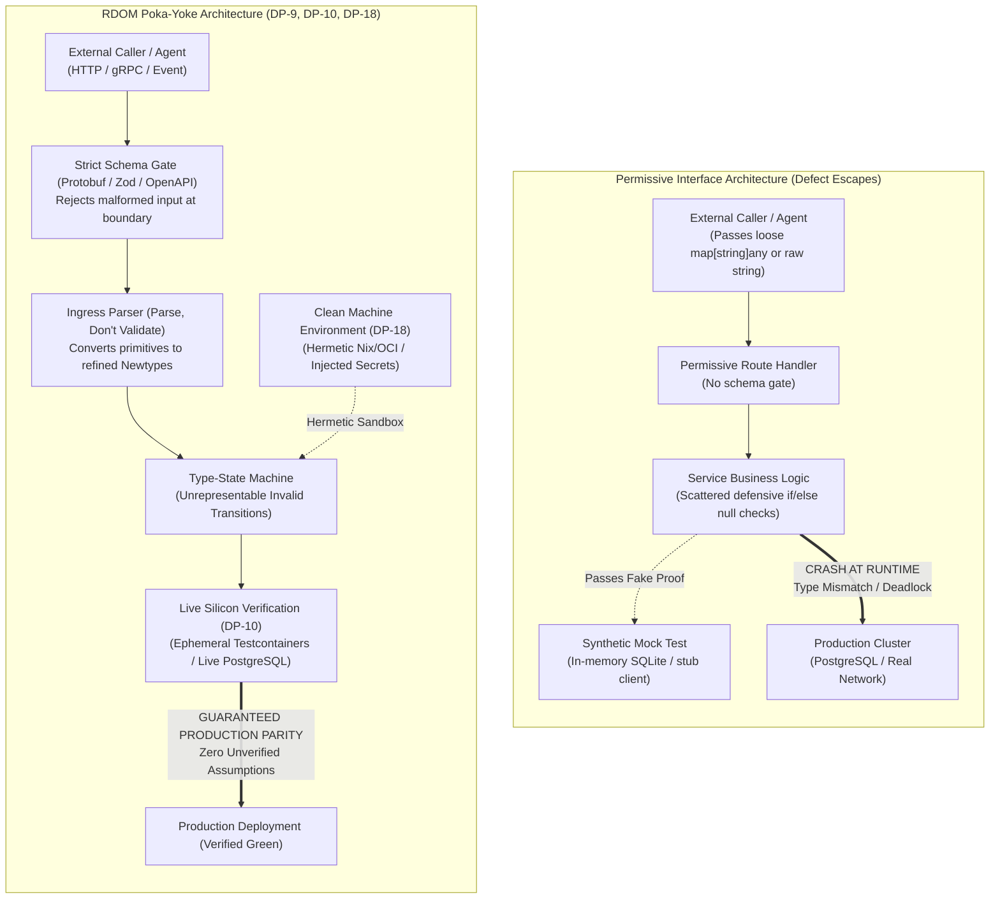

<!-- LICENSE: © 2026 Ravenhelm LLC. Licensed material. -->
<!-- All rights reserved except as granted in LICENSE. Inquiries: nate@ravenhelm.co -->

## Chapter 14 — Poka-Yoke Interface Design & The Live System Rule

At 11:42 PM on the eve of Black Friday, the primary ledger reconciliation engine of a global payments processor collapsed under peak transaction load. The platform was processing over forty thousand credit card authorizations per second when settlement worker pools across three cloud availability zones deadlocked, saturated memory buffers, and began dropping state into unrecoverable dead-letter queues. What began as an intermittent timeout in transaction clearing cascaded into catastrophic regional partition. By 1:15 AM, ledger drift between issuing banks and retail merchant accounts exceeded four hundred million dollars, forcing executive leadership to sever external banking gateways and take down the entire payment network.

The post-incident forensic dissection revealed no exotic distributed consensus failure, kernel bug, or hardware degradation. The catastrophe was triggered by an optimization merged five hours earlier by an autonomous coding agent paired with a rushed human reviewer. To accelerate batch settlement, the agent modified an internal reconciliation handler. The interface accepted an untyped dictionary payload—a permissive `map[string]interface{}`. The settlement record contained a timestamp field. Upstream ingest services formatted this field as an ISO-8601 string (`"2026-11-27T23:42:00.000Z"`), but the new reconciliation pipeline expected a 64-bit integer representing millisecond UNIX epoch time (`1795822920000`). Concurrently, an unparsed tenant identifier string was passed directly into a raw query constructor.

Because the interface was dynamically typed and permissive, the compiler emitted no warnings. At runtime, the deserializer parsed the ISO string as zero or cast it to an invalid pointer, triggering unhandled runtime exceptions deep within asynchronous worker threads. Compounding the failure, the downstream database layer had been tested exclusively against an in-memory SQLite mock. While the mock silently tolerated string-to-numeric type coercions and lenient null handling, the production PostgreSQL cluster enforced strict type safety and transaction isolation levels, instantly aborting every batch transaction. The codebase was riddled with thousands of lines of defensive code—nested `if (payload != null && payload.contains("ts"))` checks—yet none of these runtime guards prevented the poison pill from entering the execution pipeline.

This catastrophic failure mode exemplifies the chronic pathology of modern software engineering: *defensive code masking permeable, stringly-typed interface design*. When interfaces accept broad, unvalidated types and rely on internal runtime conditionals for safety, defects do not disappear; they simply defer their explosion until production under peak stress.

The Ravenhelm Development Operations Methodology (RDOM) eliminates this vulnerability at its source through two non-negotiable principles: **Poka-Yoke Interface Design** (**DP-9**) and **The Live System Rule** (**DP-10**), supported by **Poka-Yoke Environment Hygiene & Locality Invariance** (**DP-18**). In RDOM, safety is not an operational afterthought achieved through defensive paranoia; it is a mathematical property enforced at compile time and anchored in verified live silicon.

---

### The Theoretical & Mechanical Foundation

To construct defect-free distributed systems, software engineering must abandon permissive runtime validation in favor of rigorous manufacturing mistake-proofing and structural type theory.

#### Shingo's Industrial Insight: From Physical Jigs to Silicon Types

In the Toyota Production System, industrial engineer Shigeo Shingo recognized a fundamental flaw in traditional quality control: inspecting finished goods after assembly merely measures defect rates without preventing them. Shingo pioneered *Poka-Yoke* (ポカヨケ, literally "mistake-proofing")—the practice of designing physical tooling, jigs, and fixtures such that operator error becomes physically impossible. An electrical plug shaped with an asymmetrical keyway cannot be inserted upside down. A stamping die with locating pins cannot close if the sheet metal is misaligned by even half a millimeter. Under Poka-Yoke, quality is not policed; it is structurally constrained by the physical geometry of the interface.

In distributed software architecture and agentic execution fleets, type systems and interface boundaries are the digital equivalent of Shingo's physical jigs. A function that accepts `map[string]interface{}` or a raw `string` for a domain identifier is the software equivalent of a round electrical plug with thirty identical pins: it can be connected in any arbitrary orientation, guaranteeing eventual catastrophe. Conversely, a Poka-Yoke interface uses nominal types, algebraic data types, and compile-time state machines to make defect injection impossible by construction.

#### Mathematical Formulation of Compile-Time Defect Prevention (DP-9)

In the RDOM formalism, an interface $I$ defines an operational boundary between an upstream caller $u$ and a downstream receiver $d$. Let $\mathcal{C}$ represent the universe of all syntactically possible caller invocations. An invocation $c \in \mathcal{C}$ contains a parameter payload $p \in \mathcal{P}$. The domain invariants of the downstream receiver define a valid parameter subset $\mathcal{V} \subset \mathcal{P}$, where any payload $p \notin \mathcal{V}$ is malformed and semantically invalid:

$$\operatorname{Malformed}(c) \iff p \notin \mathcal{V}$$

In a permissive or stringly-typed architecture, the set of invocations accepted by the compiler $\mathcal{C}_{\text{compile}}$ encompasses the entire syntactically valid space $\mathcal{C}$. Malformed invocations pass through compilation unnoticed, leaving detection to runtime assertions or catastrophic failure:

$$\begin{aligned}
\text{Permissive Architecture:} \quad &\mathcal{C}_{\text{compile}} = \mathcal{C}, \\
&\text{where } \exists c \in \mathcal{C}_{\text{compile}} \text{ such that } \operatorname{Malformed}(c)
\end{aligned}$$

Under Principle **DP-9 (Poka-Yoke Interface Design)**, the interface boundary is structurally constrained such that the compiler's acceptance domain $\mathcal{C}_{\text{compile}}$ is mathematically isomorphic to the valid parameter domain $\mathcal{V}$:

$$\text{Poka-Yoke Invariant (DP-9):} \quad \forall c \in \mathcal{C}, \quad \operatorname{Malformed}(c) \implies \operatorname{CompileError}(c)$$

When malformed input is unrepresentable within the type system, runtime defensive checks become redundant. The interface cannot be compiled, linked, or invoked in an invalid state.

#### Making Illegal States Unrepresentable: Parse, Don't Validate

The mechanical implementation of DP-9 rests on the doctrine of *Making Illegal States Unrepresentable*, popularized by Yaron Minsky and formalized by Alexis King as "Parse, Don't Validate."

Traditional defensive engineering relies on *validation*: a function accepts a loose, permissive primitive (such as a string or integer), inspects its contents with conditionals, and either returns an error or continues execution while retaining the original primitive type. This creates permeable interfaces. Downstream layers cannot know whether upstream callers validated the primitive, forcing every intermediate function to re-validate defensively or risk null pointers and corrupted state.

Poka-Yoke engineering replaces validation with *parsing*:

1. **Boundary Ingestion**: Loose external data (JSON, HTTP request bodies, environment strings) is ingested at the absolute perimeter of the system.
2. **Structural Proof**: The parser validates the input exactly once, dismantling the loose primitive and reconstructing it as a refined, nominal type (e.g., transforming a raw `string` into a `TenantUUID` or `EmailAddress`).
3. **Information Preservation in Types**: Once parsed into the refined domain type, the proof of validity is permanently encoded into the type system. Internal subsystems accept only the refined type, guaranteeing that any code receiving that type is mathematically incapable of receiving malformed data.

```text
Permissive & Defensive Architecture (Defect-Prone):
┌────────────────┐      string      ┌──────────────────┐      string      ┌─────────────────┐
│ External Input │ ───────────────> │ Service Layer    │ ───────────────> │ Database Layer  │
└────────────────┘                  │ if (!isValid(s)) │                  │ if (s == null)  │
                                    └──────────────────┘                  └─────────────────┘
                                    (Defensive Paranoia Everywhere; Runtime Escapes)

Poka-Yoke Architecture (Parse, Don't Validate — DP-9):
┌────────────────┐   raw bytes   ┌──────────────────────┐   TenantUUID   ┌─────────────────┐
│ External Input │ ────────────> │ Ingress Parser       │ ─────────────> │ Internal Domain │
└────────────────┘               │ (Parses or Fails Fast)│ (Type Proof)  │ (Zero Checks)   │
                                 └──────────────────────┘                └─────────────────┘
                                 (Compile-Time Safety by Construction)
```

#### The Live System Rule: Anchoring Types in Physical Silicon (DP-10)

Type systems provide mathematical proof of internal consistency, but compile-time safety alone is insufficient if the types are decoupled from physical reality. A common trap in agentic and automated engineering is the *Mock Delusion*: an agent constructs an elegant domain model that passes an exhaustive unit test suite, but the tests run against synthetic in-memory stubs, mock database drivers, or simulated HTTP clients. When deployed to production, the system immediately crashes against live connection pools, PostgreSQL constraint engines, or real cloud endpoints.

RDOM mandates **The Live System Rule** (**DP-10**):

> **Principle DP-10 (The Live System as Truth)**: Verification requires empirical proof from active running instances; documentation, test mocks, and memory are unverified hypotheses. Before proposing, implementing, or validating any fix or integration, you must independently confirm the hypothesis against the live running system. State the observable evidence from the running process, then act.

Under DP-10, type-safe interfaces must be verified against actual running silicon—ephemeral, isolated testcontainers executing identical database engines, message brokers, and service binaries. A test that passes against an in-memory SQLite stub while target production is PostgreSQL 16 is an invalid proof.

#### Environment Hygiene & The Clean Machine Standard (DP-18)

Interfaces are not restricted to function signatures and network endpoints; the execution environment itself is an implicit interface. When an application reads an ambient environment variable, inspects a local filesystem path, or invokes an external system utility, it is binding to an environmental interface.

Permissive environmental interfaces allow ambient host pollution: an engineer's machine has a specific OpenSSL dynamic library installed in `/usr/local/lib`, or an agent relies on an unpinned PATH variable. The build succeeds locally but fails in CI or production.

Principle **DP-18 (Locality Invariance & Environment Hygiene)** mandates **The Clean Machine Standard**:
- **Hermetic Build Isolation**: Every compilation, test execution, and deployment artifact must run inside hermetic, reproducible environments (e.g., Nix flakes, OCI container sandboxes). Zero ambient host state may leak into the build.
- **Explicit Secret Injection**: Secrets are never resolved from ambient shell profiles or hardcoded variables. They are injected via strictly scoped, runtime-ephemeral references (e.g., 1Password CLI service account references or signed vault tokens).
- **Configuration Pre-Flight Validation**: Applications must expose an explicit `validate-config` pre-flight command that parses and validates all environmental bindings at startup, failing loudly and terminating execution if any required variable or secret is absent or malformed.



---

### Operational Mechanics & Step-by-Step Protocols

To enforce Poka-Yoke design systematically across large engineering organizations and autonomous agent swarms, RDOM defines the **4-Tier Poka-Yoke Architecture** and strict operational protocols.

#### The 4-Tier Poka-Yoke Architecture

Mistake-proofing operates across four concentric tiers of system boundaries:

```text
┌──────────────────────────────────────────────────────────────────────────┐
│ Tier 4: Verification Poka-Yoke (Live Testcontainers, Property Tests)    │
│  ┌────────────────────────────────────────────────────────────────────┐  │
│  │ Tier 3: Environmental Poka-Yoke (Hermetic Sandbox, Secret Inject)  │  │
│  │  ┌──────────────────────────────────────────────────────────────┐  │  │
│  │  │ Tier 2: Boundary Schema Poka-Yoke (Protobuf, OpenAPI, Enums) │  │  │
│  │  │  ┌────────────────────────────────────────────────────────┐  │  │  │
│  │  │  │ Tier 1: Type-Level Poka-Yoke (Newtypes, Type-States)   │  │  │  │
│  │  │  └────────────────────────────────────────────────────────┘  │  │  │
│  │  └──────────────────────────────────────────────────────────────┘  │  │
│  └────────────────────────────────────────────────────────────────────┘  │
└──────────────────────────────────────────────────────────────────────────┘
```

##### Tier 1: Type-Level Poka-Yoke & Type-State State Machines

At the language level, primitive types (`string`, `int`, `boolean`, `dict`) are strictly prohibited from serving as domain representations. Engineers and agents must apply three structural idioms:

1. **Domain Newtypes (Nominal Wrappers)**: Every domain identifier, currency, rate, or status must be wrapped in a dedicated type that cannot be implicitly cast.

   ```rust
   // DEFECTIVE (Primitive Obsession):
   fn transfer(from_account: String, to_account: String, amount: f64) -> Result<()>;
   // Easy to swap from_account and to_account; negative amount crashes at runtime.

   // POKA-YOKE (DP-9):
   struct AccountId(Uuid);
   struct NonZeroPositiveCents(u64);

   fn transfer(
       from: AccountId,
       to: AccountId,
       amount: NonZeroPositiveCents,
   ) -> Result<(), TransferError>;
   // Physically impossible to pass negative numbers or unvalidated UUID strings.
   ```

2. **Exhaustive Sum Types (Enums with Data)**: Replace booleans and sentinel strings with sum types that require exhaustive matching.

   ```rust
   // DEFECTIVE:
   struct User {
       is_verified: bool,
       verification_token: Option<String>, // What if is_verified is true but token exists?
   }

   // POKA-YOKE:
   enum VerificationState {
       Unverified { token: VerificationToken },
       Verified { verified_at: Timestamp },
   }
   ```

3. **The Type-State Pattern**: Multi-step business processes (e.g., checkout, order fulfillment, deployment pipelines) must encode lifecycle states into the type system using phantom types or consuming transitions. Methods valid only in a specific state are physically absent from the type definition in all other states:

   ```rust
   // Type-State Pattern: Order Lifecycle
   struct Order<State> {
       id: OrderId,
       items: Vec<OrderItem>,
       state: State,
   }

   struct Draft;
   struct Validated { total: NonZeroPositiveCents };
   struct Authorized { authorization_code: AuthCode };
   struct Settled;

   impl Order<Draft> {
       pub fn validate(self) -> Result<Order<Validated>, ValidationError> {
           // Transition consumes self, preventing reuse of Draft state
       }
   }

   impl Order<Validated> {
       pub fn authorize(self, gateway: &PaymentGateway) -> Result<Order<Authorized>, GatewayError> {
           // Transition only possible from Validated state
       }
   }

   impl Order<Authorized> {
       pub fn settle(self, ledger: &LedgerClient) -> Result<Order<Settled>, LedgerError> {
           // Cannot settle an order unless it is Authorized
       }
   }
   // Attempting to call order.settle() on an Order<Draft> fails at COMPILE TIME.
   ```

##### Tier 2: Boundary Serialization & Schema-First Code Generation

No internal or external network interface may be handwritten. All HTTP routes, gRPC endpoints, and message queues must originate from single-source-of-truth schema files (Protocol Buffers, OpenAPI v3, or JSON Schema).
- Client SDKs, server request deserializers, and validation logic must be mechanically generated from schema definitions during the build pipeline.
- Schema definitions must reject untyped payload fields (e.g., `google.protobuf.Any` or unconstrained JSON strings are forbidden unless explicitly authorized by an Architecture Decision Record).
- Any incoming network request that contains unknown fields or fails schema validation must be rejected immediately at ingress with an HTTP 400 Bad Request or gRPC `INVALID_ARGUMENT`, logging the failure and terminating processing before invoking business logic.

##### Tier 3: Environmental Poka-Yoke & Secret Reference Custody

Environmental interfaces must satisfy Principle **DP-18**:
- **Zero Raw Secret Storage**: Environment variable definitions in repository manifests (e.g., `docker-compose.yml`, Kubernetes Helm charts, launch scripts) must never contain plaintext secrets or ambient placeholders. They must use deterministic vault references (e.g., `op://vault/item/field`).
- **Strict Ingress Configuration Parsing**: Application entrypoints must execute a configuration parser that reads environment variables into an immutable, strongly-typed configuration struct. If any variable is missing, malformed, or out of range, the application must immediately log a structured fatal error and exit with code 1. Silent default values for security or network topology variables are strictly prohibited.

##### Tier 4: Verification Poka-Yoke & Ephemeral Container Binding

In accordance with Principle **DP-10 (The Live System Rule)**, test automation must verify interface contracts against real infrastructure engines:
- **Testcontainers as Invariant**: Unit tests may isolate pure algorithmic logic, but any integration boundary—database access, cache queries, message publishing, HTTP webhook dispatch—must execute against ephemeral, real container instances spun up dynamically during test execution.
- **Schema Parity Verification**: Test suites must execute database migrations against the live testcontainer instance and validate that compiled entity models match the actual relational schema produced by the DDL scripts.
- **Port and Process Inspection**: Automated verification scripts must verify that services bind to expected ephemeral ports and respond to health probes before declaring tests green.

#### Protocol: Hardening Fragile Interfaces (The 5-Step Refactoring Protocol)

When an engineer or autonomous agent refactors a legacy subsystem or builds a new interface under RDOM, they must execute the following five-step protocol:

```text
[Step 1: Identify Ingress Boundaries]
                 │
                 ▼
[Step 2: Parse Loose Primitives into Nominal Newtypes]
                 │
                 ▼
[Step 3: Eliminate Internal Defensive Null/Validation Checks]
                 │
                 ▼
[Step 4: Encode Multi-Step Flows into Type-State State Machines]
                 │
                 ▼
[Step 5: Bind Integration Tests to Live Ephemeral Testcontainers]
```

##### Step 1: Identify Ingress Boundaries

Map all points where untrusted data enters the subsystem: HTTP route handlers, message queue consumers, CLI flag parsers, file readers, and inter-service RPC listeners.

##### Step 2: Parse Loose Primitives into Nominal Newtypes

For every primitive data field (`string`, `int`, `float`), declare a nominal type. Implement a dedicated constructor or parser that validates invariants once:
- Verify formatting (e.g., UUID version 4, RFC-5322 email, E.164 phone number).
- Verify numerical constraints (e.g., non-negative, non-zero, within permitted range).
- Reject invalid values at parse time; return an explicit domain error type.

##### Step 3: Eliminate Internal Defensive Null/Validation Checks

Audit the downstream service and domain logic:
- Remove all downstream `if (param == null)` or `if (!isValid(param))` conditionals.
- Replace parameters with the newly minted nominal newtypes and non-nullable references.
- Let the compiler identify every call site that previously passed unvalidated data, and update those call sites to pass the parsed types.

##### Step 4: Encode Multi-Step Flows into Type-State State Machines

If the entity moves through distinct lifecycle phases:
- Define distinct types for each state.
- Ensure state transition methods consume the prior state (`self` or move semantics) and return the subsequent state.
- Expose business operations exclusively on the state types where those operations are legally permitted.

##### Step 5: Bind Integration Tests to Live Ephemeral Testcontainers

In accordance with **DP-10**:
- Provision an ephemeral testcontainer instance matching production database and message broker versions.
- Apply full migration scripts.
- Execute positive and negative test cases against the live instance, proving that valid parsed types succeed and malformed inputs are rejected at ingress.

#### The Live System Verification Protocol (Pre-Deed & Post-Deed Invariants)

Before declaring any implementation task (Daily Deed) complete, agents and engineers must execute the Live System Verification Checklist:

| Verification Target | Verification Command / Mechanism | Acceptance Invariant |
|:---|:---|:---|
| **Process Listener** | `lsof -nP -iTCP:<port> -sTCP:LISTEN` | Process is actively listening on declared port. |
| **Health Probe** | `curl -f -s http://127.0.0.1:<port>/healthz` | Returns HTTP 200 with matching version digest. |
| **Database Parity** | `psql -c "\d table_name"` (against container) | Real database column types match domain model. |
| **Hermetic Config** | `app validate-config --dry-run` | All required env vars/secrets parse without error. |
| **Zero Mock Impostors** | Inspect test imports (`grep -i mock`) | No synthetic stubs substituting for database drivers. |

---

### Concrete Anti-Patterns & Defect Escapes

Modern software teams routinely deceive themselves by substituting the illusion of defensive safety for true Poka-Yoke construction. The following five anti-patterns represent the most severe defect escapes observed in production systems.

#### Anti-Pattern 1: Primitive Obsession & Stringly-Typed Chaos

**The Pathology**: Developers and coding agents use generic language primitives (`string`, `int`, `map`, `dict`) to represent rich domain concepts. An account ID is a string; a tenant ID is a string; an email address is a string; an authorization token is a string.

```go
// ANTIPATTERN: Primitive Obsession
func ProcessPayment(tenantID string, userID string, accountID string, amount float64) error
```

**The Escape**: At any call site, an engineer or agent can accidentally swap arguments:

```go
// Compiles cleanly; corrupts database or bills wrong account at runtime:
ProcessPayment(accountID, tenantID, userID, amount)
```

Because all three parameters are strings, the type checker is blind to the inversion. The defect escapes compilation, passes naive unit tests, and silently corrupts production accounting ledgers.

**The Poka-Yoke Remedy**: Wrap each identifier in an uncastable nominal type:

```go
type TenantID struct { value uuid.UUID }
type UserID struct { value uuid.UUID }
type AccountID struct { value uuid.UUID }
type MoneyCents struct { value uint64 }

func ProcessPayment(t TenantID, u UserID, a AccountID, m MoneyCents) error
```

Swapping arguments now triggers an immediate compile-time error.

#### Anti-Pattern 2: The Defensive Null-Checking Epidemic

**The Pathology**: Teams attempt to achieve robustness by sprinkling null checks, fallback defaults, and optional chaining throughout every layer of the application:

```typescript
// ANTIPATTERN: Defensive Null Checking
function calculateDiscount(user?: User, cart?: Cart): number {
  if (!user || !cart || !cart.items) {
    return 0; // Silent fallback swallowing corrupted state!
  }
  return user.tier === "GOLD" ? cart.total * 0.2 : 0;
}
```

**The Escape**: Defensive null checks do not solve defects; they conceal them. When `cart` is null due to an upstream deserialization bug, `calculateDiscount` silently returns `0` instead of raising an alarm. The customer is billed the wrong amount, the transaction completes, and accounting records drift without throwing an error.

**The Poka-Yoke Remedy**: Enforce non-nullable boundaries. If a user and cart are required to calculate a discount, the function signature must require non-nullable, fully parsed entities. Nullability is resolved at ingress:

```typescript
function calculateDiscount(user: ActiveUser, cart: ValidatedCart): DiscountAmount {
  // Guaranteed non-null by type construction; zero defensive checks needed
  return user.tier === Tier.Gold ? cart.total.multiply(0.2) : DiscountAmount.zero();
}
```

#### Anti-Pattern 3: The Mock Impostor Fallacy

**The Pathology**: An engineering organization boasts 98% automated test coverage. To maximize test execution speed, developers replace real databases, Redis caches, and message brokers with in-memory mock libraries (e.g., mock SQL drivers, dictionary-based mock caches, or in-memory SQLite).

**The Escape**: Mocks encode the developer’s *assumptions* about external systems, not the *actual behavior* of those systems. A mock database client does not emulate PostgreSQL's MVCC transaction isolation, table lock contention, foreign key cascading constraints, or dialect-specific SQL functions. An autonomous agent writes code that passes 100% of mock tests, but when deployed against PostgreSQL, the query fails due to an invalid JSONB cast or deadlock.

**The Poka-Yoke Remedy**: Apply **DP-10 (The Live System Rule)**. Integration tests must use testcontainers running exact production engine images. If a test does not run against live silicon, it provides zero proof of operational readiness.

#### Anti-Pattern 4: Dirty Host Contamination & Ambient Bleed

**The Pathology**: A developer or agent builds a service that compiles and runs on their local laptop because their system has global packages installed in `/usr/local/bin`, specific dotfiles in `~/.bashrc`, or ambient AWS credentials stored in `~/.aws/credentials`.

**The Escape**: When the code merges to `main` and enters the CI runner or production container builder, the build fails with missing dependencies, or worse, fails silently at runtime due to mismatched library versions. The team wastes hours debugging "works on my machine" discrepancies.

**The Poka-Yoke Remedy**: Enforce **DP-18 (Locality Invariance & The Clean Machine Standard)**. All builds, tests, and tool invocations must execute inside hermetic environments where network egress, environment variables, and filesystem mounts are explicitly declared and isolated from ambient host pollution.

#### Anti-Pattern 5: Permissive Option Bags & Unvalidated Dictionaries

**The Pathology**: Functions accept a generic configuration object or variable-length option dictionary:

```python
# ANTIPATTERN: Permissive Option Bag
def configure_worker_pool(**kwargs):
    concurrency = kwargs.get("concurrency", 10)
    timeout = kwargs.get("timeout_ms", 5000)
    # Misspelled options like timeout_seconds are silently ignored!
```

**The Escape**: An engineer or agent passes `timeout_seconds=30` instead of `timeout_ms=30000`. The function accepts the dictionary without error, silently ignores the misspelled key, and applies the default timeout of 5,000 milliseconds. The worker pool prematurely terminates long-running jobs in production, leaving developers mystified because "the configuration flag was set."

**The Poka-Yoke Remedy**: Use strict, schema-validated configuration dataclasses with no arbitrary keyword arguments:

```python
from pydantic import BaseModel, PositiveInt

class WorkerPoolConfig(BaseModel):
    concurrency: PositiveInt
    timeout_ms: PositiveInt

    class Config:
        extra = "forbid"  # Rejects unknown or misspelled keys immediately!
```

---

### Upstream & Downstream Integration (The Sovereign Triad)

Poka-Yoke Interface Design and the Live System Rule do not exist in isolation; they serve as critical interlocking gears across the Sovereign Triad: **RLOM** (demand & intent), **RDOM** (execution & verification), and **RROM** (release & runtime operations).

```text
┌────────────────────────────────────────────────────────────────────────┐
│ UPSTREAM: Ravenhelm Lifecycle Operations Methodology (RLOM)            │
│ Definition of Ready (DoR) Gate: Interface Contract Specification        │
│ - Formal Schema Defined (OpenAPI / Protobuf / Zod)                     │
│ - Newtype Dictionary & Domain Boundary Models Approved                 │
└────────────────────────────────────┬───────────────────────────────────┘
                                     │ Formal Interface Contracts
                                     ▼
┌────────────────────────────────────────────────────────────────────────┐
│ ACTIVE: Ravenhelm Development Operations Methodology (RDOM)            │
│ Execution & Verification Wave (DP-9, DP-10, DP-18):                    │
│ - Parse, Don't Validate Ingress Boundary Construction                  │
│ - Type-State Lifecycle Pattern Implementation                          │
│ - Ephemeral Testcontainer Live Verification (Silicon Grounding)         │
│ - Hermetic Clean Machine Build & Lint Certification                    │
└────────────────────────────────────┬───────────────────────────────────┘
                                     │ Immutable Verified Artifacts
                                     ▼
┌────────────────────────────────────────────────────────────────────────┐
│ DOWNSTREAM: Ravenhelm Release Operations Methodology (RROM)            │
│ Deployment & Runtime Gate: Proof Before Traffic Cutover                 │
│ - Pre-Flight validate-config Execution                                 │
│ - Live Port, Health & Schema Parity Introspection                      │
│ - Zero-Downtime Canary Verification                                    │
└────────────────────────────────────────────────────────────────────────┘
```

#### Upstream RLOM Interface: The Contracted Definition of Ready

Under the Ravenhelm Lifecycle Operations Methodology (RLOM), no feature request, architectural initiative, or agent deed may enter active RDOM development waves without satisfying the **Definition of Ready (DoR)** interface contract:
1. **Schema Pre-Declaration**: Any new or modified inter-service communication or external API must include a formal schema definition (OpenAPI, Protobuf, or JSON Schema) checked into the repository or shared schema registry.
2. **Domain Boundary Mapping**: The task specification must enumerate the nominal domain newtypes required for all business entities (IDs, timestamps, monetary values), explicitly prohibiting primitive obsession.
3. **Live Test Harness Criteria**: The deed definition must specify the live containerized infrastructure required for DP-10 verification (e.g., PostgreSQL 16 image tag, Redis cluster configuration), ensuring workers and agents do not fall back to synthetic mocks.

#### Downstream RROM Interface: Pre-Flight Proof & Canary Verification

When RDOM completes execution and promotes artifacts downstream to the Ravenhelm Release Operations Methodology (RROM), Poka-Yoke guarantees govern deployment:
1. **Pre-Flight Configuration Certification**: Before traffic routing occurs, the release orchestrator runs the container image with the `validate-config` command. The application parses all injected secret references and environment variables. If any configuration key is invalid or unreachable, the rollout aborts instantly without dropping live traffic.
2. **Live System Pre-Traffic Introspection (DP-10)**: The deployment pipeline queries the live `/healthz` and `/readyz` endpoints of newly spawned pods, inspects database connection pool readiness, and confirms that the running process matches the immutable OCI digest generated by the CI build.
3. **Canary Mistake-Proofing**: If ingress metrics detect a spike in schema validation errors or type conversion failures on canary instances, traffic is immediately severed by automated circuit breakers, preventing blast radius expansion.

---

> **Augmentation Surface — AI Agent & Human Roles**
>
> **Where an agent layer transforms this practice:**
> - **Exhaustive Schema Code Generation**: Autonomous agents systematically generate boilerplate-heavy nominal newtypes, serialization schemas, parser combinators, and exhaustive sum types across thousands of endpoints without fatigue or human copy-paste errors.
> - **Automated Testcontainer Orchestration**: Agents dynamically provision ephemeral live testcontainers for every execution wave, run migration scripts, and verify interface behavior against physical PostgreSQL and message queue engines (enforcing **DP-10**).
> - **Static Permeability Linting**: Specialized agent reviewers parse ASTs to identify primitive obsession, unparsed dictionaries, and defensive null-checking anti-patterns, automatically generating refactoring diffs to enforce parse-don't-validate paradigms.
>
> **What the human architect keeps:**
> - **Ontological Domain Boundaries**: Human systems architects retain exclusive authority over the conceptual domain model—defining what constitutes an entity, determining identity lifecycles, and modeling core business invariants.
> - **Type-State State Machine Topologies**: Humans design the legal state transitions of mission-critical workflows (e.g., legal compliance, payment settlement, access control).
> - **Sovereign Interface Breaking Authority**: Humans review and approve any breaking change to public schemas, API contracts, or core protocols, preventing autonomous agents from accidentally introducing breaking mutations across distributed estate boundaries.

<!-- RUBRIC_CHECK:
  structural: pass
  content: pass
  funnel: pass
  chapter-type-extras: n/a
  word-count: 4515
  principle-citations: DP-9, DP-10, DP-18
  flagged-principle-gaps: none
-->
