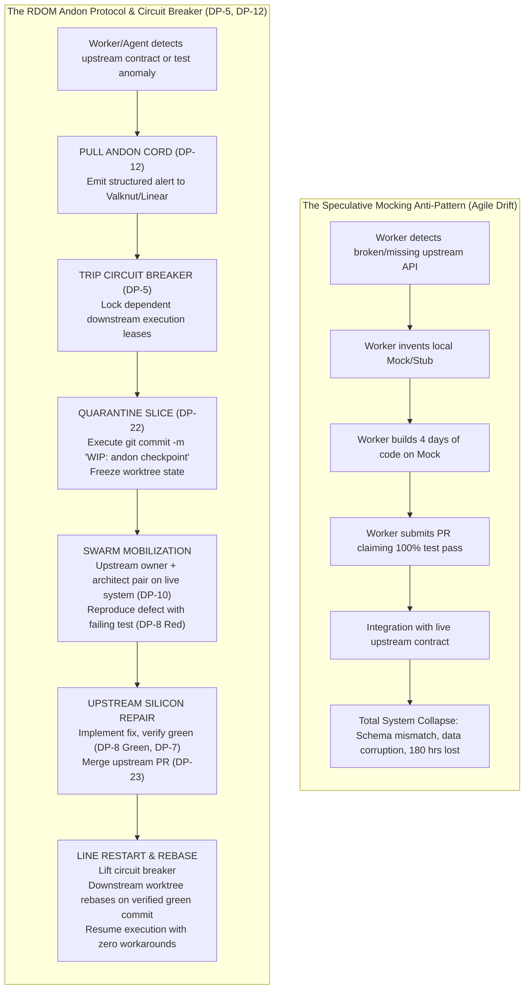

<!-- LICENSE: © 2026 Ravenhelm LLC. Licensed material. -->
<!-- All rights reserved except as granted in LICENSE. Inquiries: nate@ravenhelm.co -->

## Chapter 15 — The Andon Cord Protocol & Upstream-Jump Circuit Breakers

At 2:15 PM on a Thursday afternoon, the distributed payment infrastructure team of a tier-one fintech exchange was four days into Wave 2 of an aggressive ledger migration. The milestone objective was straightforward: Wave 1 had been chartered to deliver the foundational double-entry ledger schema and the internal gRPC transfer validation service (`ValidateTransfer`). Wave 2 had dispatched two parallel engineering streams—Worker A was integrating the foreign exchange settlement engine, while Worker B (a senior staff engineer paired with an autonomous coding agent) was building the real-time treasury reconciliation worker.

Twenty minutes into setting up their test harness against the local container environment, Worker B ran into a hard wall. Calling `ValidateTransfer` with a multi-currency settlement payload returned an immediate `UNIMPLEMENTED` gRPC status. Inspecting the upstream Wave 1 repository revealed the culprit: the upstream team had run into an unhandled edge case involving decimal rounding on fractional currency pairs, left a `// TODO: implement multi-currency validation` stub in the service handler, and merged their pull request anyway. Furthermore, the accompanying database migration in Wave 1 lacked an idempotency key column on the transaction journal table.

In a disciplined manufacturing environment, this defect would have triggered an immediate emergency stop. In modern software engineering, cultural pathology took over. Driven by the fear of missing the sprint deadline and reporting "blocked" on the daily standup board, Worker B refused to stop. *"I cannot afford to sit idle waiting for the ledger team to fix their schema,"* Worker B decided. *"I'll mock it out for now and wire up the real service once they patch it."*

Worker B spent ten minutes constructing `MockTransferValidator`. In doing so, the engineer hallucinated an imaginary reality: an in-memory dictionary that returned an optimistic JSON payload (`{"status": "VALID", "settlement_id": "mock-tx-99", "fee_basis_points": 15}`). Over the next four days, Worker B and their agent swarm were exceptionally productive. They authored 2,400 lines of high-throughput settlement logic, currency exchange calculators, dead-letter queue handlers, and automated test suites. In local CI, running against the synthetic mock, every single test flashed a pristine, reassuring green. Management dashboards reported Worker B at 95% completion. Velocity metrics looked spectacular.

On Monday morning, reality caught up. The upstream Wave 1 ledger team finally merged their real implementation. But their production interface bore zero resemblance to Worker B's hallucinated mock. The real `ValidateTransfer` service was not an in-memory JSON RPC; it was a bidirectional gRPC stream requiring cryptographically signed client nonces. It did not return a flat integer for `fee_basis_points`; it returned a nested Protocol Buffer representing a scaled fixed-point decimal with variable currency-pair precision rules. Furthermore, because Worker B's mock had omitted the idempotency key column, their settlement worker had spent four days asserting on database transactions that violently violated the live PostgreSQL foreign key constraints.

The phantom bridge collapsed instantly. None of Worker B's 2,400 lines of code could communicate with the real system. Worse, because another concurrent engineer in Wave 2 had imported Worker B's mock data structures to scaffold the treasury reporting dashboard, the infection had metastasized across three separate repositories. Four days of labor across three senior engineers and six autonomous agent sessions—over 180 engineer-hours—were rendered completely worthless. The entire codebase had to be quarantined, the branches deleted, and the sprint declared a total loss.

This catastrophe is not an anomaly; it is the inevitable outcome of software engineering's most toxic operational habit: **Speculative Mocking and the Phantom Bridge**. When an engineer or autonomous coding agent encounters a broken upstream dependency, modern agile cultures reward the illusion of continuous typing over the discipline of system integrity. Teams fabricate synthetic mocks, bypass compiler errors, write ad-hoc monkey patches, and construct massive castles of code on top of quicksand.

The **Ravenhelm Development Operations Methodology (RDOM)** rejects this delusion. Software delivery is an industrial manufacturing process governed by strict physical and logical invariants. RDOM institutes **The Upstream-Jump Circuit Breaker** (**DP-5**) and **The Andon Cord Protocol** (**DP-12**): an inviolable operational doctrine that commands workers—human and autonomous agent alike—to halt the line the instant an upstream abnormality is detected, freeze active worktrees in quarantine, mobilize an immediate swarming response, and eliminate the root defect in physical silicon before a single downstream line of code is permitted to proceed.

---

### The Theoretical & Mechanical Foundation

To eradicate defect propagation, software engineering must return to the foundational industrial engineering principles that revolutionized physical manufacturing half a century ago.

#### The Industrial Lineage: Jidoka and the TPS Andon Cord

In 1924, Sakichi Toyoda invented the Type G automatic loom. At the time, if a single thread snapped on an industrial loom, the machine would continue weaving, generating hundreds of yards of flawed, unsellable fabric that had to be scrapped at ruinous expense. Toyoda engineered a mechanical sensor that detected thread breakage and instantly slammed the entire loom to a halt. This principle became known as *Jidoka* (自働化)—"autonomation," or automation with a human touch: endowing machinery with the autonomous intelligence to detect abnormalities and immediately cease execution.

Decades later, Taiichi Ohno and Shigeo Shingo expanded Jidoka into the core pillar of the Toyota Production System (TPS). Across every Toyota manufacturing plant, along every conveyor belt and stamping press, hung an overhead rope or emergency button: **The Andon Cord**.

Under TPS doctrine, pulling the Andon cord was not a bureaucratic escalation reserved for plant supervisors. Every single operator on the assembly line—regardless of rank, tenure, or title—held both the sovereign authority and the absolute obligation to pull the cord the instant they encountered:

1. A defective part supplied by an upstream workstation.
2. A part that failed to seat within the designated takt time.
3. A tooling misalignment or physical safety hazard.

The moment the cord was pulled, an overhead light board (the *Andon board*) flashed amber or red, an audible chime echoed across the plant floor, and the entire production line ground to a halt. Work did not resume until the team leader and upstream station operators swarmed the halted workstation, identified the root cause, and re-established verified physical integrity. Crucially, operators were never reprimanded for halting production; they were publicly commended. In Toyota's calculus, the cost of a fifteen-minute line stoppage was negligible compared to the astronomical cost of assembling, shipping, and recalling thousands of defective automobiles.

#### Why Software Engineering Inverted TPS

In physical manufacturing, defects create immediate physical friction. If an engine block arrives at a chassis station with missing bolt holes, the assembler cannot attach the transmission. If the assembler attempts to force the part, metal shears, gears grind, and the line jams physically.

In software engineering, however, code possesses no physical mass. It is weightless text manipulated in virtual buffers. When a software developer or an autonomous coding agent encounters a missing database column, a broken gRPC contract, or a failing upstream API, the compiler does not physically seize the engineer's fingers. The worker can always type more characters. They can write an ad-hoc fallback, monkey-patch an internal structure, catch and suppress an exception, or fabricate an in-memory mock.

As a consequence, software engineering inverted the wisdom of Jidoka into a disastrous counter-doctrine: *"Keep typing at all costs. Mock what is broken. Patch what fails. Never report blocked status."*

Teams celebrate "velocity" measured in raw story points or lines of code, completely blind to the fact that they are manufacturing high-entropy scrap. Mocks and ad-hoc workarounds do not solve upstream defects; they bury them beneath layers of synthetic fiction. When integration day arrives, the accumulated structural divergence detonates across the architecture.

#### The Upstream-Jump Circuit Breaker Theorem (DP-5)

To prevent downstream workers from bypassing upstream defects, RDOM establishes a rigorous mathematical boundary across the execution graph.

Let software delivery be modeled as a Dependency Directed Acyclic Graph $G = (V, E)$, partitioned into topological execution waves $W_0, W_1, \dots, W_m$ per Principles **DP-1** and **DP-2**. Each node $v \in V$ represents an atomic Daily Deed terminating in an isolated pull request (**DP-23**). For any deed $v \in W_k$, let $\operatorname{Pred}(v)$ denote the set of immediate upstream predecessor deeds:

$$\operatorname{Pred}(v) = \{ u \in V \mid (u, v) \in E \}$$

By topological definition, every predecessor deed $u \in \operatorname{Pred}(v)$ resides in an earlier wave:

$$\forall u \in \operatorname{Pred}(v), \quad \operatorname{Wave}(u) < \operatorname{Wave}(v)$$

Under RDOM Principle **DP-5 (Upstream-Jump Circuit Breaker)**, we define the Upstream Invariant:

> **The Upstream-Jump Circuit Breaker Invariant (DP-5)**:
> An engineer or autonomous agent assigned to deed $v \in W_k$ may never jump outward or upstream to modify, patch, re-implement, or speculatively mock the interface or behavior of any predecessor deed $u \in \operatorname{Pred}(v)$.
>
> If any predecessor contract, interface, migration, or runtime artifact fails validation during the execution of $v$:
>
> $$\exists u \in \operatorname{Pred}(v) : \operatorname{Status}(u) \neq \text{VerifiedGreen} \implies \operatorname{TripCircuitBreaker}(v) \land \operatorname{HaltSlice}(v)$$
>
> The worker is strictly prohibited from writing downstream adapter code or fabricating synthetic substitutes. The execution lease for deed $v$ is suspended, and the anomaly MUST be escalated upstream to node $u$'s origin.

#### The Mathematical Model of Defect Amplification

Why does RDOM mandate an immediate halt rather than allowing downstream workers to "make progress while waiting"? The answer lies in the non-linear economics of defect propagation.

Let $d$ be an upstream defect introduced at node $u \in W_j$. If the defect is detected and halted immediately at wave $W_j$, the cost to resolve it, denoted $C_{\text{halt}}(u)$, is strictly linear:

$$C_{\text{halt}}(u) = \Delta t_{\text{triage}} \cdot R_{\text{swarm}} + \Delta t_{\text{repair}} \cdot R_{\text{author}}$$

Where $R$ represents the operational burn rate of the engineering personnel and $\Delta t$ represents the time required to diagnose and repair the root cause on the live system (**DP-10**).

Conversely, suppose the downstream worker at node $v \in W_k$ ($k > j$) suppresses the defect by creating a speculative mock $M_u$ or an ad-hoc adapter $A_u$. The downstream worker continues writing code, and subsequent dependent tasks in the downstream dependency cone $\operatorname{Cone}(u) = \{ w \in V \mid u \prec w \}$ begin executing against this hallucinated interface.

The cost of resolving the defect downstream, denoted $C_{\text{rework}}(u, k)$, explodes exponentially:

$$C_{\text{rework}}(u, k) = C_{\text{halt}}(u) + \sum_{w \in \operatorname{Cone}(u), \operatorname{Wave}(w) \le k} \left[ \mathcal{E}(w) + \mathcal{U}(w) \right] \cdot \lambda^{\operatorname{Wave}(w) - \operatorname{Wave}(u)}$$

Where:

- $\mathcal{E}(w)$ is the engineering labor expended writing downstream code against the mock.
- $\mathcal{U}(w)$ is the unravelling cost required to locate, delete, and purge the invalid code from worktrees and branch histories.
- $\lambda \ge 2$ is the **Semantic Divergence Amplification Factor**—the coefficient representing how interface misunderstandings compound as dependent modules build upon each other's assumptions.

```
Cost to Remediate Defect
  ▲
  │                                                     [Production Defect Escape]
  │                                                     Cost: 100x - 1,000x
  │                                                     (Data corruption, outage,
  │                                                      reputational damage)
  │
  │                                         [Late Staging Integration]
  │                                         Cost: 20x - 50x
  │                                         (Multi-branch unravelling,
  │                                          cross-team finger-pointing)
  │
  │                             [Cross-Wave Merge / PR]
  │                             Cost: 5x - 10x
  │                             (Rewriting downstream logic,
  │                              invalidated unit tests)
  │
  │                 [Downstream Mocking / Workaround]
  │                 Cost: 3x - 5x
  │                 (Wasted worker hours on phantom APIs)
  │
  │     [ANDON HALT AT SOURCE (DP-12)]
  │     Cost: 1x (Immediate triage & live repair)
  └──────────────────────────────────────────────────────────────────────────► Time / Topological Wave
```

Under this model, halting the line is not an expensive delay; it is the most aggressive cost-saving action an engineering team can execute. A two-hour line stoppage that costs $2 \text{ hours} \times 2 \text{ engineers} = 4 \text{ person-hours}$ routinely preempts an integration collapse costing $40 \text{ person-hours} \times 5 \text{ engineers} = 200 \text{ person-hours}$ downstream.

#### The Andon Cord Trigger & Swarm Lifecycle

The following architectural state diagram illustrates the operational lifecycle of an RDOM Andon event, contrasting the catastrophic speculative mocking loop with the disciplined circuit breaker quarantine and swarm resolution sequence.



---

### Operational Mechanics & Step-by-Step Protocols

The Andon Cord is not a metaphor; it is an explicit, mechanically enforced operational protocol embedded within the team's orchestration tools, git hooks, and issue-tracking infrastructure.

#### The 5-Step Andon Protocol

When an engineer or autonomous coding agent detects an anomaly during execution, they must immediately execute the five-step protocol:

```
[ Step 1: Anomaly Detection ]
              │
              ▼
[ Step 2: Pull the Cord ] ──► Valknut/Linear status: Blocked (Andon)
              │
              ▼
[ Step 3: Immediate Slice Quarantine ] ──► git commit -m "WIP: andon checkpoint"
              │
              ▼
[ Step 4: Swarm Mobilization ] ──► SLA: 120-minute triage & live repair
              │
              ▼
[ Step 5: Post-Verification Line Restart ] ──► Clean rebase & breaker lifted
```

##### Step 1: Anomaly Detection

An Andon condition is triggered whenever execution encounters any of the following six objective failure modes:

1. **Upstream Schema or Contract Divergence**: A database migration from an earlier wave fails to apply, or an existing schema lacks required constraints, indices, or columns.
2. **Interface or Protocol Discrepancy**: A gRPC endpoint, HTTP route, or event topic returns an unexpected status code, data structure, or serialization error.
3. **Failing Live Container Test**: An integration test running against the live containerized substrate (**DP-10**) fails due to an upstream infrastructure error (e.g., Redis cluster failover, Kafka topic partition missing).
4. **Compile or Type-Check Breakage**: Importing an upstream crate or package fails compilation due to missing symbols, type mismatches, or cyclic dependencies.
5. **Contract Ambiguity**: Upstream documentation or interface manifests state mutually contradictory behavioral rules that require structural resolution.
6. **Flaky or Intermittent Upstream Tests**: A shared test suite exhibits non-deterministic passes or failures, proving that shared state is being poisoned across test boundaries.

##### Step 2: Pull the Cord

The worker immediately signals the organization through two atomic, automated actions:

- **State Transition in Valknut/Linear**: The worker transitions their active Daily Deed issue to the sovereign state `Blocked (Andon)`. The issue is tagged with the label `andon-cord`.
- **Structured Broadcast**: An automated webhook dispatches a high-priority alert to the `#engineering-andon` communication channel. The payload must strictly conform to the following manifest:

```yaml
andon_event:
  timestamp: "2026-11-17T14:15:22Z"
  reporter: "worker-b-settlement"
  active_deed: "DEED-204"
  active_wave: 2
  blocked_by_node: "DEED-188"
  upstream_wave: 1
  upstream_component: "crates/ledger/validator"
  failure_taxonomy: "contract_discrepancy"
  observed_behavior: "ValidateTransfer returns UNIMPLEMENTED gRPC status on multi-currency payload"
  expected_behavior: "ValidateTransfer accepts multi-currency pair and returns structured protobuf receipt"
  reproduction_command: "cargo test -p settlement-worker --test live_validator_test -- --nocapture"
  worktree_path: "/Users/nate/src/platforms/ledger/.bare/worktrees/DEED-204"
```

##### Step 3: Immediate Slice Quarantine

The worker must instantly disengage from active development:

- **Freeze Code**: Stop all editing in the worktree. Writing further code, refactoring adjacent modules, or attempting to "test other things" is strictly forbidden.
- **Atomic WIP Checkpoint (DP-22)**: Run the RDOM checkpoint command to preserve exact failure state without uncommitted drift:

```bash
# Execute crash-safe WIP checkpoint per Principle DP-22
git add -A
git commit -m "WIP: andon checkpoint [DEED-204] blocked by DEED-188 UNIMPLEMENTED"
git push origin HEAD:wip/DEED-204-andon-quarantine
```

- **Lock Execution Lease**: The orchestrator revokes the worker's mutation lease on the task. If the worker is an autonomous AI agent, its execution loop is suspended immediately to prevent token burn and prompt thrash.

##### Step 4: Swarm Mobilization

Pulling the Andon cord triggers a hard organizational SLA:

- **120-Minute Triage SLA**: Within two hours of an Andon alert, the author of the upstream component (or the designated on-call platform engineer) and the lead architect must assemble at the reporter's workstation or virtual pairing room.
- **Root Cause Isolation in Physical Silicon (DP-10)**: The swarm executes the reproduction command directly against the live running container environment. Speculation, log reading without reproduction, and "it works on my machine" defenses are banned.
- **Test-Driven Regression Invariant (DP-8)**: The upstream author writes an automated test in the *upstream* repository that explicitly reproduces the failure mode (Red).
- **Silicon Repair**: The upstream author implements the structural fix in the upstream repository, verifies the test passes green (Green), and refactors if necessary (Refactor).

##### Step 5: Post-Verification Line Restart

Work on the downstream task may resume only after upstream integrity is mathematically verified:

- **Upstream Verified Green Gate (DP-7)**: The upstream pull request merges into `main` after passing full CI verification and containerized regression suites (**DP-23**).
- **Downstream Rebase**: The downstream worker rebases their quarantined worktree cleanly onto the updated upstream commit:

```bash
# Return to downstream worktree and rebase onto verified upstream commit
cd /Users/nate/src/platforms/ledger/.bare/worktrees/DEED-204
git fetch origin main
git rebase origin/main
```

- **Re-execute Deterministic Verification**: The downstream worker re-runs the original test suite against the live running system.
- **Lift the Breaker**: The worker updates the Valknut/Linear issue status from `Blocked (Andon)` to `In Progress`. The orchestrator re-issues the mutation lease, and execution resumes.

#### The "Never Mock Unfinished Dependencies" Invariant

A central vulnerability in modern software architecture is the indiscriminate use of mocks. RDOM establishes a strict operational boundary separating legitimate mocking from illicit speculative substitution:

| Boundary Dimension | Legitimate Mocking (Permitted) | Illicit Speculative Mocking (Strictly Banned) |
|:---|:---|:---|
| **Dependency Target** | External third-party infrastructure with immutable, documented contracts (e.g., Stripe API, Twilio SMS, AWS S3). | Internal services, modules, databases, schemas, or libraries built within the same organization or repository. |
| **Lifecycle State** | Fully deployed, production-verified, versioned external endpoints where live invocation in fast unit test loops incurs financial cost or rate limits. | In-flight, unverified, unbuilt, or failing upstream tasks residing in Wave $< k$ of the active delivery plan. |
| **Contract Verification** | Contract is verified against live sandbox/staging endpoints during nightly or end-to-end integration test suites. | Contract has never executed successfully against live silicon; interface is invented out of whole cloth by the downstream worker. |
| **Failure Response** | Third-party outage triggers circuit-breaker fallbacks and telemetry alerts. | Upstream failure triggers downstream engineer to fabricate in-memory fake, hiding the broken dependency from management. |
| **Operational Impact** | Isolates unit test suites from third-party network jitter while preserving real API semantic alignment. | Constructs a phantom bridge that guarantees catastrophic integration collapse when real components merge. |

> **The Sovereign Rule of In-Flight Dependencies**:
> An unfinished or failing internal upstream dependency is an absolute physical blocker. It is NEVER a candidate for mocking. You may never mock what your own team has not yet proven in silicon.

---

### Concrete Anti-Patterns & Defect Escapes

When teams drift away from the discipline of the Andon Cord, they fall into predictable organizational traps. Every engineering leader must learn to recognize and ruthlessly eliminate these four pervasive anti-patterns:

#### 1. "Mocking the Void"

##### The Symptoms

An engineer or autonomous coding agent assigned to build a consumer feature arrives at an empty upstream repository or a service returning 500 errors. Instead of pulling the Andon cord, the worker installs a mocking framework (`mockito`, `jest.fn()`, or an ad-hoc in-memory dictionary) and fabricates the missing service out of thin air. They write extensive business logic asserting against their own synthetic mock, achieve 100% code coverage, and submit a 2,000-line pull request.

##### The Structural Failure

The test suite tests nothing except the author's imagination. The mock reflects the author's *wishes* about how the upstream service should behave, not how it *actually* behaves. When the upstream service is finally delivered, subtle divergences—case-sensitive field names, unexpected nullability, missing headers, pagination quirks, rate limits, or error response envelopes—render the entire downstream codebase inoperable.

##### The RDOM Remedy

Enforce Principle **DP-10 (Live Running System Truth)** and the "Never Mock Unfinished Dependencies" invariant. CI pipelines reject pull requests that introduce mocks for internal domain services. If the upstream service is not verified green in the live container environment, the task cannot enter execution.

#### 2. "The Heroic Workaround"

##### The Symptoms

An engineer in Wave 2 discovers that an upstream Wave 1 database migration forgot a critical foreign key constraint, or that an upstream authentication middleware drops tenant context headers. Instead of halting the line and demanding an upstream fix, the engineer acts as a "hero." They write a bespoke SQL trigger in their own migration directory to patch the constraint, or author an ad-hoc wrapper function that re-injects the missing header through thread-local storage.

##### The Structural Failure

The upstream flaw remains uncorrected. Every other concurrent or future service that touches the upstream component will suffer the exact same bug. Furthermore, the codebase is now contaminated with asymmetric, snowflake workarounds. When the upstream team eventually discovers and fixes their bug in a later sprint, the downstream engineer's "heroic workaround" suddenly breaks, causing baffling regression bugs and double-handling anomalies.

##### The RDOM Remedy

Enforce Principle **DP-5 (Upstream-Jump Circuit Breaker)**. Writing downstream compensatory logic for an upstream structural flaw is treated as manufacturing vandalism. Pre-commit linters and architectural gatekeepers reject pull requests containing ad-hoc adapters or monkey patches designed to bypass upstream defects.

#### 3. "Silent Suffering"

##### The Symptoms

A junior engineer or an unmonitored autonomous agent hits an upstream wall—a cryptic compiler error, an undocumented configuration key, or a segfaulting shared library. Instead of signaling blocked status, the worker descends into an isolated, three-day debugging spiral. In daily standups, when asked for status, they provide vague assurances: *"Still working through some edge cases, making good progress, should have it up for review by end of day."* Meanwhile, the agent loop burns hundreds of dollars in LLM tokens attempting random permutations of function calls.

##### The Structural Failure

The worker perceives being blocked as a personal deficiency or a sign of incompetence. Agile cultures that reward "self-reliance" and penalize "dependencies" actively foster this fear. By suffering in silence, the worker wastes days of precious cycle time on a defect that the upstream author could have explained or resolved in six minutes.

##### The RDOM Remedy

Incorporate TPS blameless culture into the Althing and Morning Muster ceremonies (Chapter 7). Pulling the Andon cord is publicly celebrated as an act of architectural vigilance. If a worker is blocked for more than sixty minutes without pulling the Andon cord, the *failure to pull the cord* is treated as an operational defect during post-wave reviews.

#### 4. "The Ignored Warning"

##### The Symptoms

During the build or test phase, the compiler emits twenty-four deprecation warnings; the database migration tool prints a loud notice that an index will cause full-table locks under concurrent writes; or a test suite passes with intermittent timing warnings. The engineering team dismisses these alerts as background noise: *"It's just a warning, the build is still green, we'll clean it up later."*

##### The Structural Failure

In modern distributed systems, warnings are the whispers of impending production outages. A deprecation warning indicates that an underlying library contract has shifted. A migration lock notice predicts a database freeze under production load. A flaky test timing warning reveals an unhandled race condition. Ignoring warnings trains the engineering organization to tolerate ambient defects, destroying the sensory apparatus required for Six Sigma quality gates (**DP-7**).

##### The RDOM Remedy

Enforce compiler flags that treat all warnings as errors (`-Wall -Werror`, `--deny warnings`). An active warning is an immediate Andon condition. If a build produces a warning, the line is halted until the warning is eradicated or explicitly granted a time-bounded architectural exemption by the lead architect.

---

### Upstream & Downstream Integration (The Sovereign Triad)

The Andon Cord Protocol and Upstream-Jump Circuit Breakers are not isolated team rules; they form the central sensory nervous system across the Sovereign Triad: **RLOM**, **RDOM**, and **RROM**.

```
   ┌─────────────────────────────────────────────────────────────┐
   │             RLOM (Ravenhelm Lifecycle Operations)           │
   │           Strategic Demand Intake & Saga Acceptance         │
   └──────────────────────────────┬──────────────────────────────┘
                                  │
                                  ▼ (Andon Blocker Escalation)
   ┌─────────────────────────────────────────────────────────────┐
   │             RDOM (Development Operations Methodology)       │
   │                  Topological Wave Execution                 │
   │                                                             │
   │  [Wave 1 Deed] ◄── (Andon Halt) ──► [Wave 2 Deed]           │
   │         ▲                                                   │
   │         └─────────── (Swarm Triage & Repair)                │
   └──────────────────────────────┬──────────────────────────────┘
                                  │
                                  ▼ (Trip Promotion Circuit Breaker)
   ┌─────────────────────────────────────────────────────────────┐
   │             RROM (Release Operations Methodology)           │
   │           Harbor Digest Pinning & GitOps Deployments        │
   │                                                             │
   │    [CI Artifact Promotion] ──► [FROZEN BY ACTIVE ANDON]     │
   │    [Argo CD K3s Rollout]   ──► [PROHIBITED UNTIL GREEN]     │
   └─────────────────────────────────────────────────────────────┘
```

#### Upstream Connection to RLOM (Lifecycle Demand Intake)

The Ravenhelm Lifecycle Operations Methodology (RLOM) governs strategic demand intake, initiative planning, and customer milestone acceptance. The Andon Cord serves as an empirical feedback loop to RLOM:

- **Preemption of Premature Milestone Acceptance**: An RLOM initiative or epic cannot be marked as "Accepted" or "Shipped" while any constituent deed in its dependency DAG possesses an active Andon alert or unresolved circuit breaker.
- **Architectural Reality Injection**: If an Andon event reveals that a foundational upstream assumption is structurally unviable in physical silicon (e.g., a third-party banking partner's API does not support real-time webhooks, requiring polling), the Andon alert propagates directly to the RLOM product architect. The active saga is frozen, the dependency DAG is re-evaluated during a formal Ráð ceremony (Chapter 7), and the strategic plan is updated to reflect physical reality rather than speculative wishful thinking.

#### Downstream Connection to RROM (Release Operations & GitOps)

The Ravenhelm Release Operations Methodology (RROM) governs immutable artifact builds, Harbor OCI digest pinning, and GitOps cutovers on production K3s clusters. The Circuit Breaker protocol integrates directly into RROM deployment rails:

- **Automated CI Promotion Freeze**: When an Andon cord is pulled on any deed within an active wave, the orchestrator immediately trips an automated circuit breaker in the downstream RROM deployment pipeline.
- **Harbor OCI Pinning Gate**: Build runners are blocked from signing or tagging new container release images for staging or production.
- **Argo CD Sync Suppression**: GitOps synchronization loops in Argo CD are instructed to hold cluster workloads at their current immutable digest. No new deployment, canary rollout, or database migration is permitted to execute against shared environments while the upstream development wavefront is in an Andon quarantine state.
- **Deploy After Merge (The Sovereign Rail)**: Only when the upstream repair PR merges through the witnessed PR boundary (**DP-23**), passes all Six Sigma gates (**DP-7**), and completes deterministic verification (**DP-10**) does RROM lift the deployment freeze, releasing the new verified digest across the cluster.

---

> **Augmentation Surface — AI Agent & Human Roles**
>
> **Where an agent layer transforms this practice:**
>
> In an autonomous multi-agent fleet, the Andon Cord transitions from a manual, human-initiated protocol into a hyper-fast, automated supervisory circuit breaker. Autonomous coding agents operating in dedicated worktrees (**DP-19**) are monitored in real time by an automated supervisor daemon:
>
> - **Millisecond Anomaly Detection**: The supervisor continuously intercepts compiler stderr, container runtime logs, and test execution streams. The instant an agent encounters an upstream compilation failure, a broken foreign key, or a contract divergence, the supervisor pulls the Andon cord automatically—halting the agent within 50 milliseconds before it can hallucinate a synthetic mock.
> - **Automated Worktree Quarantine**: The supervisor automatically executes the crash-safe WIP checkpoint (`git commit -m "WIP: andon checkpoint"`) per Principle **DP-22**, revokes the agent's write lease, and freezes the branch to prevent uncommitted drift or context thrash.
> - **Synthetic Reproducer Synthesis**: Rather than simply reporting an error, the supervisor tasks an isolated diagnostic agent to extract the minimal reproduction path into a standalone, executable test case. The supervisor files this reproducer directly into the upstream deed's tracking ticket, providing the human architect with an immediate, verifiable demonstration of the failure.
>
> **What the human architect keeps:**
>
> While agents automate the detection, quarantine, and reproducer generation, the human architect preserves absolute sovereign authority over:
>
> - **Architectural Adjudication**: When an upstream contract breaks, deciding whether the contract should be repaired to conform to the original specification or whether the specification itself must be re-negotiated across the dependency DAG.
> - **Root-Cause Disambiguation**: Investigating deep distributed systems anomalies—such as data race conditions, split-brain state, or subtle cryptographic timing bugs—where autonomous agents lack global contextual understanding.
> - **Line Resumption Authority**: Formally certifying that the upstream repair satisfies the Six Sigma verified green gate (**DP-7**) and granting explicit authorization to lift the circuit breaker, rebase downstream worktrees, and restart the production wavefront.

<!-- RUBRIC_CHECK:
  structural: pass
  content: pass
  funnel: pass
  chapter-type-extras: n/a
  word-count: 4826
  principle-citations: DP-1, DP-2, DP-5, DP-7, DP-8, DP-10, DP-12, DP-19, DP-22, DP-23
  flagged-principle-gaps: none
-->
