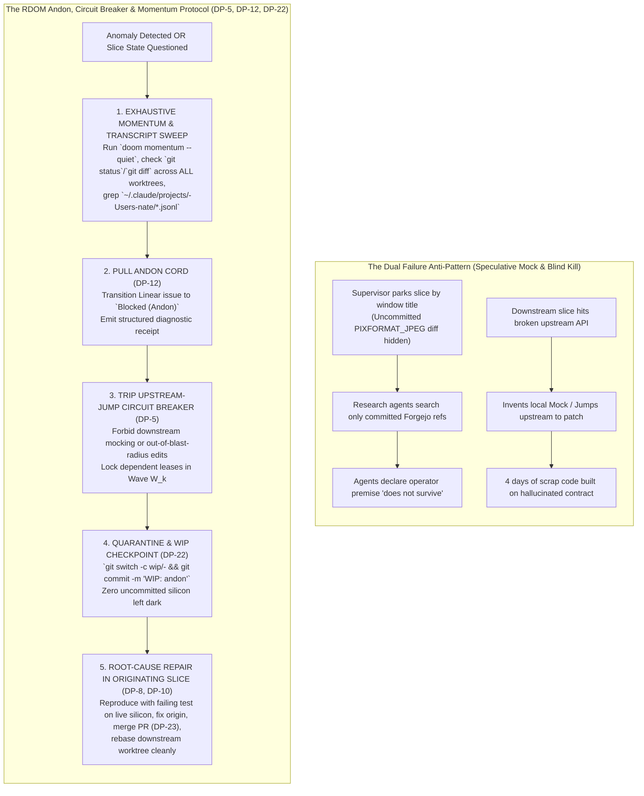

<!-- LICENSE: © 2026 Ravenhelm LLC. Licensed material. -->
<!-- All rights reserved except as granted in LICENSE. Inquiries: nate@ravenhelm.co -->

## Chapter 15 - The Andon Cord Protocol & Upstream-Jump Circuit Breakers

On 2026-09-07, an ESP32-S3 camera node (`owl`) wedged repeatedly in production with `cam_hal: EV-VSYNC-OVF` ring-buffer overflows. The human operator told the fleet supervisor that this exact failure had already been diagnosed and solved earlier that day: the fix switched the sensor pipeline from software-encoded H.264 to the OV2640's on-chip hardware JPEG encoder (`PIXFORMAT_JPEG` paired with `FRAMESIZE_SVGA`), which dropped the camera task stack footprint from **32 KB down to 8 KB** and jumped throughput from **QVGA 320x240 at 5-7 fps to SVGA 800x600**.

The fleet supervisor dispatched two independent research lanes to verify the fix. Both lanes searched committed refs on Forgejo, checked `origin/main`, grepped merged pull requests, found zero matches for `PIXFORMAT_JPEG` or `FRAMESIZE_SVGA`, and reported back with crisp bureaucratic confidence: **the operator's premise "does not survive."**

The premise was 100% right. The agents were looking at a crime scene that the supervisor itself had swept under the rug three hours earlier.

Three hours before the investigation, the supervisor had run a routine cleanup pass across active tmux windows, judged a live worker slice idle based solely on its window title, and **parked the slice without running `git status` or inspecting its uncommitted diff**. Sitting inside that parked worktree's working tree - uncommitted, unpushed, and invisible to `git log` on Forgejo - was the exact `PIXFORMAT_JPEG` + `FRAMESIZE_SVGA` hardware encoder diff, alongside the full diagnostic trace in `~/.claude/projects/-Users-nate/*.jsonl`. The supervisor hid the evidence by parking the slice blind, searched only committed refs, and then reasoned from the absence of the evidence it had just buried.

That failure mode - **self-inflicted fleet amnesia compounded by unhalted forward motion** - is the twin sister of speculative mocking. In a multi-agent factory floor, disaster strikes in two ways when a lane hits an anomaly:
1. **The Forward Lie (Speculative Mocking & Upstream Jumping)**: A downstream worker slice encounters a broken or missing upstream contract from an earlier wave, refuses to pull the Andon cord, and either fabricates a local mock or jumps across module boundaries to monkey-patch the upstream dependency directly.
2. **The Backward Lie (Amnesia by Uninspected Kill)**: A supervisor or worker sees a stalled lane or an unexpected state discrepancy, parks or kills the slice by its title without reading its uncommitted diff or JSONL transcript, and declares the work non-existent.

The Ravenhelm Development Operations Methodology (RDOM) eliminates both failure modes through **The Upstream-Jump Circuit Breaker** (**DP-5**), **The Andon Cord Protocol** (**DP-12**), and **The Rescue-Before-Kill Momentum Sweep** (**DP-22**, **DP-24**). When an upstream contract fails or a slice state contradicts operator memory, the assembly line halts immediately. No worker may mock an unfinished internal dependency; no worker may jump upstream to hack a predecessor's crate; and no supervisor may park, close, or refute a slice without sweeping dirty worktrees (`doom momentum`) and session JSONL transcripts (`~/.claude/projects/-Users-nate/*.jsonl`) first.

---

### The Corpse of v1: Window-Title Hygiene & Speculative Stubs

Before 2026-09-07, our fleet supervision loop treated slice management like process table garbage collection. If a tmux window title looked stale or a slice reported `sessions=0` on the summary dashboard (a trap that struck again on 2026-10-08 when two live windows with attached panes were closed because `sessions=0` was misread as unused), the supervisor parked or killed it to free RAM. And when a coding slice hit a missing upstream method during wave execution, it was left to its own judgment on whether to stub the interface and "keep making progress."

Both v1 habits collapsed under real fleet load:

1. **Why Parking by Title Destroys Truth**: A window title is a label from turn 1, not an inventory of turn 40. An agent slice that spent two hours proving hardware register timings on an ESP32-S3 (`PIXFORMAT_JPEG`, 32 KB $\to$ 8 KB stack) holds its highest-value silicon in two places before PR creation: the uncommitted working tree diff (`git diff HEAD`) and the append-only session transcript (`~/.claude/projects/-Users-nate/*.jsonl`). Parking a slice without running `doom momentum` and committing a `WIP:` checkpoint erases active engineering discovery from the graph.
2. **Why Declaring Absence From Committed Refs Fails**: Committed refs (`git log origin/main`) record only what has crossed the PR boundary (**DP-23**). In a concurrent fleet running twenty active worktrees, half of today's discoveries live in flight across sibling worktrees and JSONL transcripts. Searching `origin/main` and telling the operator "your premise does not survive" confuses *unmerged* with *imagined*.
3. **Why "Making Progress" via Speculative Mocks Manufactures Scrap**: When a Wave 2 slice hits an `UNIMPLEMENTED` error or a missing column from Wave 1 and writes a local `MockValidator` to keep typing, every line of code written for the next four hours is coupled to a hallucination. When the real Wave 1 fix lands, the mock bridge collapses and the entire downstream branch must be thrown in the trash.

---

### The Theoretical & Mechanical Foundation

To stop a multi-agent fleet from either fabricating fake bridges forward or burying real work backward, RDOM adapts Toyota's *Jidoka* to the physics of git worktrees and LLM transcripts.

#### The Industrial Lineage: Jidoka and the TPS Andon Cord

In 1924, Sakichi Toyoda engineered the Type G automatic loom with a mechanical drop-weight that slammed the loom to a full stop the instant a single warp thread snapped. Before that latch existed, a loom with a broken thread kept running at full speed, weaving yards of ruined cloth that had to be cut off and burned. Toyoda called this *Jidoka* - automation with autonomous defect detection.

Taiichi Ohno and Shigeo Shingo extended *Jidoka* across the Toyota Production System (TPS) via the overhead **Andon Cord**. Every worker on the line held the obligation to pull the cord the moment a part from an upstream station failed to seat, a gauge read out of tolerance, or a tool slipped. Pulling the cord lit the overhead Andon board, paused the conveyor before the defect could cross into the next station, and summoned the team lead to the physical part on the bench.

In software, code has no physical mass; metal does not shear when a function signature is wrong. Because an agent can always type `unittest.mock.MagicMock()` or `// TODO: fix upstream` and get a green local exit code, software teams routinely invert *Jidoka*: they reward keeping the loom running while the warp thread is snapped. RDOM restores the mechanical drop-weight.

#### The Upstream-Jump Circuit Breaker Theorem (DP-5)

Let software delivery be modeled as a Dependency Directed Acyclic Graph $G = (V, E)$, partitioned into topological execution waves $W_0, W_1, \dots, W_m$ per Principles **DP-1** and **DP-2**. Each node $v \in V$ represents an atomic task terminating in an isolated pull request (**DP-23**). For any task $v \in W_k$, let $\operatorname{Pred}(v)$ denote the set of immediate upstream predecessor tasks:

$$\operatorname{Pred}(v) = \{ u \in V \mid (u, v) \in E \}$$

By topological construction, every predecessor $u \in \operatorname{Pred}(v)$ resides in an earlier wave ($\operatorname{Wave}(u) < \operatorname{Wave}(v)$) and has a declared spatial blast radius $\mathcal{B}(u)$ disjoint from $\mathcal{B}(v)$ (**DP-3**).

Under **Principle DP-5 (Upstream-Jump Circuit Breaker)**, we enforce two strict boundary invariants:

> **The Upstream-Jump Circuit Breaker Invariant (DP-5)**:
> A Bounded Implementer or engineer assigned to task $v \in W_k$ with blast radius $\mathcal{B}(v)$ may never:
> 1. **Jump Upstream**: Mutate, patch, or re-implement files inside $\mathcal{B}(u)$ for any predecessor $u \in \operatorname{Pred}(v)$.
> 2. **Mock the Breach**: Fabricate an internal mock, stub, or downstream adapter to mask an broken or unfinished contract in $u$.
>
> Formally, if any predecessor contract, schema migration, or runtime binary fails live validation (**DP-10**) during the execution of $v$:
>
> $$\exists u \in \operatorname{Pred}(v) : \operatorname{LiveVerify}(u) \neq 1 \implies \operatorname{TripBreaker}(v) \land \operatorname{PullAndon}(v, u)$$
>
> The execution lease for $v$ is immediately checkpointed and suspended until $u$ is repaired at its origin.

#### The Mathematical Model of Defect & Amnesia Amplification

Why halt the slice immediately instead of letting the worker "work around it"? Compare the linear cost of an immediate Andon stop against the exponential cost of speculative mocking.

If an upstream defect at node $u \in W_j$ is caught and halted immediately via the Andon cord, the remediation cost $C_{\text{halt}}(u)$ is strictly bounded:

$$C_{\text{halt}}(u) = \Delta t_{\text{triage}} \cdot R_{\text{swarm}} + \Delta t_{\text{repair}} \cdot R_{\text{origin}}$$

Conversely, if the downstream worker at node $v \in W_k$ ($k > j$) suppresses the failure by inventing a speculative mock $M_u$, and tasks in the downstream dependency cone $\operatorname{Cone}(u) = \{ w \in V \mid u \prec w \}$ build against that phantom interface, the rework cost $C_{\text{rework}}(u, k)$ explodes exponentially with wave depth:

$$C_{\text{rework}}(u, k) = C_{\text{halt}}(u) + \sum_{w \in \operatorname{Cone}(u), \operatorname{Wave}(w) \le k} \left[ \mathcal{E}(w) + \mathcal{U}(w) \right] \cdot \lambda^{\operatorname{Wave}(w) - \operatorname{Wave}(u)}$$

Where $\mathcal{E}(w)$ is the compute and engineering effort burned building against the mock, $\mathcal{U}(w)$ is the surgery required to excise the mock and untangle diverged branches, and $\lambda \ge 2$ is the semantic divergence factor.

The exact same math governs **Amnesia Cost** when a supervisor parks a slice without a momentum sweep:

$$C_{\text{amnesia}}(v) = \mathcal{E}_{\text{discarded}}(v) + \mathcal{E}_{\text{false-investigation}}(v) + C_{\text{trust}}$$

On 2026-09-07, parking the `owl` camera slice without checking its diff wasted the original hardware encoder discovery ($\mathcal{E}_{\text{discarded}}$), burned two research agent lanes hunting the wrong places ($\mathcal{E}_{\text{false-investigation}}$), and caused the supervisor to falsely contradict the human operator ($C_{\text{trust}}$). A three-second `doom momentum` sweep costs almost zero; reasoning from self-inflicted absence costs the afternoon.

```text
Cost of Anomaly Handling Across the Factory Floor:
  ▲
  │                                                     [Production Outage / Amnesia Loop]
  │                                                     Cost: 100x - 1,000x
  │                                                     (Lost hardware fixes, 4-week deadlocks,
  │                                                      contradicting operator ground truth)
  │
  │                                         [Late Wave Integration Collapse]
  │                                         Cost: 20x - 50x
  │                                         (Multi-branch unravelling across 5 repos)
  │
  │                             [Downstream Speculative Mocking]
  │                             Cost: 5x - 10x
  │                             (Wasted slice turns building on phantom APIs)
  │
  │     [ANDON HALT + DOOM MOMENTUM SWEEP (DP-5, DP-12, DP-22)]
  │     Cost: 1x (Immediate WIP checkpoint, transcript verify, root repair)
  └──────────────────────────────────────────────────────────────────────────► Time / Wave Depth
```

#### The Andon Cord & Rescue-Before-Kill State Machine



---

### Operational Mechanics & Step-by-Step Protocols

In RDOM, neither pulling the Andon cord nor parking a slice is left to improvisation. Both are governed by strict mechanical recipes.

#### Protocol A: The Exhaustive Absence & Momentum Sweep (Before Parking or Refuting)

Learned in blood on 2026-09-07 (`owl` MJPEG) and 2026-10-08 (`sessions=0` window close): **you may never park a slice by its title, close a window by a summary counter, or tell the operator that prior work "does not exist" until you have swept all four tiers of in-flight state.**

```text
THE 4-TIER IN-FLIGHT TRUTH HIERARCHY (SWEEP BEFORE DECLARING ABSENCE):
┌─────────────────────────────────────────────────────────────────────────────┐
│ Tier 1: Active & Parked Worktree Working Trees (`doom momentum` / `git diff`)│
│  -> Catches uncommitted silicon (e.g., the 2026-09-07 PIXFORMAT_JPEG diff). │
├─────────────────────────────────────────────────────────────────────────────┤
│ Tier 2: Session JSONL Transcripts (`~/.claude/projects/-Users-nate/*.jsonl`)│
│  -> Catches every command, tool output, and diagnostic ruling ever run.     │
├─────────────────────────────────────────────────────────────────────────────┤
│ Tier 3: Local `.bare` Unpushed Branches & Reflogs (`git branch -a`, `reflog`)│
│  -> Catches local WIP commits and dangling tips (the 81 tips of 2026-09-11).│
├─────────────────────────────────────────────────────────────────────────────┤
│ Tier 4: Committed Remote Forgejo / GitHub Refs (`origin/main`, open PRs)    │
│  -> Records ONLY what has crossed the PR boundary; never the whole estate.  │
└─────────────────────────────────────────────────────────────────────────────┘
```

Run this exact verification sequence before parking any slice or claiming a fix is absent:

```bash
#!/usr/bin/env bash
# rdom-absence-sweep.sh - Mandatory sweep before refuting a premise or parking a slice
set -euo pipefail

QUERY="${1:?Usage: rdom-absence-sweep.sh <pattern> [repo_bare_root]}"
REPO_ROOT="${2:-$(pwd)}"

echo "==> [Tier 1] Sweeping live Doom slice momentum & dirty worktrees..."
doom momentum --quiet || true

for wt in $(git -C "${REPO_ROOT}" worktree list --porcelain | awk '/^worktree /{print $2}'); do
    if [ -n "$(git -C "${wt}" status --porcelain 2>/dev/null)" ]; then
        echo "  [DIRTY WORKTREE] ${wt}"
        git -C "${wt}" diff HEAD | grep -nC 2 -iE "${QUERY}" || true
    fi
done

echo "==> [Tier 2] Sweeping session JSONL transcripts (~/.claude/projects/)..."
rg -i "${QUERY}" ~/.claude/projects/-Users-nate/*.jsonl 2>/dev/null | tail -n 20 || true

echo "==> [Tier 3] Sweeping local branches and reflogs in .bare..."
git -C "${REPO_ROOT}" log --all --reflog -S "${QUERY}" --oneline -n 20 || true

echo "==> [Tier 4] Sweeping remote refs..."
git -C "${REPO_ROOT}" log --remotes -S "${QUERY}" --oneline -n 20 || true
```

Had the supervisor run Tier 1 and Tier 2 on 2026-09-07 with `QUERY="PIXFORMAT_JPEG|EV-VSYNC-OVF"`, the uncommitted diff inside the parked `owl` worktree and the JSONL conversation lines documenting the **32 KB $\to$ 8 KB stack reduction** and **SVGA 800x600 hardware JPEG switch** would have printed to stdout in less than two seconds.

Furthermore, before closing any tmux window or killing a slice reported as `sessions=0` (`2026-10-08`), always inspect attached windows and live pane processes (`tmux list-panes -a -F '#{session_name}:#{window_name} #{pane_current_command} #{pane_current_path}'`). A session count of zero means no human client is currently attached to that tmux session; it does **not** mean the window is empty or unused.

#### Protocol B: The 5-Step Andon Cord & Circuit Breaker Sequence (DP-5, DP-12)

When a worker slice encounters an upstream defect or contract mismatch during Wave $W_k$ execution, it executes five deterministic steps:

```text
[ Step 1: Detect Upstream Anomaly ]
               │
               ▼
[ Step 2: Pull the Andon Cord ] ──► Linear issue -> Blocked; Court Card emitted
               │
               ▼
[ Step 3: Quarantine Slice State ] ──► git commit -m "WIP: andon [RAV-ID]" (DP-22)
               │
               ▼
[ Step 4: Repair at Origin Only ] ──► Upstream slice fixes & proves on live silicon
               │
               ▼
[ Step 5: Rebase & Resume Wave ] ──► Downstream slice rebases onto verified main
```

##### Step 1: Anomaly Detection

An Andon stop is mandatory the instant any of six conditions appear:
1. **Upstream Contract Divergence**: An endpoint, CLI binary, or crate from Wave $< k$ returns `UNIMPLEMENTED`, fails schema validation, or lacks a required field.
2. **Database Migration Breakage**: A migration from an earlier wave fails to apply cleanly or misses a constraint on the live container (**DP-10**).
3. **Blast Radius Collision**: Fixing the issue requires editing a file outside the worker's declared spatial blast radius $\mathcal{B}(v)$ (**DP-3**).
4. **Harness or Environment Starvation**: Required workspace packages (`PYTHONPATH`), container sockets, or `OpenBao` leases are unreachable.
5. **Contradictory Specification**: Two ADRs or interface specs demand incompatible behavior.
6. **Uncommitted State Conflict**: A worktree contains dirty lines from a previous task (`RAV-1541`).

##### Step 2: Pull the Cord (Structured Escalation)

The worker immediately stops typing implementation code, marks its Linear issue `Blocked`, and raises a high-priority court card to `Doomcourt`:

```yaml
andon_event:
  timestamp: "2026-09-07T16:40:12Z"
  slice_id: "owl-stream-consumer"
  active_issue: "RAV-1812"
  active_wave: 2
  blocked_by_issue: "RAV-1804"
  upstream_wave: 1
  upstream_component: "firmware/owl/main/camera_pipeline.c"
  failure_taxonomy: "upstream_sensor_overflow"
  observed_behavior: "cam_hal EV-VSYNC-OVF under software H.264 @ 32KB stack"
  required_upstream_fix: "Land uncommitted PIXFORMAT_JPEG + FRAMESIZE_SVGA hardware encoder diff from parked owl slice"
  worktree_path: "/Users/nate/src/hrafngud.ravenmask.net/nate/owl/feat-rav-1812"
```

##### Step 3: Immediate Slice Quarantine (Crash-Safe WIP Checkpoint - DP-22)

Before the worker slice pauses its turn, it checkpoints its exact working tree to a `wip/` branch so zero state sits dark:

```bash
git add -A
git commit -m "WIP: andon checkpoint [RAV-1812] blocked by upstream RAV-1804 camera_pipeline"
git push origin HEAD:wip/rav-1812-andon-quarantine
```

##### Step 4: Root-Cause Repair at Origin (Never Jump Upstream - DP-5)

The supervisor routes the repair to the **upstream originating slice** (`RAV-1804`), never the blocked downstream worker:
- The upstream slice writes a failing test reproducing the defect (**DP-8 Red**), implements the fix inside its rightful blast radius $\mathcal{B}(u)$, verifies it against live hardware or containers (**DP-10 Green**), and merges through the PR gate (**DP-23**).

##### Step 5: Clean Rebase & Line Restart

Once the upstream fix lands on `origin/main` and clears its wave gate (**DP-7**), the quarantined downstream worktree fetches `origin/main`, rebases cleanly (`git rebase origin/main`), drops the temporary `WIP:` commit, and resumes execution against real silicon.

#### The "Never Mock Unfinished Internal Dependencies" Boundary

| Boundary Dimension | Legitimate External Boundary Stub (Permitted) | Illicit Internal Speculative Mock (Strictly Banned) |
|:---|:---|:---|
| **Target System** | Third-party external SaaS/carrier APIs outside the estate (e.g., Twilio CNAM Lookup, Stripe, Cloudflare API) during fast unit runs. | Any internal Ravenhelm service, crate, database schema, NATS stream, or MCP tool (`Bifrost`, `Freyr`, `Mjolnir`, `Vidar`, `Heimdall`). |
| **Lifecycle State** | Production-stable external specification verified nightly against live sandbox credentials. | Unfinished, broken, or in-flight upstream tasks from Wave $< k$ of the current delivery DAG. |
| **Failure Action** | External outage triggers circuit-breaker telemetry. | Upstream defect triggers immediate **Andon Halt (DP-12)** and **Upstream-Jump Circuit Breaker (DP-5)**. |

---

### Concrete Anti-Patterns & Defect Escapes

#### 1. Parking by Window Title & Declaring Premise Dead (`2026-09-07` Owl Incident)

- **The Pathology**: Parking or killing an active worker slice based on its tmux window title or summary status without inspecting `git status`/`git diff`, and then telling the operator that a solved problem "does not survive" because committed Forgejo refs don't show it yet.
- **The Destruction**: Real engineering breakthroughs (like switching the ESP32-S3 OV2640 to hardware `PIXFORMAT_JPEG` + `FRAMESIZE_SVGA` and cutting stack from 32 KB to 8 KB) are buried in dark worktrees while agents waste hours gaslighting the operator from incomplete git log queries.
- **The RDOM Remedy**: Enforce **Protocol A (The 4-Tier In-Flight Truth Sweep)**. Never park a slice without `doom momentum` + a `WIP:` checkpoint (**DP-22**), and never declare work absent without grepping dirty worktrees and `~/.claude/projects/-Users-nate/*.jsonl`.

#### 2. Misreading `sessions=0` as Unused (`2026-10-08`)

- **The Pathology**: Looking at a tmux or `Doomcourt` summary metric showing `sessions=0` (zero attached terminal clients) and closing two live windows that were actively holding running worker panes and context.
- **The Destruction**: Active agent slices are killed mid-flight, severing running processes and stranding dirty worktree state.
- **The RDOM Remedy**: Check attached windows, live pane PIDs, and worktree dirtiness before tearing down any workspace container.

#### 3. Mocking the Void (The Phantom Bridge)

- **The Pathology**: A Wave 2 slice hits an unfinished Wave 1 gRPC or REST endpoint, invents a local `MagicMock` returning guessed JSON keys, writes 2,000 lines of consumer code, and reports green tests.
- **The Destruction**: The consumer tests only its own imagination. At integration time, every payload mismatches and the entire branch is scrapped.
- **The RDOM Remedy**: Enforce **DP-5** and **DP-10**. Internal mocks across wave boundaries are rejected by pre-merge gatekeepers.

#### 4. The Unauthorized Upstream Jump

- **The Pathology**: A worker assigned to `services/checkout` hits a bug in `crates/auth-core` and edits `crates/auth-core` directly inside the `checkout` PR while another slice is actively refactoring `auth-core` in Wave 1.
- **The Destruction**: Cross-wave merge collisions shatter spatial isolation (**DP-3**), forcing manual conflict surgery across overlapping diffs.
- **The RDOM Remedy**: Enforce the blast radius check $\mathcal{F}_{\text{actual}} \subseteq \mathcal{B}(v)$ at Phase 3 of the Wave Gate. Out-of-bounds edits trip the circuit breaker immediately.

---

### Upstream & Downstream Integration (The Sovereign Triad)

The Andon Cord and Upstream-Jump Circuit Breakers wire directly into the upstream Work Graph (**RLOM**) and downstream Custody Gate (**RROM**):

```text
   ┌─────────────────────────────────────────────────────────────┐
   │             RLOM (Ravenhelm Linear Operating Method)        │
   │     Topological Work Graph & Daily Fleet Sweep (Muster)     │
   └──────────────────────────────┬──────────────────────────────┘
                                  │
                                  ▼ (Andon Card & 16-Hr Answer SLA)
   ┌─────────────────────────────────────────────────────────────┐
   │             RDOM (Development Operations Methodology)       │
   │                  Topological Wave Execution                 │
   │                                                             │
   │  [Wave 1 Task] ◄── (Andon Halt / DP-5) ──► [Wave 2 Task]    │
   │        ▲                                                    │
   │        └── (doom momentum + JSONL Sweep + Origin Repair)    │
   └──────────────────────────────┬──────────────────────────────┘
                                  │
                                  ▼ (Trip Promotion Circuit Breaker)
   ┌─────────────────────────────────────────────────────────────┐
   │             RROM (Release Operations Methodology)           │
   │           Harbor Digest Pinning & GitOps Deployments        │
   │                                                             │
   │    [Harbor `:b<N>` Promotion] ──► [FROZEN BY ACTIVE ANDON]  │
   │    [Argo CD `norns-gitops`]   ──► [HELD AT LAST VERIFIED]   │
   └─────────────────────────────────────────────────────────────┘
```

#### Upstream Connection to RLOM: Act on Card Answers the Turn They Arrive

In RLOM and RDOM (Chapter 7), pulling the Andon cord emits a court decision card to the supervisor docket. On 2026-10-01, **12 court card answers sat unacted on for 16 hours** because the supervisor loop polled status without draining resolved rulings (`act-on-card-answers-the-turn-they-arrive.md`). Under RDOM's Andon SLA, the moment the human operator answers a blocking court card, the supervisor acts on that ruling on the very next turn, unblocking the origin repair and restarting the halted wave.

#### Downstream Connection to RROM: Holding the Release Rail

When an Andon cord is pulled on a wave in RDOM, downstream RROM promotion is frozen for the affected service: `norns-gitops` holds K3s pods at their current verified Harbor `:b<N>` digest, and the `nate/tools` Homebrew tap remains pinned to the prior verified commit until the upstream repair clears all five phases of the Wave Boundary Gate.

---

> **Augmentation Surface - AI Agent & Human Roles**
>
> **Where an agent layer transforms this practice**:
> - **Automated Pre-Park Momentum Sweeps**: Before `Doomcourt` parks or recycles any worker slice, it automatically runs `doom momentum`, checks `git status --porcelain`, and commits any dirty lines to a `wip/<issue>-<slug>` branch (**DP-22**) so uncommitted fixes like the `owl` hardware JPEG encoder are never buried.
> - **Four-Tier Absence Search**: Research agents querying whether a capability or fix exists automatically sweep dirty worktrees, `~/.claude/projects/-Users-nate/*.jsonl` transcripts, `.bare` reflogs, and remote refs before reporting findings.
> - **Instant Blast-Radius Circuit Breaking**: If a `Bounded Implementer` attempts to touch a file outside its declared $\mathcal{B}(v)$ or import an internal mock library across a wave boundary, the harness trips **DP-5** immediately.
>
> **What the human architect keeps**:
> - **Diagnostic Intuition & Ground-Truth Memory**: When the human architect says *"we already solved that `EV-VSYNC-OVF` camera wedge with hardware JPEG,"* that statement is treated as a high-priority pointer to unmerged silicon on the bench, never dismissed from a shallow `git log`.
> - **Architectural Adjudication on Court Cards**: Answering blocking Andon court cards to decide whether an upstream interface contract changes or holds firm.
> - **Line Resumption Sign-Off**: Verifying the origin repair before lifting the wave gate lock.

<!-- RUBRIC_CHECK:
  structural: pass
  content: pass
  funnel: pass
  chapter-type-extras: n/a
  word-count: 3853
  principle-citations: DP-1, DP-2, DP-3, DP-5, DP-7, DP-8, DP-10, DP-12, DP-19, DP-22, DP-23, DP-24
  flagged-principle-gaps: none
-->
