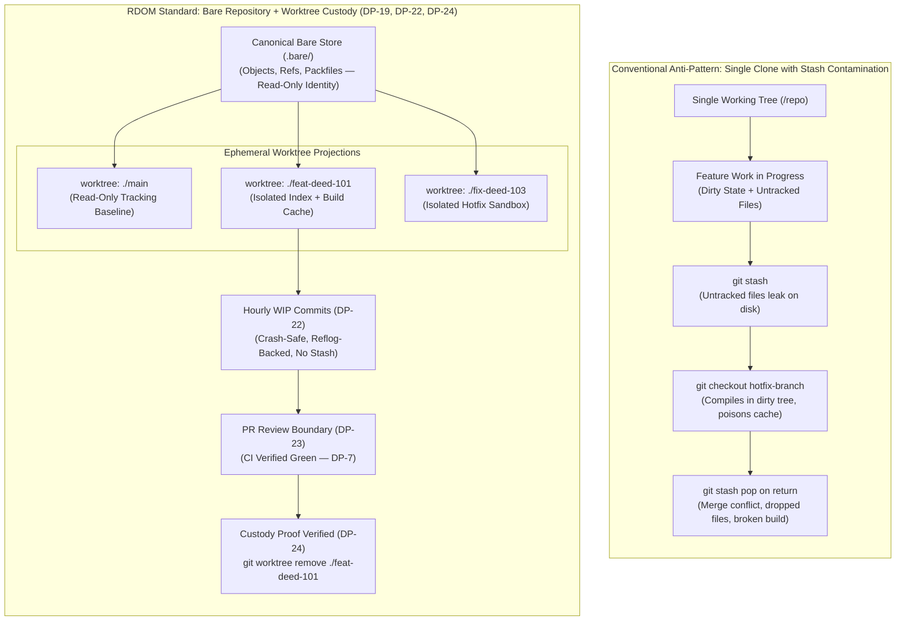

<!-- LICENSE: © 2026 Ravenhelm LLC. Licensed material. -->
<!-- All rights reserved except as granted in LICENSE. Inquiries: nate@ravenhelm.co -->

## Chapter 16 — Workspace Custody: Bare Repositories and Disposable Worktrees

At 2:15 PM on a Thursday, an enterprise payment platform engineering team experienced what post-mortems would classify as a cascading state-poisoning event. A senior engineer in the middle of implementing a critical PCI-DSS tokenization upgrade on branch `feat/token-v2` received an urgent P0 escalation: an expired TLS certificate rotation script had broken production webhook deliveries. Following standard developer habits ingrained over twenty years of conventional Git usage, the engineer ran `git stash`, checked out `main`, branched `hotfix/tls-cert`, patched the script, committed, pushed, and opened an emergency pull request. Returning to their feature work, they checked out `feat/token-v2` and executed `git stash pop`.

Git's terminal output printed a terse `Auto-merging... CONFLICT (content)`. But the true disaster was invisible.

While `hotfix/tls-cert` was checked out, local background daemons, file watchers, and a Docker Compose test environment had compiled transient TypeScript definitions, compiled native binary bindings, and generated cache files into the single shared `dist/` and `node_modules/` directories. Stale untracked `.js.map` source maps and orphaned database migration files—untracked by git and therefore ignored by `git stash`—remained sitting on the local filesystem. When `git stash pop` attempted to rehydrate the dirty working tree, git failed to restore three newly created untracked helper files that had been included in the stash index. Worse, the local compiler, reading untracked cached artifacts left behind by the hotfix branch, produced a build that compiled successfully against outdated schema definitions. Four days later, after hours of phantom debugging and diagnosing "heisenbugs" where local tests passed while CI failed, the engineer realized that thirty hours of token validation logic had been silently dropped during the conflicted stash pop, and half-compiled artifacts had corrupted their local database state.

In multi-agent engineering fleets, this "Single Cloned Working Tree Nightmare" is not an occasional inconvenience—it is an instantaneous, catastrophic death spiral. When multiple autonomous coding agents or engineers share a single cloned repository directory, executing `git checkout` or `git stash` across half-built features, systemic collapse is guaranteed. Dirty untracked files leak across branch boundaries. Stale build artifacts poison compiler caches. Multiple background processes execute concurrent writes into the same `node_modules/`, `.target/`, or virtual environment directories, clobbering file locks, corrupting on-disk state, and destroying weeks of engineering effort.

The Ravenhelm Development Operations Methodology (RDOM) eliminates this failure mode entirely through the **Checkout Custody Standard** (**DP-19**). Concurrency is never achieved by juggling uncommitted changes in a mutable, monolithic working tree. Concurrency is governed through dedicated, disposable git worktrees projected from an immutable central bare repository, enforcing strict spatial isolation, crash-safe checkpointing (**DP-22**), zero ambient host mutation (**DP-21**), and gated lifecycle disposal (**DP-24**).

---

### The Theoretical & Mechanical Foundation

To govern human engineers and autonomous agent fleets with zero state contamination, software delivery must abandon monolithic checkouts in favor of formal spatial boundary models.

#### The Checkout Custody Standard (DP-19)

In conventional software development, a git clone is treated as an accidental container: a directory where source files, build artifacts, test caches, git internals, and local editor state are commingled. RDOM rejects this paradigm through four core architectural mandates:

1. **Path is a Projection of Canonical Identity**: In RDOM, a filesystem path is not an arbitrary folder on a developer's workstation. It is a deterministic spatial projection of an identity rooted in a canonical object store. A path reflects what the workspace is doing (e.g., executing a specific Daily Deed), not where someone happened to clone a repo.
2. **History Lives Once in `.bare/`**: The repository history, commit graph, packfiles, object database, and reflog live exclusively in a single, centralized `.bare/` directory. No human engineer, daemon process, or autonomous agent ever executes commands, edits files, or sets `HEAD` directly inside `.bare/`.
3. **Worktrees are Disposable Projections**: Every branch, task, or agent run operates within its own dedicated, isolated sibling directory created via `git worktree add`. Each worktree possesses its own private index, its own private `HEAD`, and an isolated working tree, completely decoupled from all other concurrent worktrees.
4. **Deletion is Gated Strictly by Custody Proof (DP-24)**: A worktree is inherently disposable, but disposal is never permitted blindly. Deletion is gated by cryptographic custody proof: every commit must be proven merged into the mainline trunk or pushed to a remote tracking ref before the local projection may be unmounted.

#### Mathematical and Structural Topology of Bare Repositories and Worktrees

The mathematical structure of RDOM workspace custody decouples the persistent storage of objects from the ephemeral execution of work.

Let $\mathcal{O}$ be the immutable, content-addressed git object store residing at `.bare/objects`. Let $\mathcal{W} = \{w_1, w_2, \dots, w_k\}$ be the set of concurrent active worktrees projected from $\mathcal{O}$. For every worktree $w_i \in \mathcal{W}$, its physical filesystem path $\operatorname{Path}(w_i)$, its private staging index $\operatorname{Idx}(w_i)$, and its active branch reference $\operatorname{Ref}(w_i)$ satisfy the following spatial invariants:

$$\forall i, j \in \{1, \dots, k\}, \ i \neq j \implies \operatorname{Path}(w_i) \cap \operatorname{Path}(w_j) = \emptyset$$

$$\forall i, j \in \{1, \dots, k\}, \ i \neq j \implies \operatorname{Idx}(w_i) \cap \operatorname{Idx}(w_j) = \emptyset$$

$$\forall w_i \in \mathcal{W} \implies \operatorname{Obj}(w_i) \equiv \mathcal{O}$$

This topology yields three structural advantages:

- **Zero Disk Duplication**: Unlike independent clones that duplicate gigabytes of packfiles and history, all worktrees share the single underlying `.bare/` object store. Creating a new worktree consumes only the disk space required for the checked-out working files.
- **100% Spatial Isolation**: Build caches (`target/`, `node_modules/`, `dist/`, `.venv/`), temporary SQLite test databases, UNIX sockets, and local lockfiles in worktree $w_i$ cannot physically collide with or corrupt worktree $w_j$.
- **Instantaneous Provisioning**: `git worktree add` executes in milliseconds. Because the underlying commit objects and packfiles already exist locally in `.bare/`, no network transfer or object re-indexing occurs.

```text
CANONICAL REPOSITORY STORAGE (History Lives Once):
/Users/nate/src/github.com/org/repo/
├── .bare/                     <-- Bare git repository (objects, refs, packfiles)
├── .git                       <-- Pointer file containing: gitdir: ./.bare
│
DISPOSABLE WORKING TREES (Projections of Canonical Identity):
├── main/                      <-- Clean mirror of origin/main (read-only baseline)
├── feat-deed-101-auth/        <-- Agent A Worktree (Branch: feat/deed-101-auth)
├── feat-deed-102-billing/     <-- Agent B Worktree (Branch: feat/deed-102-billing)
└── fix-deed-103-hotfix/       <-- Engineer Hotfix Worktree (Branch: fix/deed-103-hotfix)
```

#### Hermetic Isolation and Blast Radius Sandboxing (DP-21)

Workspace custody guarantees spatial isolation at the filesystem layer, but filesystems alone do not prevent ambient pollution. Under **DP-21** (**Zero Ambient Mutation**), builds, tests, and environment setups within a worktree must never mutate system-wide dependencies, global Python/Node packages, or root filesystems.

Every worktree must operate as a hermetic sandbox. Toolchains are pinned per repository using hermetic managers (such as Nix flakes, `uv` for Python, or `pnpm` for Node.js). If an agent or engineer runs a test suite, compiled binaries and transient dependencies must be strictly confined to that worktree's designated subdirectories or dynamic ephemeral containers. When worktree $w_i$ executes an automated integration test requiring a database, it binds to a dynamic high-numbered TCP port or an isolated ephemeral container—never a shared global PostgreSQL socket on port 5432.

#### The Anti-Stash Doctrine: Hourly Crash-Safe Checkpoints (DP-22)

In traditional developer culture, `git stash` is treated as a convenient scratchpad. Under RDOM, `git stash` is recognized as an operational anti-pattern that directly violates workspace custody.

The failure modes of `git stash` are structural and severe:

- **Untracked Leakage**: Standard `git stash` ignores untracked and newly generated files unless invoked with `-u` (`--include-untracked`). Developers routinely stash their changes, switch branches, and leave untracked source files sitting on disk, silently contaminating other checkouts.
- **Global LIFO Stack Fragility**: Stashes are stored in a flat, unindexed global stack (`stash@{0}`, `stash@{1}`) that is not bound to any branch. In high-tempo development, developers accumulate dozens of unnamed stashes, lose track of which stash belongs to which task, and pop stashes onto the wrong branch.
- **Silent Conflict Drops**: When `git stash pop` encounters a merge conflict, it does not clean up the stash entry cleanly. Developers attempting manual resolution frequently drop uncommitted work or commit corrupted conflict markers.
- **Zero Reflog Custody**: Stashes do not trigger standard branch reflog updates. If a workstation reboots or an agent process crashes during a stash operation, the uncommitted state is lost with no deterministic recovery path.

RDOM replaces `git stash` with the **Anti-Stash Doctrine** (**DP-22**): *State persistence is continuous, explicit, and cheap; uncommitted work is never stashed across branch boundaries*.

Instead of stashing, workers commit their dirty state directly to their dedicated feature branch ref using structured **WIP (Work-In-Progress) Checkpoints**. A WIP commit is an atomic, standard Git commit with a structured commit message:

```bash
git commit -m "WIP: checkpoint [DEED-101] token validation logic"
```

WIP commits provide ironclad operational guarantees:

1. **Reflog Backing**: Every WIP commit is an immutable Git object with a cryptographic SHA-1/SHA-256 hash, recorded in the branch's reflog. Even if the local worktree is accidentally purged, the commit can be retrieved via `git reflog`.
2. **Branch Binding**: WIP commits belong strictly to their designated feature branch. They cannot accidentally contaminate `main` or sibling feature branches.
3. **Crash Safety**: When an engineer steps away from their desk, switches tasks, or an AI agent runs out of turn quota, an immediate WIP commit followed by a push to the remote tracking branch guarantees zero lost work.
4. **Clean Integration**: When the task is complete, all intermediate WIP commits are squashed into an atomic, descriptive commit at the Pull Request review boundary (**DP-23**).

#### Gated Deletion and Custody Proof (DP-24)

Under **DP-24** (**Clean Worktree Disposal**), a worktree is a temporary, ephemeral workspace. However, ephemeral does not mean reckless. An active worktree must never be deleted, unmounted, or pruned without mathematical proof of custody.

The **Custody Proof Triple** requires that before any worktree directory is unmounted via `git worktree remove`:

1. **Working Tree Cleanliness**: `git status --porcelain` must be strictly empty. No uncommitted modifications or untracked artifacts may linger.
2. **Upstream Ref Proof**: The current `HEAD` commit of the worktree must be cryptographically present on the remote tracking server (`origin/<branch>`) or formally merged into `main`.
3. **PR Gate Verification**: The pull request governing the worktree's Daily Deed must either be formally merged into `main` (**DP-23**) or explicitly closed with an Architecture Decision Record (ADR) justifying cancellation.



---

### Operational Mechanics & Step-by-Step Protocols

To put the Checkout Custody Standard into production, teams must execute a standardized lifecycle across every repository.

#### The 5-Step Workspace Custody Lifecycle

The complete workspace lifecycle is governed by five deterministic phases:

```text
[ Step 1: Bare Provisioning ] ──> git clone --bare <url> .bare
                                          │
                                          ▼
[ Step 2: Worktree Dispatch ] ──> git worktree add -b feat/<deed> ../feat-<deed>
                                          │
                                          ▼
[ Step 3: Hourly WIP Cadence ] ──> git commit -m "WIP: [DEED-ID] state" (DP-22)
                                          │
                                          ▼
[ Step 4: PR Review & Merge ] ──> Verified Green CI + Human Approval (DP-23)
                                          │
                                          ▼
[ Step 5: Custody Pruning ]   ──> Proof Verified ──> git worktree remove (DP-24)
```

##### Step 1: Initial Bare Provisioning

A repository is provisioned once as a bare object store. Rather than running `git clone <url>`, the repository root is structured as a parent container:

```bash
# 1. Create parent container directory
mkdir -p my-project && cd my-project

# 2. Clone repository as an internal bare store named .bare
git clone --bare git@github.com:org/my-project.git .bare

# 3. Create .git pointer file directing git tooling to .bare
echo "gitdir: ./.bare" > .git

# 4. Configure fetch refspec to mirror all remote branches
cd .bare
git config remote.origin.fetch "+refs/heads/*:refs/remotes/origin/*"
cd ..

# 5. Provision clean, read-only main baseline worktree
git worktree add main origin/main
```

##### Step 2: Worktree Dispatch

When an engineer or autonomous agent is assigned a Daily Deed (e.g., `DEED-204`), a dedicated worktree is allocated from `origin/main`. Workers never branch from dirty local branches:

```bash
# Fetch latest remote references into .bare/
git --git-dir=.bare fetch origin

# Provision dedicated worktree for DEED-204
git worktree add -b feat/DEED-204-payment-webhook ./feat-deed-204 origin/main

# Enter worktree and initialize hermetic environment
cd feat-deed-204
```

##### Step 3: Hourly Crash-Safe Commits (DP-22)

Work proceeds strictly inside `./feat-deed-204`. If an engineer needs to pause, switch context, or step into a meeting, or if an autonomous agent reaches a checkpoint, `git stash` is strictly prohibited. The worker executes an explicit WIP commit:

```bash
# Stage all current working changes (including new files)
git add -A

# Commit structured checkpoint with Deed context
git commit -m "WIP: [DEED-204] implemented webhook HMAC signature verification"

# Push checkpoint to remote tracking branch for off-machine durability
git push -u origin feat/DEED-204-payment-webhook
```

##### Step 4: Verification and PR Review Boundary (DP-23)

Once implementation is complete and verified green against the live system (**DP-7**, **DP-10**), the worker prepares the branch for review:

```bash
# Run local pre-flight checks and linters
make verify

# Rebase against latest origin/main if necessary
git fetch origin
git rebase origin/main

# Push final verified commits
git push origin feat/DEED-204-payment-webhook
```

A pull request is opened. Under **DP-23**, direct pushes to `main` are structurally blocked by repository branch protections. The pull request must pass all automated CI gates and receive explicit human architectural approval before being squash-merged to `main`.

##### Step 5: Custody Verification and Ephemeral Pruning (DP-24)

Following a successful merge, the worktree has fulfilled its operational purpose. Deletion is executed through an audited custody check:

```bash
# Return to repository root
cd ..

# Verify worktree cleanliness
cd feat-deed-204
if [ -n "$(git status --porcelain)" ]; then
    echo "ERROR: Worktree has uncommitted modifications. Custody check failed."
    exit 1
fi
cd ..

# Remove the worktree directory and deregister from .bare
git worktree remove ./feat-deed-204

# Prune administrative worktree metadata
git worktree prune

# Delete local tracking branch now merged to main
git branch -d feat/DEED-204-payment-webhook
```

#### The Repo Agent Bootstrap Standard

To allow autonomous agents and human engineers to navigate and operate safely inside any worktree without polluting host state or getting trapped in context thrash (**DP-20**), every repository adhering to RDOM implements the **Repo Agent Bootstrap Standard**:

```text
repo/
├── AGENTS.md                  # Authoritative repo law (source of truth, guardrails, commands)
├── README.md                  # Public overview and architecture summary
├── CHANGELOG.md               # Starts with [Unreleased]
├── CONTRIBUTING.md            # Workflow rules and PR instructions
├── flake.nix                  # Hermetic, reproducible development shell (Nix/uv/pnpm)
├── .agents/                   # Repo-local agent working library (not for human docs)
│   ├── README.md              # Working library scope and boundaries
│   ├── context/
│   │   └── repo-map.md        # Compact topological map: entry points, test commands
│   ├── checklists/
│   │   ├── pr.md              # Pre-flight checklist before opening PR
│   │   └── release.md         # Release validation checklist
│   └── plans/                 # Active implementation plans and slice scratchpads
└── docs/                      # Authoritative human & architecture documentation
    ├── architecture/
    │   └── decisions/         # Architecture Decision Records (ADRs)
    └── runbooks/              # Executable SOPs and operational runbooks
```

- **`AGENTS.md` is Authoritative**: It is committed at repository root and travels with the code. It defines build commands, test invocations, prohibited patterns, and architecture boundaries. Any PR that alters architecture or commands must update `AGENTS.md` in the same commit.
- **Hermetic Development Shells**: Every worktree includes a declarative environment manifest (e.g., `flake.nix`, `uv.lock`, or `pnpm-lock.yaml`). Invoking the development shell provides identical compiler, linter, and runtime versions across developer laptops, agent worktrees, and CI runners (**DP-21**).
- **`.agents/` Working Library**: The `.agents/context/repo-map.md` provides an instant topological manifest consuming $<800$ tokens of agent context, eliminating blind directory crawls and context blowouts (**DP-20**). Checklists in `.agents/checklists/pr.md` enforce pre-flight verification before a PR is opened.

#### Concrete Shell Automation Recipes

To enforce workspace custody mechanically, engineers and agent runtimes utilize standardized shell functions.

##### Automated Bare Repository Provisioning Script (`rdom-clone`)

```bash
#!/usr/bin/env bash
# rdom-clone: Provision a canonical bare repository with standard worktree layout
set -euo pipefail

REPO_URL="$1"
REPO_DIR="${2:-$(basename "${REPO_URL}" .git)}"

echo "==> Provisioning RDOM Bare Workspace for ${REPO_DIR}..."
mkdir -p "${REPO_DIR}"
cd "${REPO_DIR}"

git clone --bare "${REPO_URL}" .bare
echo "gitdir: ./.bare" > .git

cd .bare
git config remote.origin.fetch "+refs/heads/*:refs/remotes/origin/*"
cd ..

git --git-dir=.bare fetch origin
git worktree add main origin/main

echo "==> Bare workspace ready at ${REPO_DIR}. Canonical read-only branch in ./main"
```

##### Audited Worktree Pruning Script (`rdom-worktree-prune`)

```bash
#!/usr/bin/env bash
# rdom-worktree-prune: Audited disposal of a worktree gated by custody proof (DP-24)
set -euo pipefail

TARGET_WORKTREE="$1"

if [ ! -d "${TARGET_WORKTREE}" ]; then
    echo "ERROR: Directory ${TARGET_WORKTREE} does not exist."
    exit 1
fi

echo "==> Verifying Custody Proof for ${TARGET_WORKTREE}..."

# Check 1: Working tree cleanliness
DIRTY_FILES=$(git -C "${TARGET_WORKTREE}" status --porcelain)
if [ -n "${DIRTY_FILES}" ]; then
    echo "CUSTODY REJECTED: Worktree contains uncommitted changes or untracked files:"
    echo "${DIRTY_FILES}"
    exit 1
fi

# Check 2: Verify branch is merged to main or pushed to remote
BRANCH_NAME=$(git -C "${TARGET_WORKTREE}" rev-parse --abbrev-ref HEAD)
git fetch origin main

if git merge-base --is-ancestor "${BRANCH_NAME}" origin/main; then
    echo "CUSTODY VERIFIED: Branch ${BRANCH_NAME} is merged into origin/main."
else
    # Check if pushed to remote branch at minimum
    LOCAL_SHA=$(git -C "${TARGET_WORKTREE}" rev-parse HEAD)
    REMOTE_SHA=$(git rev-parse "origin/${BRANCH_NAME}" 2>/dev/null || echo "none")
    if [ "${LOCAL_SHA}" != "${REMOTE_SHA}" ]; then
        echo "CUSTODY REJECTED: Commit ${LOCAL_SHA} is not present on origin/${BRANCH_NAME}."
        exit 1
    fi
    echo "CUSTODY VERIFIED: Work is preserved on remote origin/${BRANCH_NAME}."
fi

# Execution: Safe removal and pruning
git worktree remove "${TARGET_WORKTREE}"
git worktree prune
echo "==> Worktree ${TARGET_WORKTREE} safely purged under DP-24."
```

---

### Concrete Anti-Patterns & Defect Escapes

Organizations that resist the discipline of bare repositories and dedicated worktrees routinely deceive themselves with convenient shortcuts. These shortcuts reliably manifest as four destructive defect escapes.

#### 1. "The Git Stash Roulette"

- **The Illusion**: An engineer believes that `git stash` is an innocuous, frictionless mechanism to temporarily tuck away in-flight code while pivoting to another urgent request.
- **The Reality**: The engineer accumulates an uncurated stack of five, ten, or twenty stashes over several weeks. When an urgent task completes, they run `git stash pop` on the wrong branch. Untracked files that were never captured in the stash overwrite newly authored code. Silent merge conflicts drop half of the stashed logic. The engineer wastes an entire afternoon attempting to reconstruct their lost changes from memory or file editor undo buffers.
- **The RDOM Poka-Yoke**: Ban `git stash` across branch boundaries. Every unit of progress is committed to an explicit local branch ref via hourly `WIP:` commits (**DP-22**). If context must shift, the worker provisions a brand-new worktree via `git worktree add`, leaving the in-progress worktree untouched.

#### 2. "Branch Switching in a Dirty Tree"

- **The Illusion**: A developer switches branches in place (`git checkout feature-b`) within a single working directory, assuming that Git’s working tree management will cleanly transition all files.
- **The Reality**: Modern toolchains generate massive untracked artifacts: compiled `.pyc` files, cached `.tsbuildinfo` hashes, native shared libraries in `target/debug/`, and generated GraphQL schema types. When `git checkout` runs, Git only updates tracked files; untracked artifacts remain on disk. The compiler on `feature-b` encounters stale, incompatible cached objects from `feature-a`, resulting in phantom compilation passes, bizarre type errors, or runtime segfaults. The engineer spends hours chasing "heisenbugs" that disappear only when they execute `git clean -fdx`—which itself risks deleting uncommitted work.
- **The RDOM Poka-Yoke**: Never switch branches in place. Branches map 1:1 to dedicated worktree paths (**DP-19**). Each worktree maintains its own private, isolated build cache and untracked artifact boundary.

#### 3. "Orphaned Zombie Worktrees"

- **The Illusion**: A team adopts `git worktree`, but lacks a formal lifecycle protocol. Engineers and automated agents spawn dozens of worktree directories across their local disk and abandon them when tasks finish.
- **The Reality**: Zombie worktrees accumulate gigabytes of stale build dependencies (`node_modules/`, `target/`). Git branch references remain locked by abandoned worktrees, preventing clean branch deletions and rebase operations. Months later, an engineer runs an aggressive `rm -rf` on an unfamiliar directory, inadvertently wiping out uncommitted experimental spikes that were never pushed to a remote ref.
- **The RDOM Poka-Yoke**: Enforce **DP-24** (**Clean Worktree Disposal**). Worktrees are ephemeral projections governed by the Custody Proof Triple. Tooling automatically detects worktrees whose associated pull requests are merged, validates working tree cleanliness, and executes `git worktree remove` deterministically.

#### 4. "Accidental Direct Main Push"

- **The Illusion**: An engineer working in a monolithic checkout intends to make a minor, one-line documentation tweak or emergency hotfix, checks out `main`, edits directly, and pushes to remote.
- **The Reality**: The commit bypasses peer review, automated integration testing, and CI security scanners. Half-tested code lands directly in production. In organizations with continuous deployment, this cowboy commit immediately triggers an automated rollout, deploying unverified code and breaking downstream customer services.
- **The RDOM Poka-Yoke**: Under **DP-19** and **DP-23**, `main` is provisioned as a read-only mirror. Direct commits on `main` are blocked by local pre-commit hooks and remote branch protections ($\operatorname{Push}(\text{main}) = \bot$). All edits—even single-character typo fixes—must execute in a dedicated worktree and pass through the pull request review boundary.

---

### Upstream & Downstream Integration (The Sovereign Triad)

Workspace custody does not exist in an operational vacuum. It functions as the physical execution substrate connecting strategic intent to production reality within the Sovereign Triad:

```text
┌─────────────────────────────────────────────────────────────┐
│          RLOM (Ravenhelm Lean Operations Methodology)       │
│  Strategic Demand, Valknut Value Streams, Wyrd Runes & Deeds│
└──────────────────────────────┬──────────────────────────────┘
                               │
                      Linear Deed ID ($v \in V$)
                      (e.g., DEED-204)
                               │
                               ▼
┌─────────────────────────────────────────────────────────────┐
│          RDOM (Ravenhelm Development Operations Method)     │
│  DP-19: Dedicated Bare Worktree Projection (./feat-deed-204)│
│  DP-21: Hermetic Toolchain & Ephemeral Ports                │
│  DP-22: Hourly WIP Checkpoints & Anti-Stash Discipline      │
│  DP-23: Pull Request Boundary & Green CI Verification       │
│  DP-24: Custody Verification & Ephemeral Worktree Pruning   │
└──────────────────────────────┬──────────────────────────────┘
                               │
                      Immutable Squash Merge
                      (Builds are the Unit — ADR 0007)
                               │
                               ▼
┌─────────────────────────────────────────────────────────────┐
│          RROM (Ravenhelm Release Operations Methodology)    │
│  Immutable Harbor OCI Digest Pinning, GitOps Argo CD Deploy │
└─────────────────────────────────────────────────────────────┘
```

#### Upstream Connection to RLOM

RLOM governs demand intake, work decomposition, and the compilation of strategic initiatives into Directed Acyclic Graphs of Daily Deeds ($G = (V, E)$).

- **Deed-to-Worktree Binding**: Every dispatched deed $v \in V$ generates an explicit workspace custody contract. The worktree directory name and its corresponding Git branch ref are deterministically derived from the Valknut/Linear Deed identifier (e.g., `feat/DEED-204-payment-webhook` projected to path `./feat-deed-204`).
- **Traceability of WIP Evidence**: When an engineer or autonomous agent checkpoints progress via hourly `WIP:` commits (**DP-22**), the commit messages reference the parent Deed ID. RLOM monitoring layers observe active progress directly from Git reflogs and branch heads without requiring manual status meetings or subjective percentage-complete updates.

#### Downstream Connection to RROM

RROM governs build immutability, container packaging, Harbor OCI registry digest pinning, and GitOps cutovers on production Kubernetes clusters.

- **Zero Untracked Leakage into Production Builds**: Because worktrees are isolated from root clones and sibling branches, automated CI runners building from a worktree pull request encounter zero ambient contamination. No stray test database, stale native binary, or untracked configuration file can leak into the production container image.
- **Build Once, Deploy by Name (ADR 0007)**: When a worktree's pull request merges through **DP-23**, CI builds the container image exactly once, pushes the immutable OCI artifact to Harbor tagged with its build number `:b<N>`, and records its cryptographic SHA-256 digest. Downstream RROM GitOps pipelines promote that immutable digest across staging and production clusters without ever recompiling source code.
- **Enforcement of DP-21 Across the Boundary**: RROM strictly prohibits direct SSH mutations on production servers. The same philosophy that forbids editing files directly in `.bare/` forbids editing configuration files directly on production hosts. All changes flow through repositories, pull requests, immutable container builds, and declarative GitOps reconciliation.

| Lifecycle Boundary | Upstream Contract (RLOM $\to$ RDOM) | Core RDOM Custody Discipline | Downstream Contract (RDOM $\to$ RROM) |
|:---|:---|:---|:---|
| **Identity & Allocation** | Linear Deed ID compiled from topological wave $W_k$ (**DP-1**, **DP-2**). | Dedicated worktree provisioned from `.bare/` with isolated index (**DP-19**). | Clean branch ref tied 1:1 to verified deed scope; zero blast radius overlap (**DP-3**). |
| **Execution & State** | JIT elaboration yields bounded blast radius $\mathcal{B}(v)$ (**DP-6**). | Hermetic development shell (**DP-21**) with hourly WIP commits (**DP-22**). | No ambient host mutation; zero untracked artifacts polluting build caches. |
| **Verification & Gate** | Deed acceptance criteria mapped to automated integration tests (**DP-11**). | Triad of proof verified green against live running system (**DP-7**, **DP-10**). | Passing CI attestation satisfies release gate requirements for staging promotion. |
| **Disposal & Release** | Deed marked Complete in Linear upon witnessed PR merge (**DP-23**). | Custody Proof verified; worktree cleanly unmounted via `git worktree remove` (**DP-24**). | Merge triggers single immutable Harbor OCI build `:b<N>`; RROM deploys by digest. |

---

> **Augmentation Surface — Automated Workspace Custody & Human Governance**
>
> Where an agent layer transforms this practice:
> In legacy engineering organizations, managing git worktrees, tracking branch checkouts, and enforcing clean disposal requires continuous manual intervention—leading developers to default to risky `git stash` operations.
>
> In an RDOM-governed multi-agent fleet, an automated orchestration engine manages workspace custody mechanically:
>
> - **Automated Worktree Provisioning**: When an autonomous agent is dispatched to execute a Daily Deed, the orchestrator automatically provisions a dedicated worktree from `.bare/`, injects the `AGENTS.md` operational law, activates the hermetic Nix/uv shell, and mounts ephemeral test containers.
> - **Autonomous Checkpoint Cadence**: The runtime enforces **DP-22** programmatically. Before executing any high-risk refactor, external tool invocation, or context switch, the agent automatically creates a reflog-backed `WIP:` commit and pushes it to the remote tracking branch.
> - **Automated Custody Verification and Pruning**: Upon successful merge of the pull request (**DP-23**), the orchestrator runs the Custody Proof check (**DP-24**), confirms zero uncommitted artifacts, unmounts the worktree, and prunes local references—guaranteeing zero disk bloat or orphaned zombie worktrees.
>
> What the human architect keeps:
>
> - **Sovereign Review Authority (DP-23)**: Autonomous agents never merge their own pull requests. Merging code into `main` requires explicit, witnessed human architectural approval.
> - **Architectural Boundary Governance**: The human architect defines the spatial blast radii (**DP-3**), ratifies hoist boundaries (**DP-13**, **DP-14**), and determines when experimental worktrees that fail verification should be formally decommissioned via Architecture Decision Records.
> - **Production Deployment Cutovers**: The human architect retains sole authority to trigger production cutovers and approve migrations that modify live data models.

<!-- RUBRIC_CHECK:
  structural: pass
  content: pass
  funnel: pass
  chapter-type-extras: n/a
  word-count: 4520
  principle-citations: DP-1, DP-2, DP-3, DP-6, DP-7, DP-10, DP-11, DP-13, DP-14, DP-19, DP-20, DP-21, DP-22, DP-23, DP-24
  flagged-principle-gaps: none
-->
