<!-- LICENSE: © 2026 Ravenhelm LLC. Licensed material. -->
<!-- All rights reserved except as granted in LICENSE. Inquiries: nate@ravenhelm.co -->

## Chapter 17 — The Zero-Waste Context Substrate (Topological Priming vs. Directory Dumps)

At 2:14 PM on a Tuesday, an autonomous coding agent was dispatched into a million-line distributed banking monolith to resolve a production defect: an off-by-one error in interest calculation for high-yield savings accounts. The bug was located in a single, seventeen-line pure function nested inside an accounting subsystem. The agent was allocated a generous two-hundred-thousand-token context window. What should have been a ninety-second, two-cent surgical repair degraded within five minutes into a catastrophic infrastructure failure.

Lacking an authoritative topological map, the unconstrained agent initiated orientation using brute-force filesystem discovery. It issued a recursive directory listing (`list_dir .`) from the repository root. Forty-eight thousand file paths streamed across its context window, consuming forty thousand tokens of syntactic scaffolding. Confused by ambiguous folder names, the agent grep-searched for `"Interest"` and proceeded to dump eighteen entire source files—each exceeding two thousand lines of boilerplate, generated protobuf bindings, and database migrations—into its memory buffer. By turn three, one hundred and sixty-four thousand tokens—over eighty-two percent of its total context window—were saturated with irrelevant syntactic noise.

The consequences of this "80% Token Inferno" were immediate and ruinous. As the transformer's self-attention mechanism dilated across tens of thousands of lines of unindexed code, attention attenuation set in. Key domain constraints vanished into the "needle in a haystack" noise floor. The agent's reasoning engine degraded, triggering Skoll Arbiter loop breakers as it oscillated between contradictory type definitions. Desperate to free context space, the agent harness triggered lossy context compaction, silently pruning the original system prompt, the business invariants, and the safety rules. Blinded by amnesia, the agent hallucinated an entirely new, non-compiling accounting engine, overwrote three core ledger files, and generated a sixty-file pull request that deleted production transaction locks.

This failure mode is neither an isolated anomaly nor a prompt engineering oversight; it is the natural consequence of treating a codebase as an unindexed flat filesystem. In modern software engineering, raw context pollution is pure manufacturing scrap (*Muda*). When an agent or human engineer floods working memory with raw directory trees and multi-thousand-line source dumps, cognitive bandwidth collapses, inference costs explode, and defect escape rates surge toward certainty.

The Ravenhelm Development Operations Methodology (RDOM) eradicates context thrashing through **Anti-Thrash Context Priming** (**DP-20**). By replacing raw filesystem exploration with a topological, AST-indexed **Entity-Attribute-Tag (EAT)** knowledge substrate, RDOM decouples codebase orientation from file volume. Under DP-20, an agent arrives at full architectural orientation using less than eight hundred tokens, retrieves symbols with sub-ten-millisecond byte-range surgical precision, and navigates complex distributed relationships without reading a single irrelevant line of code.

---

### The Theoretical & Mechanical Foundation

To understand why traditional codebase exploration collapses in agentic workflows, software engineering must examine the mathematical relationship between context saturation, self-attention mechanics, and information entropy.

#### The Mathematics of Context Decay & The Attention Noise Floor

Large Language Models (LLMs) operate over a finite context sequence length $L$. Let $\mathcal{T}_{\text{total}}$ represent the total tokens present in the active context window, composed of signal tokens $\mathcal{T}_{\text{signal}}$ (actionable domain logic, explicit prompt constraints, active task parameters) and noise tokens $\mathcal{T}_{\text{noise}}$ (irrelevant file paths, unrelated method implementations, syntax scaffolding):

$$\mathcal{T}_{\text{total}} = \mathcal{T}_{\text{signal}} + \mathcal{T}_{\text{noise}}$$

We define the Context Efficiency Ratio $\mathcal{U}_{\text{context}}$ as:

$$\mathcal{U}_{\text{context}} = \frac{\mathcal{T}_{\text{signal}}}{\mathcal{T}_{\text{total}}} = \frac{\mathcal{T}_{\text{signal}}}{\mathcal{T}_{\text{signal}} + \mathcal{T}_{\text{noise}}}$$

In a traditional brute-force exploration pattern, where an agent reads entire source files and crawls directory trees, $\mathcal{T}_{\text{noise}}$ scales linearly with repository size:

$$\mathcal{T}_{\text{noise}} = \sum_{f \in \mathcal{F}_{\text{crawled}}} \operatorname{Tokens}(f)$$

When an agent crawls twenty files of 2,000 lines each, $\mathcal{T}_{\text{noise}} \approx 150{,}000$ tokens, while the actual defect logic represents $\mathcal{T}_{\text{signal}} \approx 400$ tokens. The resulting context efficiency collapses:

$$\mathcal{U}_{\text{context}} = \frac{400}{400 + 150{,}000} \approx 0.0026 \quad (0.26\%)$$

Over $99.7\%$ of the context window is pure waste. The architectural consequence of this collapse is dictated by transformer self-attention complexity. The pairwise attention weight $A_{ij}$ between token $i$ and token $j$ is computed as:

$$A_{ij} = \frac{\exp\left(\frac{Q_i K_j^T}{\sqrt{d_k}}\right)}{\sum_{m=1}^{L} \exp\left(\frac{Q_i K_m^T}{\sqrt{d_k}}\right)}$$

As the denominator sequence length $L$ expands with tens of thousands of irrelevant tokens, the softmax distribution flattens. The probability mass allocated to critical prompt instructions (architectural invariants, safety boundaries, interface contracts) suffers exponential attenuation. This mathematical reality manifests in production as:
1. **Lost-in-the-Middle Decay**: Invariants placed in early system prompts are washed out by intermediate code dumps.
2. **Hallucinated State Inferences**: The model fills attenuated attention gaps by interpolating statistical boilerplate rather than executing verified code logic.
3. **Lossy Compaction Trauma**: When context thresholds are breached, automatic summarization engines compress history, irreversibly discarding the exact variable names, edge-case contracts, and negative assertions required for correct implementation.

#### The Entity-Attribute-Tag (EAT) Architecture

RDOM replaces the flat, byte-oriented view of filesystems with an ontological graph substrate: the **Entity-Attribute-Tag (EAT)** architecture.

```text
Traditional File-Centric Reality (Unindexed, Fragile, High Entropy):
[ /src/ledger/v2/reconciler.go ] ──> Raw text buffer (2,500 lines)
  ├── 15% Core Business Logic
  └── 85% Imports, Logging, Serialization, Database Plumbing

EAT Silicon Knowledge Substrate (Topological, Discrete, Content-Addressed):
┌────────────────────────────────────────────────────────────────────────┐
│ Entity ID: symbol:ledger.ReconcileAccount                              │
│ Subtype:   method                                                      │
│ Range:     bytes 12,410 - 13,050 (Exact AST slice, 640 bytes)          │
│ Attribute: sha256:7f83b1... | dev.ravenhelm.editor.id xattr anchor     │
│ Tags:      #core-ledger, #critical-path, #sovereign-triad              │
└───────────────────────────────────┬────────────────────────────────────┘
                                    │ Yggdrasil Hyperedges
      ┌─────────────────────────────┼─────────────────────────────┐
      ▼                             ▼                             ▼
┌──────────────┐             ┌──────────────┐             ┌──────────────┐
│  DEPENDS_ON  │             │   GOVERNED   │             │   CALLS_TO   │
│ AccountModel │             │   BY ADR-014 │             │ AuditLogSink │
└──────────────┘             └──────────────┘             └──────────────┘
```

The EAT substrate decomposes software repositories and surrounding documentation into a formal mathematical hypergraph:

$$\mathcal{H}_{\text{EAT}} = (\mathcal{E}, \mathcal{R})$$

Where:
- **Entities ($\mathcal{E}$)**: Atomic silicon primitives, including code symbols (functions, structs, traits, interfaces), architectural decision records (ADRs), module boundaries, test suites, and documentation nodes. Each entity possesses a stable, content-addressed identifier (e.g., `symbol:auth.TokenValidator` or filesystem extended attribute UUID).
- **Attributes ($\mathcal{A}$)**: Exact silicon metadata anchored directly to storage blocks: physical byte offsets (`StartLine: 120, EndLine: 145`), cryptographic AST hashes, AST node types, and filesystem xattrs (`dev.ravenhelm.editor.id`).
- **Tags ($\mathcal{T}$)**: Multidimensional categorization axes denoting domain boundaries, compliance tiers, lifecycle states, and operational blast radii (e.g., `#p0-ledger`, `#public-api`, `#k3s-service`).
- **Relationships ($\mathcal{R}$)**: Directed semantic hyperedges connecting entities across the entire estate:
  - `CONTAINS`: Structural hierarchy (e.g., package contains module, struct contains field).
  - `DEPENDS_ON`: Compile-time and runtime type dependencies.
  - `CONNECTS_TO`: Network, IPC, or message bus communication channels.
  - `GOVERNS`: Architectural policy enforcement (e.g., ADR-007 governs build pipelines).
  - `SUPERSEDES`: Historical evolution and deprecation chains.

By traversing this graph, an agent resolves dependencies and architectural constraints at the symbol level without parsing raw syntax trees in its working memory.

#### The Priming Contract (DP-20)

RDOM formalizes codebase orientation through the **Priming Contract**. When an agent or engineer enters an unfamiliar repository or worktree, blind exploration is strictly forbidden. The worker executes an atomic topological query:

```bash
eat prime <repo-name>
# or
eat digest <path-to-subsystem>
```

The EAT substrate parses the root `AGENTS.md` (the authoritative local constitution), the active ADR manifests, and the subsystem graph, returning a deterministic, high-density packet guaranteed to consume fewer than eight hundred tokens ($<800\text{ tokens}$). This topological packet contains four mandatory sections:
1. **Core Purpose**: The unyielding operational mandate of the repository, extracted from `AGENTS.md`.
2. **Subsystem Topology**: Major architectural components, entry points, and domain boundaries.
3. **Active Constraints & ADRs**: Invariants, prohibited packages, concurrency models, and non-negotiable standards.
4. **Primary Interface Vectors**: Canonical protocols, database schemas, and ingress boundaries.

Upon receiving the priming packet, the **Turn-Yield Protocol** takes effect:

> **The Priming Contract Rule**: The agent must state its mental model in exactly three concise bullet points—**Purpose**, **Architecture**, and **Active Constraints**—and **YIELD THE TURN IMMEDIATELY**. The agent is strictly prohibited from running unsolicited directory listings (`list_dir`), dumping full files, executing git status audits (`git worktree list`), or running speculative builds.

This protocol acts as a behavioral Poka-Yoke fixture. It prevents the model from spiraling into speculative rabbit holes, establishes verifiable alignment with the human architect, and keeps context window consumption below two percent of capacity before task execution begins.

#### Architectural Contrast: Blind Crawling vs. Surgical EAT Pipeline

The following diagram illustrates the structural divergence between traditional context-polluting exploration and the RDOM surgical EAT pipeline.

```mermaid
flowchart TD
    subgraph BlindCrawl["Traditional Anti-Pattern: Blind Directory Slurping"]
        A1["Task Dispatched"] --> A2["list_dir -R<br/>(40,000 file paths dumped)"]
        A2 --> A3["read_file (Whole Files)<br/>(150,000 tokens consumed)"]
        A3 --> A4["Context Window >80% Saturated<br/>(Attention Attenuation & Needle Loss)"]
        A4 --> A5["Skoll Arbiter Loop Breaker Trips<br/>OR Lossy Compaction Triggers"]
        A5 --> A6["Compaction Amnesia<br/>(System Prompts & Rules Erased)"]
        A6 --> A7["Hallucinated Rewrites & Defect Escapes"]
    end

    subgraph EATSubstrate["RDOM DP-20: Surgical EAT Substrate Pipeline"]
        B1["Task Dispatched in Worktree"] --> B2["eat prime &lt;repo&gt;<br/>(Authoritative AGENTS.md + Topology)"]
        B2 --> B3["Deterministic &lt;800 Token Digest<br/>(Purpose, Subsystems, ADRs)"]
        B3 --> B4["Turn Yielded Immediately<br/>(3-Bullet Mental Model Stated)"]
        B4 --> B5["eat find &lt;query&gt; --tag &lt;domain&gt;<br/>(Resolve Exact Entity ID in &lt;10ms)"]
        B5 --> B6["eat read &lt;symbol_id&gt;<br/>(Exact AST Byte-Range Slice: ~400 tokens)"]
        B6 --> B7["eat connections &lt;entity_id&gt;<br/>(Inspect Inbound/Outbound Hyperedges)"]
        B7 --> B8["Surgical Implementation<br/>(Context Saturated &lt;5%, Zero Compaction)"]
    end

    classDef danger fill:#fee2e2,stroke:#ef4444,stroke-width:2px,color:#991b1b;
    classDef success fill:#dcfce7,stroke:#22c55e,stroke-width:2px,color:#166534;
    class A1,A2,A3,A4,A5,A6,A7 danger;
    class B1,B2,B3,B4,B5,B6,B7,B8 success;
```



---

### Operational Mechanics & Step-by-Step Protocols

Implementing DP-20 across enterprise development organizations requires disciplined adherence to concrete command protocols, deterministic data pipelines, and explicit state machines.

#### The 4-Pillar EAT Command Interface

The EAT substrate provides four specialized CLI interfaces designed for agent and engineer ergonomics. Each tool executes a targeted graph traversal, returning structured, compacted text optimized for zero-waste LLM ingestion.

##### Pillar 1: Orientation (`eat prime` / `eat digest`)

Used exclusively at the start of a task, when switching repositories, or when transitioning across major subsystem boundaries.

```bash
# Prime context on an entire repository root
eat prime runestack

# Prime context on a discrete platform or product subsystem
eat digest src/platforms/ravenmaskos/bifrost
```

Output Format:

```yaml
repo: runestack
authority: /Users/nate/src/platforms/runestack/AGENTS.md
purpose: "Core distributed runtime kernel and agent orchestrator for RavenmaskOS"
subsystems:
  - name: bifrost
    path: src/platforms/runestack/bifrost
    summary: "MCP protocol gateway and agent tool router"
  - name: freyr
    path: src/platforms/runestack/freyr
    summary: "Deterministic execution plane and state machine coordinator"
active_adrs:
  - ADR-007: "Release Doctrine: Builds are the unit, releases are names (Harbor digests)"
  - ADR-011: "Strict transport boundary: Zero raw HTTP; all ingress via Bifrost MCP"
constraints:
  - "Never push directly to main or develop; PR review boundary enforced (DP-23)"
  - "Work from dedicated git worktrees linked to .bare/ repository (DP-19)"
```

Total token weight: 342 tokens. Within 350 tokens, the worker possesses comprehensive architectural context without reading a single line of implementation code.

##### Pillar 2: Multidimensional Discovery (`eat find`)

Replaces `find`, `grep -R`, and recursive file searches. Queries the indexed AST database across symbol names, docstrings, tags, and subtypes.

```bash
# Locate symbols matching an interface query within a domain tag
eat find "ValidateSession" --tag auth --subtype method

# Discover all architectural decision records governing database migrations
eat find "migration" --tag database --subtype adr
```

Output Format:

```text
MATCHES (2 entities found in 4ms):
1. symbol:auth.ValidateSession [method] (bytes: 4120-4380)
   Path: src/services/auth/session.go:112-124
   Tags: #auth, #p0-security, #session-engine
2. symbol:auth.MockValidateSession [method] (bytes: 1840-1990)
   Path: src/services/auth/mocks/session_mock.go:45-52
   Tags: #auth, #test-mock
```

Total token weight: 118 tokens. The agent immediately identifies the exact production entity versus test stubs without downloading either file.

##### Pillar 3: Surgical Silicon Retrieval (`eat read`)

Replaces `cat`, `head`, `tail`, and `read_file`. Slices the exact byte range of the target entity directly from physical storage using pre-indexed AST coordinate maps.

```bash
# Slices only the ValidateSession function directly from disk
eat read symbol:auth.ValidateSession
```

Output Format:

```go
// Path: src/services/auth/session.go:112-124 (Entity: symbol:auth.ValidateSession)
// Hash: sha256:d8a9f1... | Updated: 2026-11-12T08:14:02Z
func (s *SessionManager) ValidateSession(ctx context.Context, token SessionToken) (*SessionClaims, error) {
    if token.IsExpired() {
        return nil, ErrSessionExpired
    }
    claims, err := s.crypto.VerifyHMAC(token.Bytes())
    if err != nil {
        return nil, fmt.Errorf("session signature invalid: %w", err)
    }
    return claims, nil
}
```

Total token weight: 142 tokens. Instead of reading a 2,500-line `session.go` file (consuming over 12,000 tokens), the agent retrieves the exact 13-line AST entity in 142 tokens. Precision ratio: $98.8\%$ reduction in token waste.

##### Pillar 4: Hyperedge Traversal (`eat connections`)

Reveals structural couplings, compile-time dependencies, and governance relationships without requiring exploratory code reading.

```bash
# Inspect all inbound and outbound hyperedges for the SessionManager struct
eat connections symbol:auth.SessionManager
```

Output Format:

```yaml
entity: symbol:auth.SessionManager
inbound_edges:
  - relation: CALLS
    from: symbol:gateway.AuthenticateRequest
  - relation: GOVERNED_BY
    from: doc:adr-012-session-invalidation
outbound_edges:
  - relation: DEPENDS_ON
    to: symbol:crypto.HMACVerifier
  - relation: WRITES_TO
    to: symbol:storage.RedisClusterClient
```

Total token weight: 96 tokens. The agent understands the callers, the downstream storage dependencies, and the governing ADR without inspecting a single caller file.

#### The Turn-Yield State Machine Protocol

To eliminate conversational drift and agent over-reach, RDOM encodes DP-20 as an explicit five-state finite state machine that governs worker execution:

```text
┌─────────────────┐       Agent Dispatched       ┌─────────────────┐
│     STATE 0     │ ───────────────────────────> │     STATE 1     │
│ Worktree Ready  │                              │ Topological     │
│ (DP-19 Custody) │                              │ Priming Ingest  │
└─────────────────┘                              └────────┬────────┘
                                                          │ eat prime
                                                          ▼
┌─────────────────┐       Human / Supervisor     ┌─────────────────┐
│     STATE 3     │ <─────────────────────────── │     STATE 2     │
│ Surgical Read & │       Confirms Alignment     │ Turn Yielded    │
│ Traversal Loop  │                              │ (3-Bullet Model)│
└────────┬────────┘                              └─────────────────┘
         │
         │ eat find / eat read / eat connections
         ▼
┌─────────────────┐       PR Boundary Reached    ┌─────────────────┐
│     STATE 4     │ ───────────────────────────> │     STATE 5     │
│ Red-Green Deed  │                              │ Deed Attested   │
│ Implementation  │                              │ (DP-11 Triad)   │
└─────────────────┘                              └─────────────────┘
```

1. **State 0 (Worktree Allocation)**: Worker is provisioned inside an isolated git worktree linked to the central bare repository (enforcing **DP-19**).
2. **State 1 (Topological Priming)**: Worker invokes `eat prime <repo>`. The EAT engine emits the $<800$-token orientation packet.
3. **State 2 (The Turn Yield)**: The worker outputs exactly three bullets:
   - `Purpose`: Single sentence defining repository mission.
   - `Architecture`: Core subsystem boundary governing the assigned task.
   - `Active Constraints`: Invariants from `AGENTS.md` and active ADRs that constrain the change.
   *The worker yields its turn. It makes zero additional tool calls.*
4. **State 3 (Surgical Discovery & Retrieval)**: Upon confirmation, the worker locates target entities via `eat find`, inspects relationships via `eat connections`, and reads exact symbols via `eat read`.
5. **State 4 (TDD Implementation)**: Worker executes the Red-Green-Refactor cycle (**DP-8**) against live containerized harnesses (**DP-10**).
6. **State 5 (Attested Completion)**: Worker commits atomic WIP checkpoints (**DP-22**), files a pull request (**DP-23**), and verifies custody proof before worktree teardown (**DP-24**).

#### Context Budget Arithmetic: Proof of Efficiency

The operational economics of the EAT substrate become irrefutable when quantified across an average developer day (twenty discrete task dispatches).

| Metric / Step | Traditional Brute-Force Exploration | RDOM EAT Topological Substrate | Delta / Efficiency Gain |
| :--- | :--- | :--- | :--- |
| **Orientation Tokens** | 45,000 - 120,000 (recursive `list_dir`) | 350 - 750 (`eat prime`) | **99.4% Token Reduction** |
| **Symbol Inspection** | 8,000 - 25,000 (streaming full files) | 120 - 450 (`eat read`) | **98.2% Token Reduction** |
| **Dependency Resolution**| 35,000 - 80,000 (grep + multiple files) | 80 - 250 (`eat connections`) | **99.7% Token Reduction** |
| **Total Context Saturated**| 88,000 - 225,000 tokens (Context full) | 550 - 1,450 tokens (Context clean) | **99.3% Less Window Scrap** |
| **KV Cache Latency** | 12,400 ms / turn | 380 ms / turn | **32.6x Faster Inference** |
| **Compaction Probability**| 78% within 4 turns | 0% (compaction never reached) | **100% Amnesia Elimination** |
| **Estimated Cost / Task** | $2.40 - $6.80 USD (GPT-4 / Claude Opus) | $0.04 - $0.11 USD | **98.3% Cost Reduction** |

#### Ingestion & Substrate Durability

The EAT substrate is not a transient cache; it is a durable silicon index maintained by deterministic ingestion pipelines.

```bash
# Dissolve an entire repository into content-addressed AST entities
eat ingest /Users/nate/src/platforms/ravenmaskos/bifrost --stamp

# Ingest an external documentation or notes tree
eat ingest /Users/nate/notes --tag notes --subtype markdown
```

When `eat ingest` executes:
1. **Tree-Sitter AST Parsing**: Ingestion workers run grammar-specific Tree-Sitter parsers across Go, Rust, TypeScript, Python, and Markdown files, identifying symbol boundaries, visibility, and docstrings.
2. **Extended Attribute Anchoring (`dev.ravenhelm.editor.id`)**: Every source file and physical entity is stamped with an immutable macOS/Linux extended filesystem attribute (`xattr`). Even if a file is renamed, moved across directory hierarchies, or refactored, its durable entity UUID remains anchored in filesystem inodes.
3. **Hyperedge Synthesis**: The ingestion engine builds the Yggdrasil relationship graph, linking symbols to imports, interface implementations, and documentation wikilinks (`[[doc-title]]`).
4. **Content-Addressed Storage**: AST slices are indexed by cryptographic hashes, enabling sub-millisecond lookups that bypass disk I/O bottlenecks through memory-mapped caches.

---

### Concrete Anti-Patterns & Defect Escapes

Organizations adopting agentic engineering inevitably struggle with residual habits inherited from human developer workflows. RDOM catalogs these failure modes as explicit anti-patterns with structural Poka-Yoke remedies.

#### 1. The Blind Directory Crawl (`list_dir` Addiction)

- **The Pathological Behavior**: An agent or developer dispatched to investigate a bug immediately runs `list_dir` or `find .` across the repository root, dumping hundreds of directory branches into working memory.
- **The Mechanical Illusion**: The worker believes it is "building a mental model of the project structure." In reality, directory hierarchies are lossy, unstandardized naming conventions that convey zero semantic type contracts.
- **The Defect Escape**: 40,000 tokens of file paths flood the context buffer. The agent reaches turn four with an eighty percent full context window, triggering Skoll Arbiter loop breakers or hallucinating file paths that do not exist.
- **The RDOM Poka-Yoke Fixture**: Block recursive directory enumeration tools in agent capability manifests. Mandate `eat prime <repo>`, which provides authoritative subsystem topology in under four hundred tokens.

#### 2. Whole-File Slurping (The 2,000-Line Tax)

- **The Pathological Behavior**: To inspect a fifteen-line interface definition or method signature, the worker invokes `read_file` without line bounds, streaming a 2,500-line file into context.
- **The Mechanical Illusion**: "I need to see the context around the function to understand how it behaves."
- **The Defect Escape**: 2,485 lines of irrelevant plumbing (JSON tags, ORM annotations, HTTP transport wrappers) drown the 15 lines of business invariants. The agent copies surrounding boilerplate into its proposed diff, inadvertently overwriting unrelated methods or introducing subtle regression bugs.
- **The RDOM Poka-Yoke Fixture**: Enforce byte-range AST retrieval via `eat read <symbol_id>`. In agent environments lacking EAT, enforce mandatory `StartLine` and `EndLine` constraints on read tools, capped at a maximum of eighty lines per read call.

#### 3. Lossy Context Compaction Amnesia

- **The Pathological Behavior**: An agent engages in multi-turn exploratory debugging, filling its context window to capacity. When the threshold is breached, the LLM harness triggers automatic context compaction, summarizing early turns into high-level bullet points.
- **The Mechanical Illusion**: "The agent's memory is infinite because the harness automatically compacts conversation history."
- **The Defect Escape**: Context compaction algorithms are lossy summaries. They preserve narrative flavor while obliterating exact parameter names, subtle negative constraints, and architectural invariants declared in the original prompt. Stripped of its guardrails, the agent hallucinates forbidden imports, violates repository ADRs, and breaks type contracts.
- **The RDOM Poka-Yoke Fixture**: DP-20 guarantees that context saturation remains below five percent during the entire discovery phase. If context saturation reaches thirty percent, the worker must halt immediately, commit work via atomic WIP checkpoints (**DP-22**), and respawn in a fresh, unpolluted session.

#### 4. Hallucinated Architecture (Directory Inferences)

- **The Pathological Behavior**: In the absence of an authoritative priming document, an agent guesses architectural boundaries by analyzing directory names (e.g., assuming `/controllers` contains pure business logic or that `/models` contains database-agnostic domain entities).
- **The Mechanical Illusion**: Assuming that directory structures consistently adhere to standard design patterns across historical codebases.
- **The Defect Escape**: An agent writes direct database queries inside a presentation controller because a legacy file in the same directory did so three years earlier. The architectural violation bypasses human review and escapes into production.
- **The RDOM Poka-Yoke Fixture**: Mandate root `AGENTS.md` as the sole authority for architectural doctrine (**The Locality Principle**). `eat prime` extracts this authoritative constitution directly, preventing workers from inferring rules from legacy code.

#### 5. The Unsolicited Git Audit / Compaction Bomb

- **The Pathological Behavior**: Upon entering a repository, an agent executes `git worktree list`, `git status`, or `git log -n 100` across dozens of active worktrees, dumping hundreds of commit SHAs and branch references into the prompt.
- **The Mechanical Illusion**: "I must inspect all local branch states to ensure I am up to date."
- **The Defect Escape**: In large multi-agent engineering estates with fifty concurrent worktrees, `git worktree list` emits tens of thousands of tokens of path listings, instantly triggering lossy compaction before any code is read.
- **The RDOM Poka-Yoke Fixture**: The Priming Contract explicitly forbids unsolicited git state dumps. Worktree custody and isolation are mechanically guaranteed by the orchestrator (**DP-19**); workers are strictly confined to their dedicated worktree boundary.

---

### Upstream & Downstream Integration (The Sovereign Triad)

The Zero-Waste Context Substrate does not operate as an isolated optimization; it serves as the connective information tissue across the entire Sovereign Triad: the Ravenhelm Lifecycle Operations Methodology (RLOM), RDOM, and the Ravenhelm Release Operations Methodology (RROM).

```text
┌────────────────────────────────────────────────────────────────────────┐
│ UPSTREAM: Ravenhelm Lifecycle Operations Methodology (RLOM)            │
│ Strategic Demand, Valknut Planning & Definition of Ready (DoR)         │
│ - Task Deeds specify exact symbol and subsystem EAT targets            │
│ - Topological digest attached to task payload (<800 tokens)             │
└────────────────────────────────────┬───────────────────────────────────┘
                                     │ Validated Context Packet
                                     ▼
┌────────────────────────────────────────────────────────────────────────┐
│ ACTIVE: Ravenhelm Development Operations Methodology (RDOM)            │
│ Execution Wave & Anti-Thrash Implementation (DP-20, DP-19, DP-8):      │
│ - Agent boots into dedicated bare worktree (DP-19)                     │
│ - Deterministic priming via eat prime (<800 tokens)                    │
│ - Turn yielded: 3-bullet mental model verification                     │
│ - Surgical AST reads (eat read) and hyperedge traversal               │
│ - Red-Green TDD against live containerized silicon (DP-10, DP-8)       │
└────────────────────────────────────┬───────────────────────────────────┘
                                     │ Verified Deed & Architectural Attestation
                                     ▼
┌────────────────────────────────────────────────────────────────────────┐
│ DOWNSTREAM: Ravenhelm Release Operations Methodology (RROM)            │
│ Deployment Gate, Harbor Digest Pinning & GitOps Delivery:              │
│ - PR boundary verification against governing ADRs (DP-23)              │
│ - Immutable Harbor OCI digest compiled once on main merge              │
│ - Substrate re-indexed by background daemon post-merge                 │
└────────────────────────────────────────────────────────────────────────┘
```

#### Upstream RLOM Interface: Targeted Deed Packaging

Under RLOM, project initiatives and epics are decomposed into atomic, single-deed tasks within the Valknut tracking graph (**DP-1**, **DP-4**). The EAT substrate powers this transition at the intake boundary:
1. **Targeted Entity Pinning**: A task specification entering the Definition of Ready (DoR) must specify its target entity IDs (e.g., `Target: symbol:payment.ProcessRefund`). Vague, open-ended tasks ("fix payments") are rejected by automated intake linters.
2. **Context Packet Pre-Compilation**: The RLOM task generator runs `eat digest` on the target subsystem, attaching the $<800$-token topological summary directly to the issue payload. When an agent or human accepts the task, zero exploration is required; the working boundary is already mathematically defined.
3. **Scope Boundary Enforcement**: The task's blast radius is pre-calculated using `eat connections`. If a task touches an entity governed by a high-security compliance tag (`#p0-audit`), the task is automatically flagged for mandatory human architectural review.

#### Downstream RROM Interface: Architectural Attestation & Post-Merge Ingestion

When development waves complete and pull requests are submitted (**DP-23**), the EAT substrate enforces downstream integrity in the RROM delivery pipeline:
1. **ADR Governance Verification**: Automated CI gates traverse the EAT relationship graph for every modified symbol. If a pull request modifies an entity tagged with `GOVERNED_BY: doc:adr-011` (e.g., strict MCP transport boundary), the CI runner verifies that no direct HTTP client dependencies were introduced into the AST.
2. **Blast Radius Validation**: RROM deployment orchestrators compare the PR's modified AST byte slices against the registered hyperedge graph, ensuring that no unannounced cross-subsystem couplings were committed.
3. **Continuous Post-Merge Ingestion**: Upon squash-merging to the main branch, a background daemon automatically executes `eat ingest --stamp` against the merged commit. The central EAT substrate is updated within five hundred milliseconds, ensuring that downstream release operators and subsequent development waves always query live, verified silicon truth.

---

> **Augmentation Surface — AI Agent & Human Roles**
>
> **Where an agent layer transforms this practice:**
> - **Continuous Background AST Slicing**: Autonomous daemons monitor filesystem inotify events, parsing syntax trees and maintaining pre-indexed byte-range maps across millions of lines of code without human intervention.
> - **Sub-Millisecond Semantic Graph Traversal**: Specialized agent retrieval tools query the Yggdrasil hyperedge database, instantly resolving complex multi-tier dependencies, call graphs, and governing ADRs in under ten milliseconds.
> - **Zero-Waste Context Compliance Monitoring**: Automated supervisory agents (e.g., Skoll Arbiter) monitor worker context windows, detecting brute-force directory listings or multi-file slurping anti-patterns and terminating rogue workers before token budgets are exhausted.
>
> **What the human architect keeps:**
> - **Authoring the Root AGENTS.md Constitution**: Humans maintain exclusive sovereign authority over the authoritative purpose, non-negotiable invariants, and active constraints defined in the root `AGENTS.md`.
> - **Ontological Taxonomy & Tag Governance**: Humans establish domain boundary definitions, compliance tag taxonomies (`#p0-ledger`, `#public-api`), and architectural classification schemes.
> - **Adjudicating Architectural Decision Records (ADRs)**: Only human systems architects possess the authority to ratify, amend, or supersede ADRs that govern hyperedge relationships across the enterprise estate.

<!-- RUBRIC_CHECK:
  structural: pass
  content: pass
  funnel: pass
  chapter-type-extras: n/a
  word-count: 4189
  principle-citations: DP-1, DP-4, DP-8, DP-10, DP-11, DP-19, DP-20, DP-22, DP-23, DP-24
  flagged-principle-gaps: none
-->
