<!-- LICENSE: © 2026 Ravenhelm LLC. Licensed material. -->
<!-- All rights reserved except as granted in LICENSE. Inquiries: nate@ravenhelm.co -->

## Chapter 17 - The Zero-Waste Context Substrate (Topological Priming vs. Directory Dumps)

Three turns into a routine bug investigation, the coding session was already brain-dead. Dispatched to fix a seventeen-line boundary check inside a core service, the agent opened by running a recursive `list_dir` across the repository root, followed by an unsolicited `git worktree list` on a repository (`freyr`) carrying over twenty sibling worktrees, and then dumped six entire source files (`read_file` without line bounds) into its prompt window. Within three turns, **78% of its 200,000-token context budget was gone**.

Watch what happened next on the bench:

1. **The Skoll Arbiter Loop Breaker Tripped**: Saturated with 156,000 tokens of unindexed file paths, protobuf boilerplate, and stale worktree listings, the model's attention distribution flattened across the middle of the window. It forgot which worktree it was standing in, re-read the same 2,400-line file twice, and tripped the Skoll Arbiter loop breaker.
2. **Lossy Compaction Erased the Law**: Before the session halted, the harness crossed its auto-compaction threshold and summarized the first three turns. That lossy compaction preserved the conversational narrative ("investigating session validation") while silently erasing the concrete architectural constraints from `AGENTS.md` (no raw HTTP outside `Bifrost`, no `git stash`, strict merge-base diffs). Stripped of its guardrails mid-task, the compacted agent began hallucinating forbidden imports and rewriting working modules from memory.
3. **Cache-Read Quota Drain Across the Fleet**: Multiplied across a concurrent fleet where Fable sits on the `Doomcourt` supervisor seat and multiple Sonnet worker slices execute in parallel (`anthropic-quota-drain-is-fable-and-fleet-cache-reads.md`), carrying a 150,000-token bloated context window across forty tool turns replays 6,000,000 cached input tokens per task. Context bloat does not just make an agent stupid; it drains API rate-limit quotas across the entire estate.

Treating a codebase as an unindexed flat directory tree that every new session must crawl with `list_dir` and slurp with `read_file` is pure manufacturing scrap (*Muda*). A human engineer who opens every file in a repository before fixing one function gets fired; an autonomous agent will do it on every single ticket unless the substrate physically replaces directory crawling with surgical retrieval.

The Ravenhelm Development Operations Methodology (RDOM) eliminates context thrashing through **Anti-Thrash Context Priming** (**DP-20**), powered by the **Entity-Attribute-Tag (EAT)** silicon knowledge substrate. Instead of crawling directories or dumping whole files, an agent primes on any repository via `eat prime <repo>` or `eat digest <repo>` to receive a deterministic, **$<800$-token topological manifest**, yields its turn immediately after stating a 3-bullet mental model, retrieves exact AST byte-range slices from disk in **$<10\text{ ms}$** via `eat read <entity_id>`, and traverses cross-estate Yggdrasil hyperedges (`CONTAINS`, `DEPENDS_ON`, `CONNECTS_TO`, `GOVERNS`, `SUPERSEDES`) via `eat connections <entity_id>`. Context consumption stays below 5%. Compaction never fires.

---

### The Corpse of v1: Whole-File Slurping & The `git worktree list` Bomb

Before we built the **Entity-Attribute-Tag (EAT)** substrate, we gave agents standard filesystem tools (`list_dir`, `find_by_name`, `grep_search`, `read_file`) and wrote polite instructions in the system prompt asking them to "be selective when reading files."

Polite instructions failed completely against three physical realities of LLM tool loops:

1. **The Orientation Blindfold**: When an agent lands in an unfamiliar repository without a pre-computed topological digest, it does not know which file holds the entrypoint or which ADR governs the subsystem. To reduce uncertainty, it issues broad `list_dir` and `grep` calls. One broad call returns 400 matches; the agent reads five 2,000-line files to disambiguate them, and 78% of the context window is burned before a single test runs.
2. **The Unsolicited `git worktree list` Compaction Bomb**: When asked to "get up to speed" or "orient on `<repo>`", naive agents habitually ran `git status`, `git log -n 50`, and `git worktree list` across the repo. On repositories like `freyr` (20+ worktrees) or `gjallarhorn` (17 worktrees), dumping worktree states and branch logs injected thousands of tokens of irrelevant git metadata, triggering immediate compaction before the human operator even asked a question.
3. **The 2,000-Line Tax for a 15-Line Symbol**: Source files are packaging containers for human editors, not atomic semantic units. Reading all 2,500 lines of `reconciler.go` just to inspect the 18 lines of `ReconcileAccount()` forces the transformer to pay an 85% syntactic tax of imports, struct tags, and unrelated methods on every subsequent turn's KV-cache read.

What killed v1 was recognizing that **files are the wrong unit of retrieval for an attention mechanism**. The right unit of orientation is a bounded $<800$-token topological digest (`eat prime`), and the right unit of code retrieval is an exact AST byte-range slice (`eat read`).

---

### The Theoretical & Mechanical Foundation

To understand why surgical AST retrieval outperforms file reading by two orders of magnitude, examine the math of context attention and cache economics.

#### The Mathematics of Context Decay & Fleet Quota Drain

An LLM operates over an active context sequence of length $L = \mathcal{T}_{\text{signal}} + \mathcal{T}_{\text{noise}}$, where $\mathcal{T}_{\text{signal}}$ is the actionable domain logic and active invariants, and $\mathcal{T}_{\text{noise}}$ is unrelated syntax, directory listings, and boilerplate dumped into the window.

We define the **Context Signal Ratio** $\mathcal{U}_{\text{context}}$ as:

$$\mathcal{U}_{\text{context}} = \frac{\mathcal{T}_{\text{signal}}}{\mathcal{T}_{\text{signal}} + \mathcal{T}_{\text{noise}}}$$

When a worker slice crawls a repository with `list_dir` and reads whole files, $\mathcal{T}_{\text{noise}} \approx 156{,}000$ tokens while the target symbol and governing ADR represent $\mathcal{T}_{\text{signal}} \approx 600$ tokens:

$$\mathcal{U}_{\text{context}} = \frac{600}{600 + 156{,}000} \approx 0.0038 \quad (0.38\%)$$

Over $99.6\%$ of the window is scrap. In the transformer's self-attention layer, the attention weight $A_{ij}$ between the current generation token $i$ and an invariant token $j$ in the system prompt is governed by the softmax denominator across all $L$ tokens:

$$A_{ij} = \frac{\exp\left(\frac{Q_i K_j^T}{\sqrt{d_k}}\right)}{\sum_{m=1}^{L} \exp\left(\frac{Q_i K_m^T}{\sqrt{d_k}}\right)}$$

As $L$ balloons from $2{,}000$ tokens to $156{,}000$ tokens, two destructive effects hit simultaneously:
1. **Attention Dilution & Compaction Amnesia**: The denominator swells by nearly two orders of magnitude, diluting attention to early architectural constraints until the harness triggers lossy compaction and summarizes away the exact rules that prevent defect escapes.
2. **Quadratic/Linear Cache-Read Burn**: Across a $K$-turn tool loop, every turn re-reads the accumulated context prefix. Adding $\Delta \mathcal{T}_{\text{noise}}$ tokens on turn 2 costs $(K - 2) \cdot \Delta \mathcal{T}_{\text{noise}}$ in cumulative cache reads across the session. Keeping $L < 3{,}000$ tokens via `eat prime` and `eat read` cuts per-slice token burn by over 95%.

#### The Entity-Attribute-Tag (EAT) Hypergraph Architecture

RDOM dissolves flat filesystems into a content-addressed silicon hypergraph: the **Entity-Attribute-Tag (EAT)** substrate.

```text
Traditional File-Centric Reality (Unindexed, High Scrap):
[ src/services/auth/session.go ] ──> Raw file buffer (2,500 lines / 12,000 tokens)
  ├── 1.2% Target Method (`ValidateSession`, 13 lines / 142 tokens)
  └── 98.8% Unrelated Methods, Imports, Boilerplate (Context Scrap)

EAT Silicon Knowledge Substrate (Surgical, Content-Addressed, <10ms):
┌────────────────────────────────────────────────────────────────────────┐
│ Entity ID: symbol:auth.ValidateSession                                 │
│ Subtype:   method                                                      │
│ Range:     bytes 4,120 - 4,380 (Exact AST byte slice, 260 bytes)       │
│ Attribute: sha256:d8a9f1... | dev.ravenhelm.editor.id xattr UUID       │
│ Tags:      #auth, #p0-security, #session-engine                        │
└───────────────────────────────────┬────────────────────────────────────┘
                                    │ Yggdrasil Hyperedges
      ┌─────────────────────────────┼─────────────────────────────┐
      ▼                             ▼                             ▼
┌──────────────┐             ┌──────────────┐             ┌──────────────┐
│  DEPENDS_ON  │             │ GOVERNED_BY  │             │   CALLS_TO   │
│ HMACVerifier │             │   ADR-012    │             │  RedisStore  │
└──────────────┘             └──────────────┘             └──────────────┘
```

Formally, the EAT substrate models the estate as a directed hypergraph:

$$\mathcal{H}_{\text{EAT}} = (\mathcal{E}, \mathcal{A}, \mathcal{T}, \mathcal{R})$$

Where:
- **Entities ($\mathcal{E}$)**: Discrete silicon nodes - AST symbols (`symbol:...`), documentation and ADRs (`doc:...`), subsystems, and configuration units - each anchored by a content-addressed hash and a durable filesystem extended attribute (`dev.ravenhelm.editor.id`) that survives file renames and moves.
- **Attributes ($\mathcal{A}$)**: Exact physical coordinates on disk (`StartByte`, `EndByte`, `StartLine`, `EndLine`, `sha256` digest, AST grammar node kind).
- **Tags ($\mathcal{T}$)**: Orthogonal discovery facets (`#auth`, `#critical-path`, `#norns-service`).
- **Relationships ($\mathcal{R}$ - Yggdrasil Hyperedges)**: Typed semantic edges linking entities across repositories:
  - `CONTAINS`: Package/module/struct containment hierarchy.
  - `DEPENDS_ON`: Compile-time or runtime dependency edges.
  - `CONNECTS_TO`: Network, gRPC, NATS, or MCP transport couplings (for example, linking `Vidar` anomaly detectors to `Mjolnir` remediation executors across repos).
  - `GOVERNS`: Policy and ADR governance links (`doc:adr-0007` $\xrightarrow{\text{GOVERNS}}$ `build.yml`).
  - `SUPERSEDES`: Architectural lineage and deprecation chains.

#### The Priming Contract & Turn-Yield Rule (DP-20)

To prevent agents from burning context during orientation, RDOM enforces the **Priming Contract** (**DP-20**):

> **The Priming Contract (DP-20)**:
> 1. **Orientation via `eat prime`**: When asked to orient, get up to speed, or inspect a repository's architecture, the worker runs `eat prime <repo>` (or `eat digest <repo>`) to receive a deterministic, $<800$-token packet of purpose (extracted from `AGENTS.md`), subsystems, dependencies, and active ADRs.
> 2. **3-Bullet Mental Model & Immediate Turn Yield**: When asked to prime or orient on a repository, the worker states its mental model in **3 bullets (Purpose, Architecture, Active Constraints)** and **YIELDS THE TURN IMMEDIATELY**.
> 3. **Zero Unsolicited Audits**: During priming, the worker NEVER runs `list_dir`, NEVER reads whole files with `read_file`, NEVER dumps `git worktree list` (which triggers compaction on repos with many worktrees), and NEVER runs unsolicited git audits or builds.

```mermaid
flowchart TD
    subgraph BlindCrawl["Traditional Anti-Pattern: Blind Directory Slurping (78% Burn in 3 Turns)"]
        A1["Task Dispatched"] --> A2["list_dir + git worktree list\n(40,000 tokens of paths & 20+ worktrees)"]
        A2 --> A3["read_file (Whole 2,500-Line Files)\n(78% Context Budget Burned by Turn 3)"]
        A3 --> A4["Skoll Arbiter Loop Breaker Trips\nOR Lossy Compaction Fires"]
        A4 --> A5["Compaction Amnesia\n(AGENTS.md Constraints Erased Mid-Task)"]
        A5 --> A6["Hallucinated Imports & Quota Drain"]
    end

    subgraph EATSubstrate["RDOM DP-20: Surgical EAT Substrate Pipeline (<5% Context Used)"]
        B1["Task Dispatched in .bare Worktree"] --> B2["eat prime <repo>\n(Reads AGENTS.md + Topology + ADRs)"]
        B2 --> B3["Deterministic <800 Token Packet"]
        B3 --> B4["State 3 Bullets (Purpose, Architecture, Constraints)\n& YIELD TURN IMMEDIATELY"]
        B4 --> B5["eat find <query> --tag <tag>\n(Locate Entity ID in <10ms)"]
        B5 --> B6["eat read <entity_id>\n(Exact AST Byte-Range Slice: ~150 tokens)"]
        B6 --> B7["eat connections <entity_id>\n(Traverse Yggdrasil Hyperedges)"]
        B7 --> B8["Surgical Edit + Live Test\n(Zero Compaction, Minimal Cache-Read Burn)"]
    end

    classDef danger fill:#fee2e2,stroke:#ef4444,stroke-width:2px,color:#991b1b;
    classDef success fill:#dcfce7,stroke:#22c55e,stroke-width:2px,color:#166534;
    class A1,A2,A3,A4,A5,A6 danger;
    class B1,B2,B3,B4,B5,B6,B7,B8 success;
```



---

### Operational Mechanics & Step-by-Step Protocols

#### The 5-Command EAT Operator Interface

Every engineer and coding agent navigates the estate through five deterministic commands:

##### 1. Orientation (`eat prime` / `eat digest`)

Run at session start or when entering a repository:

```bash
eat prime yager
# or for a specific path:
eat digest ~/src/platforms/ravenmaskos/bifrost
```

Returns a deterministic $<800$-token manifest:

```yaml
repo: yager
authority: /Users/nate/src/hrafngud.ravenmask.net/nate/yager/main/AGENTS.md
purpose: "Sovereign terminal harness and multi-slice agent execution runtime (Ullr/Yager)"
subsystems:
  - name: harness-core
    path: crates/yager-core
    summary: "TurnPhase state machine, Granularity::Exact tool pricing, and slice dispatch"
  - name: cli
    path: crates/yager-cli
    summary: "Workstation CLI binary distributed via nate/tools Homebrew tap"
active_adrs:
  - ADR-0007: "Unified Release Doctrine: Builds are the unit (:b<N>), releases are names; dual-surface repos execute Rail A (Norns) and Rail B (Homebrew inreplace)"
constraints:
  - "Work from dedicated .bare sibling worktrees; one worktree per PR (DP-19)"
  - "Never price verification above guessing: keep read-only tests at Granularity::Exact (DP-9)"
```

##### 2. Surgical Silicon Retrieval (`eat read <entity_id>`)

Retrieves the exact AST byte-range slice directly from disk in $<10\text{ ms}$ without loading the surrounding file:

```bash
eat read symbol:yager_core.TurnPhase
```

```rust
// Path: crates/yager-core/src/turn.rs:42-58 (bytes: 1420-1890 | 112 tokens)
// xattr: dev.ravenhelm.editor.id=9b1deb4d-3b7d-4bad-9bdd-2b0d7b3dcb6d
#[derive(Debug, Clone, Copy, PartialEq, Eq)]
pub enum TurnPhase {
    Priming,
    AwaitingApproval,
    ExecutingTool,
    VerifyingLive,
    Completed,
    HaltedAndon,
}
```

##### 3. Hyperedge Traversal (`eat connections <entity_id>`)

Inspects inbound and outbound Yggdrasil relationships (`CONTAINS`, `DEPENDS_ON`, `CONNECTS_TO`, `GOVERNS`, `SUPERSEDES`) across repositories:

```bash
eat connections service:vidar
```

```yaml
entity: service:vidar
outbound_edges:
  - relation: CONNECTS_TO
    to: service:mjolnir
    note: "Dispatches anomaly events to Mjolnir (32 governed capabilities / 24 executable)"
inbound_edges:
  - relation: GOVERNED_BY
    from: doc:adr-019-self-healing-custody
```

##### 4. Multidimensional Discovery (`eat find`)

Finds symbols, docs, or ADRs across the estate by query, tag, and subtype:

```bash
eat find "merge-tree" --tag gatekeeper --subtype function
eat find "release" --subtype adr
```

##### 5. Substrate Ingestion (`eat ingest`)

Dissolves any repository, notes folder (`~/notes`), or docs tree (`~/docs`) into content-addressed silicon entities, stamping durable `dev.ravenhelm.editor.id` xattrs and building Yggdrasil hyperedges:

```bash
eat ingest ~/src/hrafngud.ravenmask.net/nate/yager/main --tag runestack --stamp
```

#### Context Budget Arithmetic: Raw Crawling vs. EAT Substrate

| Metric / Operation | Naive Directory & File Crawling | RDOM EAT Substrate (`DP-20`) | Measured Improvement |
|:---|:---|:---|:---|
| **Repo Orientation** | 45,000 - 120,000 tokens (`list_dir` + `git worktree list`) | **$<800$ tokens** (`eat prime <repo>`) | **99.3% Token Reduction** |
| **Symbol Read** | 8,000 - 25,000 tokens (whole-file `read_file`) | **100 - 400 tokens** (`eat read <id>`) | **98.4% Token Reduction** |
| **Retrieval Latency** | 4,000 - 12,000 ms (LLM streaming whole files) | **$<10\text{ ms}$** (direct AST byte-offset slice) | **$>400\times$ Faster Access** |
| **3-Turn Context Burn** | **78% of window** (triggers Skoll Arbiter / compaction) | **$<2\%$ of window** (zero compaction) | **100% Amnesia Prevention** |
| **Fleet Cache-Read Burn** | ~6.0M cached tokens per 40-turn slice | **~120K cached tokens** per 40-turn slice | **98.0% Quota Savings** |

---

### Concrete Anti-Patterns & Defect Escapes

#### 1. The 3-Turn 78% Context Blowout (`list_dir` + Whole-File `read_file`)

- **The Pathology**: Opening a task by crawling directories with `list_dir` and dumping complete source files with `read_file` instead of running `eat prime` and `eat read`.
- **The Destruction**: 78% of the context window is consumed within three turns, tripping Skoll Arbiter loop breakers, draining Anthropic API cache-read quota, and forcing lossy context compaction that erases `AGENTS.md` safety invariants mid-flight.
- **The RDOM Poka-Yoke**: Pre-approve `eat prime`, `eat digest`, `eat read`, `eat find`, and `eat connections` at `Granularity::Exact` (zero friction) and forbid blind directory dumps in `AGENTS.md`.

#### 2. The Priming Monologue & `git worktree list` Compaction Bomb

- **The Pathology**: When asked to "prime on `<repo>`" or "orient on `<repo>`", an agent runs `git worktree list` (dumping 20+ worktrees on `freyr`), runs `cargo check` or `pytest`, reads ten files, and writes a 1,500-word essay instead of yielding the turn.
- **The Destruction**: The session burns thousands of tokens and triggers compaction before the operator can even state the task.
- **The RDOM Poka-Yoke**: Enforce the **Priming Contract**: run `eat prime <repo>`, output **3 bullets (Purpose, Architecture, Active Constraints)**, and **YIELD THE TURN IMMEDIATELY**.

#### 3. Cross-Repo Blindness (Ignoring `eat connections`)

- **The Pathology**: Inspecting a single repository's source tree without checking its outbound `CONNECTS_TO` and `DEPENDS_ON` hyperedges in Yggdrasil (as in the 2026-08-18 `Vidar` audit that missed `Mjolnir`'s 32 governed capabilities).
- **The Destruction**: Agents declare existing production capabilities missing or break downstream consumers located in sibling repositories.
- **The RDOM Poka-Yoke**: Always traverse `eat connections <entity_id>` before modifying shared interfaces or making estate capability claims.

---

### Upstream & Downstream Integration (The Sovereign Triad)

The EAT substrate is the shared memory spine across **RLOM**, **RDOM**, and **RROM**:

```text
┌────────────────────────────────────────────────────────────────────────┐
│ UPSTREAM: Ravenhelm Linear Operating Methodology (RLOM)                │
│ Linear Work Graph & Topological Work Hierarchy                         │
│ - Issues (`RAV-<id>`) pin exact EAT target entity IDs (`symbol:...`).  │
│ - Pre-compiled `<800` token `eat digest` attached at intake.           │
└────────────────────────────────────┬───────────────────────────────────┘
                                     │ Surgical Context Packet
                                     ▼
┌────────────────────────────────────────────────────────────────────────┐
│ ACTIVE: Ravenhelm Development Operations Methodology (RDOM)            │
│ Anti-Thrash Execution Wave (DP-20, DP-19, DP-8):                       │
│ - Worker spawns in `.bare` sibling worktree (DP-19).                   │
│ - Runs `eat prime` (<800 tokens), states 3 bullets, yields turn.       │
│ - Retrieves <10ms AST slices (`eat read`) & hyperedges (`connections`).│
│ - Executes Red-Green TDD against live silicon (DP-8, DP-10).           │
└────────────────────────────────────┬───────────────────────────────────┘
                                     │ Verified Squash-Merge on `main`
                                     ▼
┌────────────────────────────────────────────────────────────────────────┐
│ DOWNSTREAM: Ravenhelm Release Operations Methodology (RROM)            │
│ Harbor Digest Build (`:b<N>`) & Post-Merge Re-Ingestion:               │
│ - CI verifies governing ADR hyperedges (`GOVERNED_BY`) on modified AST.│
│ - Post-merge hook runs `eat ingest --stamp` to update silicon index.   │
└────────────────────────────────────────────────────────────────────────┘
```

#### Upstream RLOM Interface: Entity-Pinned Work Items

When `Doomcourt` or an architect intakes a Linear issue (`RAV-<id>`), the issue specification names the exact EAT entity identifiers (`symbol:...`, `doc:adr-...`) and blast radius paths $\mathcal{B}(v)$. When a `Bounded Implementer` slice launches, it does not search for where to start; it calls `eat read` on the pinned entity ID on turn 1.

#### Downstream RROM Interface: Post-Merge Silicon Re-Indexing

When a pull request squash-merges to `main` (**DP-23**) and triggers the immutable Harbor `:b<N>` build in RROM, the post-merge hook executes `eat ingest <repo> --stamp`. Updated AST byte offsets, `sha256` digests, `dev.ravenhelm.editor.id` xattrs, and Yggdrasil hyperedges are committed to the substrate within milliseconds so the next wave queries live truth.

---

> **Augmentation Surface - AI Agent & Human Roles**
>
> **Where an agent layer transforms this practice**:
> - **Continuous AST & Hyperedge Indexing**: Background ingestion workers run `eat ingest --stamp` across all 222+ `.bare` repositories, maintaining `<10ms` byte-range maps and cross-repo Yggdrasil edges.
> - **Disciplined Turn-Yield Orientation**: Worker slices prime in `<800` tokens, report the 3-bullet mental model, and wait for operator steering without wasting a single token on unsolicited directory crawls or `git worktree list` dumps.
> - **Loop-Breaker & Quota Protection**: Supervisory monitors (`Skoll Arbiter` and `Doomcourt`) enforce context hygiene so slices never hit the 78% compaction cliff or drain fleet cache-read quota.
>
> **What the human architect keeps**:
> - **Authoring Repository Law (`AGENTS.md`)**: Defining the authoritative purpose, architectural boundaries, and active constraints that `eat prime` extracts.
> - **Ratifying `GOVERNED_BY` ADRs**: Establishing the Architectural Decision Records that bind hyperedges across services.
> - **Steering After the Turn Yield**: Verifying the agent's 3-bullet mental model at the start of a session and correcting any altitude or boundary drift before implementation begins.

<!-- RUBRIC_CHECK:
  structural: pass
  content: pass
  funnel: pass
  chapter-type-extras: n/a
  word-count: 2893
  principle-citations: DP-8, DP-9, DP-10, DP-19, DP-20, DP-23
  flagged-principle-gaps: none
-->
