<!-- LICENSE: © 2026 Ravenhelm LLC. Licensed material. -->
<!-- All rights reserved except as granted in LICENSE. Inquiries: nate@ravenhelm.co -->

## Appendix A - Presales, Solution Architecture & DemoOps Integration

Look at the browser window on the projector screen: the **Doomstadt** visualization and `thework` operational cockpit are rendering a full board of green status badges, active worker lanes, and smooth telemetry curves. A naive observer looking at the UI would certify the environment healthy and walk straight into an executive customer demonstration.

Now run `lsof -nP -iTCP -sTCP:LISTEN | grep theworkd` in the terminal underneath that browser. Nothing comes back. The backend daemon (`theworkd`) is completely dead.

Why was the cockpit glowing green while the engine underneath it was cold? Because during early frontend prototyping, the UI components had been wired with a silent `catch` block that fell back to hardcoded mock fixtures whenever the local daemon socket refused a connection (`loop-uis-silently-fall-back-to-mock-data.md`). As long as you only looked at the glass, the system lied to your face. The moment a live user or executive clicked an interactive control that required a real state mutation in `theworkd`, the Potemkin village collapsed.

In enterprise Solutions Architecture and Presales Engineering - such as leading AI and communications automation architecture across high-volume voice, SMS, and clinical/financial intake pipelines (`intelepeer-role.md`) - **a broken demo environment is a production outage in front of the buyer.** When you sit across from a healthcare CIO or financial services VP evaluating an enterprise automation contract, two failure modes kill deals on the spot:
1. **The Shared Staging Collision**: Running a live executive showcase against a mutable internal staging cluster where a developer merges a breaking schema migration ten minutes before the call, or where residual tenant records from Tuesday's hospital prospect bleed onto Thursday's competing healthcare prospect's screen.
2. **The Silent Mock Fallback (The Doomstadt / `theworkd` Trap)**: Building a demo UI that silently falls back to static JSON fixtures when a backend daemon, ASR/TTS voice gateway, or MCP tool router is unreachable, hiding the broken pipe until the buyer asks an unscripted question live on the call.

The Ravenhelm Development Operations Methodology (RDOM) eliminates both failure modes through **DemoOps**: applying the exact same engineering physics to presales reference architectures and live customer demonstrations as we apply to production clusters. By anchoring every customer showcase in **The Live System Rule** (**DP-10**), **The Witnessed Showcase Receipt** (**DP-11**), **Poka-Yoke Environment Hygiene** (**DP-18**), and **Immutable Harbor `:b<N>` Digests** (ADR-0007), RDOM guarantees that every demo runs against hermetic, daemon-verified silicon.

---

### The Corpse of v1: Shared Staging & Silent UI Fallbacks

Before formalizing DemoOps, presales prototypes and operational dashboards suffered from two recurring v1 antipatterns:

1. **Corpse 1: The Silent Mock Fallback in Loop UIs (`Doomstadt` & `thework` Cockpit)**: To let frontend slices iterate visually before backend endpoints were finished, UI data hooks were written with `try { return await fetchDaemon() } catch { return MOCK_STATE }`. That convenience turned into an operational trap: when `theworkd` crashed or failed to start, the UI rendered plausible-looking mock data with zero visual warning. Operators and verification agents inspecting the web page reported the app "up and rendering" while the daemon was dead. We outlawed silent mock fallbacks across every operational and demo surface: **if the backend daemon (`theworkd`, `Bifrost`, `Freyr`) is unreachable, the UI must render a loud, unmistakable `DAEMON DISCONNECTED` banner, and pre-flight verification must probe the daemon socket directly (`curl /healthz` + `lsof`), never the browser DOM alone.**
2. **Corpse 2: Bespoke "Cowboy Sales Branches" on Unpinned `:latest` Tags**: Solutions engineers tailoring a voice/comms flow for a prospect would clone a repo onto a laptop, hack custom prompt routing or webhook payloads directly into a dirty working tree, and run `docker compose up` against `:latest` container tags. Half an hour before the customer call, `docker compose pull` would grab an unverified `:latest` image that changed an environment variable name, crashing the container loop on the tarmac.

---

### The Theoretical & Mechanical Foundation

In most organizations, presales solutions architects and core platform engineers live in a state of mutual sabotage. Presales promises unbuilt snowflakes to close quarterly pipeline; core engineering treats demo environments as second-class toys and breaks them mid-sprint.

```text
  Traditional Presales Staging (Fragile & Deceptive)
  ┌────────────────────────────────────────────────────────────────────────┐
  │ Shared Mutable Staging + Silent UI Mock Fallbacks                      │
  │  - Engineer A: Pushes breaking DB migration 10 mins before exec call   │
  │  - UI Layer: Silently falls back to mock data when daemon (`theworkd`) │
  │    is down -> looks green until buyer clicks a live action             │
  │  - Residual Tenant State: Hospital A's test PHI leaks into Hospital B  │
  └────────────────────────────────────────────────────────────────────────┘

  RDOM Sovereign DemoOps Pipeline (Hermetic & Daemon-Verified)
  ┌────────────────────────────────────────────────────────────────────────┐
  │ Ephemeral Customer Sandbox (DP-18, DP-19, DP-21)                       │
  │  - Dedicated `.bare` Sibling Worktree (`demo-prospect-acme`)           │
  │  - Pinned Harbor OCI Digests (`:b<N>` from ADR-0007 - zero `:latest`)  │
  │  - Sanitized Vertical Seed Fixtures (Zero cross-prospect tenant bleed) │
  │  - Daemon-First Pre-Flight Probe (Probes `theworkd`/API, never UI mock)│
  │                                                                        │
  │ Witnessed Showcase Execution (DP-11) ──> [Live Transaction Receipts]   │
  │                                                                        │
  │ Custody-Proved Teardown & Intake Hoist (DP-13, DP-24)                  │
  │  - `docker compose down -v` + `git worktree remove` + RLOM Intake      │
  └────────────────────────────────────────────────────────────────────────┘
```

#### The Three Laws of Sovereign DemoOps

1. **Probe the Daemon, Never the Glass (DP-10)**: A UI rendering pixels in a browser is not proof that the backend is alive (`Doomstadt` / `theworkd`). Pre-flight certification must verify the underlying daemon PID, TCP socket listener, database schema parity, and end-to-end state mutation before any human joins the call. Silent mock fallbacks in production or demo builds are forbidden.
2. **Immutable Digest Parity (ADR-0007)**: Demo sandboxes never run unpinned `:latest` containers or unmerged laptop hacks. They pull exact, cryptographically verified Harbor OCI build digests (`:b<N>`) and compose official SDK surfaces via **Project Factory Composition Profiles** (**DP-16**).
3. **Hermetic Per-Prospect Isolation (DP-18, DP-19, DP-24)**: Every prospect engagement provisions its own isolated `.bare` sibling worktree and ephemeral container volume seeded with vertical-specific synthetic data (healthcare patient scheduling, retail order routing, financial authentication), and tears down completely when the engagement closes.

#### Mathematical Formulation of Presales Feasibility in the Work Graph

When an enterprise prospect requests a custom integration during presales scoping (for example, a custom EHR HL7/FHIR intake adapter or a bespoke IVA telephony transfer rule), the Solutions Architect does not guess a delivery date on a slide. The requirement is modeled as a candidate subgraph $G_{\text{candidate}} = (V_{\text{cand}}, E_{\text{cand}})$ spliced into the active delivery DAG $G = (V, E)$ (**DP-1**):

$$G' = (V \cup V_{\text{cand}}, E \cup E_{\text{cand}})$$

Let $\mathcal{P}_{\text{crit}}(G)$ denote the critical-chain duration of the committed Quarterly Engineering Contract (**DP-4**), and let $B_{\text{proj}}$ be the remaining project buffer. The presales commitment is topologically feasible under current capacity if and only if:

$$\Delta T_{\text{crit}} = \mathcal{P}_{\text{crit}}(G') - \mathcal{P}_{\text{crit}}(G) \le B_{\text{feed}} \quad \land \quad \operatorname{Cycles}(G') = \emptyset$$

Furthermore, per the **Planning-Time DRY Hoist (`2026-09-21` RootFifth Rule - DP-13, DP-14)**: if the prospect's requested capability is needed by $\ge 2$ prospective or existing tenants, it is hoisted out of bespoke professional-services code and scheduled into an upstream platform wave so we build the version that everything downstream can use, never a one-off snowflake.

```mermaid
flowchart TD
    subgraph AntiPattern["The Dual Demo Disaster (Shared Staging + Silent Mock Fallback)"]
        Dev1["Unpinned `:latest` / Shared Staging Push"] --> Stage[("Broken Backend Daemon\n(`theworkd` down / DB drifted)")]
        Stage --> MockUI["UI Silently Falls Back to Mock Data\n(Looks green on passive load)"]
        MockUI --> LiveClick["Prospect Asks for Live Action on Call\n(500 Error / Dead Controls / Deal Lost)"]
    end

    subgraph RDOMDemoOps["RDOM 5-Phase Sovereign DemoOps Pipeline"]
        RFP["Prospect Discovery / Architecture Scoping"] --> P1["Phase 1: DAG Feasibility & DRY Hoist Check\n(Monthly Architecture Review: DP-1, DP-13, DP-14)"]
        P1 --> P2["Phase 2: Hermetic Sandbox Provisioning\n(.bare Worktree + Pinned Harbor `:b<N>` Images: DP-18, DP-19)"]
        P2 --> P3["Phase 3: Daemon-First Pre-Flight Certification\n(Probes `theworkd`/API sockets + Zero Mock Fallback Check: DP-10)"]
        P3 --> P4["Phase 4: Witnessed Live Showcase Execution\n(Real Voice/API/DB Mutation Receipts: DP-11)"]
        P4 --> P5["Phase 5: Custody-Proved Teardown & RLOM Intake\n(Clean Volume Wipe + Issue Promotion: DP-24)"]
    end
```



---

### Operational Mechanics & Step-by-Step Protocols

Every enterprise demonstration and proof-of-concept (PoC) executes through the **5-Phase DemoOps Lifecycle**:

```text
┌──────────────────────────────────────────────────────────────────────────────────┐
│                           THE 5-PHASE DEMOOPS LIFECYCLE                          │
├─────────────────────┬────────────────────────────────────────────────────────────┤
│ Phase 1: DAG        │ Model custom requirements as candidate issues; apply the   │
│ Feasibility & Hoist │ Hoist-vs-Defer Test (DP-14) at Monthly Architecture Review.│
├─────────────────────┼────────────────────────────────────────────────────────────┤
│ Phase 2: Hermetic   │ Provision `.bare` sibling worktree; pin Harbor `:b<N>`     │
│ Sandbox Provision   │ digests; seed sanitized vertical-specific synthetic data.  │
├─────────────────────┼────────────────────────────────────────────────────────────┤
│ Phase 3: Daemon     │ 30 mins pre-call: probe live daemon sockets (`lsof`,       │
│ Pre-Flight Probe    │ `/healthz`), assert `MOCK_FALLBACK=false`, run e2e mutation│
├─────────────────────┼────────────────────────────────────────────────────────────┤
│ Phase 4: Witnessed  │ Execute live showcase walkthrough against real silicon;    │
│ Showcase Execution  │ emit verifiable trace IDs and UAT receipts (DP-11).        │
├─────────────────────┼────────────────────────────────────────────────────────────┤
│ Phase 5: Custody    │ Destroy ephemeral volumes (`down -v`); prove custody &     │
│ Teardown & Hoist    │ prune worktree (DP-24); file validated feedback in RLOM.   │
└─────────────────────┴────────────────────────────────────────────────────────────┘
```

#### Phase 1: Custom Requirement Ingestion & The Hoist-vs-Defer Gate

When scoping a solution architecture for an enterprise buyer:
1. **Decompose to Issues**: Break the prospect's integration requirements into concrete tasks with explicit input/output schemas (OpenAPI/Protobuf).
2. **Apply the Hoist-vs-Defer Test (DP-13, DP-14)**: Ask whether this connector, auth flow, or routing rule is a generic platform primitive or a single-tenant configuration. If $\ge 2$ workflows need it, hoist it into the core platform wave plan rather than building a throwaway presales hack.
3. **Ratify at the Monthly Architecture Review**: Confirm that critical-chain impact fits within committed buffers before signing contractual delivery dates.

#### Phase 2: Hermetic Sandbox Provisioning (`.bare` + Pinned `:b<N>`)

Provision the prospect's sandbox inside a dedicated sibling worktree pinned to an immutable release tag or Harbor `:b<N>` digest:

```bash
# Provision isolated .bare sibling worktree for the prospect engagement
cd ~/src/hrafngud.ravenmask.net/nate/freyr
git --git-dir=.bare fetch origin
git worktree add -b demo/regional-health-poc ./demo-regional-health v4.3.0
cd ./demo-regional-health
```

Seed the database container with deterministic, sanitized vertical fixtures (`seed-healthcare-synthetic.sql`) carrying zero data from any other customer or prospect.

#### Phase 3: Daemon-First Pre-Flight Certification (Closing the `theworkd` Trap)

Thirty minutes before the scheduled call, run `demo-preflight-check.sh`. Notice how this script obeys the **Doomstadt / `theworkd` Lesson**: it never trusts a HTTP 200 on static frontend HTML; it probes the backend daemon socket, verifies `MOCK_FALLBACK` is disabled, and executes a real database write/read roundtrip:

```bash
#!/usr/bin/env bash
# demo-preflight-check.sh - Daemon-First Pre-Flight Verification (DP-10)
set -euo pipefail

DAEMON_PORT="${DAEMON_PORT:-8080}"

echo "==> [1/5] Proving backend daemon process is listening on TCP:${DAEMON_PORT}..."
lsof -nP -iTCP:"${DAEMON_PORT}" -sTCP:LISTEN >/dev/null || {
    echo "PREFLIGHT_FAIL: Backend daemon is NOT listening on :${DAEMON_PORT} (UI would be a ghost!)" >&2
    exit 1
}

echo "==> [2/5] Verifying live daemon health & rejecting mock-fallback mode..."
HEALTH_JSON=$(curl -fsS "http://127.0.0.1:${DAEMON_PORT}/healthz")
MODE=$(printf '%s' "${HEALTH_JSON}" | jq -r '.mode // "unknown"')
if [ "${MODE}" = "mock" ] || [ "${MODE}" = "fallback" ]; then
    echo "PREFLIGHT_FAIL: Daemon reported mode='${MODE}'. Silent mock fallbacks are forbidden!" >&2
    exit 1
fi

echo "==> [3/5] Validating live PostgreSQL schema parity & non-empty synthetic seed..."
ROW_COUNT=$(docker compose exec -T postgres psql -U ravenhelm -d demo_db -tAc \
    "SELECT count(*) FROM public.patient_intake_sessions WHERE tenant_id = 'demo-regional-health';")
if [[ ! "${ROW_COUNT}" =~ ^[1-9][0-9]*$ ]]; then
    echo "PREFLIGHT_FAIL: Expected >0 seeded rows for tenant demo-regional-health, got '${ROW_COUNT}'" >&2
    exit 1
fi

echo "==> [4/5] Pre-warming ephemeral auth lease & executing live roundtrip mutation..."
TEST_ID=$(curl -fsS -X POST "http://127.0.0.1:${DAEMON_PORT}/api/v1/intake/probe" \
    -H "Content-Type: application/json" \
    -d '{"tenant_id":"demo-regional-health","probe":true}' | jq -r '.receipt_id')
[[ "${TEST_ID}" =~ ^[0-9a-f-]{36}$ ]] || {
    echo "PREFLIGHT_FAIL: Live mutation probe did not return a valid UUID receipt!" >&2
    exit 1
}

echo "==> [5/5] GREEN. Daemon, database, and live mutation path verified (receipt=${TEST_ID})."
```

#### Phase 4: Witnessed Showcase Execution (DP-11)

During the live call, every workflow triggered by the Solutions Architect executes against the verified daemon, writes real rows to PostgreSQL/ClickHouse, and emits observable trace receipts. Because the **Witnessed Showcase Receipt** (**DP-11**) required to pass internal wave gates is the exact same executable scenario used in customer demos, internal User Acceptance Testing (UAT) and external presales demonstrations share one codebase and one harness.

#### Phase 5: Custody-Proved Teardown & Feedback Hoisting (DP-24)

When the PoC concludes:
1. **Wipe Ephemeral Volumes**: `docker compose down -v --remove-orphans` destroys all prospect-specific container state.
2. **Rescue Any Validated Configs**: If custom configuration templates were refined during the PoC, commit them to the branch, push to `origin/demo/regional-health-poc`, and link them to the RLOM intake issue.
3. **Prune Worktree Under Custody Proof (DP-24)**: Run `rdom-worktree-prune ./demo-regional-health` to verify zero dirty lines and unmount the sibling worktree cleanly.

---

### Concrete Anti-Patterns & Defect Escapes

| Anti-Pattern | The Mechanical Failure | The RDOM DemoOps Remedy |
|:---|:---|:---|
| **1. Loop UI Silent Mock Fallback** (`Doomstadt` / `theworkd`) | UI catches daemon connection errors and renders hardcoded mock data; looks green until clicked live. | Ban silent mock fallbacks in UI code; probe the backend daemon socket (`lsof` + `/healthz` + mutation receipt) in pre-flight (**DP-10**). |
| **2. The Shared Staging Demo Crash** | Running an executive demo on mutable internal staging while engineers push breaking schema migrations. | Provision a dedicated `.bare` sibling worktree and isolated container stack pinned to an immutable Harbor `:b<N>` digest (**ADR-0007**). |
| **3. Ambient Cross-Prospect Tenant Bleed** | Reusing a persistent demo database across multiple calls, leaking Prospect A's name or data to Prospect B. | Seed sanitized vertical fixtures into an ephemeral volume per prospect and wipe with `docker compose down -v` on teardown (**DP-18**, **DP-24**). |
| **4. The Stranded Cowboy Sales Branch** | Hacking 800 lines of unmerged custom demo code onto a local laptop clone with no path back to `main`. | Compose official SDKs in a tracked `.bare` worktree and hoist multi-tenant capabilities via the **Hoist-vs-Defer Test** (**DP-13**, **DP-14**). |
| **5. Promissory SOW Commitments** | Sales signs contractual delivery dates for custom features without checking critical-chain impact. | Require **Monthly Architecture Review** DAG feasibility verification before any custom deliverable enters a Statement of Work (**DP-1**, **DP-4**). |

---

### Upstream & Downstream Integration (The Sovereign Triad)

```text
┌────────────────────────────────────────────────────────────────────────┐
│ UPSTREAM: Ravenhelm Linear Operating Methodology (RLOM)                │
│ Commercial Intake, Topological Hierarchy & Showcase-as-UAT             │
│  - Presales RFQs & field gaps enter Linear Triage (`RAV-<id>`).        │
│  - Multi-prospect needs hoist into Quarterly Engineering Contracts.    │
│  - Internal UAT Showcase Receipt (DP-11) = Certified Demo Script.      │
└───────────────────────────────────┬────────────────────────────────────┘
                                    │ Ratified Scope & Digest Pin
                                    ▼
┌────────────────────────────────────────────────────────────────────────┐
│ ACTIVE: Ravenhelm Development Operations Methodology (RDOM)            │
│ Ephemeral Worktree Custody, DRY Hoisting & Daemon Verification         │
│  - `.bare` sibling worktree per PoC (`demo-<prospect>`, DP-19).        │
│  - Daemon-first pre-flight probe (`theworkd` lesson, DP-10).           │
│  - Prototype-to-trunk promotion via DRY Hoisting (DP-13, DP-14).       │
└───────────────────────────────────┬────────────────────────────────────┘
                                    │ Immutable Harbor OCI Digest (`:b<N>`)
                                    ▼
┌────────────────────────────────────────────────────────────────────────┐
│ DOWNSTREAM: Ravenhelm Release Operations Methodology (RROM)            │
│ Build Once, Deploy Anywhere (Production & Demo Parity - ADR-0007)      │
│  - Demo sandboxes pull the exact Harbor `:b<N>` digests running on     │
│    Norns K3s (`norns-gitops`), zero `:latest` drift.                   │
└────────────────────────────────────────────────────────────────────────┘
```

---

> **Augmentation Surface - Autonomous DemoOps & Human Solutions Architecture**
>
> **Where an agent layer transforms this practice**:
> - **Automated Sandbox Spin-Up & Daemon Pre-Flight**: Before a scheduled technical showcase, a DemoOps worker slice provisions the `.bare` sibling worktree, pulls the pinned Harbor `:b<N>` containers, seeds the vertical synthetic fixture, and executes the 5-step daemon-first pre-flight probe (verifying `lsof`, `/healthz`, zero mock fallback, and a live UUID mutation receipt).
> - **RFQ-to-DAG Feasibility Mapping**: Research agents parse incoming technical RFPs against the EAT substrate (`eat find`, `eat connections`), mapping which requirements are already satisfied by live capabilities in production and which require new candidate nodes in the delivery DAG.
> - **Custody-Proved Teardown**: After the call, the closer archives telemetry logs to the RLOM deal record, wipes ephemeral container volumes, and prunes the worktree under **DP-24**.
>
> **What the human architect keeps**:
> - **Executive Discovery & Live Architectural Steering**: Leading the live technical conversation in the room, diagnosing the buyer's real operational bottleneck beneath their stated symptom, and steering the live demo to prove the exact capability that closes the deal.
> - **Commercial & Architectural Ratification**: Exercising veto authority at the **Monthly Architecture Review** over custom SOW promises that would fracture the platform's declarative core.

<!-- RUBRIC_CHECK:
  structural: pass
  content: pass
  funnel: pass
  chapter-type-extras: n/a
  word-count: 2752
  principle-citations: DP-1, DP-4, DP-7, DP-10, DP-11, DP-13, DP-14, DP-16, DP-18, DP-19, DP-21, DP-24
  flagged-principle-gaps: none
-->
