<!-- LICENSE: © 2026 Ravenhelm LLC. Licensed material. -->
<!-- All rights reserved except as granted in LICENSE. Inquiries: nate@ravenhelm.co -->

## Appendix A — Presales, Solution Architecture & DemoOps Integration

At 2:15 PM on a Thursday in mid-November, the Global Head of Solutions Architecture and an enterprise Account Executive sat across from the Chief Information Officer and Chief Security Officer of a Tier-1 healthcare consortium. On the table was a $14 million multi-year software contract. For six weeks, presales had answered detailed Requests for Quotations (RFQs), reassuring executive buyers that the platform’s distributed data pipeline could seamlessly isolate sensitive Protected Health Information (PHI) across autonomous regional provider tenants. Today was the decisive proof point: the live executive demonstration.

The Solutions Architect opened his browser, navigated to the company’s internal staging portal, and logged into the shared enterprise demo cluster. With twenty C-suite executives observing, he clicked the workflow trigger to initiate an automated multi-tenant ingest pipeline. The screen paused, a browser spinner rotated for forty-five agonizing seconds, and then the interface detonated with an unhandled HTTP 500 Internal Server Error. Panicking, the architect refreshed the browser. A raw database traceback painted the projector screen: `column "tenant_partition_id" does not exist in relation "clinical_ingest_records"`. Ten minutes prior to the meeting, a core infrastructure engineer working on an unrelated sprint ticket had deployed an unverified database migration to the shared staging environment. The migration stripped backwards compatibility, dropped legacy schema columns, and invalidated existing staging records.

Attempting to salvage the presentation, the architect switched tabs to a secondary fallback tenant. The fallback loaded, but disaster compounded: the shared database had not been sanitized following a demonstration to a competing hospital network two days earlier. Splashed across the dashboard in bold typography were the name, billing identifiers, and clinical telemetry of the rival healthcare system. To make matters fatal, the mock API tokens embedded in the client bundle expired mid-session, deadlocking the front-end application in a persistent authentication loop. The CIO closed his laptop, thanked the sales team for their time, and terminated the procurement process.

The deal evaporated in less than twelve minutes. In the executive post-mortem, Sales blamed Engineering for maintaining an unstable and brittle staging cluster. Engineering countered that Sales had hijacked a volatile development environment without coordination or notice. Both assessments misdiagnosed the pathology. The failure was not human negligence; it was an architectural and operational void. The enterprise had treated sales demonstrations as marketing stagecraft—unversioned, unmonitored, and unanchored in engineering discipline—rather than recognizing them for what they truly are: first-class, mission-critical engineering artifacts operating at the vanguard of the technical estate.

The Ravenhelm Development Operations Methodology (RDOM) eliminates this systemic failure mode through **DemoOps**: the synthesis of solution architecture, ephemeral test environments, and topological verification. By anchoring presales demonstrations directly in **The Witnessed Showcase Deed** (**DP-11**) and **Poka-Yoke Environment Hygiene & Locality Invariance** (**DP-18**), RDOM guarantees that every prospective customer interaction runs against hermetic, deterministic, live containerized reality.

---

### The Theoretical & Mechanical Foundation

In traditional software development, presales engineering and core product engineering exist in an adversarial dynamic. Presales operates under intense commercial velocity, assembling bespoke prototypes, ad-hoc API integrations, and speculative mockups to close immediate pipeline. Core engineering operates under defensive mandates, protecting trunk stability, schema consistency, and long-term maintainability.

When these forces collide without structural governance, organizations succumb to two destructive antipodes:
1. **The Disposable Prototype Trap**: Solutions engineers construct brittle, unversioned demonstration apps on local developer workstations or unmanaged cloud instances. Once the contract is signed, the customer discovers that the promised capability requires an arduous, nine-month replatforming because the demo was an illusion assembled from hardcoded mocks.
2. **The Stifled Innovation Trap**: Every prospective customer requirement must be filed as a ticket in core engineering's quarterly backlog. Engineering quotes delivery four months out; the prospect signs with an agile competitor within two weeks.

```text
  Traditional Staging Trap (Permeable & Fragile)
  ┌────────────────────────────────────────────────────────────────────────┐
  │ Shared Mutable Staging Cluster                                         │
  │  - Engineer A: Deploys breaking DB migrations mid-sprint               │
  │  - Engineer B: Resets Redis cache and revokes test API tokens          │
  │  - Presales SE: Demonstrates live to Fortune 500 CIO ──> [FATAL CRASH]  │
  │  - Residual Tenant State: Cross-contaminates prospect data             │
  └────────────────────────────────────────────────────────────────────────┘

  RDOM Sovereign DemoOps Pipeline (Hermetic & Deterministic)
  ┌────────────────────────────────────────────────────────────────────────┐
  │ Ephemeral Customer Sandbox (DP-18, DP-21)                              │
  │  - Disposable Git Worktree (`worktree/demo-prospect-acme`)             │
  │  - Immutable OCI Containers (:b<N> from RROM Harbor Digest)            │
  │  - Deterministic Synthetic Fixtures (Sanitized Domain Data)             │
  │  - Automated Pre-Flight Health & Verification Probes (DP-10)           │
  │                                                                        │
  │ Witnessed Showcase Execution (DP-11) ──> [Empirical Proof]            │
  │                                                                        │
  │ Automated Teardown & Custody Archival (DP-24)                          │
  │  - Zero Host Pollution · Log Archival · RLOM Requirement Feedback       │
  └────────────────────────────────────────────────────────────────────────┘
```

RDOM resolves this dichotomy by establishing that demonstration environments and presales prototypes are subject to the exact same rigorous invariants as production releases.

#### The DemoOps Doctrine: Demos as First-Class Engineering Deliverables

Under RDOM, a product demonstration is not a sales performance; it is an empirical verification of system capabilities. The **DemoOps Doctrine** establishes three foundational axioms:

1. **Parity of Substrate**: A demonstration cannot be executed against mocks, synthetic browser stubs, or shadow runtimes. It must execute against the identical, immutable OCI container images (`:b<N>`) and configuration schemas deployed to production environments via the Ravenhelm Release Operations Methodology (RROM).
2. **Hermetic Isolation (The Clean Machine Standard, DP-18)**: Shared demo environments are prohibited. Every customer demonstration must execute within a completely dedicated, ephemeral sandbox with pristine data isolation, hermetic environment boundaries, and deterministic lifecycle teardown.
3. **The Showcase as Empirical Anchor (DP-11)**: A demonstration is an executable showcase deed. If a workflow cannot run deterministically from an automated test script against live, running containers, it does not exist and cannot be presented to external stakeholders.

#### Mathematical Formulation of Presales Feasibility in the Work Graph

Enterprise presales frequently involves scoping bespoke integrations, custom data adapters, or tenant-specific policy engines. In the RDOM formal framework, customer requirements cannot be accepted as narrative contractual promises. They must be modeled as candidate nodes within a directed acyclic graph (DAG) $G = (V, E)$, where vertices $V$ represent discrete technical deeds and directed edges $E$ represent strict topological preconditions:

$$G_{\text{presales}} = (V_{\text{core}} \cup V_{\text{candidate}}, E_{\text{core}} \cup E_{\text{spec}})$$

Let $t(v)$ represent the execution duration of deed $v \in V$, and let $\mathcal{P}_{\text{crit}}$ denote the critical path of the delivery graph:

$$\mathcal{P}_{\text{crit}} = \max_{p \in \text{Paths}(G)} \sum_{v \in p} t(v)$$

When presales evaluates a prospective client commitment (e.g., custom OAuth2 identity bridging or high-throughput webhook transforms), the candidate deed $v_{\text{custom}}$ is evaluated against the active critical chain. If the addition of edge $(u, v_{\text{custom}})$ introduces cyclic dependencies or shifts the critical chain beyond the committed delivery window, the requirement is topologically rejected:

$$\Delta T_{\text{delivery}} = \mathcal{P}_{\text{crit}}(G') - \mathcal{P}_{\text{crit}}(G) > B_{\text{buffer}} \implies \text{Feasibility Veto}$$

By evaluating presales demands against the formal dependency graph, engineering prevents commercial overcommitment while providing solution architects with exact, mathematically grounded lead times.

#### Architectural Comparison: Fragile Staging vs. RDOM Ephemeral DemoOps

```mermaid
flowchart TD
    subgraph AntiPattern["Fragile Shared Demo Staging (The Disaster Pattern)"]
        Dev1["Engineer A\n(Pushes WIP Migration)"] --> SharedStage[("Shared Mutable Staging DB\n(Contaminated State)")]
        Dev2["Engineer B\n(Modifies Auth Tokens)"] --> SharedStage
        SE1["Sales Engineer\n(Presents to C-Suite)"] -.->|Connects to volatile port| SharedStage
        SharedStage -->|500 Error / Schema Drift / Data Leak| DemoCrash["Executive Demo Crash\n(Deal Terminated)"]
    end

    subgraph RDOMDemoOps["RDOM Sovereign Ephemeral DemoOps & Showcase Pipeline"]
        RFP["Customer RFQ / Presales Opportunity"] --> FeasDAG["Phase 1: Feasibility DAG & Deed Modeling\n(Architectural Validation: DP-1, DP-16)"]
        FeasDAG --> Provision["Phase 2: Ephemeral Sandbox Provisioning\n(Bare Worktree + Harbor Containers :b<N>: DP-18, DP-21)"]
        Provision --> PreFlight["Phase 3: Automated Pre-Flight Certification\n(Deterministic Health Probes & Seed Priming: DP-10)"]
        PreFlight --> Showcase["Phase 4: Witnessed Showcase Execution\n(Live Silicon Proof / RLOM Showcase Deed: DP-11)"]
        Showcase --> Teardown["Phase 5: Automated Teardown & Custody Archival\n(Zero Host Pollution & Feedback Hoisting: DP-24)"]
        Teardown --> Done["Contract Win & Promoted RLOM Saga"]
    end
```



---

### Operational Mechanics & Step-by-Step Protocols

To enforce the DemoOps Doctrine across distributed teams and automated agent fleets, RDOM establishes a standardized **5-Phase DemoOps Lifecycle**. Every prospective engagement progresses through rigorous phase gates, converting customer demands from abstract sales notes into verified technical artifacts.

```
┌──────────────────────────────────────────────────────────────────────────────────┐
│                           THE 5-PHASE DEMOOPS LIFECYCLE                          │
├─────────────────────┬────────────────────────────────────────────────────────────┤
│ Phase 1: Ingestion  │ Requirements modeled as candidate deeds; DAG feasibility   │
│ & Feasibility DAG   │ evaluated; architectural ratification via Ráð Council.    │
├─────────────────────┼────────────────────────────────────────────────────────────┤
│ Phase 2: Ephemeral  │ Automated spin-up of isolated git worktree & containerized │
│ Sandbox Provision   │ runtime (:b<N>); deterministic synthetic fixture seeding.  │
├─────────────────────┼────────────────────────────────────────────────────────────┤
│ Phase 3: Pre-Flight │ Execution of automated smoke tests, token pre-warming, and │
│ Certification       │ live schema parity checks 30 minutes prior to call.        │
├─────────────────────┼────────────────────────────────────────────────────────────┤
│ Phase 4: Witnessed  │ Interactive execution of declared walkthrough script;     │
│ Showcase Execution  │ cryptographic event logging; live system proof (DP-11).   │
├─────────────────────┼────────────────────────────────────────────────────────────┤
│ Phase 5: Teardown   │ Automated resource de-provisioning; git custody cleanup;   │
│ & Custody Archival  │ requirements hoisted to RLOM product backlog (DP-24).     │
└─────────────────────┴────────────────────────────────────────────────────────────┘
```

#### Phase 1: Custom Requirement Ingestion & Feasibility DAG

When an enterprise Request for Proposal (RFP) requires features or integrations not yet resident in the core platform trunk, presales solutions architects do not author speculative statement-of-work (SOW) promises. Instead, the requirement enters the **Presales Feasibility Gate**:

1. **Deed Decomposition**: The requested capability is decomposed into standard RDOM deeds (Deed ID, preconditions, functional invariants, verification commands, and exit criteria).
2. **Project Factory Profile Composition (ADRs 002 & 003)**: Following Ravenhelm Project Factory standards, prototypes must be declared compositions of official platform software development kits (SDKs) and existing service substrates (**DP-16**). Solutions engineers are prohibited from introducing shadow libraries, novel database drivers, or toy runtime frameworks.
3. **The Ráð Architectural Ratification**: The candidate deeds are submitted to the Ráð architecture council. The council evaluates critical chain impact, security boundaries, and architectural fit. If approved, the deeds are assigned a tracked prospective status in the RLOM backlog; if rejected, sales is provided an alternative topological solution or an explicit technical refusal.

#### Phase 2: Ephemeral Sandbox Provisioning

Never again shall a customer presentation occur on an internal staging cluster or an unmanaged laptop. Every demo environment is provisioned dynamically via automated infrastructure-as-code:

- **Isolated Workspace Custody (DP-19, DP-21)**: The provisioning engine creates a dedicated, ephemeral git worktree from the canonical bare repository:

  ```bash
  # Automated provisioning of presales customer sandbox worktree
  git worktree add -b demo/acme-corp ~/var/sandboxes/demo-acme-corp v4.12.0
  cd ~/var/sandboxes/demo-acme-corp
  ```

- **Hermetic Container Topology**: Sandboxes utilize immutable OCI container images tagged with verified Harbor build numbers (`:b<N>`). No code is compiled on the fly, and no unpinned `latest` images are permitted.
- **Poka-Yoke Seed Ingestion**: The database container initializes against a pristine, synthetic enterprise fixture. Fixture generators inject realistic volume, domain-appropriate nomenclature (e.g., healthcare records for medical prospects; ledger transactions for fintech prospects), and deterministic credentials. Every synthetic record is tagged with an ephemeral demo tenant identifier, completely isolated in memory and storage from any other prospective customer.

#### Phase 3: Automated Pre-Flight Certification

Thirty minutes prior to a scheduled customer demonstration, the DemoOps orchestration pipeline triggers an automated pre-flight certification suite:

```bash
#!/usr/bin/env bash
# demo-preflight-check.sh — Automated Pre-Flight Verification Probe
set -euo pipefail

echo "==> [PRE-FLIGHT] Verifying Ephemeral Sandbox Health..."
curl -fsSL -o /dev/null http://127.0.0.1:8080/healthz || {
    echo "ERROR: Core application gateway unresponsive." >&2
    exit 1
}

echo "==> [PRE-FLIGHT] Validating Database Schema Parity (DP-10)..."
docker compose exec postgres psql -U ravenhelm -d demo_db -c \
    "SELECT to_regclass('public.clinical_ingest_records');" | grep -q "clinical_ingest_records" || {
    echo "ERROR: Schema drift detected in demo database." >&2
    exit 1
}

echo "==> [PRE-FLIGHT] Pre-warming Ephemeral Auth Tokens..."
DEMO_TOKEN=$(curl -fsSL -X POST http://127.0.0.1:8080/api/v1/auth/prewarm \
    -H "Content-Type: application/json" \
    -d '{"tenant_id": "demo-acme-corp", "ttl_minutes": 180}' | jq -r .access_token)

test -n "${DEMO_TOKEN}" || {
    echo "ERROR: Failed to pre-warm authentication session." >&2
    exit 1
}

echo "==> [PRE-FLIGHT] Running Headless End-to-End Walkthrough..."
pnpm test:e2e:demo --silent

echo "==> [PRE-FLIGHT] GREEN. Demo environment certified for executive showcase."
```

If any probe fails—whether due to port conflict, database timeout, or expired secret—the pre-flight gate sounds an internal alert. The solutions engineer is alerted with actionable remediation fifteen minutes before meeting the client, eliminating live, unexpected crashes.

#### Phase 4: Witnessed Showcase Execution

During the client demonstration, the solutions architect executes the declared **Showcase Walkthrough Script**. Rather than clicking randomly across a sandbox, the showcase follows a structured path mirroring the customer’s target use cases:

1. **Witnessed Silicon (DP-10, DP-11)**: Every action performed in the demonstration triggers live backend services, persists transactions to physical database storage, and emits structured OpenTelemetry traces.
2. **Observable Receipts**: When the architect showcases an enterprise workflow (such as document ingestion, automated classification, or dispatch), the UI displays verifiable receipts: cryptographic transaction IDs, execution timestamps, and audit log entries.
3. **Showcase-as-UAT Recording**: The entire demonstration is recorded and ingested into the engineering repository as an official showcase deed artifact. This session serves dual utility: it provides the client with an immutable proof-of-concept record and satisfies the upstream RLOM requirement for User Acceptance Testing (UAT).

#### Phase 5: Automated Teardown & Custody Archival

The instant the presentation concludes or the ephemeral lease expires (typically four hours from provisioning), the DemoOps engine executes phase-gate teardown (**DP-24**):

```bash
# Automated cleanup and archival
cd ~/var/sandboxes/demo-acme-corp
docker compose down -v --remove-orphans
cd ~
git worktree remove --force ~/var/sandboxes/demo-acme-corp
git branch -D demo/acme-corp
```

1. **Zero Host Mutation**: Container volumes, networks, and temporary runtime credentials are disintegrated. No dangling state or orphaned test databases persist on host infrastructure.
2. **Execution Telemetry Archival**: Application logs, network performance metrics, and client interaction records are packaged into a compressed evidence tarball and attached to the prospective deal’s RLOM intake node.
3. **Feedback Hoisting**: Any custom friction points, unexpected edge cases, or client enhancement requests noted during the demonstration are parsed directly into candidate requirement deeds for product management evaluation.

---

### Concrete Anti-Patterns & Defect Escapes

Organizations that lack rigorous DemoOps governance inevitably fall prey to systemic anti-patterns that burn pipeline, destroy credibility, and pollute production codebases.

```
┌────────────────────────────────────────────────────────────────────────┐
│                      PRE-SALES & DEMO ANTI-PATTERNS                    │
├─────────────────────────┬──────────────────────────────────────────────┤
│ The Shared Staging Trap │ Running customer demos on internal developer │
│                         │ staging clusters vulnerable to rogue pushes. │
├─────────────────────────┼──────────────────────────────────────────────┤
│ The Potemkin Mock       │ Hardcoding client UI returns that mask       │
│ Village                 │ unbuilt distributed infrastructure.          │
├─────────────────────────┼──────────────────────────────────────────────┤
│ The Cowboy Sales Branch │ Unversioned, bespoke hacks applied directly  │
│                         │ to local laptops without branch custody.     │
├─────────────────────────┼──────────────────────────────────────────────┤
│ Ambient Tenant Bleed    │ Reusing unpurged demo databases, leaking     │
│                         │ competitor data across prospective clients.  │
├─────────────────────────┼──────────────────────────────────────────────┤
│ Promissory Contract     │ Signing legal enterprise SOW commitments     │
│ Debt                    │ without topological DAG feasibility proof.   │
└─────────────────────────┴──────────────────────────────────────────────┘
```

#### 1. The Shared Staging Demo Trap

The most common operational failure in high-growth companies is conducting sales demonstrations on the internal engineering staging environment. Staging exists to validate integration between unstable feature branches and core services; by definition, it is volatile, fluid, and prone to breaking changes. Conducting an executive demonstration on staging is an act of extreme organizational negligence. When an engineer merges a pull request with broken seed data or an incompatible Redis key format, the demo crashes in front of the prospect. RDOM strictly prohibits sales demos on internal staging infrastructure, mandating immutable, isolated container releases (:b<N>) in dedicated sandboxes.

#### 2. The Potemkin Mock Village ("Mocking the Missing Feature")

When a prospect asks whether the platform supports a specific complex workflow—such as automated enterprise reconciliation—an unprincipled presales engineer is tempted to intercept network calls and return hardcoded JSON payloads. The demonstration looks dazzling in the browser, but the underlying capability does not exist in silicon. The customer signs a multi-million-dollar deal predicated on an illusion. When implementation begins, engineering is forced into an emergency crisis, scrambling to construct complex distributed backend architecture in weeks. RDOM enforces **DP-10 (The Live System Rule)** and **DP-11 (The Showcase Deed)**: software demos must execute against live, running containers emitting verifiable database writes and cryptographic receipts. Mocked illusions are classified as gross architectural defects.

#### 3. The Cowboy Sales Branch

To tailor a demonstration for a specific client, a solutions engineer clones the repository locally, checks out an unmanaged branch, and writes hundreds of lines of brittle, unlinted custom logic directly into the UI components. The presentation succeeds, but the branch remains stranded on the engineer’s laptop. When the customer buys the product and requests the exact interface shown during the sales cycle, the company discovers that the code cannot be merged into `main` because it violates type safety, lacks test coverage, and conflicts with six months of trunk commits. Under RDOM, custom integrations must use **Project Factory Composition Profiles (ADR 002/003)**: prototypes link officially supported SDK surfaces within isolated worktrees, and any code destined for production must traverse the **DRY Hoisting Protocol** (**DP-13, DP-14**).

#### 4. Ambient Tenant Bleed

When sales teams share a persistent "demo environment" over months, test data accumulates like toxic silt. A demonstration for Prospect A creates accounts, orders, and patient records. Three days later, the same environment is demonstrated to Prospect B—a direct competitor. If a search query or notification dropdown displays Prospect A’s corporate logo or executive names, the enterprise deal is incinerated instantly, frequently accompanied by legal liability and non-disclosure violations. RDOM enforces **DP-18 (Poka-Yoke Environment Hygiene)**: every demo session executes within an ephemeral sandbox seeded with sanitized, prospect-specific synthetic data, followed by automated, irreversible teardown upon session completion (**DP-24**).

#### 5. Promissory Contract Debt

Enterprise account executives under quarterly quota pressure frequently commit to unbuilt integrations in Statement of Work (SOW) appendices without engineering consultation. They treat engineering as a black box capable of infinite elastic acceleration. The company signs contractual commitments containing severe SLA penalties for features that violate distributed systems physics. RDOM outlaws promissory commitments: no contract may include custom technical deliverables unless the candidate deeds have achieved **Ráð Architectural Ratification** and their execution topology has been formally modeled against the RLOM delivery DAG (**DP-1**).

---

### Upstream & Downstream Integration (The Sovereign Triad)

DemoOps is not an isolated sales function; it is an organic, bi-directional subsystem integrated into the Ravenhelm Sovereign Triad: **RLOM** (Lifecycle Operations), **RDOM** (Development Operations), and **RROM** (Release Operations).

```text
┌────────────────────────────────────────────────────────────────────────┐
│ UPSTREAM: Ravenhelm Lifecycle Operations Methodology (RLOM)            │
│ Demand Ingestion, Saga Specification & Showcase-as-UAT (P-6)          │
│  - Presales requirements ingested as candidate deeds in backlog DAG    │
│  - Prospective client pain points shape Saga acceptance criteria       │
│  - Executable Showcase deeds serve as empirical sign-off for UAT      │
└───────────────────────────────────┬────────────────────────────────────┘
                                    │ Feasibility Contracts & Scenarios
                                    ▼
┌────────────────────────────────────────────────────────────────────────┐
│ ACTIVE: Ravenhelm Development Operations Methodology (RDOM)            │
│ Execution, Ephemeral Sandboxes & Showcase Deeds (DP-11, DP-18)         │
│  - Worktree custody isolation (DP-19, DP-21)                           │
│  - Live system verification probes (DP-10)                             │
│  - Prototype-to-trunk promotion via DRY Hoisting Protocol (DP-13, 14)  │
│  - Six Sigma quality boundary gates (DP-7)                             │
└───────────────────────────────────┬────────────────────────────────────┘
                                    │ Immutable OCI Digest Promotion (:b<N>)
                                    ▼
┌────────────────────────────────────────────────────────────────────────┐
│ DOWNSTREAM: Ravenhelm Release Operations Methodology (RROM)            │
│ Immutable Build Artifacts & Ephemeral Deployment Parity                │
│  - Sandboxes pull exact Harbor container digests as production         │
│  - Declarative Helm & Argo CD manifest parity across demo clusters     │
│  - Pre-flight configuration validation & automated zero-leak teardown  │
└────────────────────────────────────────────────────────────────────────┘
```

#### Upstream RLOM Integration: Presales as an Empirical Sensor

In the Sovereign Triad, presales solution architecture functions as an empirical radar scanning the market horizon. Customer RFQs, objection patterns, and integration bottlenecks are not discarded after a deal concludes; they are ingested directly into RLOM:

1. **Saga Formation from Customer Reality**: When multiple enterprise prospects request adjacent capabilities (e.g., custom SAML identity federation or specialized ERP connectors), RLOM clusters these demands into a formal Epic or Saga. Rather than inventing abstract user personas, the Saga's acceptance criteria are derived directly from the recorded pain points and data formats of real prospects.
2. **Showcase Deeds as the Engine of UAT (RLOM P-6)**: Traditional software development separates internal User Acceptance Testing (UAT) from customer demonstrations. Product managers conduct UAT against synthetic checklists, while sales engineers invent separate demo paths. Under RDOM, this redundancy is eliminated. The **Witnessed Showcase Deed** (**DP-11**) executed for UAT is the exact operational artifact provided to presales for customer demonstrations. If a deed passes UAT, it is instantly certified for enterprise demonstration.

#### Downstream RROM Integration: Immutable Artifact Parity

The stability of the DemoOps pipeline depends entirely on its mechanical alignment with the Ravenhelm Release Operations Methodology (RROM):

1. **Immutable Container Digests**: Ephemeral demo environments never pull unstable `latest` image tags. Sandboxes are declared using precise, cryptographically signed OCI container digests (`:b<N>`) compiled by the RROM automated build pipeline and stored in the private Harbor registry.
2. **Declarative GitOps Manifests**: Demo sandbox topologies are defined using the exact same Helm charts and Argo CD application manifests that govern staging and production clusters. The only variance between a demo sandbox and a production cluster is the scale of the worker replicas and the injection of sanitized synthetic fixtures.
3. **Poka-Yoke Promotion to Trunk**: When an enterprise customer signs a contract predicated on a custom prototype, the codebase cannot be merged into `main` via raw pull request. It must pass the **PoC-to-Production Promotion Gate**:
   - **Architectural Hoisting (DP-13, DP-14)**: The Ráð council reviews the prototype to factor out customer-specific logic into configuration tables, promoting generic primitives into shared SDKs.
   - **Refactoring to Invariants**: The code is brought into compliance with core engineering standards: full test-driven development coverage (**DP-8**), type-state compile-time guarantees (**DP-9**), and OpenTelemetry instrumentation.
   - **Six Sigma Gate Verification (DP-7)**: The promoted code must achieve clean, green verification across all CI/CD linters and automated security scans before entering the release stream.

---

> **Augmentation Surface — Autonomous DemoOps & Sovereign Sales Engineering**
>
> **Where an agent layer transforms this practice:**
>
> - **Autonomous Sandbox Provisioning & Teardown**: Autonomous agent workers monitor sales scheduling platforms (e.g., calendar invites, CRM stage updates). Upon detecting an upcoming executive demonstration, an agent automatically branches an isolated git worktree, spins up containerized infrastructure via Docker Compose or Kubernetes, seeds synthetic enterprise fixtures, and runs pre-flight health probes thirty minutes prior to the call. Upon meeting conclusion, the agent scrubs the environment and archives telemetry logs with zero human intervention.
> - **Automated RFQ Parsing & DAG Feasibility Modeling**: Agent models ingest five-hundred-page technical RFPs, extract candidate integration requirements, map them against the platform’s existing OpenAPI and Protobuf schemas, and generate draft dependency DAGs showing exact critical chain lead times for commercial scoping.
> - **Synthetic Fixture Synthesis**: Given an enterprise prospect's industry vertical, agents generate rich, privacy-compliant, multi-relational database fixtures mimicking complex enterprise topologies (thousands of accounts, nested permissions, realistic transactional histories) without risking proprietary data leaks.
>
> **What the human architect keeps:**
>
> - **Sovereign Contractual Ratification**: Humans alone possess the authority to ratify contractual feature commitments, assessing legal liability, commercial profitability, and strategic product alignment.
> - **Architectural Feasibility Veto**: The Ráð architecture council maintains absolute veto power over custom integration designs that threaten trunk maintainability, security boundaries, or distributed consensus invariants.
> - **High-Trust Executive Demonstrations**: While autonomous agents prepare and certify the underlying silicon, the human solutions architect conducts the executive narrative, building trust, interpreting nuance, and navigating strategic buyer objections during high-stakes C-suite interactions.

<!-- RUBRIC_CHECK:
  structural: pass
  content: pass
  funnel: pass
  chapter-type-extras: n/a
  word-count: 3901
  principle-citations: DP-1, DP-7, DP-8, DP-9, DP-10, DP-11, DP-13, DP-14, DP-16, DP-18, DP-19, DP-21, DP-24
  flagged-principle-gaps: none
-->
